# ISPF — IoT, SCADA, MES, and the shop-floor side of ERP

**One self-hosted system for a plant.** Devices on the network, operator screens, alarms, history, production accounting, and the workflows between them. Same object tree, same API, same console — on your server or in your cloud.

Website: [ispf.ai](https://ispf.ai) · Demo: [demo.iot-solutions.ru](https://demo.iot-solutions.ru/) · Repo: [github.com/iot-solutions-ru/ispf](https://github.com/iot-solutions-ru/ispf)

[](LICENSE)
[](docs/README.md)
[](docs/en/learn.md)
[](CHANGELOG.md)
[](docs/en/architecture.md)

On a typical site those jobs are five products and a year of integration. Here a device, a dashboard, an alert rule, a correlator, and a BPMN workflow are nodes of one tree, and you talk to all of them the same way. Orchestration and twin logic sit on **SINGLETON** or **INSTANCE** hubs. A `DEVICE` node is the driver and the telemetry, nothing else.

<!-- Hero: when ready, drop docs/assets/ispf-hero.gif and change src below (script: docs/assets/README.md). -->

<p align="center">
  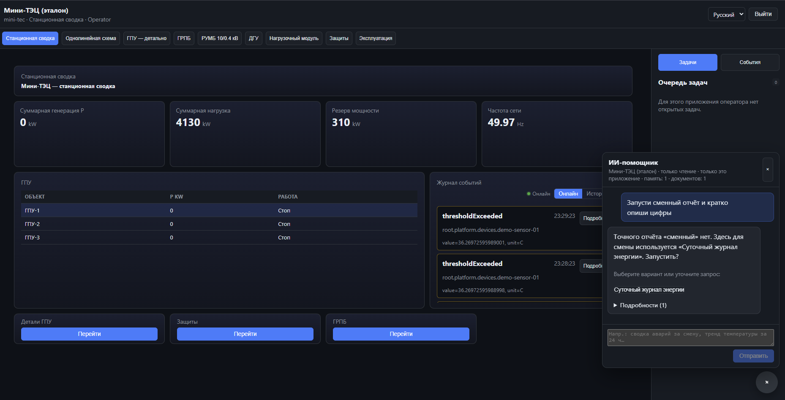
  &nbsp;
  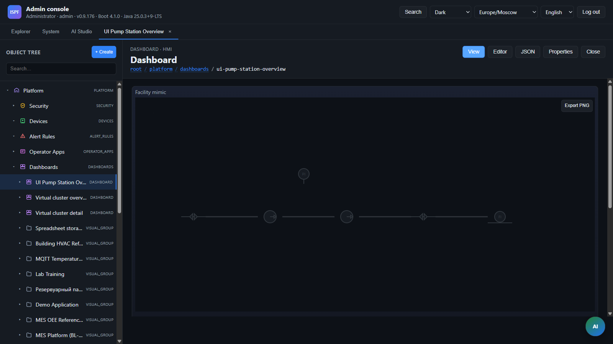
</p>

<p align="center">
  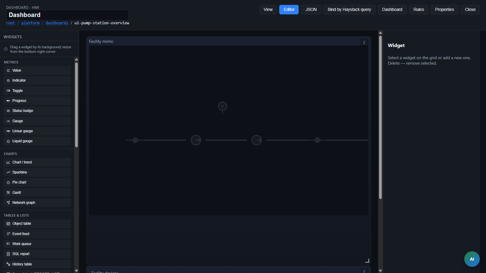
  &nbsp;
  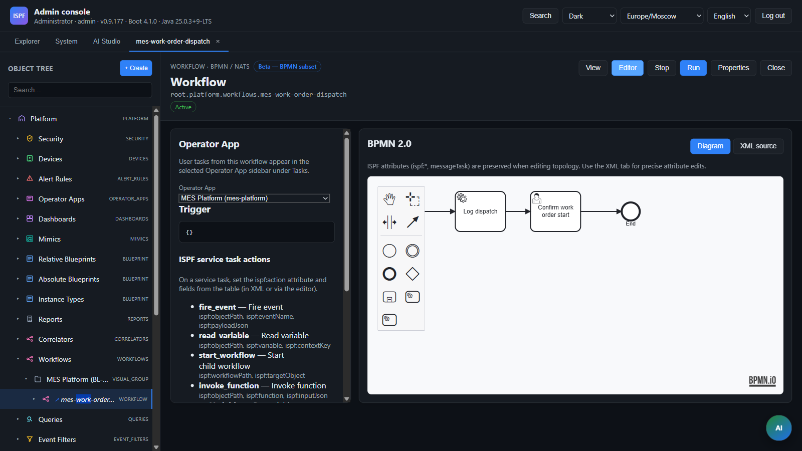
</p>


> **Business logic lives on the platform** — models, variables, events, functions, and workflows. The core ships generic engines; solutions are declarative configuration (bundle deploy), not core forks. See [architecture](docs/en/architecture.md).

<p align="center">
  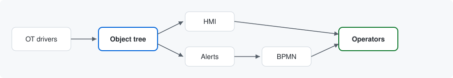
</p>

### Hosted solution UIs (ui-packs)

Industry apps ship as React SPAs at `/apps/<appId>/` — not pages inside the admin console. Live gallery: [demo.iot-solutions.ru](https://demo.iot-solutions.ru/) (`admin` / `admin`).

<p align="center">
  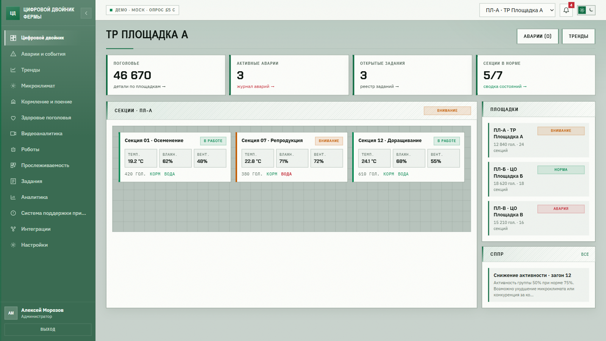
  &nbsp;
  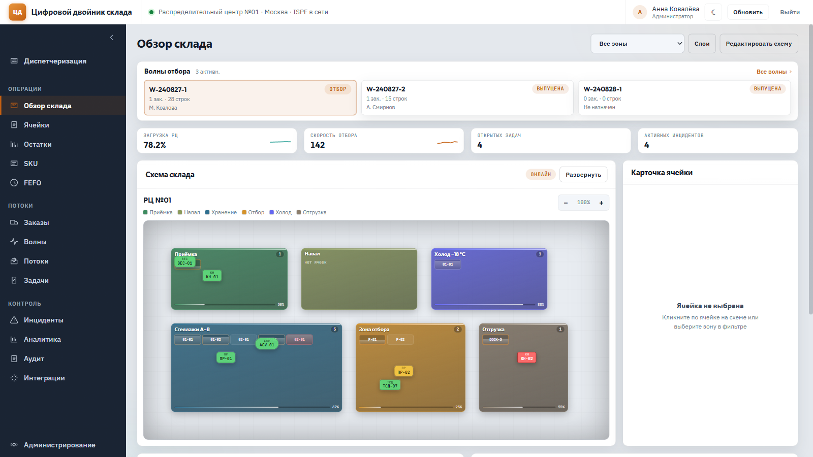
</p>

<p align="center">
  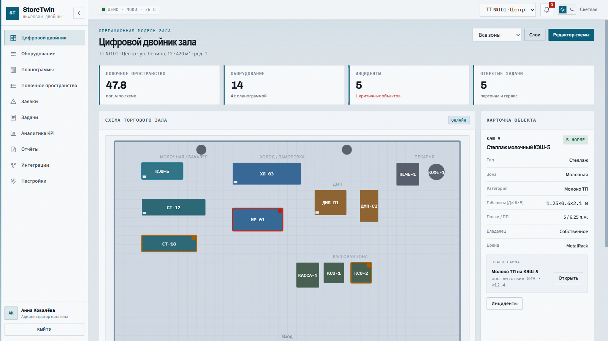
  &nbsp;
  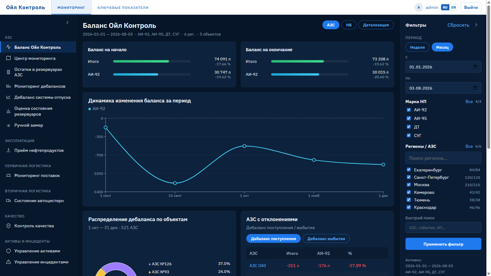
</p>

<p align="center">
  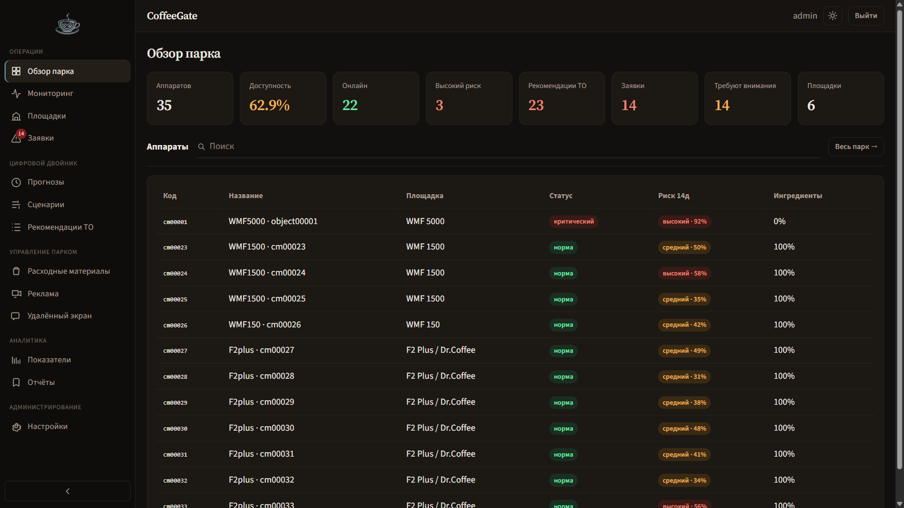
  &nbsp;
  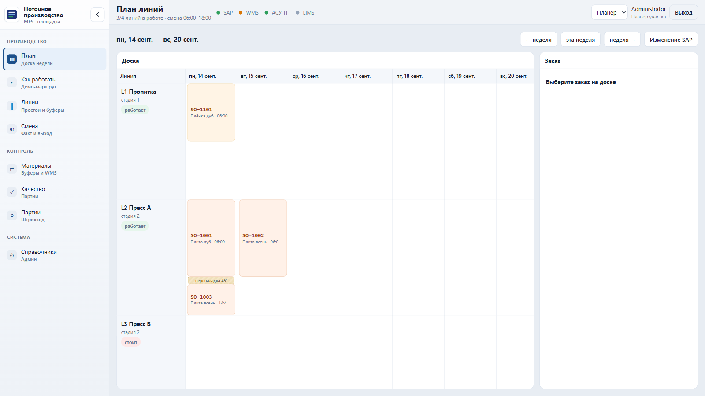
</p>

<p align="center">
  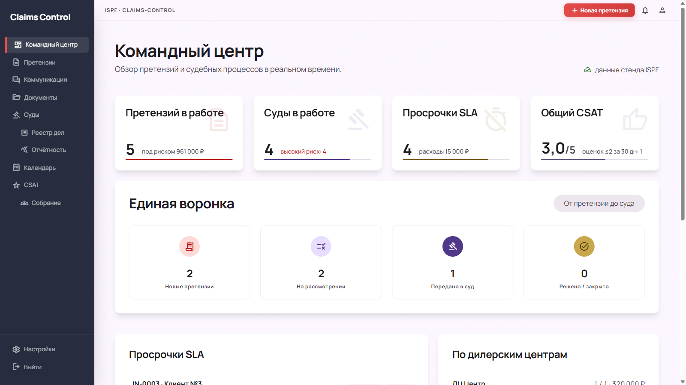
  &nbsp;
  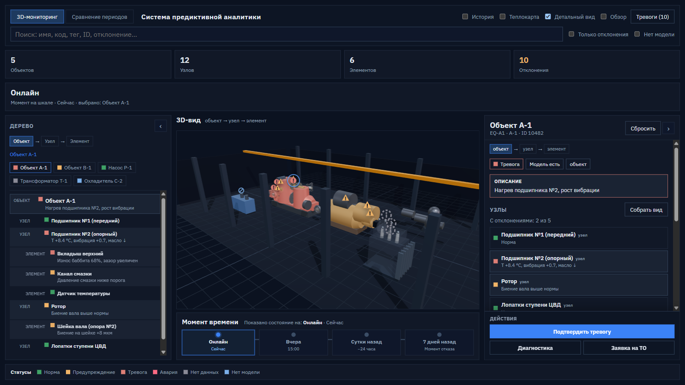
</p>

<p align="center">
  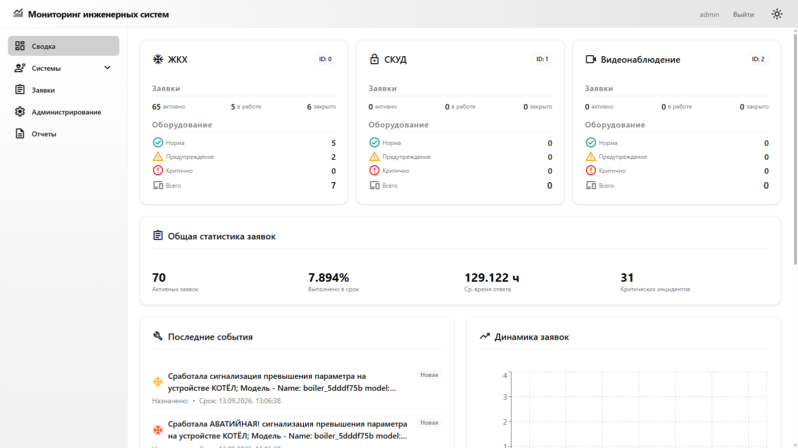
  &nbsp;
  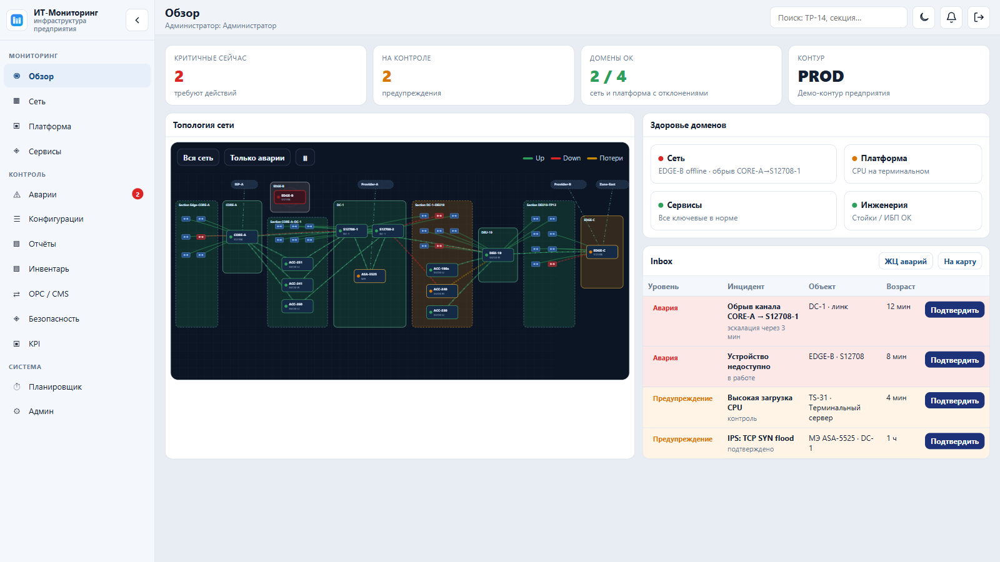
</p>

<p align="center">
  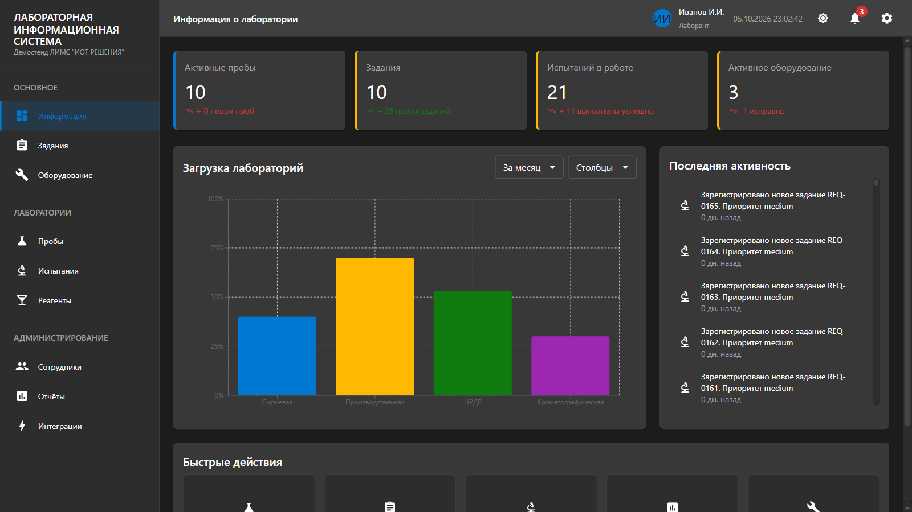
</p>

## What actually runs

**Field and IoT.** 162 driver packs: Modbus, OPC UA, S7, MQTT, SNMP, BACnet, IEC-104, DNP3, JDBC, and a long tail of lab codecs. 114 are marked PRODUCTION. In this repo that word means a codec plus a loopback test, not a signed plant pilot. The protocols we stand up in the interop lab are the usual industrial set. Maturity, protocol by protocol: [drivers](docs/en/drivers.md).

**SCADA.** Mimic editor in the browser, 218 P&ID symbols (valves, pumps, tanks, pipes, electrical), a symbol bound to a variable, and a command back to the device from the same screen. Dashboards for trends, tables, maps, and spreadsheets. Operator mode is the same screens without the admin tree. Symbol library: [scada](docs/en/scada.md).

**Alarms and shift processes.** A CEL condition on a variable fires an event. A correlator can start a BPMN workflow from that event. The workflow waits on an operator in the work queue, calls a function, or branches. A trip, a work order, and an escalation are the same mechanism. [automation](docs/en/automation.md) · [workflows](docs/en/workflows.md).

**History.** The screen reads the last value. Trends and shift reports read the historian. Local profile is a file H2 database. In production the hot tier is PostgreSQL/Timescale (about a week of operator trends), the warm tier is ClickHouse, and cold export is Parquet. Cassandra stays experimental. [historian tiers](docs/en/historian-tiers.md).

**MES.** Lines, shifts, OEE, batches, SPC, and dispatch are configuration on the tree. The catalog bundle `mes-platform` carries dispatch, OEE, batch, and quality; `mes-oee-reference` is the separate OEE reference. The model follows ISA-95. The operator opens them as dashboards of one app (`?mode=operator&app=mes-platform`). [MES](docs/en/mes.md) · [platform reference](docs/en/reference-mes-platform.md).

**The shop floor’s side of ERP.** Orders, batches, yield, and what the shop has to tell the office. Catalog bundles cover ISA-95 contours for a core plant, pharma, printing, APS, and CMMS. Where a demo exchanges data with an accounting system, the bundle says the exchange is simulated. A live 1C or SAP connector is not shipped.

**Twins and ready sites.** An INSTANCE hub is a twin with its own logic: a farm, a warehouse, a store, a tank farm, a CHP. The operator UI for those is a React app at `/apps/<appId>/`, built outside this repo and installed as a ui-pack. The pictures above are that gallery. Live catalog: [marketplace.ispf.ai](https://marketplace.ispf.ai).

**People, tenants, other sites.** TOTP, rights down to a variable, separate tenants, an audit log. Federation when a second site has to see the first. Helm, and an ARM image when the box is in the field rather than in the server room. [security](docs/en/security.md) · [deployment](docs/en/deployment.md).

**Assistant.** You write the task in the console. The agent lays out devices, screens, and rules, shows each step, and waits for an OK before it writes. 67 regression scenarios cover that path. [ai-development](docs/en/ai-development.md).

**How a solution leaves the laptop.** `ispf pack` or a bundle deploy. Or Application Git: pull a release, push a branch, open a PR ([ADR-0063](docs/en/decisions/0063-application-git-lifecycle.md)). Logic stays in hub functions and binding rules. Widgets only display variables.

A code-verified read against Ignition, PI, Opcenter, and the rest is the [competitive scorecard](docs/en/competitive-scorecard.md) (about 8.0 / 10 as of the September 2026 audit). First hour on the product: [learn](docs/en/learn.md) · [по-русски](docs/ru/learn.md).

## Why people install it

| Job | Where it lives |
| --- | --- |
| One address space for tags, screens, and processes | Object tree, CEL bindings |
| Operator screens, not only a protocol gateway | Explorer, operator mode, SCADA mimics |
| An alarm that starts real work | Alert rule → correlator → BPMN |
| A plant solution without a fork of the server | Bundle + ui-pack |
| The tree in git | `ispf pack`, or Application Git |
| A stack you can patch yourself | Java 25, Spring Boot 4, React 19, PostgreSQL |

## Quick start

### All-in-one release (Windows / Linux / macOS)

**Portable zip** (JDK **25**): download `ispf-*-portable.zip` from [GitHub Releases](https://github.com/iot-solutions-ru/ispf/releases), unzip, then `start.bat` (Windows) or `./start.sh` (Linux/macOS).

Uses an **embedded H2** file DB (no PostgreSQL to install). After first start: `data/ispf-local.mv.db` next to the JAR.

**Container** ([GitHub Packages](https://github.com/iot-solutions-ru/ispf/pkgs/container/ispf-server)):

```bash
docker pull ghcr.io/iot-solutions-ru/ispf-server:latest
docker run --rm -p 8080:8080 -v ispf-data:/opt/ispf/data ghcr.io/iot-solutions-ru/ispf-server:latest
```

Open http://localhost:8080 — login `admin` / `admin`. Operator HMI: http://localhost:8080?mode=operator

### From source (dev)

**Requirements:** JDK **25**, Node.js 20+, Docker optional (Postgres/NATS/Keycloak for fuller stacks).

```bash
# API — local profile (H2, no OAuth; syncs a small set of dev driver packs)
./gradlew :packages:ispf-server:bootRun --args="--spring.profiles.active=local"

# Web console (separate terminal)
cd apps/web-console && npm install && npm run dev
```

| URL | Purpose |
| --- | ------- |
| http://localhost:8080 | Admin console (all-in-one JAR) |
| http://localhost:5173 | Admin console (Vite dev) |
| http://localhost:8080?mode=operator | Operator HMI (all-in-one JAR) |
| http://localhost:5173?mode=operator | Operator HMI (Vite dev) |
| http://localhost:8080/api/v1/info | Version / capabilities |
| http://localhost:8080/actuator/health | Health |

Full guide: [Getting started](docs/en/getting-started.md) · [Начать работу](docs/ru/getting-started.md)

> Avoid a cold `./gradlew test` on first day — it builds the full driver matrix and can take a long time. Prefer `bootRun` + the console, or `./tools/ci/pr-fast.sh` / `.\tools\ci\pr-fast.ps1` before a PR.

### Demo objects (local profile)

| Path | Purpose |
| ---- | ------- |
| `root.platform.devices.demo-sensor-01` | Virtual sensor + alarm |
| `root.platform.dashboards.demo-sensor` | HMI dashboard |
| `root.platform.alert-rules.temperature-threshold-exceeded` | CEL alert rule |
| `root.platform.correlators.alarm-handler-on-threshold-event` | Correlator → workflow |
| `root.platform.workflows.demo-alarm-handler` | BPMN demo |
| `root.platform.devices.snmp-localhost` | SNMP agent |

## Documentation

**Start here:** [Learn ISPF](docs/en/learn.md) · [Try ISPF (≈15 min)](docs/en/getting-started.md#try-ispf-15-minutes) · [Docs hub by role](docs/en/readme.md)

| | English (canonical) | Русский |
| --- | ------------------- | ------- |
| Learn | [learn.md](docs/en/learn.md) | [learn.md](docs/ru/learn.md) |
| Hub | [docs/en/readme.md](docs/en/readme.md) | [docs/ru/readme.md](docs/ru/readme.md) |
| Product | [product.md](docs/en/product.md) | [product.md](docs/ru/product.md) |
| Getting started | [getting-started.md](docs/en/getting-started.md) | [getting-started.md](docs/ru/getting-started.md) |
| Architecture | [architecture.md](docs/en/architecture.md) | [architecture.md](docs/ru/architecture.md) |
| Drivers | [drivers.md](docs/en/drivers.md) | [drivers.md](docs/ru/drivers.md) |
| Applications / Git | [applications.md](docs/en/applications.md#application-git-adr-0063) | [applications.md](docs/ru/applications.md#application-git-adr-0063) |
| Solution developer | [solution-developer-guide.md](docs/en/solution-developer-guide.md) | [solution-developer-guide.md](docs/ru/solution-developer-guide.md) |
| API | [api.md](docs/en/api.md) | [api.md](docs/ru/api.md) |
| License | [license.md](docs/en/license.md) | [license.md](docs/ru/license.md) |
| Roadmap | [roadmap.md](docs/en/roadmap.md) | [roadmap.md](docs/ru/roadmap.md) |

More: [operator guide](docs/en/operator-guide.md) · [anti-patterns](docs/en/anti-patterns.md) · [glossary](docs/en/glossary.md) · [ADRs](docs/en/decisions/readme.md) · [doc hub](docs/README.md)

## Repository layout

```text
iot-solutions-platform-framework/
├── packages/           # Core, CEL, drivers, server (Spring Boot)
├── apps/web-console/   # React admin + operator UI
├── examples/           # demo-app, MES/HVAC references, labs
├── docs/en · docs/ru   # Canonical EN + Russian docs
├── site/               # Project GitHub Pages (EN + RU)
├── deploy/             # Compose, VPS, Grafana, edge
└── docker-compose.yml
```

## License

**[GNU Affero General Public License v3.0](LICENSE)** — platform (`ispf-server`, `web-console`, core packages).

Optional **Enterprise** dual-license: [LICENSE-COMMERCIAL.md](LICENSE-COMMERCIAL.md) · [commercial licensing](docs/en/commercial-licensing.md).

Driver packs and application bundles may use separate terms. Details: [license](docs/en/license.md) · [NOTICE](NOTICE).

## Contributing & feedback

Issues and PRs welcome — especially driver/HMI bugs, docs fixes, and real-plant pilot feedback.

Notable product changes go in **[CHANGELOG.md](CHANGELOG.md)** (`[Unreleased]` until the next version bump). See [CONTRIBUTING.md](CONTRIBUTING.md).

If ISPF helps your project, a GitHub ★ helps others discover it. For OT / integrator discussions, open an issue with your stack (protocols, historian size, HMI constraints).
