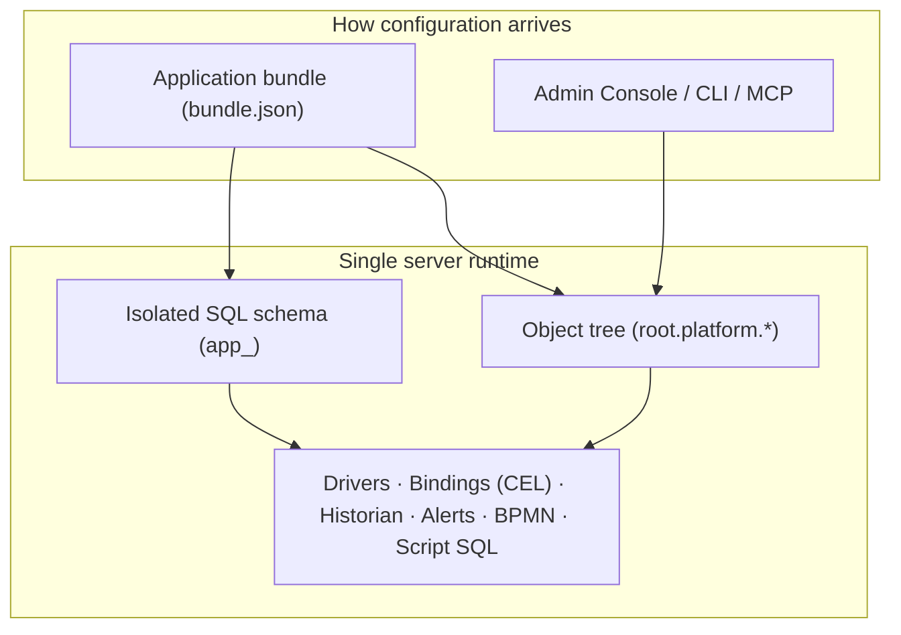

> **Language:** Canonical English. Russian edition: [ru/application-principles.md](../ru/application-principles.md).

# Application architecture rules on ISPF

> **Status:** Stable — core engineering rules for designing solutions on ISPF. Status tags: [doc-status.md](doc-status.md).

This guide explains how to structure an application on ISPF so that equipment connections, calculations, SQL tables, operator screens, and deployments remain clean and maintainable.

Related guides: [How ISPF works](learn.md) · [Solution developer guide](solution-developer-guide.md) · [Object model](object-model.md) · [Blueprints](blueprints.md) · [Custom React UI](external-ide.md) · [Common design mistakes](anti-patterns.md).

---

## Core idea

An application on ISPF does **not** fork the Java server (`ispf-server`) or modify the Admin Console (`apps/web-console`). Instead:

1. **The platform provides general-purpose engines:** protocol drivers, the object tree, the CEL expression and binding engine, time-series storage, threshold alerts, BPMN workflows, and a sandboxed SQL/script runner.
2. **Your project configures those engines:** you define templates (*blueprints*), object nodes, SQL tables in your application's isolated database schema, script functions, dashboards, and workflows.
3. **Deployment is an application bundle (`bundle.json`):** packaging delivers your configuration into the server's object tree and application schema (plus an optional `ui-pack` zip if you build a custom React interface).



---

## Ten engineering rules (P1–P10)

### P1. Everything runs through the object tree

After you deploy an application, all live tags, functions, dashboards, alarms, and workflows live as nodes in the object tree (`root.platform.*`) and communicate over the same REST and WebSocket APIs. The record in `root.platform.applications.<appId>` only registers the application's metadata and its isolated PostgreSQL schema (`app_<appId>`) — it is **not** a separate runtime process.

### P2. Keep domain code out of the platform core

Never add plant-specific or industry-specific Java controllers to `ispf-server`, Flyway migrations to the platform database schema, or custom pages to `apps/web-console`. Doing so turns your installation into an un-upgradable fork. Domain tables go into your application's `migrations[]`, domain queries go into `functions[]`, and custom operator screens go into a standalone `ui-pack` ([ADR-0001](decisions/0001-app-platform-boundary.md)).

### P3. Prefer declarative rules over custom code

Before writing custom code, use the built-in declarative mechanism designed for the job:
- **Tag scaling, unit conversion, KPI math:** calculation rules (*binding rules*) with CEL or built-in functions (`scale`, `clamp`, `movingAvg`, `counterRate`).
- **Threshold monitoring with hysteresis/delay:** `ALERT` nodes.
- **Multi-step operator procedures and approvals:** `WORKFLOW` (BPMN) nodes.
- **CRUD queries on application SQL tables:** declarative JSON `script` functions (`selectMany`, `selectOne`, `exec`, `return`).

### P4. An application bundle is a delivery package, not a black box

`bundle.json` is how your project moves cleanly from Git to test and production servers (`ispf pack` → `ispf validate` → `ispf deploy`, or `POST /api/v1/applications/{appId}/deploy`). Re-deploying a bundle reconciles existing tree nodes and applies any new SQL migrations idempotently.

### P5. One consistent model for reactive rules

Reactive rules across ISPF follow one pattern:

```text
WHEN (input changes / event fires / timer ticks)
  → IF (CEL condition is true)
  → THEN (write variable / update dashboard context / emit event)
```

Do not embed long scripts or custom visibility mini-languages inside individual dashboard widgets. Keep rules on objects so they can be validated and inspected in one place ([platform-logic](platform-logic.md)).

### P6. One job — one mechanism

Avoid solving the same problem in two places at once:

| Engineering task | Standard ISPF mechanism | What to avoid |
|------------------|-------------------------|---------------|
| Polling PLCs, meters, brokers | `DEVICE` node + protocol driver + point mappings | Polling hardware from external scripts or browsers |
| Derived tags & cross-device math | Binding rules (`@bindingRules`) on a hub object | Complex formulas inside dashboard widgets |
| High/low threshold alarms | `ALERT` node (`root.platform.alert-rules.*`) | Custom polling loops in SQL scripts |
| Multi-event patterns in a time window | `CORRELATOR` node (`root.platform.correlators.*`) | Hand-rolled state machines in variables |
| Shift procedures with human sign-off | `WORKFLOW` (BPMN `userTask` + `serviceTask`) | Chaining ad-hoc button scripts |
| Reading/writing business tables (orders, batches) | JSON script functions in an isolated app SQL schema | Writing to platform system tables |
| Reflecting SQL query results in a tag | `sqlBinding` | Periodic external cron scripts |

### P7. How templates, live editing, bundles, and change sets fit together

Newcomers sometimes wonder whether **Admin Console**, **Blueprints**, **Bundles**, and **Change sets** are competing ways to build a project. They are not — each solves a different step of engineering work:

1. **Templates (`Blueprint`) define the structure of repeated objects.** If you have 30 identical heat exchangers, define one `INSTANCE` blueprint (`heat-exchanger-v1`) so every unit gets the exact same variables, alarms, and rules.
2. **Interactive editing (Admin Console or IDE/MCP) is how you build and test on a dev stand.** For a quick lab test or SNMP monitor without custom SQL tables, editing the tree directly is enough.
3. **An application bundle (`bundle.json`) is how you version and ship a repeatable solution.** As soon as you need Git history, CI checks, SQL tables, or deployment to test/production servers, pack your work into a bundle (`ispf pack`).
4. **A change set is for reviewing a batch of edits on an existing tree** (`preview → apply`), not for bootstrapping a new application from scratch ([collaboration](collaboration.md)).

### P8. Address functions and data through the object tree

After deploying an application, its functions are exposed on the tree (for example, `root.platform.singleton-blueprints.<hub>` or `root.platform.applications.<appId>.functions`) and invoked uniformly through `POST /api/v1/bff/invoke`. Use `operatorUi` in `bundle.json` (not the deprecated `operatorManifest` format).

### P9. Choose the right operator UI for the job

ISPF supports two ways to present screens to shift operators:
- **Built-in Dashboards & SCADA mnemonics (`?mode=operator&app=<appId>`):** fastest for P&ID diagrams, single-line electrical schematics, trend charts, alarm tables, and standard forms — zero frontend code required.
- **Hosted React web app (`ui-pack` at `/apps/<appId>/`):** best when your product needs custom layouts, interactive maps, 3D views, or dense domain tables. Built in a separate Vite/React repo and served by ISPF ([Custom React UI](external-ide.md)). You can also keep a simple built-in dashboard as a fallback.

### P10. Validate before deploying

Always run validation before applying changes to a shared or production environment:
- Validate expressions via `POST /api/v1/expressions/validate` (or the **Validate** button in the console).
- Validate bundles via `ispf validate` (use `--strict` before shipping) and run dry-run checks before deployment.

---

## Separating equipment from logic

### Logic objects vs DEVICE (mandatory)

**Core engineering rule:** An object that holds application logic, multi-device orchestration, SQL functions, or digital-twin calculations **must not** have `ObjectType.DEVICE`.

**Why this matters in practice:** A `DEVICE` node is tied to a communication driver (IP address, slave ID, polling loop, connection state). In real plants, sensors and PLCs get disabled for maintenance, swapped out, or re-addressed. If plant KPIs, order management functions, or BFF endpoints sit on a `DEVICE` node, maintaining a single controller breaks the application.

Choose the object kind according to its role:

| Role in your project | What to use | Typical path | Notes |
|----------------------|-------------|--------------|-------|
| **One central controller / orchestrator** for the whole solution or station | **`SINGLETON`** blueprint | `root.platform.singleton-blueprints.<project>-hub` | One unique instance; ideal host for application functions, BFF calls, and station-wide KPIs |
| **Many identical units / digital twins** (lines, boiler houses, stores, tanks) | **`INSTANCE`** blueprint (Instance Type) | `root.platform.instances.*` or `root.platform.devices.<site>.*` | Stamp out N instances from one template; each twin carries its own calculations |
| **Physical or simulated equipment** (PLC, meter, sensor, broker) | **`DEVICE`** node | Under `root.platform.devices.*` (or as a child under a site/twin node) | Driver configuration and raw/mapped telemetry tags only |

> **Grouping under `devices`:** Placing `DEVICE` children underneath a `SINGLETON` or `INSTANCE` parent (or inside a `CUSTOM` folder under `root.platform.devices.<site>`) is completely fine. Only the hub's **type** must not be `DEVICE`.

**How validation enforces this ([ADR-0060](decisions/0060-solution-authoring-constraints.md)):**
- Default interactive validate/deploy reports `LOGIC_HOST_DEVICE` as a **WARNING** so you can iterate while prototyping.
- Strict ship checks (`ispf validate --strict`, `POST .../deploy?strict=true`, `examples/` CI, and marketplace publishing) treat `LOGIC_HOST_DEVICE` as an **ERROR**.

---

## Quick reference: where each piece belongs

| What you are building | Where it lives | Guide |
|-----------------------|----------------|-------|
| Equipment polling (Modbus, OPC UA, S7, MQTT, SNMP) | `DEVICE` node + driver point mappings | [Device drivers](drivers.md) |
| Station / application orchestrator (1 per app) | `SINGLETON` hub object | [Blueprints](blueprints.md) |
| Repeated equipment unit / digital twin (N per app) | `INSTANCE` template + instantiated nodes | [Blueprints](blueprints.md) |
| Tag math and cross-object aggregation | Binding rules (`@bindingRules`) | [Calculation rules](bindings.md) |
| Hourly / shift averages and OEE | Historian rules (`kind: "historian"`) | [Historian cookbook](analytics-historian-cookbook.md) |
| Threshold alarms & hysteresis | `ALERT` node | [Automation](automation.md) |
| Multi-step procedures & operator queue tasks | `WORKFLOW` (BPMN) node | [BPMN workflows](workflows.md) |
| Business tables & SQL CRUD | `migrations[]` + JSON `script` functions on hub | [Solution developer guide](solution-developer-guide.md) |
| Standard operator screens & P&ID schematics | `DASHBOARD` + `MIMIC` nodes | [Dashboards](dashboards.md) · [SCADA](scada.md) |
| Custom React operator web app | Separate Vite/React repo → `ui-pack` + `/api/v1/bff/invoke` | [Custom React UI](external-ide.md) |

> **Note for AI Studio / MCP tool authors:** internal tool routing tables and agent execution gates are documented separately in [agent-knowledge.md](agent-knowledge.md) and [ai-development.md](ai-development.md).
