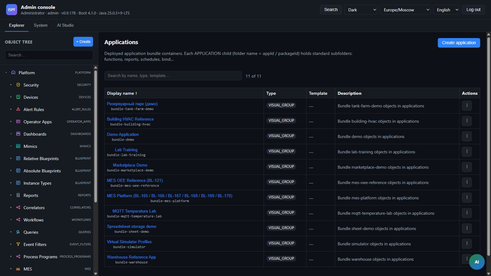

> **Language:** Canonical English. Russian edition: [ru/applications.md](../ru/applications.md).

# Application Solutions: `bundle.json`, Functions, SQL Migrations, and BFF

> **Status:** Stable — declarative solution packaging (`bundle.json`), isolated application SQL schemas, step-script functions, BFF gateway, schedules, and Git integration. Status tags: [doc-status.md](doc-status.md).

ISPF lets you build and ship complete industrial and enterprise solutions (SCADA, MES, energy management, building automation) **as declarative `bundle.json` packages without adding domain Java code to `ispf-server`** ([ADR-0001](decisions/0001-app-platform-boundary.md)). For a step-by-step tutorial from scratch, see the **[Solution Developer Guide](solution-developer-guide.md)**.

---

## 1. Overview of Solution Mechanisms



| Capability | API / Manifest Section |
|------------|------------------------|
| Application registration & SQL schema isolation | `POST /api/v1/applications` (`schemaName`, `tablePrefix`) |
| Application SQL migrations | `POST /api/v1/applications/{appId}/data/migrate` (`migrations[]` in bundle) |
| Declarative JSON step-script functions | `POST /api/v1/applications/{appId}/functions/deploy` (`functions[]` in bundle) |
| One-request bundle deployment | `POST /api/v1/applications/{appId}/deploy` (`bundle.json`) |
| Unified UI Backend-for-Frontend (BFF) gateway | `POST /api/v1/bff/invoke` (`wireProfile: "ispf-operator-v1"`) |
| BPMN workflow function calls | `serviceTask` with `action="invoke_function"` |
| Periodic schedules | `GET / POST /api/v1/schedules` (`schedules[]` in bundle) |
| Git repository sync (pull release / push PR) | **Git** tab on `APPLICATION` node (`/api/v1/applications/{appId}/git/**`) |

---

## 2. Registering an Application and Isolated SQL Migrations

```http
POST /api/v1/applications
Content-Type: application/json

{
  "appId": "myapp",
  "displayName": "My Application",
  "tablePrefix": "myapp_",
  "schemaName": "myapp"
}
```

### Application Data Migrations (`migrations[]`)

Application tables never go into platform Flyway. They are deployed into the application's own isolated database schema (`schemaName`, default `app_<appId>`):

```http
POST /api/v1/applications/myapp/data/migrate
Content-Type: application/json

{
  "version": "1.0.0",
  "scripts": [
    { "id": "items", "sql": "CREATE TABLE IF NOT EXISTS myapp_item (id VARCHAR(64) PRIMARY KEY, title VARCHAR(255));" }
  ]
}
```

- Repeated calls with the same `(version, id)` are **idempotent** and safely skipped.
- DDL guards prevent application scripts from modifying system tables (`applications`, `object_nodes`, `workflow_*`, etc.). When `tablePrefix` is set, all created tables must start with that prefix.
- Check migration status: `GET /api/v1/applications/myapp/data/status`.

---

## 3. Application Script Functions (`source.type = "script"`)

Application functions are attached to **`SINGLETON`** or **`INSTANCE`** logic nodes (never to `ObjectType.DEVICE`) and execute a sequence of JSON steps inside a single JDBC transaction:

| Script Step | Purpose |
|-------------|---------|
| `selectOne` | Run SQL `SELECT` and store a single row (`Map`) in a script variable |
| `selectMany` | Run SQL `SELECT` and store a list of rows (`List<Map>`) in a script variable |
| `exec` | Execute parameterized SQL `INSERT` / `UPDATE` / `DELETE` |
| `setVar` | Assign a literal or `${...}` expression to a script variable |
| `buildRecord` | Assemble a `Map` from computed `fields` |
| `map` | Transform a list variable (`source`) using `fields` and `${item.*}` |
| `invoke_function` | Call another object function (up to 8 levels deep) |
| `when` / `if` | Conditional branching (`then` / `else`) |
| `readVariable` | Read a variable field from an object in the tree (`objectPath: "self"` or full path) |
| `jsonParse` | Parse a JSON string into structured fields |
| `setDriverTelemetry` | Push telemetry values to a device node |
| `instantiateModelIfMissing` | Create an object instance from a blueprint if it does not yet exist |
| `cancel_workflows` | Cancel active BPMN workflow instances |
| `failIfNull` / `failIfNotEquals` | Abort and return a structured `error_code` and `error_message` |
| `return` | Build the function output record from `fields` |

Full examples of built-in, script, and sandboxed Java functions: **[Object functions (`object-functions.md`)](object-functions.md)**.

```http
POST /api/v1/applications/myapp/functions/deploy
Content-Type: application/json

{
  "objectPath": "root.platform.singleton-blueprints.myapp-hub",
  "functionName": "myapp_ping",
  "version": "1",
  "descriptor": {
    "inputSchema": { "name": "in", "fields": [{"name": "orderId", "type": "STRING"}] },
    "outputSchema": {
      "name": "out",
      "fields": [
        {"name": "error_code", "type": "STRING"},
        {"name": "error_message", "type": "STRING"}
      ]
    }
  },
  "source": {
    "type": "script",
    "body": "{ \"steps\": [ ... ] }"
  }
}
```

---

<a id="bundle-deploy-req-pf-03"></a>

## 4. Deploying a Complete Solution Bundle (`bundle.json`)

A single `POST /api/v1/applications/{appId}/deploy` request registers the application, runs SQL migrations, registers blueprints, reconciles tree objects, deploys functions, alert rules, correlators, dashboards, workflows, reports, and schedules.

### SemVer and Format Contract ([ADR-0064](decisions/0064-release-compatibility-lts.md))
- `version` is **required** and must follow strict SemVer `MAJOR.MINOR.PATCH` (for example, `"1.0.0"`).
- `formatVersion` is an optional integer indicating the manifest wire format (defaults to `1`; unknown future format versions are rejected safely).
- Optional `changelog` (or `metadata.changelog`) documents release changes for the Solutions catalog.

```http
POST /api/v1/applications/myapp/deploy
Content-Type: application/json

{
  "version": "1.0.0",
  "displayName": "My Application",
  "tablePrefix": "myapp_",
  "schemaName": "myapp",
  "blueprints": [
    {
      "name": "myapp-hub-v1",
      "description": "Application orchestrator hub",
      "type": "SINGLETON",
      "targetObjectType": "CUSTOM",
      "variables": []
    }
  ],
  "objects": [
    {
      "parentPath": "root.platform.singleton-blueprints",
      "name": "myapp-hub",
      "type": "CUSTOM",
      "templateId": "myapp-hub-v1",
      "displayName": "My Application Hub"
    }
  ],
  "dashboards": [
    {
      "path": "root.platform.dashboards.myapp-ops",
      "title": "Operator Board",
      "layoutJson": "{ \"columns\": 84, \"rowHeight\": 8, \"widgets\": [] }"
    }
  ],
  "workflows": [
    {
      "path": "root.platform.workflows.myapp-main",
      "bpmnXml": "<definitions ...>...</definitions>",
      "status": "ACTIVE"
    }
  ],
  "migrations": [ { "id": "001_init", "sql": "..." } ],
  "functions": [ ... ],
  "schedules": [
    {
      "scheduleId": "import-job",
      "enabled": true,
      "intervalMs": 60000,
      "actionType": "invoke_function",
      "action": {
        "objectPath": "root.platform.singleton-blueprints.myapp-hub",
        "functionName": "myapp_importRecords"
      }
    }
  ]
}
```

### Validation Modes (`strict`), Rollback, and `pull-from-tree`

```http
GET  /api/v1/applications/{appId}/export
POST /api/v1/applications/{appId}/bundle/validate?dryRun=true|false&strict=true|false
POST /api/v1/applications/{appId}/deploy?strict=true|false&runTests=true|false
GET  /api/v1/applications/{appId}/deploy/history
POST /api/v1/applications/{appId}/deploy/rollback
POST /api/v1/applications/{appId}/bundle/pull-from-tree
```

- **Authoring vs Strict Ship Validation ([ADR-0060](decisions/0060-solution-authoring-constraints.md)):** by default (`strict=false`), placing logic on a `DEVICE` node (`LOGIC_HOST_DEVICE`) is reported as a `WARNING` so iterative prototyping is not blocked. With `strict=true` (or CLI `ispf validate --strict` / `ispf deploy --strict`), architecture violations return HTTP `400` (`deployed: false`).
- **Transactional preflight:** before mutating the object tree, `deploy` validates all target paths and executes `migrations[]` in a database transaction. If a SQL statement fails, the batch rolls back and drops any tables created by that failed attempt.

---

<a id="bff-req-pf-06"></a>

## 5. Backend-for-Frontend Gateway (`POST /api/v1/bff/invoke`)

Operator dashboards and hosted React applications (`ui-pack`) call backend functions through a single gateway:

```http
POST /api/v1/bff/invoke
Content-Type: application/json

{
  "objectPath": "root.platform.singleton-blueprints.myapp-hub",
  "functionName": "myapp_processRecord",
  "input": {
    "schema": { "name": "in", "fields": [{"name": "orderId", "type": "STRING"}] },
    "rows": [{ "orderId": "ORD-101" }]
  },
  "wireProfile": "ispf-operator-v1"
}
```

With `wireProfile: "ispf-operator-v1"`:
- **Success:** returns `"error_code": "OK"`, `"error_message": ""`, `"result"` (an object for scalar output or an array of row objects for tabular output), and `"result_field_labels"`.
- **Error:** returns the application error code in `"error_code"` and message in `"error_message"`.

---

## 6. Declarative SQL Bindings (`sqlBinding`)

You can synchronize a variable on a logic node with a SQL query against the application schema:

```http
POST /api/v1/applications/{appId}/bindings/deploy
Content-Type: application/json

{
  "objectPath": "root.platform.singleton-blueprints.myapp-hub",
  "variable": "readyCount",
  "query": "SELECT COUNT(*) AS value FROM myapp_item WHERE status = 'ready'",
  "refresh": "on_schedule",
  "refreshIntervalMs": 30000,
  "valueField": "value"
}
```

Refresh modes: `on_schedule` (periodic poll), `on_function_success` (after a function commits), or `on_event` (when an object event fires). If a refresh query fails or returns no usable numeric value, the variable retains its last value marked with `quality=BAD` (counted in `ispf.sql_binding.refresh_failures.total{reason}`) rather than overwriting with a false `0`.

---

<a id="application-git-adr-0063"></a>

## 7. Application Git Integration ([ADR-0063](decisions/0063-application-git-lifecycle.md))

The **Git** tab on an `APPLICATION` node connects the application's `bundle.json` to a GitHub or GitLab repository:

| Operation | Endpoint | Behavior |
|-----------|----------|----------|
| Configure repository binding | `GET / PUT / DELETE /api/v1/applications/{appId}/git` | Stores HTTPS repository URL, provider (`github` \| `gitlab`), branch, path to `bundle.json`, and encrypted PAT in the credential vault |
| Check sync status | `GET /api/v1/applications/{appId}/git/status` | Returns binding metadata and last synced commit SHA |
| Pull release from Git | `POST /api/v1/applications/{appId}/git/pull` | Fetches `bundle.json` at the requested `ref`, validates, and deploys it |
| Push live tree to a PR/MR | `POST /api/v1/applications/{appId}/git/push-pr` | Runs `pull-from-tree`, creates a branch `ispf/...`, and opens a Pull Request / Merge Request |

---

## 8. Operator Workspace Menu (`operatorUi`)

To expose an application in the Operator HMI launcher (`?mode=operator&app=myapp`), include `operatorUi` in `bundle.json`:

```json
{
  "appId": "myapp",
  "title": "Plant Operations",
  "defaultDashboard": "root.platform.dashboards.myapp-ops",
  "dashboards": [
    { "path": "root.platform.dashboards.myapp-ops", "title": "Overview" }
  ]
}
```

**Related guides:** [Solution developer guide](solution-developer-guide.md) · [Solution developer public API](solution-developer-public-api.md) · [External IDE & hosted React UI](external-ide.md) · [Reports](reports.md).
