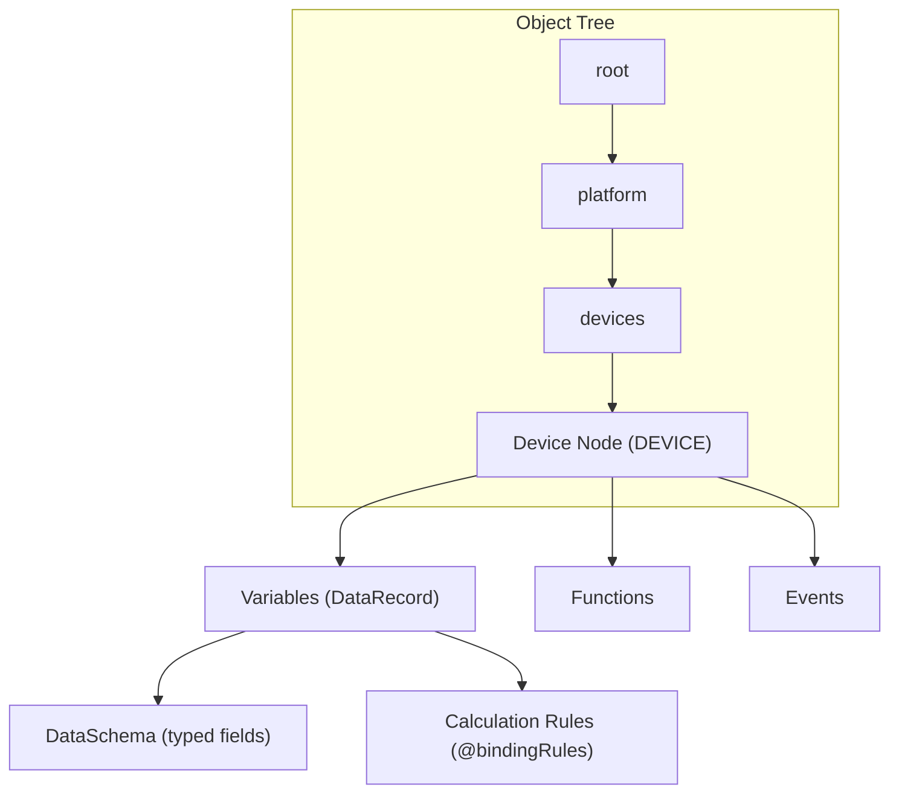

> **Language:** Canonical English. Russian edition: [ru/architecture.md](../ru/architecture.md).

# ISPF Architecture

> **Status:** Stable — server layers, execution engines, data flows, and extension points. Status tags: [doc-status.md](doc-status.md).

**Related guides:** [How ISPF works](learn.md) · [Object model](object-model.md) · [High-availability cluster](cluster.md) · [Application architecture rules](application-principles.md) · [Architecture Decision Records (ADRs)](decisions/readme.md).

---

## 1. Overview

**ISPF (IoT Solutions Platform Framework)** is a self-hosted server platform for industrial automation, SCADA, IoT telemetry, and shop-floor manufacturing execution (MES). It provides a single hierarchical object model, unified access control, and REST/WebSocket APIs for field equipment, operator screens, alarms, time-series history, and BPMN workflows.

<a id="core-principle-business-logic-in-platform-mechanisms"></a>

## 2. Core Principle: Application Logic Lives in the Object Tree

Plant and industry-specific logic is expressed as **declarative configuration in the object tree**, never by adding custom industry Java code to `ispf-server`:

| Platform Mechanism | Responsibility |
|--------------------|----------------|
| **Blueprints (`SINGLETON`, `INSTANCE`, `MIXIN`)** | Reusable templates defining variables, events, functions, calculation rules, and alert templates |
| **Variables (`DataRecord` / `DataSchema`)** | Current state, reactive and historical calculation rules (`@bindingRules`), and time-series recording |
| **Events, Alerts, and Correlators (`ALERT`, `CORRELATOR`)** | Threshold evaluation with hysteresis/delay and multi-event sequence correlation |
| **Object Functions (`FunctionDescriptor`)** | Callable operations on logic nodes (JSON step scripts, SQL queries, sandboxed Java, or built-in handlers) |
| **Workflows (`WORKFLOW`)** | BPMN 2.0 processes, operator work-queue tasks, timers, and escalation paths |

- **The platform core (`main`)** implements universal runtime engines once: protocol polling, the object tree, Google CEL evaluation, the time-series historian, alarm evaluation, BPMN execution, and SQL script execution.
- **An application solution (`bundle.json`)** packages configuration for those engines together with isolated application SQL tables (`schemaName`) and optional custom React operator UIs (`ui-pack` served at `/apps/<appId>/`). See [ADR-0001](decisions/0001-app-platform-boundary.md).

---

## 3. Domain Model



- **Addressable tree nodes:** every entity has a dot-separated path such as `root.platform.devices.pump-01` or `root.platform.singleton-blueprints.station-hub`.
- **Logic objects vs `DEVICE`:** orchestration, cross-device calculations, and BFF functions live on **`SINGLETON`** or **`INSTANCE`** nodes — never on `ObjectType.DEVICE` (`DEVICE` nodes are strictly for protocol drivers and raw I/O telemetry). See [Application architecture rules](application-principles.md#logic-objects-vs-device-mandatory).

---

## 4. Runtime Layers and Module Map

```text
┌─────────────────────────────────────────────────────────┐
│  Web Console (React 19 + Vite + TanStack Query)         │
│  Admin Explorer │ Operator HMI │ Dashboard/BPMN Editors │
├─────────────────────────────────────────────────────────┤
│  HTTP & WebSocket API Layer (Spring Boot 4, Java 25)    │
│  REST /api/v1/** │ WS /ws/objects │ OIDC JWT & RBAC     │
├─────────────────────────────────────────────────────────┤
│  Core Domain Services                                   │
│  ObjectManager │ BindingRuleEngine │ EventService       │
│  AlertRuleService │ EventCorrelatorService              │
│  WorkflowService │ DashboardService │ ReportService     │
│  DriverRuntimeService │ BlueprintEngine                 │
├─────────────────────────────────────────────────────────┤
│  Modular Packages & SPIs                                │
│  ispf-core │ ispf-expression │ ispf-plugin-blueprint    │
│  ispf-plugin-workflow │ ispf-ai-agent │ ispf-driver-*   │
├─────────────────────────────────────────────────────────┤
│  Storage & Messaging                                    │
│  PostgreSQL / TimescaleDB │ ClickHouse │ Redis │ NATS   │
└─────────────────────────────────────────────────────────┘
```

| Gradle Module | Role |
|---------------|------|
| `packages/ispf-core` | Core data structures: `PlatformObject`, `DataRecord`, `DataSchema`, binding cascade analysis |
| `packages/ispf-expression` | Google CEL engine, formal Z3 verifier, and built-in signal functions (`counterRate`, `movingAvg`, `hysteresis`, …) |
| `packages/ispf-plugin-blueprint` | Blueprint registry, parameter resolution, and `SINGLETON` / `INSTANCE` / `MIXIN` lifecycle |
| `packages/ispf-plugin-workflow` | Pure-Java BPMN 2.0 subset parser and execution engine |
| `packages/ispf-ai-agent` | Tree-first AI agent, `ContextPack` hybrid search, and MCP server adapter |
| `packages/ispf-driver-*` | 160+ modular protocol driver packs (`modbus-tcp`, `opcua`, `s7`, `iec104`, `dnp3`, `mqtt`, `snmp`, …) |
| `packages/ispf-server` | Spring Boot server, REST controllers, security, historian, and application bundle deployment |

---

## 5. Runtime Data Flows

### Telemetry and Calculation Pipeline
```text
DeviceDriver.readPoints()
  → DriverRuntimeService
  → ObjectManager.setDriverTelemetryValue() (in-memory RAM update + historian write)
  → BindingPropagationListener → BindingRuleEngine (CEL & reactive functions)
  → AlertRuleListener (threshold & hysteresis evaluation)
  → ObjectChangeEvent → WebSocket (/ws/objects) → Operator browser
```

### Event, Correlation, and Workflow Pipeline
```text
EventService.fire()
  → event_history (PostgreSQL / TimescaleDB or ClickHouse)
  → CorrelatorDispatchService (COUNT / SEQUENCE / EVENT_CHAIN / WINDOW)
  → WorkflowService.run() (BPMN instance)
  → userTask → Work Queue (/api/v1/work-queue) → Operator HMI
```

---

## 6. Scaling: High-Availability Cluster vs Multi-Site Federation

- **Horizontal cluster ([cluster.md](cluster.md)):** multiple stateless `ispf-server` replicas share **one** PostgreSQL database and **one** `root.platform.*` tree. Device polling is partitioned across replicas via `platform_driver_locks`, and live variable values are mirrored in memory across replicas over NATS ([ADR-0029](decisions/0029-cluster-live-variable-replica-sync.md)).
- **Multi-site federation ([federation.md](federation.md)):** separate ISPF instances at remote plants or edge gateways (including sites behind NAT) connect to a central Hub over outbound WebSocket tunnels while keeping their own local databases.

---

## 7. Supported Extension Points

1. **Application bundles (`bundle.json`):** ship models, objects, SQL migrations, script functions, dashboards, workflows, and reports via `POST /api/v1/applications/{appId}/deploy` ([applications.md](applications.md)).
2. **Hosted React UIs (`ui-pack`):** build custom React/Vite operator applications in an external IDE and host them at `/apps/<appId>/` ([external-ide.md](external-ide.md)).
3. **Protocol driver packs (`DeviceDriver` SPI):** build drop-in protocol adapters using the [Driver DDK](driver-ddk.md).
4. **Analytics function packs (`AnalyticsFunctionProvider` SPI):** add custom time-series evaluators ([analytics-formulas-and-packs.md](analytics-formulas-and-packs.md)).
