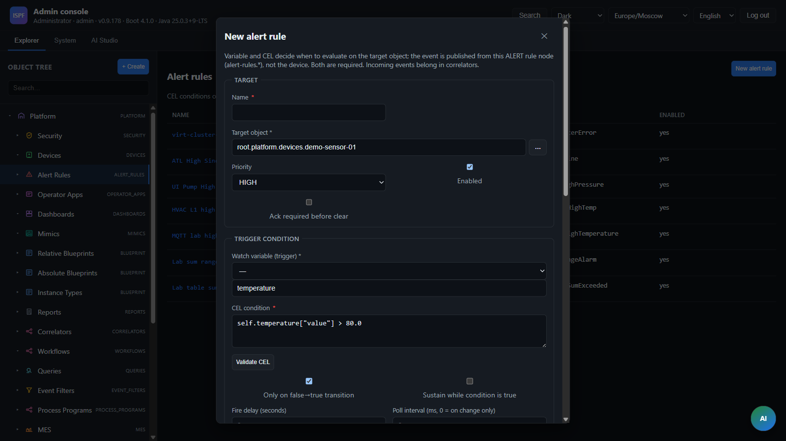
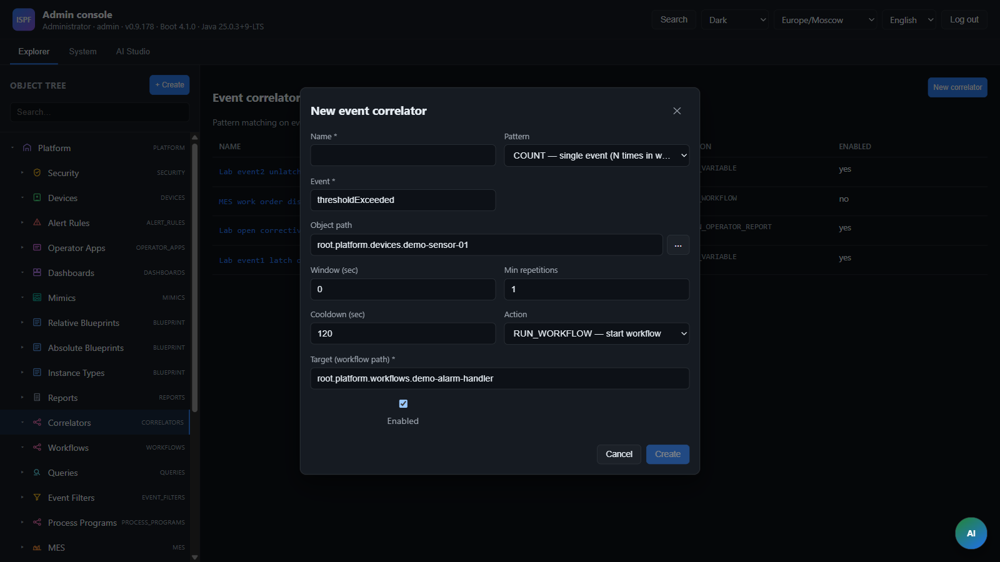

> **Language:** Canonical English. Russian edition: [ru/automation.md](../ru/automation.md).

# Automation: Events, Alert Rules, and Event Correlators

> **Status:** Stable — platform events, CEL threshold alert rules with hysteresis/latching, multi-event correlators, notification relays, and cyclic process programs. Status tags: [doc-status.md](doc-status.md).

**Related guides:** [Workflows & BPMN](workflows.md) · [Operator guide](operator-guide.md) · [Escalation workflow templates](reference-escalation-templates.md) · [ADR-0039](decisions/0039-unified-alarm-architecture.md) · [ADR-0062](decisions/0062-correlator-keyed-dispatch.md).

**Demo:** [`examples/alert-rule-evolution`](../../examples/alert-rule-evolution/) — extending an alert rule; [`examples/ot-alarm-classify`](../../examples/ot-alarm-classify/) — classify an OT alarm.

---

## 1. Platform Events and the Event Journal

Every object in the tree can declare typed events (`EventDescriptor`) with a name, payload schema (`DataSchema`), and severity level (`DEBUG`, `INFO`, `WARNING`, `ERROR`, `CRITICAL`).

### How Events Are Published
1. **Via REST API or object rules:** `POST /api/v1/events/fire` (or `fire(@/evt/...)` in a binding rule) validates the payload against the object's `EventDescriptor`, writes the entry to `event_history`, broadcasts it over WebSocket (`/ws/objects`), and forwards it to active event correlators.
2. **High-rate direct driver ingress (`EVENT_JOURNAL_ONLY`):** when a device driver is configured with `telemetryPublishMode = "EVENT_JOURNAL_ONLY"`, incoming messages bypass CEL evaluation and stream directly into `event_history` via `EventJournalAsyncWriter` ([ADR-0027](decisions/0027-event-journal-ingress-fast-path.md)).

### Querying the Event Journal

```http
GET /api/v1/events?objectPath=root.platform.devices.demo-sensor-01&limit=50
```

You can also filter events by a CEL expression on the payload (`GET /api/v1/events?expr=payload.temperature > 80.0`) or apply a saved filter node from `root.platform.event-filters.*` (`?filterPath=...`).

---

## 2. Alert Rules (`ALERT` Nodes in `root.platform.alert-rules.*`)



Alert rules are stored as tree nodes of type `ALERT` (model `alert-rule-v1`) under `root.platform.alert-rules.*`. Whenever the watched variable changes (or on a periodic timer `pollIntervalMs`), `AlertRuleService` evaluates the CEL condition and fires the configured event.

### Alert Rule Configuration Fields

| Field | Description |
|-------|-------------|
| `objectPath` | Target object being monitored |
| `watchVariable` | Variable on `objectPath` that triggers evaluation |
| `conditionExpr` | Boolean Google CEL condition (for example, `self.temperature.value > 80.0`) |
| `eventName` | Event fired when the alert activates (for example, `thresholdExceeded`) |
| `priority` | `CRITICAL`, `HIGH`, `MEDIUM`, or `LOW` |
| `edgeTrigger` | When `true`, fires only on the `false → true` transition |
| `delaySeconds` | On-delay timer: seconds the condition must remain continuously `true` before firing (`0` = immediate) |
| `sustainWhileTrue`, `rateLimitSeconds` | Re-fire periodically while the condition remains `true`, throttled by `rateLimitSeconds` |
| `deactivateExpr`, `deactivateDelaySeconds`, `clearEventName` | **Hysteresis / latch mode:** keeps the alert latched until `deactivateExpr` holds for `deactivateDelaySeconds` (for example, activate at `> 80.0`, clear at `< 70.0` and fire `thresholdCleared`) |
| `ackRequired` | Marks whether operator acknowledgement is required |
| `notificationWebhookUrl`, `notificationEmailTarget` | Optional direct HTTP webhook URL or email target (`to@host\|subject\|body`) |

Each alert rule is evaluated under its own lock so concurrent updates never double-fire or corrupt sustain/latch timers, and a failure in one rule is isolated and counted in `ispf.alert.rule_failures.total{reason=condition|error}` without blocking other rules.

### Alert Rules REST API (`admin`)

```http
GET / POST         /api/v1/alert-rules
GET / PUT / DELETE /api/v1/alert-rules/by-path?path=root.platform.alert-rules.<name>
```

---

## 3. Event Correlators (`CORRELATOR` Nodes in `root.platform.correlators.*`)



Event correlators (`CORRELATOR`, model `correlator-v1`) watch the stream of events across time windows and trigger an automated action when a multi-event pattern matches.

### Correlation Patterns (`patternType`)

| Pattern Type | When It Triggers |
|--------------|------------------|
| **`COUNT`** | The event `eventName` occurs at least `minOccurrences` times within `windowSeconds` |
| **`SEQUENCE`** | Event A (`eventName`) is followed by Event B (`secondEventName`) on the same object within `windowSeconds` |
| **`EVENT_CHAIN`** | An ordered chain of 3 or more events (`eventName` followed by comma-separated `secondEventName`, with optional max step gap `sequenceGapSeconds`) completes within `windowSeconds` |
| **`WINDOW`** | All listed events (`eventName` + comma-separated `secondEventName`) occur at least once within `windowSeconds` in any order |

### Correlator Actions (`actionType`)

| `actionType` | `actionTarget` Format | Action Taken |
|--------------|-----------------------|--------------|
| `RUN_WORKFLOW` | Workflow tree path (`root.platform.workflows....`) | Starts a BPMN workflow instance |
| `FIRE_EVENT` | Event name | Fires a synthetic event on the target object |
| `SET_VARIABLE` | `variableName=value` | Writes a variable on the target object |
| `OPEN_OPERATOR_REPORT` | Report tree path (`root.platform.reports....`) | Prompts the operator UI to open the specified report |
| `SEND_WEBHOOK` | `https://...` | Sends an HTTP POST JSON notification |
| `SEND_EMAIL` | `recipient@example.com\|Subject\|Body` | Sends an email via `ispf.notifications.email-relay-url` |
| `SEND_SMS` | `+15551234567\|Message text` | Sends an SMS via `ispf.notifications.sms-relay-url` |

### Correlators REST API (`admin`)

```http
GET / POST         /api/v1/correlators
GET / PUT / DELETE /api/v1/correlators/by-path?path=root.platform.correlators.<name>
```

---

## 4. Notification Relays and Outbound Notification Drivers

Global relay settings for alert and correlator notifications:

| Property / Environment Variable | Purpose |
|---------------------------------|---------|
| `ispf.notifications.email-relay-url` (`ISPF_NOTIFICATIONS_EMAIL_RELAY_URL`) | HTTP relay endpoint for `SEND_EMAIL` |
| `ispf.notifications.sms-relay-url` (`ISPF_NOTIFICATIONS_SMS_RELAY_URL`) | HTTP relay endpoint for `SEND_SMS` |
| `ispf.notifications.timeout-seconds` (`ISPF_NOTIFICATIONS_TIMEOUT_SECONDS`) | HTTP request timeout (default `15` s) |

You can also configure dedicated notification `DEVICE` nodes using the `email` (`ispf-driver-email`), `sms` (`ispf-driver-sms`), or `webhook` (`ispf-driver-webhook`) drivers and trigger them from schedules (`root.platform.schedules.*`, supporting both `intervalMs` and `cronExpression` with `timeZone`).

---

## 5. Cyclic Process Programs (`root.platform.process-programs.*`)

For periodic closed-loop calculations with safety interlocks, create a `PROCESS_PROGRAM` node (`process-program-v1`):
- `cycleIntervalMs` — execution period;
- `targetObjectPath` and `outputVariable` — where to write the computed output;
- `controlExpression` — CEL formula evaluated each cycle;
- `interlockExpression` — optional boolean CEL guard; when `false`, the write is skipped and `lastError` records `"interlock blocked"`.
