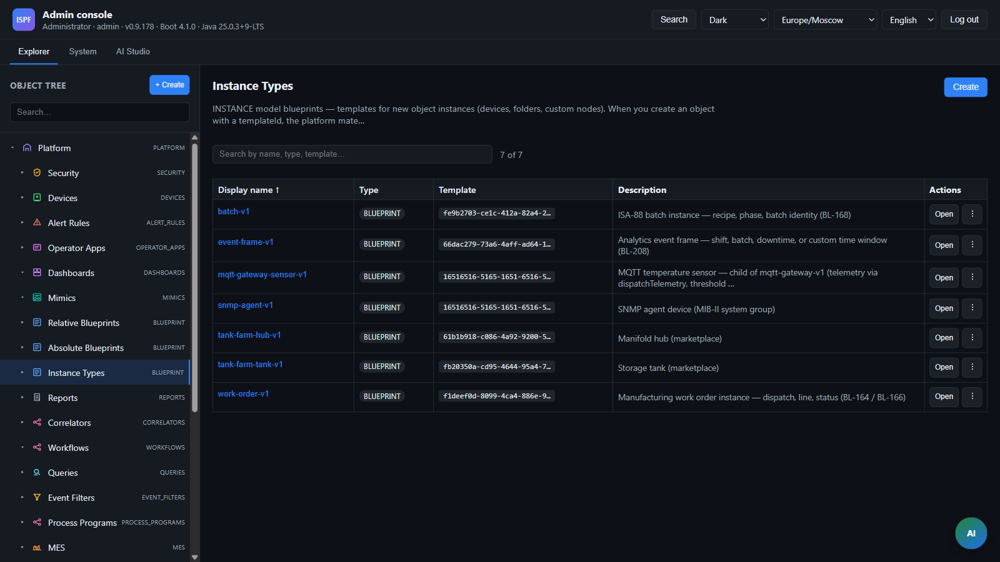

> **Language:** Canonical English. Russian edition: [ru/blueprints.md](../ru/blueprints.md).

# Object Templates (Blueprints)

> **Status:** Stable — `SINGLETON`, `INSTANCE`, and `MIXIN` blueprints, parameterized SQL bindings and alert rules, and CEL applicability rules. Status tags: [doc-status.md](doc-status.md).

A **blueprint** (`BlueprintDefinition`) is a reusable template that defines the variables, events, functions, calculation rules (`@bindingRules`), SQL bindings, and alert rules for an object in the tree ([ADR-0011](decisions/0011-model-type-semantics.md)).

**Related guides:** [Object model](object-model.md) · [Application architecture rules](application-principles.md) · [Binding rules](bindings.md).

---

## 1. The Three Blueprint Kinds (`BlueprintType`)



| Blueprint Kind | Tree Catalog | Purpose and Behavior |
|----------------|--------------|----------------------|
| **`SINGLETON`** | `root.platform.singleton-blueprints` | **Unique orchestrator / application hub** (1 per solution or station). The blueprint definition and its live instance live together at `root.platform.singleton-blueprints.<name>` |
| **`INSTANCE`** | `root.platform.instance-types` | **Repeatable object type** (for example, a production line, pump unit, or tank twin). Instantiated N times into the tree via `POST /api/v1/blueprints/{id}/instantiate` |
| **`MIXIN`** | `root.platform.mixin-blueprints` | **Composable trait / aspect** (for example, Haystack tags, Brick class, or extra KPI formulas) that merges variables, functions, and rules into an existing object |

**Demo:** [`examples/demo-plant`](../../examples/demo-plant/) — `SINGLETON` hub plus `INSTANCE` plant objects in one deployable bundle.

### Where Application Logic Must Live (`Logic != DEVICE`)

| Architectural Role | Blueprint Kind | Rule |
|--------------------|----------------|------|
| Solution orchestrator / BFF hub | **`SINGLETON`** | Create under `root.platform.singleton-blueprints.<name>` (`ensure_singleton_instance`) |
| Repeatable digital twin with per-unit logic | **`INSTANCE`** | Instantiate with `targetObjectType: "CUSTOM"` (`instantiate_instance_type`) |
| Field sensor / PLC telemetry | `INSTANCE` or `MIXIN` on `DEVICE` | **`DEVICE` nodes hold protocol drivers and raw telemetry only** — never attach application orchestration or BFF functions to `ObjectType.DEVICE` |

---

## 2. Applying `MIXIN` Blueprints and CEL Applicability

A `MIXIN` can be attached to an object either **explicitly** (via `templateId`, `POST /api/v1/mixin-blueprints/{id}/apply`, or `appliedBlueprintIds` in a bundle) or **automatically** when an object is created (`autoApplyMixinBlueprints=true`).

Automatic application runs only when **all** of the following hold ([ADR-0018](decisions/0018-fixture-models-and-cel-applicability.md)):
1. The blueprint has `type = "MIXIN"` and `targetObjectType` matches the new object's type.
2. Its **Applicability condition (`suitabilityExpression`)** is **non-empty** and evaluates to `true` in Google CEL against the target object (`self.*`).

| `suitabilityExpression` | Auto-applies on `POST /objects`? | Manual `apply` / `detach` allowed? |
|-------------------------|:--------------------------------:|:----------------------------------:|
| *(empty string)* | No | Yes |
| `true` | Yes (to all matching `targetObjectType` nodes) | No (automatic / `reevaluate`) |
| `self.flag.value == true` | Only when the CEL expression is `true` | No (automatic / `reevaluate`) |

### Opt-in Mixin Re-evaluation and Detach ([ADR-0058](decisions/0058-mixin-reevaluation-and-detach.md))

If a `MIXIN` enables `reevaluation.enabled: true` (triggers `OBJECT_CREATED`, `SERVER_READY`), the platform re-checks `suitabilityExpression` and automatically attaches or detaches the mixin's owned variables, events, functions, and rules (tracked in `blueprintContributions`). Manual endpoints: `POST /api/v1/mixin-blueprints/{id}/detach`, `.../reevaluate`, and `POST /api/v1/objects/by-path/reevaluate-mixins?path=`.

---

## 3. Parameterized Blueprints (`sqlBindings` and `alertRules`)

Blueprints can include parameterized SQL bindings and alert rule templates using `${param}` placeholders. When the blueprint is applied or instantiated, `BlueprintParameterResolver` substitutes both built-in object keys (`${self.path}`, `${self.name}`, `${self.displayName}`, `${parentPath}` / `${self.parentPath}`) and custom parameters passed in `objects[].parameters`:

```json
{
  "name": "oil-control-tank-v1",
  "type": "INSTANCE",
  "targetObjectType": "CUSTOM",
  "sqlBindings": [
    {
      "variable": "levelCm",
      "query": "SELECT COALESCE((SELECT level_cm FROM oc_measurement WHERE tank_code='${code}' ORDER BY measured_at DESC LIMIT 1), 0) AS value, 'cm' AS unit",
      "dataSourcePath": "root.platform.data-sources.oil-control",
      "refreshIntervalMs": 5000,
      "valueField": "value"
    }
  ],
  "alertRules": [
    {
      "name": "tank-${code}-high",
      "watchVariable": "levelCm",
      "conditionExpr": "self.levelCm.value > 1000.0",
      "eventName": "levelHigh",
      "enabled": true
    }
  ]
}
```

Instantiating the template in `bundle.json`:

```json
{
  "parentPath": "root.platform.instances.oil-control.tanks",
  "name": "rvs-1",
  "type": "CUSTOM",
  "templateId": "oil-control-tank-v1",
  "parameters": { "code": "RVS-1" }
}
```

**Demo:** [`examples/oil-control`](../../examples/oil-control/) — tank `INSTANCE` blueprints with `${code}` in SQL bindings.

---

## 4. Built-in Schemas vs Demo Fixture Blueprints

- **System-intrinsic schemas** (`dashboard-v1`, `workflow-v1`, `report-v1`, `alert-rule-v1`, `correlator-v1`, `data-source-v1`, `schedule-v1`) are automatically embedded into their corresponding `ObjectType` nodes on creation.
- **Demo fixture blueprints** (`mqtt-sensor-v1`, `mqtt-gateway-v1`, `snmp-agent-v1`, `virtual-lab-v1`) are loaded only when `ispf.bootstrap.fixtures-enabled=true` (local dev and training stands; disabled on production servers).

---

## 5. Blueprint REST API (`admin`)

| HTTP Method & Path | Description |
|--------------------|-------------|
| `GET / POST / PUT / DELETE /api/v1/singleton-blueprints` | Manage `SINGLETON` blueprints and ensure their live hub instance (`GET .../{id}/instance`) |
| `GET / POST / PUT / DELETE /api/v1/instance-types` | Manage `INSTANCE` blueprints |
| `GET / POST / PUT / DELETE /api/v1/mixin-blueprints` | Manage `MIXIN` blueprints |
| `GET / POST / PUT / DELETE /api/v1/blueprints` | Unified blueprint catalog API |
| `POST /api/v1/blueprints/{id}/apply?objectPath=...` | Apply a blueprint to an existing object |
| `POST /api/v1/blueprints/{id}/instantiate` | Create a new object instance from an `INSTANCE` blueprint |
| `POST /api/v1/blueprints/from-object` | Export an existing object's structure as a reusable blueprint |
| `GET /api/v1/blueprints/attachments` | List objects where a blueprint is currently applied |
