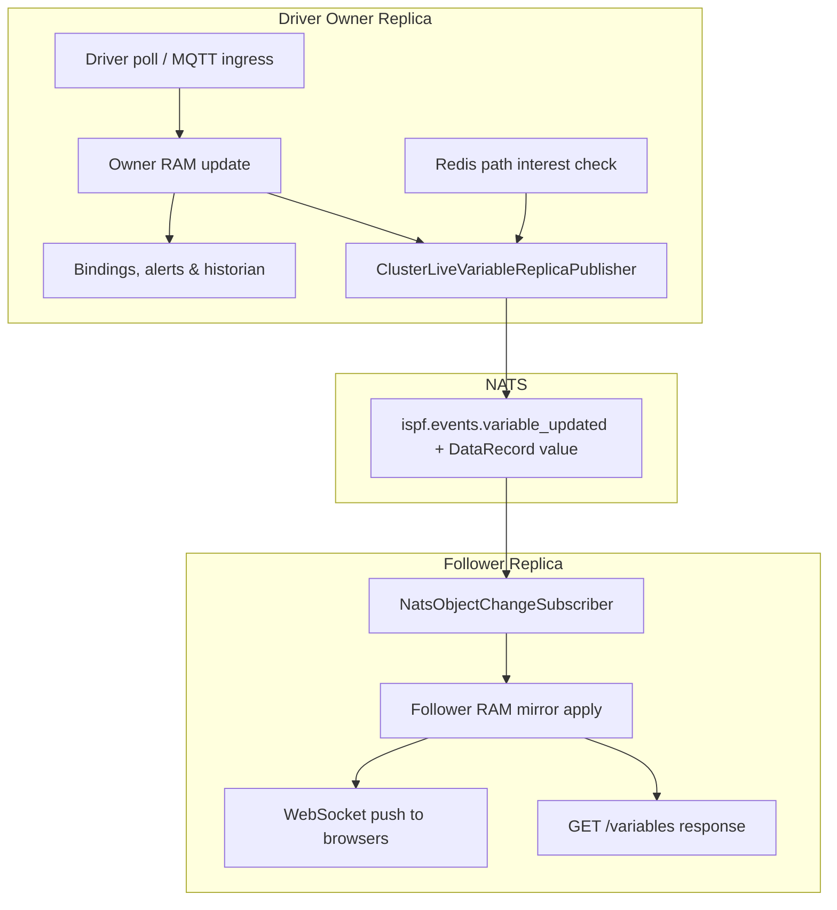

> **Language:** Canonical English. Russian edition: [ru/cluster.md](../ru/cluster.md).

# ISPF High-Availability Cluster (Multi-Replica)

> **Status:** Beta — horizontal scaling across multiple `ispf-server` replicas, automatic driver lock partitioning, NATS live-variable mirroring, and specialized replica profiles. Status tags: [doc-status.md](doc-status.md).

This guide explains how to run multiple `ispf-server` JVM replicas over a shared PostgreSQL database for high availability and workload isolation across device polling, operator HMI screens, and background analytics.

**Related guides:** [Deployment and configuration](deployment.md) · [Deployment profiles (`demostands.md`)](demostands.md) · [Messaging](messaging.md) · [Cluster chaos & soak runbook](cluster-chaos-soak-runbook.md) · [ADR-0028](decisions/0028-horizontal-active-active-cluster.md) · [ADR-0029](decisions/0029-cluster-live-variable-replica-sync.md) · [ADR-0030](decisions/0030-cluster-config-structure-replica-sync.md) · [ADR-0032](decisions/0032-replica-profiles-and-capabilities.md) · [ADR-0069](decisions/0069-cluster-consistency.md).

---

## 1. Cluster vs Multi-Site Federation

| Characteristic | Cluster (`ISPF_CLUSTER_ENABLED=true`) | Federation ([federation.md](federation.md)) |
|----------------|---------------------------------------|---------------------------------------------|
| **Object tree** | One shared `root.platform.*` tree in a single PostgreSQL database | Separate database and object tree at each site |
| **Server nodes** | Multiple stateless JVM replicas behind an nginx load balancer in one data center | Central Hub and remote Edge sites (including sites behind NAT) |
| **Device polling** | Each `DEVICE` is leased by exactly one active replica; if that replica stops, another replica automatically takes over | Each site polls its own local equipment |

---

## 2. Cluster Architecture and Data Ownership

```text
                    nginx :8080
           REST load balancing & WebSocket ip_hash
        ┌──────────┬───────────────┬──────────┐
        ▼          ▼               ▼          │
   replica-1   replica-2      replica-3      │
   :8081       :8082           :8083          │
        └──────────┴───────┬───────┴──────────┘
                           │
              PostgreSQL (shared object tree & driver locks)
              NATS JetStream (structure sync & live variable mirror)
              Redis (WebSocket path interest, ACL cache, correlator windows)
```

On startup, each replica:
1. Validates/applies Flyway migrations against the shared PostgreSQL database.
2. Loads the object tree into memory (`loadFromDatabase()`).
3. Registers in `platform_cluster_replicas` and begins sending periodic heartbeats.
4. Acquires available device leases in `platform_driver_locks` and starts polling those drivers.

### Where Each Kind of Data Lives

| Data Category | Primary Storage | Cluster Behavior |
|---------------|-----------------|------------------|
| **Object tree structure, blueprints, functions, rules** | PostgreSQL | Any configuration write on a replica publishes a NATS JetStream notification so peer replicas immediately reload the updated path from PostgreSQL ([ADR-0030](decisions/0030-cluster-config-structure-replica-sync.md)) |
| **Primary driver telemetry** | In-memory RAM on the device's owner replica | Updated on every poll tick without writing to `object_variables` in PostgreSQL |
| **Follower live-value mirror** | In-memory RAM on all other replicas | The owner replica publishes coalesced `DataRecord` snapshots over NATS (`ClusterLiveVariableReplicaPublisher`, [ADR-0029](decisions/0029-cluster-live-variable-replica-sync.md)) |
| **Variable history & event journal** | PostgreSQL / TimescaleDB or ClickHouse | Written **only by the device's owner replica** (never duplicated by followers) |
| **Binding rules, alert rules, and correlators** | Automation pipeline on the owner replica | Evaluated once on the owner replica; computed output variables are mirrored to followers over NATS |

### Fail-Closed Startup Dependencies ([ADR-0069](decisions/0069-cluster-consistency.md))
When `ISPF_CLUSTER_ENABLED=true`, `ClusterDependencyValidator` verifies at startup that NATS JetStream (for structure sync) and Redis (when `ISPF_CLUSTER_LIVE_VARIABLE_SYNC=true` or `ISPF_CLUSTER_PATH_INTEREST=true`) are reachable, refusing to start a degraded split-brain node.

---

## 3. Live Variable Synchronization Across Replicas ([ADR-0029](decisions/0029-cluster-live-variable-replica-sync.md))



1. **Demand-driven publishing:** WebSocket `subscribe` / `unsubscribe` events on any replica update a cluster-wide reference count in Redis (`ispf:cluster:ws:interest:{path}`). The owner replica publishes NATS live-value updates whenever any client across the cluster is watching that path.
2. **Loop-free follower apply:** followers apply incoming NATS snapshots via `ClusterVariableReplicaApplier` with `replicaIngress = true` — pushing updates to local WebSocket clients and serving fresh values on `GET /variables` without re-running bindings, alerts, or historian writes.

### Two Independent Coalescing Windows

| Property | Environment Variable | Default | Purpose |
|----------|----------------------|---------|---------|
| `ispf.runtime-telemetry.coalesce-ms` | `ISPF_RUNTIME_TELEMETRY_COALESCE_MS` | `250` ms | Merges rapid driver ticks on the owner replica before running local bindings and alerts |
| `ispf.cluster.live-variable-sync-coalesce-ms` | `ISPF_CLUSTER_LIVE_VARIABLE_SYNC_COALESCE_MS` | `500` ms | Merges NATS live-value fan-out packets between replicas |

---

## 4. Replica Profiles and Role Separation ([ADR-0031](decisions/0031-cluster-replica-roles-platform-jobs.md), [ADR-0032](decisions/0032-replica-profiles-and-capabilities.md))

| `ISPF_REPLICA_PROFILE` | Public API / WS | Config Write | Drivers | Async Jobs | Schedulers | Typical Role |
|------------------------|:---------------:|:------------:|:-------:|:----------:|:----------:|--------------|
| `unified` (`all`) | yes | yes | yes | yes | yes | Single-node server only (`ISPF_CLUSTER_ENABLED=false`) |
| `edge-api` | yes | yes | no | no | yes | Primary Admin & API replicas behind nginx (`/api/`, `/ws/`) |
| `hmi-read` | read-only (`/hmi/*`) | no | no | no | no | Dedicated read-only replicas for operator screens (`?mode=operator`) |
| `io` | no | no | yes | no | yes | Dedicated protocol polling and automation replicas |
| `compute` | internal | no | no | yes | no | Background report and job workers (`platform_jobs`) |
| `analytics` | internal | no | no | no | no | Historian rollup materializer and backfill workers |

### Separate Operator HMI Ingress (`/hmi`)

Operator consoles (`?mode=operator`) automatically prefix REST and WebSocket calls with `/hmi/api/...` and `/hmi/ws/...` (`resolveIngressPath()` in `apps/web-console/src/utils/ingress/ingressPath.ts`) so nginx can route operator traffic to dedicated `hmi-read` replicas while keeping `/api/` on `edge-api` replicas. On a single-node server without `/hmi` nginx routing, `fetchWithIngressFallback()` automatically falls back to `/api/...` and `/ws/...`.

---

<a id="cluster-startup-and-configuration"></a>

## 5. Cluster Startup and Configuration

Automated bootstrap scripts: [`deploy/lab-cluster-bootstrap.sh`](../../deploy/lab-cluster-bootstrap.sh) and [`deploy/vps-cluster-bootstrap.sh`](../../deploy/vps-cluster-bootstrap.sh).

### Staged Startup Order
```text
Phase 1  Start shared infrastructure: PostgreSQL → Redis → NATS (-js) → ClickHouse (wait until healthy)
Phase 2  Start replica-1 only (bootstrap leader, profile edge-api):
         runs Flyway migrations and initializes system object tree nodes
Phase 3  Start remaining API, hmi-read, compute, and analytics replicas + nginx
Phase 4  After ~15 s, start io replicas (driver polling nodes)
Phase 5  Verify cluster health: GET /api/v1/platform/cluster/health (all nodes UP)
```

> **Why staged startup matters on an empty database:** do not start all `ispf-server` containers simultaneously on an uninitialized database — concurrent startup reconcilers (`AssetAnalyticsBootstrap`, `SystemObjectDescriptionReconciler`) can contend on `object_nodes` locks.

### Minimum Environment Variables per Replica

```bash
ISPF_CLUSTER_ENABLED=true
ISPF_REPLICA_ID=replica-1
ISPF_REPLICA_PROFILE=edge-api
ISPF_DB_URL=jdbc:postgresql://postgres:5432/ispf
ISPF_NATS_ENABLED=true
ISPF_NATS_URL=nats://nats:4222
ISPF_NATS_REPLICA_EVENTS=true
ISPF_NATS_JETSTREAM_ENABLED=true
ISPF_REDIS_ENABLED=true
ISPF_REDIS_HOST=redis
ISPF_CLUSTER_LIVE_VARIABLE_SYNC=true
ISPF_CLUSTER_PATH_INTEREST=true
```

---

## 6. Health Checks, Smoke Tests, and Troubleshooting

```http
GET /api/v1/platform/cluster/health
GET /api/v1/platform/cluster/diagnostics
Authorization: Bearer <admin-token>
```

Run the automated cluster smoke and failover verification script:

```bash
ISPF_CLUSTER_REQUIRE_DRIVER_LOCKS=1 \
  bash deploy/cluster-smoke-test.sh --config-sync --live-var-lag
python deploy/cluster-scale-load-test.py --scale-factor-floor 1.8
```

| Symptom | Cause | Resolution |
|---------|-------|------------|
| `503 REPLICA_CAPABILITY_DENIED` on config save | nginx routed a write request to an `hmi-read`, `io`, or `analytics` replica | Keep only `edge-api` replicas in the nginx `/api/` upstream pool |
| REST `GET /variables` returns stale values across replicas | Live variable sync is disabled | Ensure `ISPF_CLUSTER_LIVE_VARIABLE_SYNC=true` and `ISPF_NATS_REPLICA_EVENTS=true` on all nodes |
| Devices remain `STOPPED` or unpolled in a split-profile cluster | No replica with the `drivers` capability is running | Start at least one replica with `ISPF_REPLICA_PROFILE=io` |
