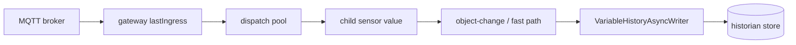

# ADR-0017: Telemetry ingest pipeline (MQTT gateway, pools, historian)

## Status

**Accepted** (2026-06-25) — architecture for high-rate MQTT → child sensors → historian. Pool sizes and coalesce numbers live in [load-testing](../load-testing.md) / [variable-history](../variable-history.md).

## Context

High-rate MQTT exposed bottlenecks: N broker connections per device, single-thread binding executors, one coalesce slot on gateway `lastIngress`, and JPA `saveAll` on `variable_samples` blocking JDBC batching.

Event journal already used `JdbcTemplate.batchUpdate` ([0016a](0016-clickhouse-event-journal.md)); historian needed the same class of path.

## Decision

1. **MQTT gateway orchestrator** (`mqtt-gateway-v1` fixture when bootstrap fixtures enabled — [0018](0018-fixture-models-and-cel-applicability.md)): one broker connection → `lastIngress` → per-topic coalesce → parallel dispatch into child sensor variables (no extra parse-binding hop on the hot path).
2. **Shared pools, not per-rule single threads** — binding-async, telemetry coalescer, gateway dispatch, object-change bus, historian async writer. Sync `BindingPropagationListener` stays ordered before historian enqueue. Defaults and elastic knobs: [load-testing](../load-testing.md), [0033](0033-prod-idle-demostand-tuning.md).
3. **Historian store SPI** (`ispf.variable-history.store`):

| Store | Role |
|-------|------|
| `jdbc` (default) | Timescale / JDBC batch — prod path |
| `jpa` | Legacy / debug |
| `clickhouse` | Opt-in warm tier — [0035](0035-historian-dual-write.md) (**shipped**, not “future”) |
| `cassandra` / `scylla` | **Experimental** — [0025b](0025-cassandra-scylla-timeseries-store.md) |

4. **Per-device `telemetryPublishMode`:**

| Mode | Historian | Automation bus | Event journal |
|------|-----------|----------------|---------------|
| `FULL` (default) | yes | yes | via alerts / API / correlators |
| `TELEMETRY_ONLY` | yes (fast path) | telemetry lane | no |
| `EVENT_JOURNAL_ONLY` | no | skipped | yes — [0027](0027-event-journal-ingress-fast-path.md) |

## Consequences

- Gateway + JDBC batch is the supported high-rate story; absolute rates are hardware-bound — measure via [load-testing](../load-testing.md).
- Profiles ([0033](0033-prod-idle-demostand-tuning.md)) choose idle vs throughput overlays; do not treat this ADR as an env catalog.

## Related

- [0016-clickhouse-event-journal](0016-clickhouse-event-journal.md) (**0016a**)
- [0026-elastic-telemetry-ingress](0026-elastic-telemetry-ingress.md)
- [0027-event-journal-ingress-fast-path](0027-event-journal-ingress-fast-path.md)
- [0035-historian-dual-write](0035-historian-dual-write.md)
- [variable-history](../variable-history.md), [load-testing](../load-testing.md), [bindings](../bindings.md)
