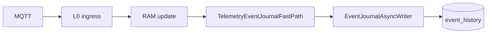

# ADR-0027: Event journal ingress fast path

## Status

**Accepted** (2026-07-04) — `EVENT_JOURNAL_ONLY` driver mode. Benchmarks and peak-tuning scripts live in [lab-event-journal-stress](../lab-event-journal-stress.md) / [load-testing](../load-testing.md).

## Context

High-rate driver telemetry can be persisted as **event journal** rows. Anti-patterns under flood: HTTP `POST /events/fire` per message, and FULL automation (bus + CEL) coupled to journal I/O. Needed: in-process enqueue without HTTP and without the telemetry/automation bus.

## Decision

1. **Third publish mode** `EVENT_JOURNAL_ONLY` (alongside `FULL` and `TELEMETRY_ONLY` from [0017](0017-telemetry-ingest-pipeline.md)):

| Mode | RAM live | Historian | Object-change bus | Event journal |
|------|----------|-----------|-------------------|---------------|
| `FULL` | yes | yes | yes | alerts / API / correlators |
| `TELEMETRY_ONLY` | yes | fast path | telemetry lane | no |
| `EVENT_JOURNAL_ONLY` | yes | no | **skipped** | **fast path** |

2. **`TelemetryEventJournalFastPath`** after in-memory set: `EventService.fireIngress()` → async journal writer; skip historian fast path, ingress dispatcher, and coalescer.
3. **Bypass L1** server ingress buffer for this mode (same idea as historian fast path in [0026](0026-elastic-telemetry-ingress.md)) so L0 and journal writer are not double-buffered.
4. **Not a replacement** for FULL automation or TELEMETRY_ONLY dashboards — orthogonal mode for raw ingress audit.

## Consequences

- Metric tag `EventFireSource.INGRESS` for fairness vs API fire.
- Coalesce / elastic / queue knobs for peak labs → [load-testing](../load-testing.md); dated rate tables → [lab-event-journal-stress](../lab-event-journal-stress.md) / `docs/evidence/` — **not** amended into this ADR on every bench.

## Related

- [0026-elastic-telemetry-ingress](0026-elastic-telemetry-ingress.md)
- [0017-telemetry-ingest-pipeline](0017-telemetry-ingest-pipeline.md)
- [0016-clickhouse-event-journal](0016-clickhouse-event-journal.md) (**0016a**)
- [automation](../automation.md), [load-testing](../load-testing.md), [lab-event-journal-stress](../lab-event-journal-stress.md)
