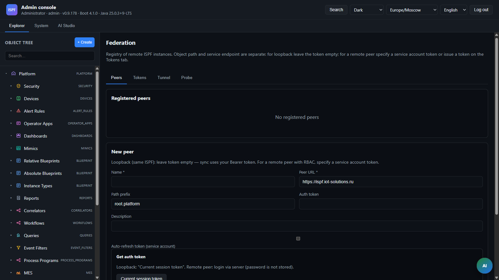

> **Language:** Canonical English. Russian edition: [ru/federation.md](../ru/federation.md).

# Multi-Site Object Federation (Central Hub and Remote Edge Sites)

> **Status:** Beta — peer registry, transparent proxy read/write, catalog synchronization, and outbound WebSocket tunnels for remote Edge sites behind NAT. Status tags: [doc-status.md](doc-status.md).

Federation connects multiple distributed ISPF instances (such as plant-floor gateways, substations, or remote pumping stations behind NAT) to a central **Hub** server so operators can monitor and interact with all sites from a single console.

---

## 1. Core Principle



**An object path is independent of the server URL.** A path such as `root.platform.devices.pump-01` is a stable identifier in the object tree, while the remote ISPF server's URL and authentication credentials live in the **federation peer registry** (`federation_peers`).

| Component / Endpoint | Description |
|----------------------|-------------|
| `federation_peers` table | Peer registry: name, `baseUrl`, `authToken`, `pathPrefix`, `enabled`, `authMode`, and connection mode |
| `federation_inbound_registrations` & `federation_outbound_agents` | One-time registration codes on the Hub and outbound WebSocket tunnel agent configs on the Edge |
| `GET / POST / PUT / DELETE /api/v1/federation/peers` | Manage federation peers (`admin` role) |
| `GET / POST /api/v1/federation/peers/{id}/auth-status`, `refresh-token` | Inspect and refresh `SERVICE_ACCOUNT` peer tokens |
| `POST / GET / DELETE /api/v1/federation/inbound/registrations` | Issue one-time inbound tunnel registration codes on the Hub |
| `GET /api/v1/federation/tunnels` | Inspect active inbound WebSocket tunnel sessions on the Hub |
| `POST / GET / PUT / DELETE /api/v1/federation/outbound/agents`, `connect` | Configure and connect an outbound tunnel agent on an Edge node |
| `/ws/federation/tunnel` | WebSocket tunnel endpoint between Edge and Hub |
| `GET /api/v1/federation/peers/{id}/catalog-sync-preview` | Preview create/update counts and conflicts before syncing a peer's catalog |
| `POST /api/v1/federation/peers/{id}/sync-catalog` (`sync-subtree`) | Import remote objects (or a selected subtree) as local proxy nodes under `root.platform.federation.<peer>.*` |
| `POST / PATCH / DELETE /api/v1/federation/binds` | Overlay a remote peer object onto an arbitrary canonical local path |
| `GET /api/v1/objects/by-path`, `GET / PUT /api/v1/dashboards/by-path` | Transparently read/write variables, history, functions, and dashboards on proxy nodes |

---

## 2. Catalog Mirror vs Federation Bind (`overlay`)

| Feature | Catalog Sync (Mirror) | Federation Bind (`overlay`) |
|---------|-----------------------|-----------------------------|
| **Best for** | Browsing an entire remote site's device catalog | Mounting a remote device at a specific local plant path |
| **Local tree path** | `root.platform.federation.<peer>.*` | Any local path, e.g. `root.platform.devices.edge-pump` |
| **Web Console UI** | **Sync catalog** button on the **Federation → Peers** panel | Object Inspector → **Federation bind** tab (or **Place locally…** on a mirror node) |

### How Federation Bind Works

When you bind a local node to a remote peer object, the node receives the system variables `federationProxy = true`, `federationPeerId`, and `federationRemotePath`. All variable reads/writes, function invocations, historian queries, and dashboard saves are proxied through `FederationProxyService`. If the local node previously ran a local `DEVICE` driver, the driver is stopped and a snapshot of its local metadata is saved; calling **unbind** (`DELETE /api/v1/federation/binds?localPath=...`) restores the local properties and restarts the driver.

```http
POST /api/v1/federation/binds
Content-Type: application/json

{
  "localPath": "root.platform.devices.edge-pump",
  "peerId": "<peer-uuid>",
  "remotePath": "root.platform.devices.demo-sensor-01"
}
```

**Loop protection:** self-binds (`localPath == remotePath` on the same instance) and multi-hop proxy chains through another federated node are rejected.

---

## 3. Catalog Synchronization and Selective Subtree Sync

### Full Catalog Sync with Conflict Resolution
Before importing a peer's catalog, the Web Console calls `GET /api/v1/federation/peers/{peerId}/catalog-sync-preview` to detect conflicts:
- `LOCAL_NATIVE` — a non-proxy object already exists at the target path (`SKIP` by default, or `BIND` to convert it).
- `PROXY_MISMATCH` — a proxy node exists but points to a different peer or remote path (`SKIP` or `BIND`).

```http
POST /api/v1/federation/peers/{peerId}/sync-catalog
Content-Type: application/json

{
  "resolutions": [
    { "localPath": "root.platform.federation.site-a.devices.pump-01", "action": "BIND" }
  ]
}
```

### Selective Subtree Sync (`sync-subtree`)
To import only a specific branch (such as `root.platform.devices` without remote dashboards):

```http
GET  /api/v1/federation/peers/{id}/subtree-sync-preview?remoteSubtreePath=root.platform.devices
POST /api/v1/federation/peers/{id}/sync-subtree
```

---

## 4. Peer Authentication and Delegated End-User ACL (`On-Behalf-Of`)

### Peer Authentication Modes (`authMode`)
- `STATIC_TOKEN` (default) — uses a manually issued Bearer token (`POST /api/v1/security/users/{username}/federation-token`).
- `SERVICE_ACCOUNT` — stores an encrypted username/password (`ispf.security.secrets-key`), logs in to the remote peer automatically, and refreshes the token ~20% before expiry.

### Delegated End-User Authorization (`FederationOnBehalfOfFilter`)
When an operator interacts with a federated object on the Hub:
1. The Hub authenticates the inter-server channel using the peer's `authToken` and forwards the operator's identity in `X-ISPF-On-Behalf-Of-User`, `X-ISPF-On-Behalf-Of-Roles`, and `X-ISPF-On-Behalf-Of-Tenant`.
2. On the remote peer, `FederationOnBehalfOfFilter` computes the **intersection** of the authenticated channel's roles and the forwarded user roles, then evaluates per-object and per-variable ACLs in `VariableAclRequestContext.MEMBER` mode.
3. This guarantees that a service-account channel acts as an authorization ceiling and can never escalate an operator's permissions on the remote site.

---

## 5. Outbound WebSocket Tunnel for Edge Sites Behind NAT

When an Edge site runs behind NAT or a firewall and cannot accept inbound HTTP connections, the Edge initiates an outbound WebSocket tunnel (`/ws/federation/tunnel`) to the public Hub:

```text
Edge Site (behind NAT) ── outbound WebSocket ──► Central Hub (public)
Central Hub            ── proxy requests     ──► Edge Site
```

### Setup Sequence
1. **On the Hub:** open **Federation → Tunnel → Inbound registration**, specify the site name and path prefix, and generate a **one-time registration code**.
2. **On the Edge:** open **Federation → Tunnel → Outbound agent**, enter the Hub URL and registration code, and click **Connect** (requires `ispf.security.secrets-key` on the Edge).
3. The Hub automatically creates a peer entry with `connection_mode = TUNNEL_INBOUND`.
4. Click **Sync catalog** on the Hub — all reads, writes, function calls, and live WebSocket `event_notify` updates now flow through the tunnel.

### Edge Store-and-Forward Buffer (`AgentStoreForwardService`)
While an outbound tunnel is disconnected, `AgentStoreForwardService` (`FederationOutboundEventBufferRegistry`) buffers `ObjectChangeEvent` notifications in memory (default 2 MiB per agent) and persists a disk snapshot to `{ISPF_DATA_DIR}/agent/store-forward-buffer.json` when `persist-to-disk: true`:

```yaml
ispf:
  agent:
    store-forward:
      enabled: true                 # ISPF_AGENT_STORE_FORWARD_ENABLED
      max-bytes: 2097152            # ISPF_AGENT_STORE_FORWARD_MAX_BYTES
      drop-policy: DROP_OLDEST      # DROP_OLDEST or DROP_NEWEST
      persist-to-disk: true
```

When the WebSocket tunnel reconnects, buffered events are replayed in sequence order (`seq`). Buffer statistics are exposed at `GET /api/v1/agent/store-forward/stats`.

---

## 6. Peer Health Monitoring, Manager-of-Managers HMI, and Test Budgets

### Peer Health API and Auto-Alerting
```http
GET /api/v1/federation/peers/{id}/health
```
Returns `{ peerId, level, tunnelConnected, lastProxySuccessAt, lastProxyLatencyMs, lastProxyError, pendingBufferedEvents, summary }` where `level` is `GREEN`, `YELLOW`, or `RED`. When an enabled peer transitions between `RED` and `GREEN`, `FederationPeerHealthMonitor` fires `peerHealthDegraded` / `peerHealthRecovered` on `root.platform.federation`.

### Integration test flake budget
Tunnel and store-forward integration tests poll asynchronous connect and replay; timeout constants live in `FederationIntegrationTestSupport` (`TUNNEL_CONNECT_TIMEOUT_SECONDS`, `PROXY_READY_TIMEOUT_SECONDS`, `BUFFER_DRAIN_TIMEOUT_SECONDS`, `CONNECT_RETRY_INTERVAL_MS`) and run with `@Isolated` (`FederationChaosIntegrationTest`, `FederationTunnelIntegrationTest`, `FederationStoreForwardIntegrationTest`).

### Manager-of-Managers (MoM) Operator Shell
A central Hub can host a multi-site operator workspace (`?mode=operator&app=federation-hub`) combining site tabs, the peer health selector (`OperatorFederationPeerSelector`), stale-value badges when a peer is `YELLOW`/`RED`, and an aggregated `WARNING+` event feed.

**Related guides:** [Operator guide](operator-guide.md) · [ISPF Cluster](cluster.md) · [Deployment profiles (`demostands.md`)](demostands.md).
