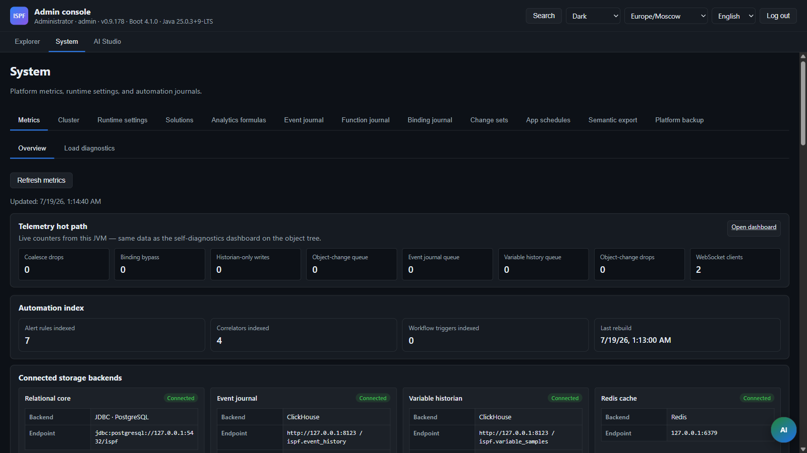

> **Language:** Canonical English. Russian edition: [ru/observability.md](../ru/observability.md).

# Observability: Metrics, Load Diagnostics, and OpenTelemetry

> **Status:** Stable — built-in load diagnostics, Prometheus metrics (`/actuator/prometheus`), and optional OpenTelemetry (OTLP) metrics and distributed tracing. Status tags: [doc-status.md](doc-status.md).

ISPF provides built-in self-diagnostics in the Web Console, exposes **Prometheus** metrics at `/actuator/prometheus`, and optionally exports metrics and distributed traces over **OTLP** to OpenTelemetry Collectors (Grafana, Uptrace, and compatible backends).

---

## 1. Built-in Load Diagnostics and Self-Monitoring



In the Admin Console under **System → Metrics** (and on the built-in dashboard `root.platform.dashboards.platform-metrics`), operators and administrators can inspect real-time server health without external tools:

| Endpoint / Surface | Role | What It Shows |
|--------------------|------|---------------|
| `GET /api/v1/platform/metrics` | `admin` | Current JVM metrics, DB pool, active drivers, queue depths, and CPU load diagnostics (`diagnostics` block) |
| `GET /api/v1/platform/cluster/diagnostics` | `admin` | Cluster-wide CPU ranking across all replicas, top load suspects (`clusterTopSuspect`), thread groups (`ispf-driver-io`, `driver-ingress`, `object-change`), driver `pressureScore`, and running jobs/workflows |
| `GET / PUT /api/v1/platform/diagnostics/metrics-probe` | `admin` | Toggles runtime synchronization of platform metrics into the tree device `root.platform.devices.platform-metrics-probe` (automatically turns off when leaving the diagnostics page) |

For headless SSH diagnostics on a single host, run [`deploy/vps-idle-thread-sample.py`](../../deploy/vps-idle-thread-sample.py), which samples `/api/v1/platform/metrics` twice and prints active thread groups and load suspects.

---

## 2. Prometheus Metrics (`/actuator/prometheus`)

The endpoint `/actuator/prometheus` (requires `admin` role) exports standard JVM, HTTP, and HikariCP metrics alongside ISPF engine counters and gauges:

| Micrometer Metric | Type | Description |
|-------------------|------|-------------|
| `ispf.object_tree.ready` | gauge | `1` when the object tree is initialized and ready |
| `ispf.drivers.active` / `connected` | gauge | Number of running and connected device drivers |
| `ispf.driver.errors.total{driver,op,kind}` | counter | Driver errors classified by kind (`transient`, `configuration`, `permanent`, `unsupported`) |
| `ispf.telemetry.coalesce_drops.total` | counter | Intermediate samples merged by last-value coalescing under high-rate ingress |
| `ispf.telemetry.historian_only.total` | counter | Samples written via the direct historian fast path (`TELEMETRY_ONLY`) |
| `ispf.object_change.queue.size{lane=...}` | gauge | Current queue depth for `telemetry`, `automation`, and `total` lanes |
| `ispf.object_change.workers.active{lane=...}` | gauge | Active worker threads in elastic pools |
| `ispf.object_change.queue.dropped.total` | counter | Notifications dropped on queue overflow |
| `ispf.events.fired.total{source=...}` | counter | Events published by source (`alert`, `api`, `correlator`, `function`) |
| `ispf.alert.fires.total` / `evaluations.total` | counter | Alert rule activations and total CEL evaluations |
| `ispf.correlator.triggers.total` | counter | Event correlator firings |
| `ispf.event_journal.queue.size` / `flushed.total` | gauge / counter | Pending and flushed event journal rows |
| `ispf.historian.dual_write.secondary_failures` | counter | ClickHouse secondary write failures in dual-write mode |
| `ispf.historian.dual_write.catchup.ranges` / `oldest_age_ms` / `wal_bytes` | gauge | Open catch-up ranges, oldest range age, and WAL size owed to ClickHouse |
| `ispf.workflow.starts.total` / `workflow_instances.running` | counter / gauge | Workflow starts and currently running BPMN instances |
| `ispf.websocket.clients` | gauge | Open `/ws/objects` client sessions |

| `ispf.telemetry.binding_bypass.total` | counter | Binding consumer present — coalesce skipped |
| `ispf.historian.spool.bytes` / `.lag` / `.oldest_age_ms` | gauge | Sole-store ClickHouse disk spool backlog |
| `ispf.historian.spool.quota` | gauge | `1` when spool `max-bytes` rejects new accepts |
| `ispf.historian.spool.errors` / `.replayed` | gauge | Cumulative spool errors / replayed batches |
| `ispf.binding.truncations` | counter | Binding cascade stop-loss hits (`MAX_PASSES` / `MAX_DEPTH`); also System → Metrics `bindingTruncationsTotal` |

Ready-to-use Grafana dashboard: [`deploy/grafana/ispf-automation-pipeline.json`](../../deploy/grafana/ispf-automation-pipeline.json). Optional alert rules for dual-write catch-up, sole-store spool, and binding stop-loss: [`deploy/prometheus-ispf-alerts.yml`](../../deploy/prometheus-ispf-alerts.yml).

---

## 3. OpenTelemetry (OTLP) Metrics and Distributed Tracing

Both OTLP metrics and OTLP tracing are **disabled by default** and can be enabled via environment variables:

| Feature | Environment Variables | Default |
|---------|-----------------------|---------|
| **OTLP Metrics** | `ISPF_OTLP_METRICS_ENABLED=true`, `ISPF_OTLP_METRICS_URL=http://otel-collector:4318/v1/metrics`, `ISPF_OTLP_METRICS_STEP=30s` | `false` |
| **OTLP Tracing** | `ISPF_OTLP_TRACING_ENABLED=true`, `ISPF_OTLP_TRACING_URL=http://otel-collector:4318/v1/traces`, `ISPF_OTLP_TRACING_SAMPLING=0.1` | `false` |

When tracing is enabled, every asynchronous handler on the object-change bus emits an `ispf.object-change.handler` span tagged with `handler`, `lane`, `change_type`, `path`, and `variable` / `event_name` alongside standard Spring Boot HTTP spans (`http.server.requests`). A minimal collector configuration for local testing is provided in [`deploy/otel-collector-minimal.yaml`](../../deploy/otel-collector-minimal.yaml).

---

## 4. Elastic Worker Pool Tuning

By default (`ISPF_OBJECT_CHANGE_ELASTIC_WORKERS=true`), the object-change bus scales worker threads between `min` and `max` based on queue depth:

```properties
ISPF_OBJECT_CHANGE_AUTOMATION_WORKERS_MIN=2
ISPF_OBJECT_CHANGE_AUTOMATION_WORKERS_MAX=16
ISPF_OBJECT_CHANGE_ELASTIC_SCALE_UP_THRESHOLD=50
ISPF_OBJECT_CHANGE_ELASTIC_SCALE_DOWN_STEPS=6
ISPF_OBJECT_CHANGE_ELASTIC_SCALE_CHECK_MS=500
ISPF_OBJECT_CHANGE_AUTOMATION_QUEUE_CAPACITY=10000
```

**Related guides:** [Deployment profiles (`demostands.md`)](demostands.md) · [Load testing (`load-testing.md`)](load-testing.md) · [Messaging (`messaging.md`)](messaging.md).
