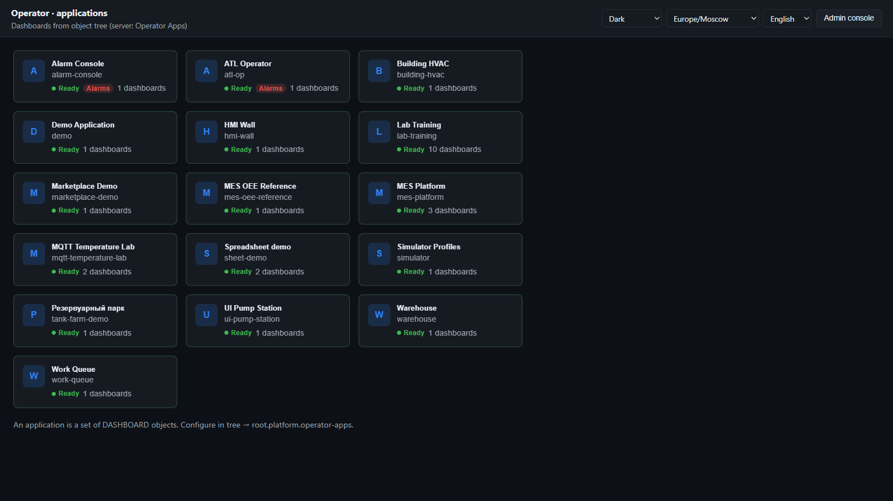

> **Language:** Canonical English. Russian edition: [ru/operator-apps.md](../ru/operator-apps.md).

# Operator Applications (`root.platform.operator-apps`)

> **Status:** Stable — operator workspace launcher, dashboard tab menus (`operatorUi`), and built-in starter apps. Status tags: [doc-status.md](doc-status.md).

An **Operator Application** defines a dedicated workspace in Operator HMI (`?mode=operator&app=<appId>`) with its own title, default dashboard, navigation tabs, and optional custom React SPA (`ui-pack`). Configurations are stored in `operator_app_ui` and represented as tree nodes under `root.platform.operator-apps.*`.

---

## 1. Operator Workspace URLs

| Workspace | URL | Purpose |
|-----------|-----|---------|
| **Application Launcher** | `/?mode=operator` | Grid of all installed operator applications |
| **Platform HMI** | `/?mode=operator&app=platform` | Default monitoring workspace |
| **Alarm Console** | `/?mode=operator&app=alarm-console` | Live event feed and active alarm bar (`root.platform.dashboards.alarm-console`) |
| **Work Queue** | `/?mode=operator&app=work-queue` | Full-screen BPMN operator task queue (`root.platform.dashboards.work-queue`) |
| **HMI Video Wall** | `/?mode=operator&app=hmi-wall` | 2×2 control-room mosaic (`root.platform.dashboards.hmi-wall`) |

On a clean installation without demo fixtures, an administrator can install the three starter workspaces (`alarm-console`, `work-queue`, `hmi-wall`) directly from the Operator Launcher (**Install starter templates**) or via `POST /api/v1/operator-apps/starters/install`.

---

## 2. REST API

| HTTP Method & Path | Description |
|--------------------|-------------|
| `GET /api/v1/operator-apps` | List all configured operator applications |
| `GET /api/v1/operator-apps/{appId}/ui` | Read the `operatorUi` definition for an application |
| `POST /api/v1/operator-apps/{appId}` | Register a new operator application |
| `PUT /api/v1/operator-apps/{appId}/ui` | Update the dashboard tabs and navigation settings for an application |
| `GET /api/v1/operator-apps/starters` | List built-in starter workspace templates |
| `POST /api/v1/operator-apps/starters/install` | Install the starter workspaces (`admin` role) |

**Related guides:** [Operator guide](operator-guide.md) · [Web Console](web-console.md) · [External IDE & hosted React UI (`ui-pack`)](external-ide.md) · [Application solutions (`applications.md`)](applications.md).
