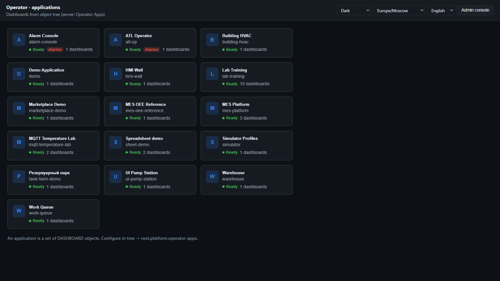
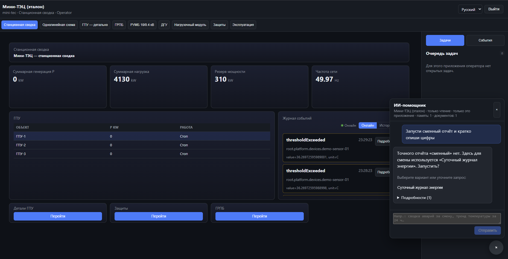

> **Language:** Canonical English. Russian edition: [ru/operator-guide.md](../ru/operator-guide.md).

# Operator Guide

> **Status:** Stable — working with Operator HMI screens, the BPMN Work Queue, the Event Journal, reports, and the read-only shift AI assistant. Status tags: [doc-status.md](doc-status.md).

This guide is for users with the **`operator`** role who monitor plant equipment, respond to alarms, complete shift tasks in the Work Queue, and run operational reports.

**Related guides:** [Product overview](product.md) · [Operator applications](operator-apps.md) · [Web Console](web-console.md) · [Widget reference](widgets.md).

---

## 1. Signing In to Operator HMI

1. Open the Web Console (`http://<host>:8080` or your plant URL).
2. Sign in with your operator credentials (on local demo stands: `operator` / `operator`).
3. **Operator HMI** opens in full-screen mode without the administrative object tree or configuration editors.

- To open the operator application launcher directly: `http://<host>:8080/?mode=operator`
- To open a specific application directly: `http://<host>:8080/?mode=operator&app=platform`
- Administrators can also configure **auto-start** on a user account (`autoStartEnabled = true`, `autoStartApp = "<appId>"`) so the assigned workspace opens immediately after sign-in.

---

## 2. Operator HMI Layout and Permissions

The main area displays the active dashboard or SCADA mimic diagram; the right-hand sidebar contains the **Work Queue** and **Event Journal**; the bottom-right icon opens the read-only **Shift AI Assistant**.

| Action | Permitted for `operator` |
|--------|:------------------------:|
| View dashboards, SCADA mimics, and historical trends | ✓ |
| Receive live WebSocket updates | ✓ |
| Invoke allowed operational functions (dashboard buttons & forms) | ✓ |
| Claim and complete tasks in the BPMN Work Queue | ✓ |
| View and filter the Event Journal and export reports | ✓ |
| Edit dashboard layouts, object tree structure, or BPMN diagrams | ✗ |
| Manage user accounts or deploy application bundles | ✗ |

---

## 3. Working with Dashboards and Widgets

### Screen Navigation and Master-Detail Selection
- When an application defines multiple dashboards, they appear as **tabs** across the top bar.
- Clicking a row in an **Object Table (`object-table`)** or **Card Grid (`card-grid`)** configured with a `selectionKey` (such as `"device"` or `"order"`) automatically updates all linked charts, gauges, and detail cards on the screen to show data for the selected item.

### Common Operator Widgets

| Widget Type | What It Displays | Operator Interaction |
|-------------|------------------|----------------------|
| `value`, `indicator`, `gauge` | Live variable value and status | View (and click to open history modal if enabled) |
| `chart`, `sparkline` | Real-time and historical trend lines | Switch time range, inspect values, export CSV/JSON |
| `scada-mimic` | Interactive P&ID or single-line diagram | Pan/zoom, click equipment to select or invoke commands, export PNG |
| `object-table`, `card-grid` | List of devices, lines, or orders | Click a row/card to drive screen selection |
| `function`, `function-form` | Command button or parameter input form | Execute an object or BFF function |
| `work-queue` | Active BPMN shift tasks | **Claim** and **Complete** tasks |
| `event-feed` | Live stream of platform events and alarms | Filter by severity or object |
| `spreadsheet` | Excel-style `A1` formula grid | Enter numbers/formulas in editable cells, undo/redo, export CSV ([Spreadsheet widget guide](spreadsheet-widget.md)) |
| `report` | Tabular SQL or tree-variable report | Filter and export CSV / XLSX / PDF / HTML |

---

## 4. Shift Task Queue (`Work Queue`)

The **Work Queue** displays human tasks (`userTask`) generated by active BPMN workflows:

1. **Task arrival:** when an automated workflow (triggered by an alarm correlator, schedule, or production order) reaches a `userTask`, the task appears in the right-hand **Work Queue** sidebar and any on-screen `work-queue` widget.
2. **Claim:** click **Claim** to assign the task to yourself (`status = CLAIMED`).
3. **Perform action & Complete:** carry out the required check or confirmation and click **Complete** — the BPMN workflow immediately resumes its next step.

---

## 5. Event Journal and Reports

- **Event Journal sidebar:** shows recent events (`DEBUG`, `INFO`, `WARNING`, `ERROR`, `CRITICAL`) such as threshold alarms, equipment state changes, and operator actions.
- **Reports:** open any report tab or `report` widget to run read-only queries and download formatted **CSV**, **XLSX**, **PDF**, or **HTML** documents ([Reports guide](reports.md)).

---

## 6. Shift AI Assistant (Read-Only Operator Copilot)

The built-in **Shift AI Assistant** (bottom-right chat icon) helps operators inspect live values, summarize 24-hour trends, run allowed reports, and check the Work Queue using natural language — **without any permission to modify platform configuration**.

| Example Operator Prompt | Assistant Action |
|-------------------------|------------------|
| *"What is the current temperature on line 2?"* | Reads live variables within the application's allowed scope (`list_variables`) |
| *"Show the pressure trend over the last 24 hours"* | Queries historian aggregates (`get_variable_trend`) |
| *"Run the shift summary report"* | Executes the permitted report (`run_report`) and summarizes key numbers |
| *"What tasks are open in the work queue?"* | Lists open BPMN tasks (`list_work_queue`) |
| *"Remember: GPU-03 supplies section B"* | Saves a shared shift note for the application (`remember_app_memory`) |
