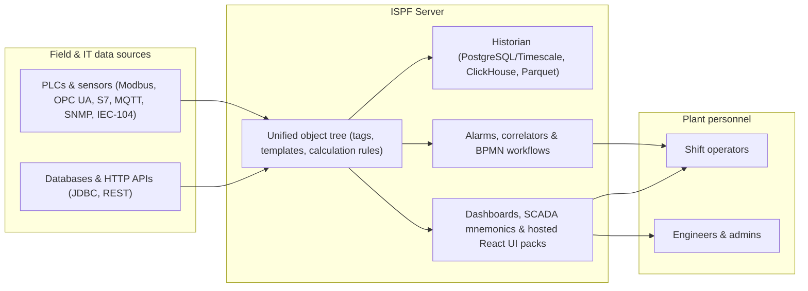
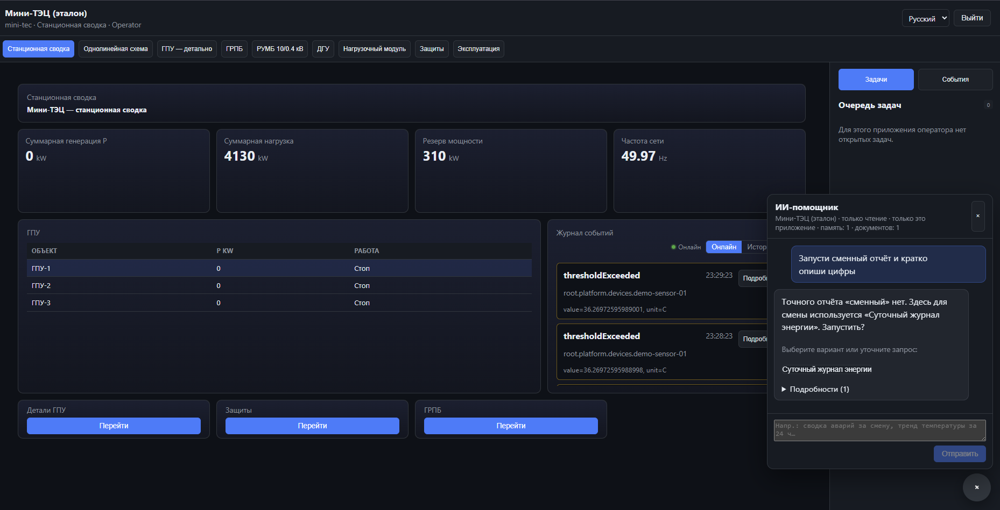

> **Language:** Canonical English. Russian edition: [ru/product.md](../ru/product.md).

# ISPF — Product Overview

> **Status:** Stable — product overview for engineers, operators, and decision-makers. Status tags: [doc-status.md](doc-status.md).

**ISPF (IoT Solutions Platform Framework)** is a self-hosted industrial automation, SCADA, IoT, and shop-floor (MES) platform. It combines equipment polling, real-time calculations, time-series history, threshold alarms, BPMN workflows, and operator screens on top of one unified object model — without requiring custom Java code in the platform core for each new site or industry.

New here? Start with **[How ISPF works](learn.md)** or jump straight to **[Getting started (15 minutes)](getting-started.md#try-ispf-15-minutes)**.

---

## Who uses ISPF

| Role | Typical daily work | Best starting page |
|------|--------------------|--------------------|
| **Shift operator / dispatcher** | Watching live screens and mnemonics, acknowledging alarms, completing shift tasks, viewing reports | [Operator guide](operator-guide.md) |
| **Automation / solution engineer** | Modelling plant objects, connecting drivers, writing formulas, building screens, packaging applications | [How ISPF works](learn.md) → [Solution developer guide](solution-developer-guide.md) |
| **Frontend developer (custom HMI)** | Building custom React web interfaces (`ui-pack`) backed by ISPF functions | [Custom React UI](external-ide.md) |
| **System administrator / DevOps** | Deploying servers or clusters, configuring PostgreSQL/ClickHouse, Keycloak SSO, backups, and monitoring | [Deployment](deployment.md) · [Security](security.md) |
| **Platform / driver developer** | Writing custom protocol drivers (`DeviceDriver` SPI) or extending the open-source core | [Driver DDK](driver-ddk.md) · [Architecture](architecture.md) |

---

## What problem ISPF solves

On a typical industrial site, teams end up integrating four or five separate products: a protocol gateway, a historian database, a SCADA/dashboard tool, an alarm engine, and a custom web backend for production accounting. Every tag rename or new line requires changes in all five places.

ISPF brings these layers together around **one hierarchical object tree** (`root.platform.*`) with a single REST + WebSocket API and role-based access model:

---

## Main capabilities

### 1. Unified object tree and templates (`Blueprints`)

Every entity — a PLC, a pumping station controller, a dashboard, a SCADA diagram, an alarm rule, or a BPMN workflow — is an addressable node in the tree (for example, `root.platform.devices.pump-01`).
- **Variables (`DataRecord`):** typed values (`DOUBLE`, `INTEGER`, `BOOLEAN`, `STRING`, `DATETIME`, tables) with optional quality flags (`GOOD`, `UNCERTAIN`, `BAD`) and time-series history.
- **Templates (`Blueprints`):** define a standard structure once and instantiate as many identical units (`INSTANCE`) or central controllers (`SINGLETON`) as needed.
- **Clean separation:** `DEVICE` nodes handle hardware drivers and raw tags; `SINGLETON` and `INSTANCE` nodes hold calculations and application functions.
Details: [Object model](object-model.md) · [Blueprints](blueprints.md).

### 2. Equipment and IT connectivity (drivers)

Pluggable driver packs connect industrial and IT protocols to `DEVICE` variables: Modbus TCP/RTU/UDP, OPC UA (client and server), Siemens S7, MQTT, SNMP, BACnet, IEC 60870-5-104, DNP3, EtherNet/IP, DLMS, HTTP, JDBC, and more. Each driver pack carries an explicit, test-verified maturity rating (`PRODUCTION` vs `BETA`, plus field-pilot checklists).
Details: [Device drivers](drivers.md) · [Driver DDK](driver-ddk.md).

### 3. Real-time calculations and time-series historian

- **Calculation rules (*binding rules*):** reactive or periodic rules written in Google **CEL** or built-in signal-processing functions (`scale`, `clamp`, `movingAvg`, `hysteresis`, `counterRate`, cross-object `read`).
- **Historian:** automatic recording of selected variables with configurable retention and aggregation (`1m`, `5m`, `1h`, shift `8h`). Scales from an embedded H2 file (laptop) to single-DB PostgreSQL/TimescaleDB, up to ClickHouse for high-rate streams and Parquet for multi-year archives.
Details: [Calculation rules](bindings.md) · [Variable history](variable-history.md) · [Historian tiers](historian-tiers.md).

### 4. Dashboards, SCADA mnemonics, and custom React apps

- **Dashboard Builder:** 84×8 grid layout with 40+ widget types (numeric cards, trends, gauges, master-detail object tables via `selectionKey`, Excel-like spreadsheets, reports, work queues).
- **SCADA Mimic Editor:** browser-based vector P&ID and single-line diagram editor with 218 industrial symbols bound directly to live variables and equipment commands.
- **Hosted React UI packs (`ui-pack`):** when a project requires a bespoke web interface (maps, 3D, complex MES boards), teams build a standalone React SPA in their IDE and serve it directly from ISPF at `/apps/<appId>/`.
Details: [Dashboards](dashboards.md) · [SCADA](scada.md) · [Widgets](widgets.md) · [Custom React UI](external-ide.md).

### 5. Alarms, event correlation, and BPMN workflows

- **Alert rules:** watch variables with CEL conditions, activation delays, hysteresis/latching (`deactivateExpr`), and webhook/email notifications.
- **Event correlators:** detect repeated events or multi-event sequences across a time window.
- **BPMN workflows:** visual process editor for automated actions (calling functions, setting tags, publishing messages) and human-in-the-loop tasks that appear in the operator's **Work Queue**.
Details: [Automation](automation.md) · [BPMN workflows](workflows.md).

### 6. Packaging applications without forking the server

Complete industry applications — isolated PostgreSQL tables (`migrations[]`), SQL/JSON backend functions (`functions[]`), object templates, screens, reports, and schedules — are packaged into a single JSON manifest (`bundle.json`), validated in CI (`ispf validate`), and deployed via REST API or Git sync.
Details: [Solution developer guide](solution-developer-guide.md) · [Applications API](applications.md).

### 7. Security, multi-site federation, and offline installs

- Role-based access control (`admin`, `operator`, custom roles) down to objects, variables, and functions; local login or enterprise SSO via OAuth2/Keycloak; optional TOTP MFA.
- Air-gapped installation bundles for isolated industrial networks.
- Clustering (HA) and hub-edge federation with store-and-forward buffering.
Details: [Security](security.md) · [Air-gap deployment](air-gap-deployment.md) · [Cluster](cluster.md) · [Federation](federation.md).

---

## Admin Console vs Operator HMI

ISPF serves two distinct interfaces from the same server depending on user role and URL:

| Mode | URL | Purpose |
|------|-----|---------|
| **Admin Console** | `http://<host>:8080` | Object tree explorer, device/rule inspectors, Dashboard Builder, SCADA Mimic Editor, BPMN Workflow Builder, system diagnostics |
| **Operator HMI** | `http://<host>:8080?mode=operator` | Clean full-screen view for shift personnel: read-only dashboards, interactive mimic controls, event log, and BPMN Work Queue |
| **Specific operator app** | `http://<host>:8080?mode=operator&app=<appId>` | Opens the navigation menu and default screen of a specific deployed application (or launches its hosted `/apps/<appId>/` UI pack) |

---

## Typical end-to-end scenarios

### 1. Equipment telemetry and alarm handling
1. An engineer creates a `DEVICE` node (for example, Modbus or MQTT), maps registers/topics to variables, and starts the driver.
2. A dashboard and P&ID mimic display live values and trends to the shift operator.
3. When temperature exceeds its threshold, an `ALERT` rule logs a critical event and starts a BPMN workflow.
4. A task appears in the operator's **Work Queue**; the operator claims the task, inspects the trend, acknowledges the alarm, and completes the step.

### 2. Deploying a shop-floor / terminal accounting app
1. A developer creates an application folder with SQL table migrations (`orders`, `batches`), JSON script functions (`listOrders`, `completeOrder`), and dashboards (or a React `ui-pack`).
2. `ispf pack` and `ispf validate --strict` verify the bundle before deployment.
3. `ispf deploy` (or `POST /api/v1/applications/<appId>/deploy`) provisions the isolated SQL schema, functions, and tree nodes in one step.
4. Operators sign in and work immediately at `?mode=operator&app=<appId>` or `/apps/<appId>/`.

---

## Technology stack and licensing

- **Backend:** Java 25, Spring Boot 4, PostgreSQL / TimescaleDB (H2 embedded for local evaluation; optional ClickHouse, NATS, MQTT, Keycloak).
- **Frontend:** React 19, TypeScript, Vite, REST + WebSocket (`WS /ws/objects`).
- **License:** Core platform (`main`) is licensed under **GNU AGPL v3**, with an optional commercial license for proprietary deployments. Driver packs and application bundles can carry separate licenses — see [License](license.md) and [Plugins](plugins.md).

Full documentation catalog: **[docs/en/readme.md](readme.md)**.
