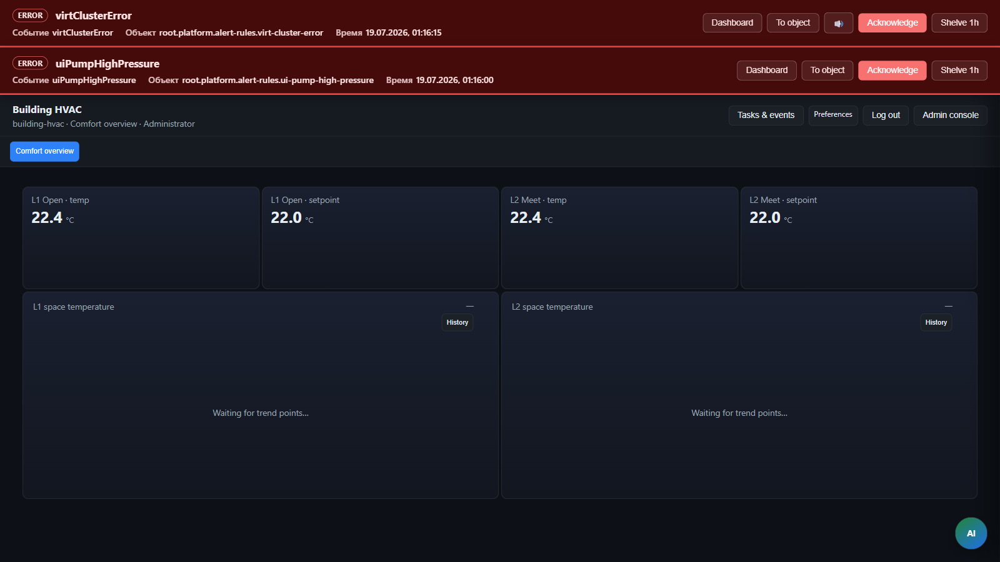

> **Language:** Canonical English. Russian edition: [ru/reference-building-hvac-walkthrough.md](../ru/reference-building-hvac-walkthrough.md).

# Reference Walkthrough: Building HVAC Comfort Zones (`building-hvac`)

> **Status:** Stable — compact reference bundle demonstrating floor climate zones, comfort setpoints, and Project Haystack semantic metadata. Status tags: [doc-status.md](doc-status.md).

The **`building-hvac`** bundle ([`examples/building-hvac-app/`](../../examples/building-hvac-app/)) demonstrates a multi-zone building climate monitoring application built without custom Java in `ispf-server`.

---

## 1. Domain Overview



| Component | Description |
|-----------|-------------|
| **Climate Zone Table** (`hvac_zone`) | Floor zone code (`L1-OPEN-01`, `L2-MEET-02`), space temperature, comfort setpoint, and operating mode (`cool` / `heat`) |
| **Application Logic Hub (`SINGLETON`)** | `root.platform.singleton-blueprints.building-hvac-app-hub-v1` — hosts BFF function `hvac_listZones` |
| **Semantic Tags** (`metadata.haystackTags`) | Standard Project Haystack markers (`site`, `equip`, `ahu`, `zone`, `temp`) |
| **Operator Workspace** | Opens at `/?mode=operator&app=building-hvac` |

---

## 2. Deployment and Verification

Deploy the bundle via **System → Solutions** in the Web Console or via HTTP:

```bash
curl -s -X POST http://localhost:8080/api/v1/applications/building-hvac/deploy \
  -H "Content-Type: application/json" \
  --data-binary @examples/building-hvac-app/bundle.json
```

Run the automated test:

```bash
./gradlew :packages:ispf-server:test --tests com.ispf.server.application.BuildingHvacBundleSmokeTest
```
