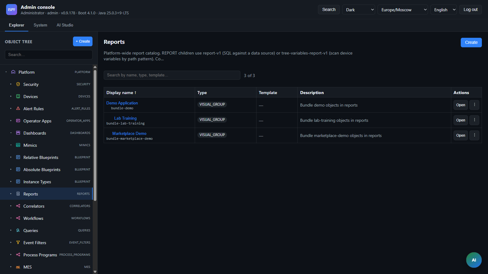

> **Language:** Canonical English. Russian edition: [ru/reports.md](../ru/reports.md).

# Reports (`REPORT`)

> **Status:** Stable — read-only SQL reports, cross-device tree-variable reports, and XLSX/PDF/HTML/CSV template exports. Status tags: [doc-status.md](doc-status.md).

Reports in ISPF are stored as object tree nodes of type **`REPORT`** under `root.platform.reports.*` (model `report-v1`). SQL reports execute read-only queries (`SELECT` / `WITH`) against a linked **`DATA_SOURCE`** (`root.platform.data-sources.*`) — such as your application's isolated SQL schema or an external relational database.

---

## 1. `REPORT` Node Structure in the Object Tree



| Tree Path | Node Type | Blueprint Model |
|-----------|-----------|-----------------|
| `root.platform.reports` | `REPORTS` | Report catalog folder |
| `root.platform.reports.<reportId>` | `REPORT` | `report-v1` (or `tree-variables-report-v1`) |

### SQL Report Variables (`report-v1`)

| Variable | Purpose |
|----------|---------|
| `title` | Display title of the report |
| `dataSourcePath` | Path to the `DATA_SOURCE` node (`root.platform.data-sources.*`) |
| `query` | Read-only SQL query (`SELECT` or `WITH`; mutating statements are rejected) |
| `parameters` | JSON array of positional `?` parameter names |
| `columns` | JSON array of `{ "field", "label" }` column definitions |
| `defaultParameters` | JSON object of default parameter values |
| `maxRows` | Maximum rows returned (default `1000`) |
| `refreshIntervalMs` | Auto-refresh interval in the UI in ms (default `30000`) |
| `templateFormat` | Optional attached template format: `xlsx`, `docx`, `html` (empty = tabular output without a template) |

Binary print templates are stored in the `report_templates` table. Double-clicking a `REPORT` node in the Admin Console opens the visual **Report Builder** with live SQL preview, column configuration, and template upload.

### Tree-Variables Report (`tree-variables-report-v1`)

Collects a summary table of a variable across multiple devices in the object tree without writing SQL:
- `reportType`: `"tree-variables"`
- `devicePathPattern`: path prefix or wildcard glob (`*`, `?`), e.g. `root.platform.devices.lab-*`
- `variableName`: variable name to read from each matching node
- `columns`: JSON array of `{ "field", "label" }`

---

## 2. Running and Exporting Reports via REST API

```http
GET    /api/v1/reports/by-path?path=root.platform.reports.ready-items
PUT    /api/v1/reports/by-path/definition?path=...
PUT    /api/v1/reports/by-path/tree-variables-definition?path=...
POST   /api/v1/reports/by-path/run?path=root.platform.reports.ready-items
GET    /api/v1/reports/by-path/export?path=...&format=csv|pdf|xlsx|html
POST   /api/v1/reports/by-path/template?path=...&format=xlsx   (multipart file)
GET    /api/v1/reports/by-path/template?path=...
DELETE /api/v1/reports/by-path/template?path=...
```

Example run request with parameters:

```http
POST /api/v1/reports/by-path/run?path=root.platform.reports.ready-items
Content-Type: application/json

{ "parameters": { "status": "ready" } }
```

---

## 3. Spreadsheet Print Templates (`Band1`, [ADR-0053](decisions/0053-ispf-template-filler.md))

Spreadsheet report templates are filled by the built-in **ISPF Template Filler** (Apache POI):
1. Create an `.xlsx` template with a named range **`Band1`** containing placeholders `${Band1.COLUMN_NAME}` (SQL column names in uppercase, e.g. `${Band1.ITEM_CODE}`).
2. Upload the template on the **Report template** tab in the Report Builder (`POST .../template?format=xlsx`).
3. Export the filled report via `GET .../export?format=xlsx|pdf|html`.

Even without an uploaded template, every report supports instant export to `CSV`, tabular `XLSX`, `HTML`, and `PDF`.

---

## 4. Packaging Reports in `bundle.json` and Displaying on Dashboards

Include `reports[]` in your application's `bundle.json` to register reports under `root.platform.reports.<reportId>`:

```json
{
  "reports": [
    {
      "reportId": "ready-items",
      "title": "Ready Items",
      "query": "SELECT item_code, status FROM demo_item WHERE status = ?",
      "parameters": ["status"],
      "columns": [
        { "field": "item_code", "label": "Code" },
        { "field": "status", "label": "Status" }
      ],
      "maxRows": 500
    }
  ]
}
```

On operator dashboards, use the **`report`** widget (`reportPath`, `parametersJson`, `contextParamsJson`, and export buttons `showCsv`, `showXlsx`, `showPdf`, `showHtml`).

**Related guides:** [Application solutions (`applications.md`)](applications.md) · [Dashboards](dashboards.md) · [Widget reference](widgets.md).
