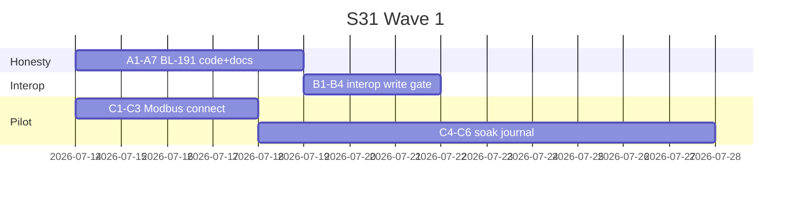

> **Language:** Canonical English. Russian edition: [ru/roadmap.md](../ru/roadmap.md).

# ISPF Platform Roadmap

> **Status:** Charter — phases and backlog. Hub: [doc-status.md](doc-status.md).

Single source of truth for the platform path: phases, sprints, REQ-PF/FW, BL IDs. **One file** — append new phases here; do not split into `roadmap-phase-N.md`.

| | |
| --- | --- |
| **Baseline** | `main`, July 2026 |
| **Updated** | 2026-11-24 (Post-S33 field soaks / pilots parked — not on active plan) |
| **Product direction** | Self-hosted industrial application platform — object tree + SCADA HMI + automation + apps + AI ([architecture](architecture.md)) |

---

## How to read this document

This file tells the **path** of ISPF: where the platform came from, where it is, and where it is going.

1. **[Where we are going](#where-we-are-going)** — product intent and the 10/10 bar.
2. **[Where we are](#where-we-are)** — summary counts and current focus.
3. **[Execution policy](#execution-policy--quality-over-features)** — quality over feature surface.
4. **[Platform path](#platform-path)** — four eras from foundation to domain maturity.
5. **[Next 90 days](#next-90-days)** — active plan.
6. **[Definition of Done](#definition-of-done--1010-overall)** and **[Quality path](#quality-path-to-done)** — how Done is earned.
7. **[Appendices](#appendices)** — REQ / sprint / BL registries for traceability.

Russian readers: [ru/roadmap.md](../ru/roadmap.md) mirrors this path narrative; **this English file remains canonical for statuses**.

---

## Conventions

### Identifiers

| Prefix | Meaning | Example |
| ------ | ------- | ------- |
| **Phase N** | Thematic roadmap wave | Phase 23, Phase 29 |
| **Sprint SN** | Delivery unit (~2 weeks), unified numbering | S01, S31 |
| **HFNN** | Hotfix outside a sprint | HF01 |
| **BL-NN** | Code-audit / excellence task | BL-80, BL-177 |
| **PF-NN / FW-NN** | Application-platform / framework requirement | PF-03 |

> **BL-140+ numbering.** The closed cluster table (S19) historically used BL-140…146. The **maturity program** (Phases 25–33) reuses those numbers for **different** tasks. Closed summary count = BL-01…139; active maturity registry = BL-140…225.

### Statuses (uniform everywhere)

| Status | Meaning |
| ------ | ------- |
| **Done** | Acceptance complete with evidence |
| **Partial** | Foundation in place; tail open (field, soak, live gate, stub) |
| **In progress** | Active work |
| **Planned** | Not started or charter-only |
| **Cancelled** | Cancelled / superseded |
| **Parked / Deferred** | Not on the active plan until a named trigger |
| **Ops** | Runbook ready; rollout on request |

### Legacy mapping → Sprint SN

| Was | Now |
| --- | --- |
| EX-1…EX-18 | S01…S18 |
| EX-INGRESS-01 | HF01 |
| EX0…EX4 (acceleration) | S19…S23 |

---

## Where we are going

ISPF is a **self-hosted industrial application platform**: one object tree, OT/IT drivers, operator HMI, automation (events, BPMN subset), apps with BFF, marketplace, and an AI layer for integrator speed.

The maturity program (Phases 25–33) aims for **10/10** across IoT / SCADA / MES / ERP Level 4 / analytics versus mature commercial platforms. That bar is not a feature checklist — it is a **usable** product: field OT, live ERP when needed, operator HMI, honest scorecard. See [Definition of Done](#definition-of-done--1010-overall) and [competitive-scorecard](competitive-scorecard.md).

ISPF is **not** a full ERP (SAP/1C) and **not** “Opcenter in the core”. Level 4 means reliable ISA-95 connectors; MES means first-class objects + certified bundles + field sites.

---

## Where we are

**As of 2026-09-09** · platform **0.9.207** · code-verified score **~8.0/10** ([competitive-scorecard](competitive-scorecard.md)).

| Category | Total | Done | Partial | Planned | Cancelled |
| -------- | ----- | ---- | ------- | ------- | --------- |
| REQ-PF | 13 | 13 | 0 | 0 | 0 |
| REQ-FW | 20 | 20 | 0 | 0 | 0 |
| BL-01…139 | 139 | 138 | 0 | 0 | 1 |
| BL-140…225 | 77 | 35 | 37 | 5 | 0 |
| Phase 0–24 | 25 | 25 | 0 | — | — |
| Phase 25–33 | 9 | 0 | 9 | 0 | — |
| Sprint S01–S30 | 30 | 30 | 0 | 0 | — |
| Sprint S31–S46 | 16 | 0 | 16 | 0 | — |

**How to read Summary.** Phase 25–33 rows stay **Partial** until field/customer close-out ([parked-backlog](parked-backlog.md)). Many **BL inside those phases are Done in lab** — see [Phases 25–33 at a glance](#phases-2533-at-a-glance). Summary Done=0 for phases is **not** “nothing shipped”. Prefer the [maturity registry](#bl-140225--full-registry) for item-level truth. Non-claims: [known-limitations](known-limitations.md).

**Current focus:** **quality over features** — harden what shipped when a bug, honesty gap, or named customer blocker appears; no new capability surface by default. **No active field-soak / pilot campaign.** AI Autopilot harness is Done (BL-177…180; live smoke opt-in `ISPF_LLM_SMOKE`). Post-S33 field tracks (AI soak, MES plant, HMI tablet, OT plant sign-off) are **parked** — [parked-backlog](parked-backlog.md). Also parked: live ERP (BL-169), BPMN/DMN beyond [ADR-0047](decisions/0047-custom-bpmn-subset-engine.md), WebAuthn (BL-194 / ADR-0056).

**Closed:** BL-01…139 (BL-112 Cancelled); Phases 0–24. **Active backlog:** BL-140…225 (new rows only for named customer blockers or honesty/hardening).

Acceleration: [acceleration-program](acceleration-program.md). VPS deploy — on request ([deployment](deployment.md), `deploy/vps-deploy-direct.ps1`).

---

## Execution policy — quality over features {#execution-policy--quality-over-features}

**Decision (2026-07-19):** concentrate on the **quality and honesty** of capabilities already in the product. Do **not** expand the feature surface (new BPMN elements, new phases, new product lines) unless a **named customer blocker** requires it.

| Default work | Not default |
| ------------ | ----------- |
| Bugs, flaky gates, stub honesty, runbooks, CI honesty | New element types / engines “for completeness” |
| Partial → Done with **REAL** evidence when unparking ([Quality path](#quality-path-to-done)) | Silent parser growth, Camunda/Flowable embed, full BPMN 2.0 |
| Scorecard / docs / UX truthfulness | Parallel greenfield waves that widen scope; unscheduled field soak campaigns |

**Rules:**

1. **Harden first** — bugs, flaky gates, stub honesty, and operator/integrator runbooks beat new BL IDs. Field soaks are **not** an open delivery queue.
2. **No silent scope growth** — new BPMN element types, DMN, or engine swap require a **new ADR**; subset freeze ([ADR-0047](decisions/0047-custom-bpmn-subset-engine.md)) stays until then.
3. **Parked stays parked** — live ERP (BL-169), WebAuthn, and Post-S33 field tracks (AI / MES / HMI / OT plant) resume only with a named customer or site task ([ready-for-field](field-pilot-playbook.md#ready-for-field-gate-policy)). Board: [parked-backlog.md](parked-backlog.md).
4. **New BL / phase rows** — only for customer blocker, compliance gate, or closing an honesty gap — not competitive checklist width.

This policy does **not** cancel the 10/10 Definition of Done; it changes **order of attack**: usable depth on what exists before more surface.

---

## Platform path

Four eras. Closed eras are not reopened; active work is Era IV plus hardening policy.

### Era I — Foundation (Phases 0–22) · Done

Core platform: object tree, driver SPI, HMI, BPMN, REQ-PF/FW, OIDC, Timescale, NATS, federation foundations, i18n, code audit, time/TZ, AI tail.

| Block | What shipped |
| ----- | ------------ |
| Phases 0–5 | CI stabilization, application-platform closure, production gates (Keycloak, Timescale, ACL, NATS), connectivity & HMI, federation/multi-tenant spikes, model/function/event/bundle hardening |
| Phases 6–17 | v0.3 production, federation auth/tunnel/bind, catalogs, reports, REQ-FW (ADR, licensing, AI layer) |
| Phases 18–22 | Frontend e2e, i18n en/ru/de/zh, UI/driver/scale audit (BL-01…65), time & TZ (BL-66…71), hardening + AI (BL-72…77, ClickHouse dual-write) |

<details>
<summary>Phase 0–22 compact table</summary>

| Phase | Theme | Status |
| ----- | ----- | ------ |
| 0 | Stabilization | Done |
| 1 | Application platform closure | Done |
| 2 | Production gates | Done |
| 3 | Connectivity & HMI | Done |
| 4 | Scale & topology | Done |
| 5 | Mechanism hardening | Done |
| 6–17 | v0.3, federation, catalogs, REQ-FW | Done |
| 18 | Frontend e2e | Done |
| 19 | Web Console i18n | Done |
| 20 | Code audit (UI, drivers, scale) | Done |
| 21 | Time & timezones | Done |
| 22 | Hardening & AI tail | Done |

</details>

REQ-PF and REQ-FW are fully Done — [Appendix A](#appendix-a--req-pf--req-fw).

### Era II — Excellence / REQ-EX (Phase 23, S01–S26) · Done

Strategic wave: driver/alarm trust, operator HMI/PWA, AI production, Haystack/Brick semantics, app velocity, edge/federation, horizontal cluster, MES wave, multi-tenant, acceleration sprints.

| Axis | Track | Readiness |
| ---- | ----- | --------- |
| Object model | EX-MODEL | Done |
| SCADA HMI | EX-HMI | Done |
| Driver depth | EX-DRIVER | Done |
| Workflow / MES | EX-MES | Done |
| Application platform | EX-APP | Done |
| Edge + federation | EX-FED | Done |
| Telemetry scale | EX-SCALE | Done |

Sprints **S01–S26** and **HF01** (elastic ingress) are **Done**. Registry: [Appendix B](#appendix-b--sprint-registry).

### Era III — Wave close-out (Phase 24, S27–S30) · Done

Post-S26, closed **2026-07-07**.

| Sprint | Theme | Outcome |
| ------ | ----- | ------- |
| **S27** | Federation hardening | Chaos e2e, flaky budget, nightly gates |
| **S28** | Ingress + historian | ClickHouse dual-write on VPS |
| **S29** | HMI close-out | WCAG / Lighthouse operator gates |
| **S30** | Registry / compliance | RU software registry entry **№ 35836** |

### Era IV — Domain maturity (Phases 25–33) · Open (phases Partial)

Excellence program: OT → HMI → Security → Historian → MES → Automation → AI → Ecosystem → Analytics. Many BL are **Done in lab**; phases stay Partial until field/customer close-out.

#### Phases 25–33 at a glance {#phases-2533-at-a-glance}

| Phase | Theme | Done highlights | Still open |
| ----- | ----- | --------------- | ---------- |
| **25** OT Trust | Drivers / edge | BL-141 interop; **BL-191 honesty Done**; lab catalog **162/162**; BL-143/144/145 **lab Done** | BL-140 field Done / edge 30d — **parked** (`P-OT`); lab soak stopped 2026-09-14 |
| **26** HMI | Mimics / operator | BL-146…152 Done (CI FPS @55; LH≥95 ops stretch) | — |
| **27** Security | MFA / tenancy | BL-153…158 Done; TOTP GA; SaaS tenant-admin + PG RLS | WebAuthn → BL-194 **Parked** |
| **28** Historian | Tiers / SLA | BL-159…163 **Done** | Enterprise L 1B CH optional |
| **29** MES / ERP L4 | ISA-95 | BL-164…168, 170, 193, 220…225 Done on `mes-platform` / patterns | Plant pilot **parked** (`P-MES-FIELD`); **live ERP (BL-169) deferred** |
| **30** Automation | CEP / BPMN | BL-171…176 Done | DMN / further BPMN **blocked** without customer + ADR |
| **31** AI | Autopilot | BL-177…182 Done (BL-178 52/52 @100%) | Soft &lt;15 min / field soak — **parked** (`P-AI-FIELD`); live smoke = `ISPF_LLM_SMOKE` |
| **32** Ecosystem | Marketplace | BL-183…190 usable paths Done | External partners / signed packs in the field |
| **33** Analytics | AF-capable | BL-201…216 largely Done | BL-200 charter row Planned |

Program goal: **10/10** on IoT / SCADA / MES / ERP L4 / analytics. Statuses and BL IDs live **only in this file**; companion charters (e.g. [analytics-platform-roadmap](analytics-platform-roadmap.md)) do not own status.

#### Competitive slice

Scale 1–10 vs Ignition / Kepware / PI / Opcenter / Tulip. Full matrix: [competitive-scorecard](competitive-scorecard.md).

| Dimension | Baseline | Code-verified | Target | Phase |
| --------- | :------: | :-----------: | :----: | ----- |
| Unified data model | 9.0 | **8.5** | 10 | 25, 29, 30 |
| SCADA / HMI | 7.0 | **8.0** | 10 | 26 |
| OT/IT drivers | 6.0 | **7.0** | 10 | 25 |
| Historian | 7.0 | **9.5** | 10 | 28 |
| Automation / alarms | 7.5 | **7.5** | 10 | 27, 30 |
| Workflow / BPMN | 6.5 | **7.5** | 10 | 30 |
| MES / ISA-95 | 5.5 | **6.5** | 10 | 29 |
| Low-code velocity | 8.0 | **8.0** | 10 | 26, 31 |
| AI-assisted development | 9.0 | **9.0** | 10 | 31 |
| Security / RBAC / tenancy | 6.5 | **8.5** | 10 | 27 |
| Deploy / scale / edge | 8.0 | **7.5** | 10 | 25, 28, 32 |
| Ecosystem / marketplace | 4.0 | **6.5** | 10 | 32 |
| Documentation / DX | 9.0 | **8.5** | 10 | 32 |
| Stack modernity | 9.0 | **9.5** | 10 | maintain |

**Overall code-verified: ~8.0/10.**

#### Priorities when resources are limited

Default: [quality over features](#execution-policy--quality-over-features).

| Priority | Focus | Why |
| -------- | ----- | --- |
| **P0** | Harden shipped paths (on demand) | Bugs, flaky gates, runbooks, stub honesty — not an open soak queue |
| **P2** | Security / Historian / Analytics / compliance | Tenders & scale; WebAuthn only if required |
| **P3** | Automation depth / Ecosystem | BPMN subset frozen; partners on existing marketplace |
| **Parked** | Live ERP BL-169; WebAuthn BL-194 | Named task only |
| **Parked** | Post-S33 field tracks | AI soak (`P-AI-FIELD`), MES plant (`P-MES-FIELD`), HMI tablet (`P-HMI-FIELD`), OT plant (`P-OT`) — named site only |

#### Domain gap audit (2026-07-09)

Strong application platform; leadership still needs **industrial depth** (honest OT field, live ERP, field MES, field HMI soak) — not another feature layer.

| Domain | Today | Missing for leadership |
| ------ | ----- | ---------------------- |
| **IoT** | Object tree, 58+ `driverId`, MQTT/Modbus/OPC UA/S7 | Field PRODUCTION trust, edge soak |
| **SCADA** | Mimic 218 symbols, builder, alerts, BPMN | Field live FPS / offline gates |
| **MES** | `WORK_ORDER`/`LOT`/OEE + reference bundles | Field plants |
| **ERP L4** | Outbox + SQL reports | Live 1C/SAP adapters (BL-169 deferred) |

Full maturity registry: [Appendix C](#appendix-c--maturity-program-registry). Phase acceptance detail: [Appendix D](#appendix-d--phases-2533-detail).

#### Who we overtake

| Competitor class | Their strength | Our counter |
| ---------------- | -------------- | ----------- |
| Connectivity hub | 150+ protocols | BL-140…145 OT Trust |
| SCADA suite | HMI + marketplace | BL-146…152 + BL-183 |
| Historian | Petabyte + AF | BL-159…163, 200… |
| MES suite | Full modules | BL-164…170, 220… |
| Shop-floor low-code | Apps in hours | BL-177…180 AI |
| Enterprise IAM | MFA, fine ACL | BL-153…157 |
| Cloud IoT SaaS | Multi-tenant | BL-155 + BL-186 |

---

## Next 90 days {#next-90-days}

Aligned with execution policy. **No scheduled feature wave and no scheduled field-soak campaign.** Live ERP (BL-169), BPMN depth beyond ADR-0047, and Post-S33 field tracks remain **parked**. AI Autopilot harness is Done. Claiming OT / MES / HMI / AI **field Done** stays blocked until a named site unparks the matching [parked-backlog](parked-backlog.md) row.

| Sprint | Timeline | Scope |
| ------ | -------- | ----- |
| **S31** | Jul–Aug 2026 | BL-177/178 **Done** (52/52 live suite; multi-app smoke; live needs `ISPF_LLM_SMOKE`) |
| **S32** | Aug 2026 | BL-180 **Done** (multi-domain live apply); BL-179 continuity Done |
| **S33** | Sep 2026 | BL-193 genealogy lite **Done** |
| **Post-S33** | **Parked** (2026-11-24) | Do **not** run as an open queue: [AI field soak](ai-field-soak-playbook.md) · [MES field pilot](mes-field-pilot-playbook.md) · [HMI offline soak](hmi-offline-field-soak.md) · OT plant sign-off — see `P-AI-FIELD` / `P-MES-FIELD` / `P-HMI-FIELD` / `P-OT` |

OT Wave 1 checklist (parked): [S31 execution backlog](#s31-wave-1-execution-backlog). Draft S31–S46: [Appendix B](#appendix-b--sprint-registry).

---

## Definition of Done — 10/10 overall {#definition-of-done--1010-overall}

Product is **10/10** when **all** of the following hold simultaneously:

1. **20 PRODUCTION drivers** with interop CI and **3 field pilots signed** — **not met** (BL-140 Partial; field per named task / soak sign-off).
2. **MES bundle** — OEE + work orders + quality without custom Java; **at least one live ERP connector** (BL-169) — not stub-only.
3. **AI agent** — ≥95% regression with **live LLM**, deploy without edits — **met** for BL bar (52/52; opt-in `ISPF_LLM_SMOKE`).
4. **Historian** — turnkey 3-tier + scale gates; AF-capable analytics (BL-200…).
5. **Security** — MFA + per-variable ACL + hard-tenancy option (BL-153…155).
6. **HMI** — mimic 500 el CI ≥55 FPS (**Done**), offline PWA 8h (BL-151, 152); stretch live ≥60 = ops.
7. **Marketplace** — 10+ signed packs, 3 external partners (BL-183, 184).
8. **Scorecard** — 14 dimensions ≥9.5 — **not met** (~8.0/10).
9. **OT honesty** — no stub labeled PRODUCTION (BL-191 honesty scope **Done**; field residual open).
10. **Compliance pack** — IEC 62443 / GAMP-lite docs (BL-192) — **met** as documentation pack, **not** product certification.

Premature Done without code-verified gates was retracted. **Usable Done** is below.

---

## Quality path to Done — usable product, not checkboxes {#quality-path-to-done}

**Goal:** Phases 25–33 close when a **real integrator + real operator + real OT engineer** can run production scenarios without core-team hand-holding.

### Principles

| # | Principle | Rejects |
| - | --------- | ------- |
| 1 | **REAL evidence** — runtime + automated test + reproducible runbook | `mode: stub`, in-memory-only GA |
| 2 | **Human sign-off** on the hot path | Self-certified Done without journal |
| 3 | **Live gates** where live behaviour is claimed | Mocked FPS, schema-only agent CI, ERP `simulated` |
| 4 | **Honest maturity** — PRODUCTION matches code | **Met (BL-191)** for honesty scope |
| 5 | **Third-party repeatability** | Demo only on maintainer laptop |
| 6 | **Field or lab SLO** | Screenshot without CI regression |

Evidence classes: **REAL** / **PARTIAL** / **STUB**. Only **REAL** promotes Partial → **Done**.

### When a BL may move Partial → Done

1. Acceptance criteria on a **prod-like** profile.
2. Integration/e2e test in CI with **no stub** on the path under test.
3. Integrator runbook (steps, rollback, limits).
4. Scorecard updated with file paths + test names.
5. No open **P0 honesty** issue in that domain.

### Four waves (order of attack)

| Wave | Focus | State |
| ---- | ----- | ----- |
| **1** | OT trust you can deploy (Phase 25 + BL-191) | Lab track active — see [S31 backlog](#s31-wave-1-execution-backlog); field Done open |
| **2** | Operator HMI (Phase 26 + shelving) | Lab Done; field soak **parked** (`P-HMI-FIELD`) |
| **3** | Plant + business loop (historian, MES, ERP) | MES lab Done; live ERP deferred; plant sites **parked** (`P-MES-FIELD`) |
| **4** | Moat + scale (AI, analytics, ecosystem, security) | AI harness Done; AI field soak **parked** (`P-AI-FIELD`); partners / scorecard not a soak queue |

#### Wave 1 — OT trust you can deploy

| Usable outcome | Evidence | BL |
| -------------- | -------- | -- |
| Integrator connects plant without middleware | 3 pilots **7-day soak** + incident journal — [field-pilot-playbook](field-pilot-playbook.md) | BL-140, 141, 191 |
| Writes and quality flags trusted | Interop CI write round-trip; matrix matches code | BL-141, 191 |
| Edge survives disconnect | Store-forward + reconnect; federation sync measured | BL-145 |

**Not Done if:** only Docker interop smoke; PRODUCTION on stub; no pilot journal.

### S31 execution backlog — Wave 1 (parked) {#s31-wave-1-execution-backlog}

> **Status: field track active (2026-09-06)** — Lab honesty (A) + interop depth (B) + catalog waves closed on `main`. **Workstream C:** [Pilot #1](../evidence/ot-trust/2026-09-06-bl140-pilot1-lab-day1.md) C1 filled on `lab-ot-vlan-192.168.100`, §1 green, soak day 1 logged; days 2–7 + C5 + sign-off remain. Same policy as [ready-for-field gate](field-pilot-playbook.md#ready-for-field-gate-policy).

**Sprint goal (usable):** OT engineer trusts the driver matrix; **one Modbus plant pilot** is running with a daily soak journal — not «BL-191 closed» without code + pilot evidence.

**Exit gate (S31 Done):**

| Gate | Evidence |
| ---- | -------- |
| Matrix honest | Zero `PRODUCTION` entries whose driver class is documented stub; CI test green |
| Interop trusted | Write round-trip in `driver-interop-smoke.sh` for `modbus-tcp`, `mqtt`, `opcua` |
| Pilot started | Modbus scenario: site named, journal day 1–3 logged, checklist §1 in progress |
| Scorecard | [competitive-scorecard](competitive-scorecard.md) dim 3 updated with file paths |

#### Workstream A — BL-191 matrix honesty (code)

| # | Task | Owner | Files / tests | Done when |
| - | ---- | ----- | ------------- | --------- |
| A1 | **Decision record:** DNP3 — downgrade to `BETA` in S31 (write is `throw` today) **or** spike `writePoint` with stepfunc loopback | OT lead | `Dnp3DeviceDriver.java`, ADR note | Recorded in PR + matrix |
| A2 | Downgrade **`opc-da`** to `BETA`; remove from `TOP_20_INDUSTRIAL` or exempt in test with comment | Dev | `DriverProductionMatrix.java` | `resolveMaturity("opc-da") == BETA` |
| A3 | Downgrade **`opc-bridge`** to `BETA` (class logs «stub ready») | Dev | same | Not PRODUCTION |
| A4 | Audit **read-only PRODUCTION** drivers: `dnp3`, `ethernet-ip`, `http`, `snmp`, `gps-tracker` — capabilities = `POLL_ONLY` only (no `WRITE` in matrix) | Dev | matrix `Capability` sets | No false WRITE claim |
| A5 | Add CI gate **`productionDriversMustNotBeDocumentedStubs`** | Dev | `DriverProductionMatrixTest.java` | Fails if stub javadoc + PRODUCTION |
| A6 | Regenerate / update driver catalog maturity column | Dev | `docs/en/drivers.md`, `docs/ru/drivers.md` | Matches matrix |
| A7 | Update promotion checklist — stub never PRODUCTION | Docs | `driver-promotion.md` | Explicit rule |

**Code anchors today:**

```149:151:packages/ispf-server-driver/src/main/java/com/ispf/server/driver/DriverProductionMatrix.java
            entry("opc-da", DriverMaturity.PRODUCTION, POLL_ONLY,
                    testPath("ispf-driver-opc-da", "com.ispf.driver.opcda.OpcDaDeviceDriverTest"),
                    "ispf-driver-opc-da"),
```

```121:123:packages/ispf-driver-dnp3/src/main/java/com/ispf/driver/dnp3/Dnp3DeviceDriver.java
    public void writePoint(String pointId, DataRecord value) throws DriverException {
        throw new DriverException("DNP3 write not implemented");
    }
```

#### Workstream B — BL-141 interop hardening

| # | Task | Owner | Files / tests | Done when |
| - | ---- | ----- | ------------- | --------- |
| B1 | Extend smoke: **FC16 / MQTT publish / OPC UA write** round-trip | Dev | `deploy/tools/driver-interop-smoke.sh` + writable `modbus/server.py` | Exit 0 on compose up (**hardening on #144**) |
| B2 | CI workflow publishes fixture smoke summary artifact | DevOps | `.github/workflows/driver-interop.yml` | Artifact on PR/main |
| B3 | Document read-only vs write drivers in interop lab | Docs | `driver-interop-lab.md` | Table matches post-BL-191 matrix (**updated**) |
| B4 | Local gate before pilot: `docker compose … up` + `driver-interop-smoke.sh` in integrator runbook | Integrator | [field-pilot-playbook](field-pilot-playbook.md) §1 dry-run | Checklist linked |

#### Workstream C — BL-140 pilot #1 (Modbus plant)

| # | Task | Owner | Files / tests | Done when |
| - | ---- | ----- | ------------- | --------- |
| C1 | **Select site:** customer or internal lab VLAN; name pilot lead + OT contact | PM | Ticket / journal header | Names in journal |
| C2 | Device config: `modbus-tcp`, 50+ tags, historian on top 5 | Integrator | ISPF device admin | Status `RUNNING` |
| C3 | Validation §1 checklist (connect, read, write, historian, HMI) | Integrator | playbook §1 | All ☐ → ☑ |
| C4 | **7-day soak:** daily journal row (uptime, incidents, tag count) | OT + integrator | [pilot soak journal](#pilot-soak-journal) below | ≥3 days logged in S31 |
| C5 | Stale alarm rule: disconnect PLC/broker once; verify operator badge | Integrator | alarm rule + mimic | Screenshot in journal |
| C6 | Sign-off template drafted (end date T+7) | QA | playbook § Pilot sign-off | Template attached to ticket |

**Recommended first pilot:** Modbus plant — simplest dry-run (`deploy/driver-interop`), no UA security policy negotiation.

#### Workstream D — BL-145 edge (stretch, not S31 blocker)

| # | Task | Owner | Done when |
| - | ---- | ----- | --------- |
| D1 | Scripted disconnect: stop upstream 15 min, verify store-forward buffer | Edge | Log excerpt in journal |
| D2 | Federation reconnect: measure sync lag after restore | Edge | Number in `federation.md` appendix |

Defer **30-day edge soak** to S33; Wave 1 only needs evidence that disconnect path was exercised once.

#### Pilot soak journal {#pilot-soak-journal}

Copy into customer ticket or `docs/` appendix. One table per pilot ([field-pilot-playbook](field-pilot-playbook.md) § Close-out).

| Day | Date | Tags online | Incidents (P0/P1) | Historian OK | Notes |
| --- | ---- | ----------- | ------------------- | ------------ | ----- |
| 1 | | | | ☐ | |
| 2 | | | | ☐ | |
| … | | | | ☐ | |
| 7 | | | | ☐ | Ready for sign-off |

**S31 does not close BL-140 field Done** — that needs 7 full days + customer OT signature. S31 closes when matrix is honest, interop write gate is green, and **pilot day 1–3** are logged with no open P0 driver defects.

#### S31 ordering (2 weeks)



Week 1: A1–A7 + B1–B2 + C1–C3. Week 2: B3–B4 + C4–C6 + D1 if capacity.

---


#### Wave 2 — Operator HMI

| Usable outcome | Evidence | BL |
| -------------- | -------- | -- |
| Operator runs **8 h** on cached HMI | PWA offline; sync without data loss | BL-151 |
| Mimic usable on real wall | **500 el ≥55 FPS** CI + WS path (**Done**); stretch unmocked ≥60 = ops | BL-152 |
| Shelving survives restart | Persistent shelf + approval | BL-158 |

**Not Done if:** Lighthouse/axe only; mocked e2e; shelf lost on restart.

#### Wave 3 — Plant + business loop

| Usable outcome | Evidence | BL |
| -------------- | -------- | -- |
| Historian at scale | 1M-point query **&lt;2 s** in CI; tiers hot→warm→cold | BL-159, 161, 202 — **Done** |
| MES on real contour | **One production site**: OEE + dispatch + quality | BL-164…170, 193 |
| ERP is not an island | **Live 1C or SAP** round-trip | BL-169 |
| Derived tag drives action | Analytics tag → variable → alarm | BL-203, 204 |

**Not Done if:** outbox only `simulated`; MES only GA smoke; historian SLA not in CI.

#### Wave 4 — Moat + scale

| Usable outcome | Evidence | BL |
| -------------- | -------- | -- |
| AI builds deployable app | Spec → bundle → operator UI **&lt;2 h**, live LLM, ≥95% regression | BL-177, 178, 180 |
| Analytics enterprise tier | 10 tags × 7d p95; 50k-tag lab documented | BL-206, 210 |
| Ecosystem without core team | **3 external partners**; **10+** listings | BL-183, 184 |
| Security tender-ready | Hard tenancy A≠B; per-var ACL; MFA; compliance pack | BL-153…157, 192 |

### Phase 30 (Automation) — after Waves 1–3

CEP / process / BPMN (BL-171…176) deepen **after** REAL operator + historian + MES — otherwise automation automates stubs. Further BPMN depth only with customer + ADR.

### Quality vs Definition of Done

| DoD # | Quality bar |
| ----- | ----------- |
| 1 OT | Wave 1 pilots + BL-191 |
| 2 MES + ERP | Wave 3 production site + live ERP |
| 3 AI | Wave 4 live LLM + integrator 2 h |
| 4 Historian | Wave 3 SLA CI + Wave 4 analytics |
| 5 Security | Wave 4 tenancy + ACL |
| 6 HMI | Wave 2 offline 8 h + live FPS |
| 7 Marketplace | Wave 4 external partners |
| 8 Scorecard | 14 dimensions REAL ≥9.5 |
| 9 OT honesty | Wave 1 |
| 10 Compliance | Wave 4 BL-192 — [compliance-tender-pack](compliance-tender-pack.md) **Done** (docs) |

### Anti-patterns (do not mark Done)

| Pattern | Example |
| ------- | ------- |
| Stub = PRODUCTION | `OpcDaDeviceDriver` in matrix |
| Fake ERP | Outbox `simulated` without live connector |
| Fake AI regression | `nightly-stub-results.json` as ≥95% proof |
| Fake partners | Partner Portal GA while only DB directory |
| Mocked perf | e2e with mocked WebSocket |
| Smoke = production | MES only GA smoke |

---

## What we preserve (no regression)

- Object tree + blueprints (MIXIN / INSTANCE / SINGLETON); logic hosts ≠ `ObjectType.DEVICE`
- Tree-first AI agent + native MCP
- BPMN workflow + bundle deploy
- Federation + horizontal cluster
- Brick / Haystack semantic layer
- ADR culture and lab walkthroughs
- Stack: Spring Boot 4, React 19, PostgreSQL, JDK 25

---

## Platform baseline

| ID | Purpose | Status |
| -- | ------- | ------ |
| P.1 | Java 25 toolchain + CI | Done |
| P.2 | Spring Boot 4.0.7 | Done |
| P.3 | Jackson 3 native | Done |

---

## Related documents

| Document | Purpose |
| -------- | ------- |
| [architecture](architecture.md) | Target architecture |
| [applications](applications.md) | Deploy API, REQ-PF |
| [deployment](deployment.md) | Prod, cluster runbook |
| [drivers](drivers.md) | Driver catalog |
| [federation](federation.md) | Edge federation |
| [known-limitations](known-limitations.md) | Non-claims |
| [parked-backlog](parked-backlog.md) | Parked themes |
| [competitive-scorecard](competitive-scorecard.md) | 1–10 score |
| [analytics-platform-roadmap](analytics-platform-roadmap.md) | Phase 33 charter |
| [decisions/](decisions/) | ADRs |
| [ru/roadmap.md](../ru/roadmap.md) | Russian path edition |

---

## Appendices {#appendices}

### Appendix A — REQ-PF & REQ-FW {#appendix-a--req-pf--req-fw}

### REQ-PF — Application platform (Done)

| ID | Capability | Phase | Status |
| -- | ---------- | ----- | ------ |
| PF-01 | Application function runtime | 0–1, 5 | Done |
| PF-02 | Application data layer | 0–1 | Done |
| PF-03 | Application package deploy | 0–1, 6 | Done |
| PF-04 | BPMN `invoke_function` | 1 | Done |
| PF-05 | Platform scheduler | 1 | Done |
| PF-06 | BFF wire gateway | 1 | Done |
| PF-07 | Model registry persistence | 5 | Done |
| PF-08 | Variable ↔ SQL sync | 5 | Done |
| PF-09 | Integration simulator SPI | 6 | Done |
| PF-10 | Workflow cancel + signal | 1, 5 | Done |
| PF-11 | Function rollback / versions | 6 | Done |
| PF-12 | Tree-first SQL reports | 12–13 | Done |
| PF-12b | Report Builder UX, exports | 12–13 | Done |
| PF-13 | Federation | 4, 7–8 | Done |
| PF-14 | Driver catalog (58 `driverId`) | 3, 10 | Done |

Details: [applications](applications.md).

---

### REQ-FW — Framework (Done)

| ID | Capability | Track | Phase | Status |
| -- | ---------- | ----- | ----- | ------ |
| FW-01 | ADR `docs/decisions/` | DOC | 16 | Done |
| FW-02 | Gap-registry process | DOC | 16 | Done |
| FW-10 | RSA licensing | LIC | 16 | Done |
| FW-11 | `installationId` + LicenseBuilder | LIC | 16 | Done |
| FW-12 | Bundle dependency manifest | LIC | 16 | Done |
| FW-20 | MES reference walkthrough | REF | 16 | Done |
| FW-30 | Solution public API doc | API | 16 | Done |
| FW-31 | Event catalog in bundle | API | 16 | Done |
| FW-32 | Event bus vs sync RPC | NET | 16 | Done |
| FW-40…43 | AI layer + Studio | AI | 16 | Done |
| FW-44…48 | Tree-first agent + tools | AI | 16–17 | Done |
| FW-49 | Agent trace + audit metrics | AI | 22 | Done |
| FW-50 | Session knowledge (agent chat docs) | AI | 22 | Done |
| FW-51 | Turn graph view (Web Console) | AI | 22 | Done |
| FW-52 | Agent metrics + prompt version | AI | 22 | Done |
| FW-53 | Plan depth LITE / FULL | AI | 22 | Done |
| FW-50 | Licensed driver JAR | DRV | 16 | Done |
| FW-60 | Time & timezone (BL-66…71) | TIME | 21 | Done |

Details: [ai-development](ai-development.md), [decisions/](decisions/).

---


### Appendix B — Sprint registry {#appendix-b--sprint-registry} {#sprint-registry}

#### Closed: S01–S30 + HF01 (Done)

| Sprint | Phase | Theme | Status |
| ------ | ----- | ----- | ------ |
| S01 | 23 | Trust — drivers + alarm | Done |
| S02 | 23 | Operator HMI | Done |
| S03 | 23 | AI production | Done |
| S04 | 23 | App velocity | Done |
| S05 | 23 | Semantic runtime | Done |
| S06 | 23 | Scale spike | Done |
| S07 | 23 | Trust + load gate | Done |
| S08 | 23 | Driver production depth | Done |
| S09 | 23 | BACnet discovery | Done |
| S10 | 23 | Telemetry quality | Done |
| S11 | 23 | Operator offline | Done |
| S12 | 23 | Audit + driver UX | Done |
| S13 | 23 | Production gates | Done |
| S14 | 23 | Bundle trust + prod | Done |
| S15 | 23 | Air-gap ops | Done |
| S16 | 23 | QA close-out | Done |
| S17 | 23 | Federation edge | Done |
| S18 | 23 | Horizontal cluster | Done |
| HF01 | 23 | Elastic ingress | Done |
| S19 | 23 | Acceleration: calibration | Done |
| S20 | 23 | Acceleration: CI velocity | Done |
| S21 | 23 | Acceleration: HMI depth | Done |
| S22 | 23 | Acceleration: edge trust | Done |
| S23 | 23 | Acceleration: semantic moat | Done |
| S24 | 23 | MES wave | Done |
| S25 | 23 | Multi-tenant + scale | Done |
| S26 | 23 | HMI + ops close-out | Done |
| S27 | 24 | Federation hardening | Done |
| S28 | 24 | Ingress + historian | Done |
| S29 | 24 | HMI close-out | Done |
| S30 | 24 | Registry / compliance | Done |

#### Draft: S31–S46 (maturity program)

| Sprint | Phase | Theme | Status |
| ------ | ----- | ----- | ------ |
| S31 | 31 | AI e2e + live LLM | Done (harness; live = `ISPF_LLM_SMOKE`) |
| S32 | 31 | AI generator + continuity | Done |
| S33 | 29 | MES genealogy lite | Done |
| — | 29 | Live ERP L4 | **Deferred** (BL-169) |
| — | 25 | OT Trust waves | Lab track / field Done open |
| S34–S36 | 26 | HMI symbols / perf / offline | Done |
| S37–S38 | 27 | MFA / ACL / tenancy / audit | Done |
| S39–S40 | 28 | Historian tiers / scale lab | Done |
| S41–S42 | 29 | MES objects / OEE / quality | Done (lab) |
| S43 | 30 | CEP + process control | Done |
| S44–S45 | 31 | AI deploy / generator | Done |
| S46 | 32 | Marketplace + partners | Done (usable paths) |

Guide: ~2 weeks per sprint; Phases 25–32 ≈ 18–24 months if fully scheduled. Active mode today is hardening, not a full calendar.

### Appendix C — Maturity program registry {#appendix-c--maturity-program-registry}

### BL-140…225 — full registry {#bl-140225--full-registry}

| ID | Phase | Name | P | Status |
| -- | ----- | -------- | - | ------ |
| BL-140 | 25 | Top-20 industrial PRODUCTION | P0 | **Partial** (matrix + playbooks + [Pilot #1 day 1](../evidence/ot-trust/2026-09-06-bl140-pilot1-lab-day1.md) on named lab VLAN; field Done after 7-day soak + sign-off) |
| BL-141 | 25 | Driver interop lab | P0 | **Done** (Docker + CI smoke) |
| BL-142 | 25 | Event→variable at driver | P1 | **Done** — MQTT + Kafka driver loopback + server IT (`MqttDriverRuntimeIntegrationTest`, `KafkaDriverRuntimeIntegrationTest`) |
| BL-143 | 25 | OPC UA server GA | P1 | **Done** (lab) — browse + read/write + subscribe create + ISPF write visible to external client (OpcUaServerExternalSubscribeNotificationTest); UA Expert/Prosys = Milo CI proxy + [opcua-server-interop](opcua-server-interop.md) manual steps; evidence [2026-10-15-bl143-opcua-server-lab-ga.md](../evidence/ot-trust/2026-10-15-bl143-opcua-server-lab-ga.md) |
| BL-144 | 25 | Driver DDK | P1 | **Done** (lab) — template + 3 refs (json-poller HTTP real); assembleDdkExamplePacks; CI ispf-driver-ddk; evidence [2026-10-15-bl144-driver-ddk-lab-ga.md](../evidence/ot-trust/2026-10-15-bl144-driver-ddk-lab-ga.md) |
| BL-145 | 25 | Agent edge GA | P1 | **Done** (lab) — disk buffer + stats API + disconnect/replay IT + deploy/tools/agent-store-forward-soak.sh; field 30d soak still Gap — evidence [2026-10-15-bl145-edge-store-forward-lab-ga.md](../evidence/ot-trust/2026-10-15-bl145-edge-store-forward-lab-ga.md) |
| BL-146 | 26 | P&ID symbol library v2 | P1 | **Done** (218 symbols) |
| BL-147 | 26 | Mimic editor pro | P1 | **Done** |
| BL-148 | 26 | Video wall mode | P2 | **Done** |
| BL-149 | 26 | Expression debugger | P1 | **Done** |
| BL-150 | 26 | Live spreadsheet v2 | P2 | **Done** |
| BL-151 | 26 | Operator offline PWA | P1 | **Done** |
| BL-152 | 26 | HMI perf gate | P1 | **Done** (CI ≥55 @500 el + WS path; not unmocked ≥60; LH≥95 ops) |
| BL-153 | 27 | MFA | P2 | **Done** (TOTP GA; WebAuthn → BL-194) |
| BL-154 | 27 | Per-variable ACL | P2 | **Done** (vars+history+invokeRoles API/UI) |
| BL-155 | 27 | Hard multi-tenancy | P2 | Done (SaaS tenant-admin + logical A≠B + PG RLS; physical schema split optional) |
| BL-156 | 27 | Audit trail GA | P2 | Done |
| BL-157 | 27 | Role templates | P2 | Done |
| BL-158 | 27 | Alarm shelving | P2 | Done |
| BL-159 | 28 | Historian tiers turnkey | P2 | **Done** — `examples/historian-tiers/`, Helm, tier routing |
| BL-160 | 28 | Asset analytics framework | P2 | Done |
| BL-161 | 28 | Historian query SLA | P2 | **Done** — `HistorianAggregateQueryLoadTest`, `tools/historian-scale/`, `load-test.yml` |
| BL-162 | 28 | Event journal petabyte path | P2 | **Done** — CH playbook + I-03 ~403k/s (~24M/min) |
| BL-163 | 28 | Trend export | P3 | **Done** (Parquet) |
| BL-164 | 29 | MES object types | P1 | **Done** — seed `WORK_ORDER`/`OPERATION`/`LOT`/`SHIFT`/`QUALITY_RECORD` + ISA-95 line on `mes-platform` v1.3.0; `MesCatalogObjectTypesIntegrationTest` |
| BL-165 | 29 | OEE first-class | P1 | **Done** — Operator `mes-platform-oee` + BFF `mes_oee_*` / `mes_platform_listLines`; `MesOeeAnalyticsDashboardIntegrationTest` |
| BL-166 | 29 | Work order dispatch | P1 | **Done** — BPMN + work-queue + confirm writes WO `status`; `MesWorkOrderDispatchIntegrationTest` |
| BL-167 | 29 | Quality module | P2 | **Done** — SPC chart dashboard + seed `QUALITY_RECORD` + genealogy (BL-193); `MesQualitySpcDashboardIntegrationTest` |
| BL-168 | 29 | ISA-88 batch lite | P2 | **Done** — seed `LOT` + Operator batch dashboard + `mes_batch_*`; `MesBatchPhaseRunnerIntegrationTest` |
| BL-169 | 29 | ERP outbox (live connector) | **Deferred** | Partial (stub; parked — not in 90-day P0) |
| BL-170 | 29 | MES certification bundle | P1 | **Done** — `mes-platform` / `mes-platform-production` ≤30 min lab path; `MesPlatformGaSmokeTest` + `MesPlatformBundleSmokeTest` |
| BL-171 | 30 | CEP engine | P3 | **Done** — WINDOW + EVENT_CHAIN correlator patterns |
| BL-172 | 30 | Process control context | P3 | **Done** — closed-loop write + interlock |
| BL-173 | 30 | Queries engine | P2 | **Done** — object-query engine (ADR-0044) |
| BL-174 | 30 | Event filters | P3 | **Done** — journal apply via filterPath |
| BL-175 | 30 | ML hooks | P3 | **Done** — anomaly SPI + threshold reference model |
| BL-176 | 30 | BPMN subset freeze | P2 | **Done** — embedded/nested `subProcess`; message catch/throw; parse reject (`callActivity`, multi-instance, inclusive/event-based gateways, compensation, event subprocess, DMN); ADR-0047 Accepted |
| BL-177 | 31 | End-to-end agent deploy | P0 | **Done** — multi-app live LLM smoke matrix `AgentLiveDeploySmokeTest` (`mes-platform`, `building-hvac`, `platform-primitive`) + `run_deploy_playbook`; live runs require `ISPF_LLM_SMOKE=true` (skipped cleanly without secrets) |
| BL-178 | 31 | Agent regression suite | P0 | **Done** — full live suite `AGENT_LIVE_SUITE_MODE=full` via `run-live-suite.sh`: **52/52 @100%** (`build/agent-regression/live-suite-results.json`, ~2026-07-18/19); nightly CI still **platform** mode |
| BL-179 | 31 | Operator agent GA | P1 | **Done** — scoped tools + memory + ru/en; `OperatorAgentContinuityIntegrationTest` (memory across turns, scope deny, readonly allowlist) |
| BL-180 | 31 | Solution generator | P0 | **Done** — multi-domain `apply:true` `composition=primitives` live tree+dashboard+alert for HVAC/MES/SCADA (`AiSolutionGeneratorLiveSmokeTest` parameterized); soft &lt;15 min log/assume; live runs require `ISPF_LLM_SMOKE=true` |
| BL-181 | 31 | Agent observability v2 | P2 | **Done** — `/agent/metrics` + `/agent/metrics/tools`; AI Studio tool table; LLM parse retry + one transient tool retry (`AgentToolTransientRetry`); `AgentMetricsApiTest` |
| BL-182 | 31 | Context pack v2 | P2 | **Done** — `competitiveGapIndex` searchable (`topic=gaps`); live overlay on context-pack info + refresh API; MCP slices; AI Studio Status |
| BL-183 | 32 | Marketplace GA | P3 | **Done** — checklist Shipped incl. honest partner multi-endpoint (11) + CI `validate-catalog.mjs` gate (12); see [marketplace](marketplace.md) |
| BL-184 | 32 | Partner program | P3 | **Done** (in-server) — directory + enroll `source=db` (3 seeded partners); Partner Portal external / not in repo |
| BL-185 | 32 | Symbol marketplace | P3 | **Done** — drop-in install to `ISPF_SYMBOL_PACKS_DIR`; `GET /api/v1/scada/symbol-packs`; mimic palette loads installed packs; demo `examples/marketplace-symbol-hvac-demo` |
| BL-186 | 32 | K8s Helm chart | P2 | **Done** — `deploy/helm/ispf` lint/template smoke + [deployment](deployment.md) install notes; CI `helm-chart` |
| BL-187 | 32 | ARM edge profile | P2 | **Done** — `deploy/edge/arm64/` compose + README + `validate.sh`; [demostands](demostands.md) |
| BL-188 | 32 | Manager-of-managers | P3 | **Done (usable path)** — hub checklist + operator peer picker; **not** 10+ peer load-proven — [federation](federation.md) |
| BL-189 | 32 | Competitive scorecard | P3 | **Done** (published; code verified ~8.0/10 @ 0.9.207 audit 2026-09-09) |
| BL-190 | 32 | Certification paths | P3 | **Done** — solution developer + platform admin curriculum + `examples/certification/` banks — [certification](certification.md) |
| BL-191 | 25 | OT matrix honesty | **Done** | Matrix honesty closed — shells/poll-only → BETA; CI stub gate |
| BL-192 | 27/32 | Compliance tender pack | P2 | **Done** — [compliance-tender-pack](compliance-tender-pack.md) |
| BL-193 | 29 | MES genealogy lite | P1 | **Done** |
| BL-200 | 33 | Analytics platform charter | P2 | Planned |
| BL-201 | 33 | AF-lite completion (BL-160 full) | P1 | **Done** |
| BL-202 | 33 | Historian tier enforcement | P1 | Done |
| BL-203 | 33 | Calculation engine core | P1 | Done |
| BL-204 | 33 | Derived tag write-back | P1 | Done |
| BL-205 | 33 | Materialized rollups (OLAP) | P2 | Done |
| BL-206 | 33 | Multi-tag Analytics Query API | P2 | **Done** — `POST .../analytics/query`, export, chart multi-series |
| BL-207 | 33 | Analytics replica profile | P2 | Done |
| BL-208 | 33 | Event frames & shift context | P2 | Done |
| BL-209 | 33 | Tag catalog & lineage UI | P2 | Done |
| BL-210 | 33 | Enterprise scale gates | P2 | Done |
| BL-211 | 33 | CEL-over-historian expressions | P2 | Done |
| BL-212a | 33 | Analytics function catalog API | P2 | Done |
| BL-212b | 33 | Analytics formula browser UI | P2 | Done |
| BL-213 | 33 | Analytics extension packs (SPI) | P2 | Done |
| BL-220 | 29 | Manufacturing pattern catalog docs | P2 | **Done** |
| BL-221 | 29 | Traceability DAG pattern | P2 | **Done** |
| BL-222 | 29 | BoM + operations graph patterns | P2 | **Done** |
| BL-223 | 29 | CTO configurator pattern | P2 | **Done** |
| BL-224 | 29 | QMS lite + documents/labels patterns | P2 | **Done** |
| BL-225 | 29 | Integration catalog + domain MCP + portal role patterns | P2 | **Done** |
| BL-230 | 25 | Schedule write_point → email/sms/webhook DEVICE gateways | P1 | **Done** |
| BL-231 | 25 | SEND_SMS + sms-relay-url; dedicated sms driver | P1 | **Done** |
| BL-228 | 25 | SSH write opt-in (allowlist) | P1 | **Done** |
| BL-229 | 25 | OPC path for ITM = opcua (Classic DA stays BETA shell) | P1 | **Done** |
| BL-232 | 25 | SCHEDULE cronExpression + timeZone | P1 | **Done** |

---

### Domain audit follow-ups & pattern catalogs

New backlog from IoT/SCADA/MES/ERP gap audit (2026-07-09). Elevates honesty and Level-4 ERP; does not replace BL-140…190.

| ID | Phase | Task | Priority | Acceptance |
| -- | ----- | ---- | -------- | ---------- |
| **BL-191** | 25 | **OT PRODUCTION matrix honesty** | **Done** (honesty scope) | Shells `opc-da` / `opc-bridge` → **BETA**; CI stub-javadoc gate; **no false WRITE** on DNP3. **Not** “all four → BETA”: `dnp3` stays **PRODUCTION + POLL_ONLY**, `ethernet-ip` stays **PRODUCTION + WRITE** ([ADR-0057](decisions/0057-ot-trust-wave1-dnp3-poll-only.md)). Wave 1 residual: interop write smoke + Modbus lab pilot |
| **BL-192** | 27 / 32 | **Compliance tender pack** | **Done** | IEC 62443 mapping lite + GAMP-lite checklist + gap register (pen-test, audit trail, hard tenancy) — [compliance-tender-pack](compliance-tender-pack.md); linked from DoD / scorecard. **Not** a product certification |
| **BL-193** | 29 | **MES genealogy / traceability lite** | **Done** | Lot ↔ material ↔ work-order ↔ quality record graph query + operator report on `mes-platform` (BFF `mes_genealogy_*`, reports, Genealogy dashboard); seed lot `BATCH-LINE-A01-001`; test `MesGenealogyLiteIntegrationTest`; [mes.md](mes.md). Extends BL-167 beyond SPC. **Not** live ERP (BL-169) |
| **BL-194** | 27 | **WebAuthn / IdP OTP MFA** | **Parked** | Passkeys / WebAuthn enrollment + login; Keycloak OTP as primary IdP MFA path. Split from BL-153 (TOTP GA **Done**) — [ADR-0056](decisions/0056-webauthn-idp-mfa.md) · [parked-backlog](parked-backlog.md) **P-WEBAUTHN** · [security](security.md) |

#### BL-220…225 — Manufacturing pattern catalog

Docs/marketplace wave for ISPF manufacturing solution patterns. Boundary: [ADR-0050](decisions/0050-manufacturing-patterns-as-solutions.md). Canonical catalog: [manufacturing-patterns](manufacturing-patterns.md). No platform Java and no MES entities in `main`.

| ID | Phase | Task | Priority | Acceptance |
| -- | ----- | ---- | -------- | ---------- |
| **BL-220** | 29 | **Manufacturing pattern catalog docs** | **Done** | Catalog and ADR define traceability DAG, BoM, CTO, QMS lite, ops DAG, L4 outbox as solution configuration |
| **BL-221** | 29 | **Traceability DAG pattern** | **Done** | `mes-platform` 1.4.0: schema `mes_platform_genealogy_dag_v2`; seed ENT-RAW→WIP→FG; BFF `mes_genealogy_queryDagByLot` / `mes_genealogy_listDagEdges`; `MesGenealogyLiteIntegrationTest` |
| **BL-222** | 29 | **BoM + operations graph patterns** | **Done** | `mes-platform` 1.5.0: schema `mes_platform_bom_ops_v1`; BFF `mes_bom_explode` / `mes_bom_whereUsed` / `mes_ops_listReady` / `mes_ops_complete`; Operator dashboard `mes-platform-bom-ops`; `MesBomOpsIntegrationTest` |
| **BL-223** | 29 | **CTO configurator pattern** | **Done** | `mes-cto` 1.0.0: option compatibility validation, generated build package/work-order draft, Operator dashboard, smoke test |
| **BL-224** | 29 | **QMS lite + documents/labels patterns** | **Done** | [manufacturing-patterns](manufacturing-patterns.md) + [mes](mes.md): QMS-lite maps to `QUALITY_RECORD`, `mes-defect-demo` BPMN disposition, genealogy/quality reports, and reports-as-documents registry; platform document engine not included |
| **BL-225** | 29 | **Integration catalog + domain MCP + portal role patterns** | **Done** | [manufacturing-patterns](manufacturing-patterns.md) + [mes-capability-mcp](mes-capability-mcp.md) + `examples/mes-integration-catalog`: outbox enqueue/poll/idempotency contract, stub connector catalog, capability mapping, portal ACL pattern; live ERP remains BL-169 |

#### BL-230…231 — Notification DEVICE gateways

One **driver pack per channel** (`email`, `sms`, `webhook`), each with its own DEVICE config (`relayUrl` / `targetUrl`).

| ID | Phase | Task | Status | Notes |
| -- | ----- | ---- | ------ | ----- |
| **BL-230** | 25 | **Schedule → DEVICE gateway** | **Done** | `write_point` + drivers `email` / `sms` / `webhook`; [automation](automation.md) / [drivers](drivers.md) |
| **BL-231** | 25 | **SMS channel** | **Done** | Correlator `SEND_SMS` + global `sms-relay-url`; DEVICE `driverId=sms` for per-gateway relay |

#### BL-228 / 229 / 232 — ITM connectivity & schedule

| ID | Phase | Task | Status | Notes |
| -- | ----- | ---- | ------ | ----- |
| **BL-228** | 25 | **SSH write** | **Done** | `ssh` driver `writeEnabled` + `writeCommandAllowlist`; matrix POLL+WRITE |
| **BL-229** | 25 | **OPC path** | **Done** | ITM/NMS path = **`opcua`** (PRODUCTION). `opc-da` / `opc-bridge` remain BETA shells — use external DA→UA gateway if Classic DA needed |
| **BL-232** | 25 | **SCHEDULE cron** | **Done** | Optional `cronExpression` (`every:Nm` or 5/6-field) + `timeZone` on tree schedules; blank cron keeps `intervalMs` |

---


### Appendix D — Phases 25–33 detail {#appendix-d--phases-2533-detail} {#phase-25-33--excellence-program}

#### Phase 25 — OT Trust

> **Lab catalog closed (2026-09-06):** Waves 1–11 → **162/162** matrix entries, **0** protocol stubs (#144). **Field trust still open** (BL-140 plant pilots). Do not claim OT **10/10** from lab codecs alone. Evidence: [`docs/evidence/ot-trust/`](../evidence/ot-trust/).

**Goal:** OT/IT connectivity **10/10** — production-grade drivers, interop lab, edge agents, DDK.

**Gap today:** lab/matrix **READY_LAB** for most packs (incl. clean-room gateway subsets); TOP-20 still has `opc-da`/`opc-bridge` **BETA**; docker interop fixtures cover **14/20** compose peers (intentional gaps: in-process / server-is-driver / SHELL_BETA); **BL-140 field** — Pilot #1 named lab site `lab-ot-vlan-192.168.100`, [day 1](../evidence/ot-trust/2026-09-06-bl140-pilot1-lab-day1.md) §1 green, soak days 2–7 open. See [post-merge inventory](../evidence/ot-trust/2026-09-06-post-merge-lab-vs-field.md).

| ID | Task | Priority | Acceptance |
| -- | ------ | --------- | ---------- |
| BL-140 | **Top-20 industrial PRODUCTION** | P0 | Modbus×3, OPC UA, OPC UA server, S7, BACnet, MQTT, SNMP, HTTP, flexible, IEC-104, DNP3, DLMS, EtherNet/IP, OPC DA bridge, GPS — `DriverMaturity.PRODUCTION`, interop test green, [drivers](drivers.md) updated |
| BL-141 | **Driver interop lab** | P0 | Docker fixtures per driver, CI workflow `driver-interop.yml`, latency + write round-trip report |
| BL-142 | **Event→variable at driver** | P1 | MQTT/Kafka streams → dynamic variables; integration test |
| BL-143 | **OPC UA server GA** | P1 | **Done (lab)** — External UA clients: subscribe, read, write; Milo CI proxy for UA Expert / Prosys + interop runbook |
| BL-144 | **Driver DDK** | P1 | **Done (lab)** — packages/ispf-driver-ddk, template, 3 reference custom drivers + pack assemble, [driver-promotion](driver-promotion.md) |
| BL-145 | **Agent edge GA** | P1 | **Done (lab)** — store-forward, offline disk buffer, federation sync IT + soak journal; 30-day **field** soak still open — [federation](federation.md) |

**Phase metric:** 20 PRODUCTION drivers; 0 beta in top-industrial list; 3 pilot OT sites without middleware.

**Related docs:** [drivers](drivers.md), [driver-promotion](driver-promotion.md), [0022-driver-production-matrix](decisions/0022-driver-production-matrix.md).

---

#### Phase 26 — HMI

**Goal:** SCADA / HMI **10/10** — P&ID library, video wall, offline operator, expression debugger.

| ID | Task | Priority | Acceptance |
| -- | ------ | --------- | ---------- |
| BL-146 | **P&ID symbol library v2** | P1 | 200+ ISA symbols, import pipeline, [scada-symbol-library](scada-symbol-library.md), legal audit |
| BL-147 | **Mimic editor pro** | P1 | Multi-select, layers, undo/redo, keyboard nav — WCAG |
| BL-148 | **Video wall mode** | P2 | Dashboard layout 2×2…4×4, auto-scale |
| BL-149 | **Expression debugger** | P1 | Step-through CEL/bindings in Web Console, breakpoints |
| BL-150 | **Live spreadsheet v2** | P2 | Real-time cell refresh, cross-sheet refs, export — [spreadsheet-widget](spreadsheet-widget.md) |
| BL-151 | **Operator offline PWA** | P1 | Service worker: dashboards + mimics cache; sync on reconnect |
| BL-152 | **HMI perf gate** | P1 | **Done** — CI acceptance: 500 el ≥55 FPS (static + WS `VARIABLE_UPDATED` path). Honesty: do **not** claim unmocked live ≥60 (no `E2E_LIVE_FPS` evidence). Lighthouse operator ≥95 = ops stretch (CI floor ≥90) — [hmi-quality-gates](hmi-quality-gates.md) |

**Phase metric:** mini-TEC + pipeline SCADA on video wall; operator 8 h offline.

**Related docs:** [scada](scada.md), [widgets](widgets.md), [hmi-quality-gates](hmi-quality-gates.md).

---

#### Phase 27 — Enterprise Security

**Goal:** Security / RBAC **10/10** — MFA, per-variable ACL, hard tenancy, audit.

| ID | Task | Priority | Acceptance |
| -- | ------ | --------- | ---------- |
| BL-153 | **MFA** | P2 | **Done** — TOTP GA (persisted enroll, admin enforce, login UX). WebAuthn / Keycloak OTP → **BL-194** — [security](security.md) |
| BL-154 | **Per-variable ACL** | P2 | **Done** — variable R/W + history enforce + UI; event/function `invokeRoles` API + descriptor editor. Trusted-channel follow-up closed: member ACL covers analytics, federation tunnel + HTTP peer on-behalf-of (channel∩roles), agent tools, WebSocket, Haystack/Brick, and hub fail-closed remote-only proxy vars |
| BL-155 | **Hard multi-tenancy** | P2 | **Done** (honest) — SaaS `tenant-admin` + logical A≠B path/API; OIDC claim; hard schema provision/drop; **PostgreSQL RLS** on shared object tables (`ispf.tenant.db-row-isolation`, default true); physical schema split still optional — [multi-tenant](multi-tenant.md) |
| BL-156 | **Audit trail GA** | P2 | **Done** — append audit log, CSV export, SIEM webhook (`ISPF_AUDIT_SIEM_WEBHOOK_URL`) |
| BL-157 | **Role templates** | P2 | **Done** — custom roles + `operator-readonly` / `mes-supervisor` ISA-95 `scopePathPrefixes` enforced on REST |
| BL-158 | **Alarm shelving** | P2 | **Done** — shelve/unshelve with persisted approval workflow — [automation](automation.md) |

**Phase metric:** MFA admin (TOTP Done); per-var ACL Done; BL-155 **Done** for publishable SaaS (tenant-admin + logical A≠B + PG RLS); physical schema split remains optional; pentest remains tender gap.

---

#### Phase 28 — Historian at Scale

**Goal:** Historian **10/10** — turnkey tiers, asset analytics, petabyte path.

| ID | Task | Priority | Acceptance |
| -- | ------ | --------- | ---------- |
| BL-159 | **Historian tiers turnkey** | P2 | **Done** — [historian-tiers](historian-tiers.md); [examples/historian-tiers/](../../examples/historian-tiers/); Helm `deployProfile` |
| BL-160 | **Asset analytics framework** | P2 | Rollups, KPI templates, derived tags (AF-like lite) — **Done** (BL-201) |
| BL-161 | **Historian query SLA** | P2 | **Done** — SLO in [variable-history](variable-history.md); CI `HistorianAggregateQueryLoadTest` + `tools/historian-scale/` |
| BL-162 | **Event journal petabyte path** | P2 | **Done** — [clickhouse-prod-playbook](clickhouse-prod-playbook.md) § BL-162; I-03 ≥10M events/min evidence |
| BL-163 | **Trend export** | P3 | Excel/CSV/Parquet bulk, REST streaming — **Done** — [variable-history](variable-history.md) |

**Phase metric:** CI 1M-point aggregate &lt;2 s (**met**); prod CH playbook ≤5 steps (**met**). Lab 1B CH samples = Enterprise L scorecard sign-off (optional, not blocking Phase 28 Done).

**Related ADRs:** [0016-clickhouse-event-journal](decisions/0016-clickhouse-event-journal.md), [0035-historian-dual-write](decisions/0035-historian-dual-write.md), [0025-cassandra-scylla-timeseries-store](decisions/0025-cassandra-scylla-timeseries-store.md).

---

#### Phase 29 — MES Platform

**Goal:** MES / ISA-95 **10/10** — marketplace manufacturing solutions with traceability, BoM, operations, quality, and integration patterns; no MES domain code in base platform.

| ID | Task | Priority | Acceptance |
| -- | ------ | --------- | ---------- |
| BL-164 | **MES object types** | **Done** | Seed typed instances on marketplace `mes-platform` — [reference-mes-platform](reference-mes-platform.md) |
| BL-165 | **OEE first-class** | **Done** | Operator OEE dashboard + BFF on `mes-platform` — [isa95-catalog](isa95-catalog.md) |
| BL-166 | **Work order dispatch** | **Done** | BPMN + work-queue + operator confirm → WO status |
| BL-167 | **Quality module** | **Done** | SPC charts, defect `QUALITY_RECORD`, genealogy report (BL-193) |
| BL-168 | **ISA-88 batch lite** | **Done** | Recipe + phase + seed `LOT` + Operator batch dashboard |
| BL-169 | **ERP outbox (live connector)** | **Done (1C path)** | B2MML envelope + `mes-integration-catalog` 1.0 `1c-http` ready profile on `emc_erp_*`; SAP IDoc remains deferred profile |
| BL-170 | **MES certification bundle** | **Done** | `mes-platform` / production — deploy ≤30 min lab — [reference-mes-platform](reference-mes-platform.md) |
| BL-220 | **Manufacturing pattern catalog docs** | **Done** | [manufacturing-patterns](manufacturing-patterns.md) + ADR-0050 docs gate; no platform Java |
| BL-221 | **Traceability DAG pattern** | **Done** | `mes-platform` 1.4.0 DAG BFF `mes_genealogy_queryDagByLot` / `mes_genealogy_listDagEdges`; schema `mes_platform_genealogy_dag_v2` |
| BL-222 | **BoM + operations graph patterns** | **Done** | `mes-platform` 1.5.0: nested BoM explosion/where-used + operation dependency ready/release BFF; schema `mes_platform_bom_ops_v1`; `MesBomOpsIntegrationTest` |
| BL-223 | **CTO configurator pattern** | **Done** | `mes-cto` 1.0.0: option families/options, incompatibility validation, generated `MAT-WIDGET-A01` build draft, Operator dashboard, smoke test |
| BL-224 | **QMS lite + documents/labels patterns** | **Done** | Pattern docs map `QUALITY_RECORD`, `mes-defect-demo` BPMN disposition, and reports-as-documents registry; no platform document engine |
| BL-225 | **Integration catalog + domain MCP + portal role patterns** | **Done** | Pattern docs + `mes-integration-catalog` skeleton: outbox contract, `mes_integration_listConnectors`, capability MCP map, portal role ACL pattern; live ERP remains BL-169 |

**Phase metric:** OEE walkthrough → production MES pattern catalog in 1 day: DAG genealogy + BoM/operations graph + CTO path without custom Java.

---

#### Phase 30 — Automation Depth

**Goal:** Automation + workflow **10/10** — CEP, process control, queries, BPMN expansion.

| ID | Task | Priority | Acceptance |
| -- | ------ | --------- | ---------- |
| BL-171 | **CEP engine** | P3 | **Done** — COUNT / SEQUENCE / EVENT_CHAIN / WINDOW; `EventCorrelatorWindowTest`, `EventCorrelatorEventChainTest` |
| BL-172 | **Process control context** | P3 | **Done** — `root.platform.process-programs` cyclic loops write `outputVariable` with interlock; `ProcessProgramRunnerTest` |
| BL-173 | **Queries engine** | P2 | **Done** — object-query functions + joins/patch; ADR-0044; `ObjectQueryFunctionIntegrationTest` |
| BL-174 | **Event filters** | P3 | **Done** — reusable filters applied via `GET /events?filterPath=` / `GET /event-filters/by-path/events`; `EventFilterApplyApiTest` |
| BL-175 | **ML hooks** | P3 | **Done** — `AnomalyDetectionSpi` + `ThresholdAnomalyDetectionSpi`; `AnomalyAlertRuleIntegrationTest` |
| BL-176 | **BPMN subset freeze** | P2 | Embedded subprocess + message catch/throw; parse reject of unsupported elements — [workflows](workflows.md), [ADR-0047](decisions/0047-custom-bpmn-subset-engine.md) |

**Phase metric:** escalation + CEP + process program in one project without ad-hoc scripts.

---

#### Phase 31 — AI Autopilot

**Goal:** AI **10/10** — automated deploy, agent regression, solution generator.

**ISPF strength — amplify, do not regress.**

| ID | Task | Priority | Acceptance |
| -- | ------ | --------- | ---------- |
| BL-177 | **End-to-end agent deploy** | P0 | Agent: spec → bundle → deploy → operator UI without human edit |
| BL-178 | **Agent regression suite** | P0 | 50 scenarios CI (MES, SCADA, HVAC) — pass rate ≥95% |
| BL-179 | **Operator agent GA** | P1 | Scoped tools, memory, ru/en — [ai-development](ai-development.md) |
| BL-180 | **Solution generator** | P0 | "Describe a plant" → tree + dashboards + alerts <15 min |
| BL-181 | **Agent observability v2** | P2 | Cost/latency per tool; failure auto-retry — [0034-agent-observability-and-session-knowledge](decisions/0034-agent-observability-and-session-knowledge.md) |
| BL-182 | **Context pack v2** | P2 | Auto-refresh from live platform + readiness gap index |

**Phase metric:** new integrator builds demo in 2 h using only AI Studio.

---

#### Phase 32 — Ecosystem & Market

**Goal:** Ecosystem **10/10** — marketplace, partners, K8s, certification.

| ID | Task | Priority | Acceptance |
| -- | ------ | --------- | ---------- |
| BL-183 | **Marketplace GA** | P3 | Browse, install, sign, version bundle — [marketplace](marketplace.md) |
| BL-184 | **Partner program** | P3 | 5 certified integrators, training curriculum |
| BL-185 | **Symbol marketplace** | P3 | Community P&ID packs with legal review |
| BL-186 | **K8s Helm chart** | P2 | Production helm + operator — [deployment](deployment.md) |
| BL-187 | **ARM edge profile** | P2 | Raspberry Pi / industrial gateway compose — [demostands](demostands.md) |
| BL-188 | **Manager-of-managers** | P3 | Federation hub 10+ peers, unified operator shell — [federation](federation.md) |
| BL-189 | **Competitive scorecard** | P3 | Public readiness matrix, updated per release |
| BL-190 | **Certification paths** | P3 | Solution developer + platform admin exams |

**Phase metric:** 10+ bundles in marketplace; 3 external partners without core team.

---

#### Phase 33 — Analytics Platform (AF-capable)

**Goal:** Historian / analytics **10/10** beyond AF-lite — calculation engine, materialized rollups, multi-tag API, optional `analytics` replica profile. Same jar: **single server** (Scenario A) or **role-separated cluster** (Scenario C).

**Charter:** [analytics-platform-roadmap](analytics-platform-roadmap.md) · **ADR:** [0038-analytics-platform-architecture](decisions/0038-analytics-platform-architecture.md)

| ID | Task | Priority | Acceptance |
| -- | ------ | --------- | ---------- |
| BL-200 | **Analytics platform charter** | P2 | ADR-0038 accepted; Phase 33 linked |
| BL-201 | **AF-lite completion** | P1 | BL-160 full: editor, PUT API, `derivedValue` runtime, example |
| BL-202 | **Historian tier enforcement** | P1 | Done — hot→warm→cold write/read; cold Parquet job |
| BL-203 | **Calculation engine core** | P1 | Done — DAG, scheduler, built-in evaluators (`ispf-analytics-engine`) |
| BL-204 | **Derived tag write-back** | P1 | Done — `observedAt` write-back, NATS fan-out, backfill API |
| BL-205 | **Materialized rollups (OLAP)** | P2 | Done — `variable_rollups`, materializer, rollup-first aggregate API |
| BL-206 | **Multi-tag Analytics Query API** | P2 | Done — `POST .../analytics/query`, export, chart multi-series |
| BL-207 | **Analytics replica profile** | P2 | Done — `ISPF_REPLICA_PROFILE=analytics`; compose/Helm |
| BL-208 | **Event frames & shift context** | P2 | Done — shift/batch/downtime windows; MES OEE integration |
| BL-209 | **Tag catalog & lineage UI** | P2 | Done — analytics tag inspector, lineage API |
| BL-210 | **Enterprise scale gates** | P2 | Done — lab scripts, SLO table, JVM gate, examples |
| BL-211 | **CEL-over-historian expressions** | P2 | Done — `hist.*`, `cel` helper, validate/evaluate API, Tag Inspector editor |
| BL-212a | **Analytics function catalog API** | P2 | Done — `GET .../analytics/catalog`; wire dormant evaluators ([0042-analytics-function-catalog](decisions/0042-analytics-function-catalog.md)) |
| BL-212b | **Analytics formula browser UI** | P2 | Done — catalog in Computations expression modal; static TS catalogs removed |
| BL-213 | **Analytics extension packs (SPI)** | P2 | Done — `ispf-analytics-api` SPI; `ispf-analytics-core-ext` (`energyDelta`) |
| BL-214 | **User-defined analytics formulas** | P2 | Done — `@analyticsFormulas` CRUD, Tier B catalog, save/apply UI, bundle import |
| BL-215 | **Formula references and blueprint sharing** | P2 | Done — `formulaRef` on rules, blueprint `analyticsFormulasJson`, re-expand on save |
| BL-216 | **Analytics pack marketplace** | P2 | Done — demo `percentChange`, local/remote install ([examples/marketplace-analytics-pack-demo](../../examples/marketplace-analytics-pack-demo/README.md)) |

**Phase metric:** Scenario B walkthrough ≤1 day; Scenario C lab gate documented; derived tag drives alarm without Chart-only rollup.

**Prerequisite:** complete BL-160 via BL-201 before BL-203+.

**Related:** [historian-tiers](historian-tiers.md), [variable-history](variable-history.md), [demostands](demostands.md), Phase 28 BL-159…163.

---


### Appendix E — Closed BL-01…139 {#appendix-e--closed-bl-01139}

**138 Done, 1 Cancelled (BL-112).** Do not reopen.

| Range | Theme | Status |
| ----- | ----- | ------ |
| BL-01…18 | Automation UI / bindings / charts | Done |
| BL-20…30 | Driver write paths + maturity | Done |
| BL-40…48 | ClickHouse, Redis/NATS UI, notifications, federation, backup | Done |
| BL-50…55 | e2e / operator / spreadsheet / vitest | Done |
| BL-56…65 | Haystack / Brick / charts | Done |
| BL-66…71 | Time & TZ | Done |
| BL-72…77 | Admin shell, AI limits, i18n, Playwright | Done |
| BL-78…85 | Driver production / interop / top-10 gates | Done |
| BL-86…95 | Alarms, operator PWA, HMI quality | Done |
| BL-96…100 | Solution catalog / bundle / signing | Done |
| BL-101…105 | Semantic query / Brick | Done |
| BL-106…110 | Agent tools / audit / SLO | Done |
| BL-111…116 | Scale / load / ClickHouse / dual-write (BL-112 Cancelled) | Done |
| BL-117…120 | Edge / federation chaos | Done |
| BL-121…126 | MES OEE / BPMN / ISA-95 / tenancy | Done |
| BL-127…132 | Deploy / air-gap / e2e / i18n gates | Done |
| BL-133…139 | Horizontal cluster | Done |

### Closed BL-01…146 detail (historical)
> Rows BL-140…146 here are **cluster S19** (Era II). The maturity registry reuses BL-140+ for **different** Phase 25–33 tasks. Closed summary count = BL-01…139.


| ID | Purpose | P | Sprint | Status |
| -- | ---------- | - | ------ | ------ |
| BL-01 | Correlator actions SET_VARIABLE, OPEN_OPERATOR_REPORT | P0 | Phase 20 | Done |
| BL-02 | Workflow actions log, publishNats | P0 | Phase 20 | Done |
| BL-03 | DataRecordValueEditor inline | P1 | Phase 20 | Done |
| BL-04 | Platform Change Sets UI | P1 | Phase 20 | Done |
| BL-05 | Edit lease indicator | P1 | Phase 20 | Done |
| BL-06 | Chart types cleanup | P1 | Phase 20 | Done |
| BL-07 | i18n widget types + binding hints | P1 | Phase 20 | Done |
| BL-08 | Application Event Catalog viewer | P1 | Phase 20 | Done |
| BL-09 | Binding expression builder | P2 | Phase 20 | Done |
| BL-10 | network-graph layout | P2 | Phase 20 | Done |
| BL-11 | gantt-chart interactive | P2 | Phase 20 | Done |
| BL-12 | history-table window | P2 | Phase 20 | Done |
| BL-13 | System settings toggles | P2 | Phase 20 | Done |
| BL-14 | Automation index dashboard | P2 | Phase 20 | Done |
| BL-15 | Object change history diff | P2 | Phase 20 | Done |
| BL-16 | Journal export CSV/JSON | P2 | Phase 20 | Done |
| BL-17 | Alert/correlator list view | P3 | Phase 20 | Done |
| BL-18 | Binding activators editor | P2 | Phase 20 | Done |
| BL-20 | Write path Modbus | P1 | Phase 20 | Done |
| BL-21 | Write path S7 | P1 | Phase 20 | Done |
| BL-22 | Write path OPC UA | P1 | Phase 20 | Done |
| BL-23 | Write path BACnet, IEC 104 | P2 | Phase 20 | Done |
| BL-24 | DNP3 Class poll | P2 | Phase 20 | Done |
| BL-25 | DLMS write | P2 | Phase 20 | Done |
| BL-26 | Stub promotion | P3 | Phase 18 | Done |
| BL-27 | DriverMaturityRegistry | P2 | Phase 20 | Done |
| BL-28 | Driver write UI | P2 | Phase 20 | Done |
| BL-29 | CWMP write | P3 | Phase 20 | Done |
| BL-30 | Loopback tests drivers | P2 | Phase 20 | Done |
| BL-40 | ClickHouse variable history | P2 | Phase 20 | Done |
| BL-41 | Redis health UI | P2 | Phase 20 | Done |
| BL-42 | NATS JetStream UI | P2 | Phase 20 | Done |
| BL-43 | YARG PDF hint | P2 | Phase 20 | Done |
| BL-44 | Notification webhook/email | P3 | Phase 20 | Done |
| BL-45 | Federation catalog sync UI | P3 | Phase 20 | Done |
| BL-46 | Federation dashboard write | P3 | Phase 20 | Done |
| BL-47 | Platform backup/restore | P3 | Phase 20 | Done |
| BL-48 | MCP admin UI | P3 | Phase 20 | Done |
| BL-50 | Playwright admin e2e | P1 | Phase 18 | Done |
| BL-51 | Operator manifest screens | P3 | Phase 20 | Done |
| BL-52 | Operator responsive | P3 | Phase 20 | Done |
| BL-53 | Spreadsheet Excel functions | P2 | Phase 20 | Done |
| BL-54 | Spreadsheet history binding | P3 | Phase 20 | Done |
| BL-55 | Frontend vitest + RTL | P2 | Phase 20 | Done |
| BL-56 | ADR Haystack overlay | P3 | Phase 20 | Done |
| BL-57 | haystack-metadata-v1 | P3 | Phase 20 | Done |
| BL-58 | Haystack export API | P3 | Phase 20 | Done |
| BL-59 | Driver Haystack tags | P3 | Phase 20 | Done |
| BL-60 | Brick Schema overlay | P3 | Phase 20 | Done |
| BL-61 | ispf-driver-haystack | P3 | Phase 20 | Done |
| BL-62 | Dashboard auto-bind tags | P3 | Phase 20 | Done |
| BL-63 | Chart range band | P2 | Phase 20 | Done |
| BL-64 | Chart candlestick | P2 | Phase 20 | Done |
| BL-65 | Chart bubble/radar | P3 | Phase 20 | Done |
| BL-66 | ADR time & timezones | P2 | Phase 21 | Done |
| BL-67 | User timeZone | P2 | Phase 21 | Done |
| BL-68 | Device timeZone | P2 | Phase 21 | Done |
| BL-69 | Historian observedAt | P3 | Phase 21 | Done |
| BL-70 | Calendar-boundary queries | P3 | Phase 21 | Done |
| BL-71 | Event occurredAt | P3 | Phase 21 | Done |
| BL-72 | Admin shell responsive | P2 | Phase 22 | Done |
| BL-73 | Reports reportTimeZone | P2 | Phase 22 | Done |
| BL-74 | Driver observedAt pilots | P3 | Phase 22 | Done |
| BL-75 | AI rate limits | P2 | Phase 22 | Done |
| BL-76 | i18n tails | P3 | Phase 22 | Done |
| BL-77 | Playwright live testids | P2 | Phase 22 | Done |
| BL-78 | ADR Driver Production Matrix | P1 | S01 | Done |
| BL-79 | observedAt rollout | P1 | S01 | Done |
| BL-80 | OPC UA discovery + subscribe | P1 | S08 | Done |
| BL-81 | BACnet Who-Is | P2 | S09 | Done |
| BL-82 | Quality flags | P2 | S10 | Done |
| BL-83 | Driver interop CI matrix | P2 | S08 | Done |
| BL-84 | Point mapping validation UI | P2 | S08 | Done |
| BL-85 | Top-10 PRODUCTION gate | P1 | S08, S13 | Done |
| BL-86 | Alarm shelving | P1 | S01, S07 | Done |
| BL-87 | Priority + ack + flood | P1 | S01, S07 | Done |
| BL-88 | Operator alarm bar polish | P2 | S02 | Done |
| BL-89 | Trend client | P1 | S02 | Done |
| BL-90 | Operator PWA shell | P1 | S02, S11, S16 | Done |
| BL-91 | Offline cache | P2 | S11 | Done |
| BL-92 | SCADA mimic 60fps | P2 | S21 | Done |
| BL-93 | Accessibility WCAG partial | P2 | S21 | Done |
| BL-94 | SCADA symbol library | P3 | S26 | Done |
| BL-95 | Operator Lighthouse CI gate | P2 | S21 | Done |
| BL-96 | Solution catalog UI | P1 | S04 | Done |
| BL-97 | Bundle semver | P1 | S04 | Done |
| BL-98 | Integrator CI template | P2 | S04 | Done |
| BL-99 | Third reference app | P1 | S04 | Done |
| BL-100 | Bundle RSA signing | P3 | S14 | Done |
| BL-101 | ADR Haystack query | P2 | S05 | Done |
| BL-102 | API haystack/query | P2 | S05 | Done |
| BL-103 | Dashboard auto-bind query | P2 | S05 | Done |
| BL-104 | Brick class inference | P3 | S23 | Done |
| BL-105 | Semantic roundtrip test | P3 | S23 | Done |
| BL-106 | Mutating tools approval | P1 | S03 | Done |
| BL-107 | Agent audit export | P2 | S12 | Done |
| BL-108 | Reference scenario catalog | P1 | S03 | Done |
| BL-109 | Operator agent allowlist | P2 | S13 | Done |
| BL-110 | Agent SLO dashboard | P2 | S03 | Done |
| BL-111 | Demand-driven pub/sub | P2 | S06 | Done |
| BL-112 | MQTT ingress sidecar | P2 | S06 | Cancelled |
| BL-113 | CI load test gate | P2 | S07 | Done |
| BL-114 | ClickHouse prod playbook | P1 | S26 | Done |
| BL-115 | Horizontal scale epic | P1 | S18 | Done |
| BL-116 | Historian dual-write | P3 | S25 | Done |
| BL-117 | Edge store-and-forward | P2 | S17 | Done |
| BL-118 | Federation peer health | P2 | S17 | Done |
| BL-119 | Selective subtree sync | P3 | S22 | Done |
| BL-120 | Federation chaos tests | P3 | S22 | Done |
| BL-121 | OEE reference pattern | P2 | S24 | Done |
| BL-122 | BPMN timer boundary | P2 | S24 | Done |
| BL-123 | Escalation workflow templates | P3 | S24 | Done |
| BL-124 | ISA-95 catalog docs | P3 | S24 | Done |
| BL-125 | Tenant isolation | P3 | S25 | Done |
| BL-126 | Per-tenant quotas | P3 | S25 | Done |
| BL-127 | One-click prod deploy | P1 | S14 | Done |
| BL-128 | Air-gap deployment | P2 | S15 | Done |
| BL-129 | Playwright live operator | P1 | S02 | Done |
| BL-130 | Scheduled staging e2e | P2 | S02 | Done |
| BL-131 | Visual regression smoke | P3 | S16 | Done |
| BL-132 | i18n hardcoded gate | P2 | S16 | Done |
| BL-133 | ADR horizontal cluster | P1 | S18 | Done |
| BL-134 | Multi-replica compose | P1 | S18 | Done |
| BL-135 | Nginx RR + WS failover | P1 | S18 | Done |
| BL-136 | Driver cluster ownership | P1 | S18 | Done |
| BL-137 | Cluster failover tests | P2 | S18 | Done |
| BL-138 | Scale-out load gate 1.8× | P2 | S18 | Done |
| BL-139 | Cluster ops API + runbook | P2 | S18 | Done |
| BL-140 | ADR-0029 live variable replica sync | P1 | S19 | Done |
| BL-141 | Redis cluster WS path interest | P1 | S19 | Done |
| BL-142 | Cluster live-sync integration test | P2 | S19 | Done |
| BL-143 | Cluster config/structure replica sync + smoke `--config-sync` | P1 | S19 | Done |
| BL-144 | Cluster replica roles + platform job queue (async reports) | P1 | S19 | Done |
| BL-145 | Replica profiles + capabilities (ADR-0032) | P1 | S19 | Done |
| BL-146 | Metrics UI load diagnostics (cluster CPU + intra-node drill-down) | P1 | S19 | Done |

**Rule:** closing BL-XX → update this table + sprint registry + PR.

---


### Appendix F — Subsystem readiness (legacy Phase 23)

Does **not** replace the competitive scorecard (~8.0/10).

| Subsystem | % | Note |
| --------- | - | ---- |
| REQ-PF / REQ-FW | 100% | — |
| UI ↔ API parity | 100% | Phase 20 |
| Driver top-10 PRODUCTION | 100% | Stub promotion on request |
| Operator alarm / PWA | 98% | S21, S29 |
| App marketplace | 98% | S04 |
| AI agent production | 98% | S03 |
| Haystack query | 100% | S23 |
| Telemetry ingress | 90% | HF01, S07 |
| Horizontal cluster | 100% | S18 |
| Federation edge | 95% | Field soak separate |
| ClickHouse variables | 100% | Dual-write VPS |
| Frontend e2e | 98% | Quality gates |

---

## History

| Date | Change |
| ---- | --------- |
| 2026-11-24 | **Post-S33 field tracks parked:** AI soak, MES plant pilot, HMI tablet soak, OT plant sign-off removed from active 90-day queue — `P-AI-FIELD` / `P-MES-FIELD` / `P-HMI-FIELD` / `P-OT` on [parked-backlog](parked-backlog.md). No scheduled soak campaign. |
| 2026-11-23 | **Path rewrite:** eras I–IV narrative; registries in appendices; facts preserved; compressed closed Phase 0–22 / sprint detail tables. |
| 2026-09-04 | **HMI offline lab 2h (demostand 0.9.207):** CDP offline soak PASS (`ui-pump-station`, 27 samples); marketplace mqtt-temperature H2 SQL sync; historian JVM scale gate archived (Enterprise L still lab). |
| 2026-09-04 | **HMI live FPS (demostand 0.9.207):** `ui-pump-station` 60 FPS / 471 WS; first unmocked **500-el** archive (`hmi-stress-500`, ~47 FPS soft floor 20). |
| 2026-09-04 | **CI/deploy:** restore `vps-single-rollout.sh` (pipefail-safe); pr-fast `forkEvery=5` (~39m backend vs ~1h13m). |
| 2026-09-01 | **ispf-vps jar 0.9.207:** SqlStatementSplitter; H2-compatible example bundle SQL; bundle suite strict OK. |
| 2026-09-01 | **ispf-vps jar 0.9.206:** migration applyPending dataSource scope; H1-full compensating cleanup on failed/partial deploy. |
| 2026-09-01 | **ispf-vps jar 0.9.205:** H1-lite bundle deploy honesty — PARTIAL/FAILED preserved; active snapshot only after sync; marketplace/AI playbook stop force-OK. |
| 2026-08-31 | **ispf-vps jar 0.9.204:** periodic binding disable-after-N failures; HMI live FPS evidence @ 0.9.203 (60 FPS / 517 WS). |
| 2026-08-31 | **ispf-vps jar 0.9.203:** workflow trigger index prune; SQL binding orphan auto-disable; CEL/AI evidence for 0.9.202. |
| 2026-08-31 | **ispf-vps jar 0.9.202:** audit bugfix batch — analytics retry loop, workflow trigger soft-fail, binding/alert/process/analytics soft-fail, boot order, probe gates, roles JSON warn, agent TX. |
| 2026-08-30 | **ispf-vps jar 0.9.201:** remaining scheduler idle gates; orphan alert auto-disable; `objectTree.ready` in platform metrics. |
| 2026-08-30 | **ispf-vps jar 0.9.200:** self-diagnostics bootstrap INTEGER zero ternary trap (probe vars + dashboard seed). |
| 2026-08-30 | **ispf-vps jar 0.9.199:** alert soft-fail + idle gate; periodic binding fireDue orphan prune; Prometheus `ispf.object_tree.ready`. |
| 2026-08-30 | **ispf-vps jar 0.9.198:** analytics tag catalog waits for `ObjectManager.isInitialized()` before scanning `@bindingRules` (cuts early-boot ObjectNotFound WARN spam). |
| 2026-08-30 | **ispf-vps jar 0.9.197:** bindingRules⋈object_nodes; SQL binding delete cascade; AI agent UTF-8 mojibake; Prometheus `ispf.websocket.clients`. |
| 2026-08-30 | **ispf-vps jar 0.9.196:** report tree-variables MEMBER ACL + object ACL on report API/agent; CEL 0.9.195 verify smoke archived. |
| 2026-08-30 | **ispf-vps jar 0.9.195:** scheduler idle gate until object tree ready; SQL binding soft-fail on missing targets; legacy `root.users.<user>` → `root.platform.security.users.<user>` sync; dogfood-deploy path corrected. HMI 2h offline soak still deferred. |
| 2026-08-30 | **ispf-vps jar 0.9.194:** WebSocket `/ws/objects` handshake no longer hard-fails when local `JwtDecoder` cannot resolve `example.invalid` issuer (opaque tokens skip JWT; resolution errors return false). |
| 2026-08-30 | **CI nightly repaired:** Invalid workflow since 2026-08-24 (`run`+`uses` merged on BL-180 upload) caused empty failed push runs and stalled schedules; fixed as `nightly.yml` + push-ack (heavy jobs schedule/dispatch only). |
| 2026-08-30 | **HMI live FPS (demostand 0.9.193):** hardened `E2E_LIVE_FPS` against real `ui-pump-station` mimic; median 60 FPS + 479 Object WS `VARIABLE_UPDATED`; evidence `docs/evidence/hmi-fps/`. HMI 2h offline field soak still deferred. |
| 2026-08-30 | **ispf-vps jar 0.9.193:** shared `parsePrivateKey`; Post-S33 scorecard/CEL/HMI honesty docs shipped with release. |
| 2026-08-30 | **Post-S33 scorecard honesty + CEL formal docs:** pin demostand **0.9.192**; AI gap residual updated (0.9.191 re-soak Done; multi-day optional); G-03 acknowledges PostgreSQL RLS Done (no physical table-routing claim); ADR-0055 surfaced in expression-language + demostand verify smoke evidence. |
| 2026-08-30 | **ispf-vps jar 0.9.192:** license PEM env unescape (literal `\\n` → AI apply signing); AI soft re-soak evidence for **0.9.191** HVAC/MES/SCADA archived; Release `v0.9.192`. |
| 2026-08-30 | **ispf-vps jar 0.9.191:** OQ/function MEMBER ACL residual + backup admin assert; MES GA 8/8; CI nightly push flood removed. |
| 2026-08-30 | **ispf-vps 0.9.190 deployed:** GitHub Release jar/UI staged and SHA-256 verified on the host; previous jar backup retained; `ispf-server` updated through `apply-platform-update.sh`; public info endpoint confirmed 0.9.190; fresh MES GA smoke 8/8. AI generator soft re-soak remains pending LLM secrets. |
| 2026-08-30 | **BL-154 trusted-channel close:** `VariableMemberAccessService` + `MEMBER` mode on analytics/agent/WS/editor/expression/Haystack/Brick; federation tunnel + HTTP peer `X-ISPF-On-Behalf-Of-*` with channel∩roles (no escalation); hub fail-closed on remote-only proxy vars; G-05 interactive residual closed. Scorecard note only (no frozen rescore). |
| 2026-08-25 | **ispf-vps jar 0.9.188:** deploy license verify on raw JSON (`sign-bundle.py` OK); `REQUIRE_SIGNED_BUNDLES=true` kept; MES GA 8/8; Flyway V89; web-console admin routing already on `/opt/ispf/web-console`. |
| 2026-08-25 | **Post-S33 named-site field evidence (ispf-vps):** AI generator HVAC/MES/SCADA oneshots archived under `docs/evidence/ai-generator/` (~19s each, soft budget met); MES `mes-platform-production` GA smoke 8/8 + OEE UUID/`RANDOM_UUID` Postgres compat; VPS hygiene (oil-control KPI bindings off, ice-cream `avgTemperature` writable, `emc` downtime SQL binding off). Journals: AI + MES. **Signed bundles enabled** on demostand (`REQUIRE_SIGNED_BUNDLES=true`, local keypair + jar sign helper); deploy API fix to verify raw JSON `contentSha256` (next jar). HMI: CI `pwa:offline-evidence` journal; 2h field still on-site. |
| 2026-07-19 | **BL-180 soft evidence path:** `LiveGeneratorEvidence` + `run-live-generator-oneshot.sh` → `live-generator-results.json` (`elapsedMs`, `softBudgetMet`); integrator checklist in [ai-agent](ai-agent.md#bl-180-soft-15-min--integrator-oneshot-field-soak-ready); pin `AGENT_LIVE_GENERATOR_DOMAIN` (default hvac). Lab oneshot ≠ field Done |
| 2026-07-19 | **Execution policy — quality over features:** harden shipped capabilities by default; no new BPMN/phase/product surface without named customer blocker + ADR; BPMN subset freeze (ADR-0047) stays; OT/ERP remain parked — [§ Execution policy](#execution-policy--quality-over-features) |
| 2026-07-19 | **Phase 32 ecosystem partials closed:** BL-183 Done (CI `marketplace-catalog` validate + honest partner multi-endpoint; not live partner SaaS); BL-186 Done (Helm lint/template + deploy docs); BL-187 Done (ARM compose/validate); BL-188 Done usable MoM path (not 10+ peer soak); BL-190 Done curriculum paths linked |
| 2026-07-19 | **BL-177 / BL-180 → Done:** multi-app `AgentLiveDeploySmokeTest` matrix + multi-domain `AiSolutionGeneratorLiveSmokeTest` harness in repo; live runs require `ISPF_LLM_SMOKE=true` (no invented multi-app/multi-domain live pass counts). BL-178 remains **Done** 52/52 @100%. Scorecard AI **8.5 → 9.0** |
| 2026-07-19 | **Phase 26 HMI close-out:** BL-147 Done (multi-select/layers/undo/keyboard + tests); BL-148 Done (2×2…4×4 + VideoWallAutoScale); BL-149 Done (server phase breakpoints + Continue + UI); BL-150 Done (live WS/poll, cross-sheet, XLSX export, editor live toggles); BL-151 Done (SW dashboards+mimics 8h, reconnect sync, `pwa:offline-evidence`); BL-152 **Done** — honesty acceptance CI 500 el ≥55 FPS + WS path (do **not** claim unmocked ≥60); LH operator ≥95 = ops stretch (CI floor 90) |
| 2026-07-19 | **Phase 27 security close-out (honest):** BL-153 **Done** TOTP GA (WebAuthn/Keycloak OTP → **BL-194** Planned); BL-154 **Done** vars+history ACL + event/function `invokeRoles` API/UI; BL-155 **Done** — SaaS `tenant-admin` + logical A≠B path/API + PostgreSQL RLS on shared tables (`ispf.tenant.db-row-isolation`; physical schema split still optional). Parked OT: BL-140/143–145 unchanged; BL-142 **Done** (MQTT + Kafka driver + server IT) |
| 2026-07-19 | **BL-183 honesty:** checklist items 1–6, 8–10 Shipped verified; item 11 Partial (BL-184 DB partners Done; live partner catalogs Planned); item 12 Partial (CLI, no publish CI gate); leave BL-183 **Partial**; BL-184 registry → Done (in-server); symbol listing no longer `source=stub` |
| 2026-07-19 | **S32 BL-180 multi-domain live:** `AiSolutionGeneratorLiveSmokeTest` parameterized HVAC + MES/factory + SCADA/plant; asserts `composition=primitives` + tree/dashboard/alert; soft &lt;15 min log/assume; skipped without `ISPF_LLM_SMOKE` |
| 2026-07-19 | **Phase 27 earlier partials:** BL-156 Done (SIEM webhook); BL-157 Done (ISA-95 `scopePathPrefixes` on REST); superseded same-day by TOTP/ACL Done + BL-194 split |
| 2026-07-19 | **BL-158 Alarm shelving Done:** `alarm_shelf_requests` JPA persistence replaces in-memory `AlarmShelfApprovalService` stub; approval queue survives restart |
| 2026-07-19 | **BL-178 Done:** full live suite `AGENT_LIVE_SUITE_MODE=full` via `run-live-suite.sh` — **52/52 @100%** (`build/agent-regression/live-suite-results.json`, generatedAt ~2026-07-18T22:34Z); nightly CI remains platform mode |
| 2026-07-19 | **BL-206 Done (registry):** Multi-tag Analytics Query API already shipped — `POST .../analytics/query`, export, chart multi-series (master table Planned → Done) |
| 2026-09-09 | **Full competitive audit (0.9.207):** scorecard **~7.6 → ~8.0/10**. Raised HMI **8.0**, Historian **9.5** (Enterprise L lab), Security **8.5**; folded Deploy **7.5** / Ecosystem **6.5**. OT/MES/AI/BPMN **unchanged** (lab pilots ≠ field; simulated ERP ≠ live; G-01 pen-test open). Matrix: [competitive-scorecard](competitive-scorecard.md). |
| 2026-09-08 | **OT parallel deepen:** Mosquitto restart policy + Pilot #2/#3 daily timers (06:05/06:10 MSK). **Pilot #3 OPC UA** lab day 1 — same-host `opcua-server`↔`opcua` loopback, 12 tags, write-back, C5; fixed signed opcua packs on lab ([evidence](../evidence/ot-trust/2026-09-08-bl140-pilot3-opcua-day1.md)). External opc-plc image pull still blocked (DNS). Not OT 10/10. |
| 2026-09-08 | **Parallel OT progress:** Jump SSH key auth restored (`lab_ed25519`). **Pilot #1 soak day 3** pass ([evidence](../evidence/ot-trust/2026-09-08-bl140-pilot1-day3.md)). **Pilot #2 MQTT** lab day 1 + C5 green — 10 topics, historian top 5 ([evidence](../evidence/ot-trust/2026-09-08-bl140-pilot2-mqtt-day1.md)). Not field Done / not OT 10/10. |
| 2026-09-07 | **Parallel tracks (soak wait avoided):** **P-HMI-8H Lab PASS** — CDP 8h offline on demostand 0.9.207 ([evidence](../evidence/hmi-offline/2026-09-05-ispf-vps-0.9.207-journal-8h.md)); **P-HMI-FIELD** still parked. **BL-140 Pilot #2 MQTT** kickoff pack ([evidence](../evidence/ot-trust/2026-09-07-bl140-pilot2-mqtt-kickoff.md)) + soak/bootstrap/pull tools; day-1 blocked on [jump SSH](../evidence/ot-trust/2026-09-07-lab-jump-ssh-blocker.md). Pilot #1 days 3–7 still open. Not OT 10/10. |
| 2026-09-07 | **OT Trust BL-140 Pilot #1 soak day 2:** auto check 06:00 MSK pass — `RUNNING`, 50 tags ([evidence](../evidence/ot-trust/2026-09-07-bl140-pilot1-day2.md)). Days 3–7 open. Not field Done / not OT 10/10. |
| 2026-09-08 | **BL-142 Done:** MQTT + Kafka server ITs (`MqttDriverRuntimeIntegrationTest`, `KafkaDriverRuntimeIntegrationTest`) — event→variable through DriverRuntimeService. |
| 2026-09-06 | **OT Trust BL-140 Pilot #1 C5 + soak timer:** disconnect peer → driver `ERROR`/`Not connected`; reconnect → `RUNNING`; daily soak-check timer 06:00 MSK ([evidence](../evidence/ot-trust/2026-09-06-bl140-pilot1-c5-disconnect.md)). Not field Done / not OT 10/10. |
| 2026-09-06 | **OT Trust BL-140 Pilot #1 lab day 1:** site `lab-ot-vlan-192.168.100`; Modbus peer `:1502`; 50-tag device RUNNING; write+historian §1; soak journal day 1 ([evidence](../evidence/ot-trust/2026-09-06-bl140-pilot1-lab-day1.md)). Not field Done / not OT 10/10. |
| 2026-09-06 | **OT Trust BL-140 Pilot #1 kickoff:** Modbus plant checklist C1–C6 + soak journal shell ([kickoff](../evidence/ot-trust/2026-09-06-bl140-pilot1-kickoff.md)). |
| 2026-09-06 | **OT Trust BL-141 fixture depth:** GPS tracker NMEA listener stand-in → compose/smoke **14/20** (after Modbus RTU **13/20**). Lab ≠ field Done. |
| 2026-09-06 | **OT Trust BL-141 fixture depth:** Modbus RTU ADU-over-TCP peer → compose/smoke **13/20** (after S7 **12/20**). Lab ≠ field Done. |
| 2026-09-06 | **OT Trust BL-141 fixture depth:** S7 SoftPlc peer → compose/smoke **12/20** (after DNP3 **11/20**). Lab ≠ field Done. |
| 2026-09-06 | **OT Trust BL-141 fixture depth:** DNP3 integrity-poll peer → compose/smoke **11/20** (after Modbus UDP **10/20**). Lab ≠ field Done. |
| 2026-09-06 | **OT Trust BL-141 fixture depth:** Modbus UDP MBAP peer → compose/smoke **10/20** (after DLMS **9/20**). Lab ≠ field Done. |
| 2026-09-06 | **OT Trust BL-141 fixture depth:** DLMS WRAPPER peer → compose/smoke **9/20** (after EtherNet/IP **8/20**). Lab ≠ field Done. |
| 2026-09-06 | **OT Trust BL-141 fixture depth:** EtherNet/IP CIP UCMM peer → compose/smoke **8/20** (after IEC104 **7/20**). Lab ≠ field Done. |
| 2026-09-06 | **OT Trust lab catalog closed:** Waves 1–11 → **162/162**, stubs **0** (#144). Post-merge honesty + TOP-20 fixture inventory (compose **3/20**). Field Done / OT 10/10 still open — deepen BL-141 + plant soaks. |
| 2026-09-05 | **OT Trust Wave 1 kicked off:** P-OT → In progress; ADR-0057 (DNP3 PRODUCTION poll-only); `http` matrix WRITE honesty; Modbus FC6 smoke; evidence under `docs/evidence/ot-trust/` |
| 2026-07-19 | **BL-191 OT matrix honesty Done (corrected):** `opc-da` / `opc-bridge` → BETA + CI stub gate; DNP3 remains PRODUCTION poll-only (write gap); ethernet-ip remains PRODUCTION with WRITE — see ADR-0057 |
| 2026-07-17 | **BL-185 Symbol marketplace Done:** filesystem symbol packs + scada API + mimic palette; local HVAC demo install; remote free zip via MarketplaceService |
| 2026-07-17 | **BL-182 Context pack v2 Done:** readiness gap index searchable + live platform overlay on `/tools/context-pack`; admin refresh; MCP `competitive-gap-index` / `live-platform` |
| 2026-07-17 | **BL-181 Agent observability v2 Done:** AI Studio tool cost/latency table; admin `/agent/metrics/tools`; transient tool auto-retry + LLM action parse retry |
| 2026-07-14 | **MES as marketplace product:** base platform no longer seeds `root.platform.mes` / `batch-v1` / `work-order-v1`; install `mes-platform` (vendor IoT Solutions). Flag `ispf.bootstrap.mes-catalog-enabled` for legacy only |
| 2026-07-17 | **BL-179 Operator agent GA:** `OperatorAgentContinuityIntegrationTest` — memory across turns, ru/en prompt headers, path scope deny, operator-readonly tool allowlist |
| 2026-07-17 | **BL-178 bundle suite REAL (no LLM):** `AgentBundleDeploySuiteTest` deploys all bundle-linked scenarios via playbook tools ≥95%; hybrid live suite tries tools before LLM |
| 2026-07-17 | **BL-178 live suite harness:** `AgentLiveRegressionSuiteTest` + `run-live-suite.sh` (modes platform/bundle/full); nightly runs platform mode with AI secrets; full 52@≥95% on-demand |
| 2026-07-17 | **Platform velocity gate:** `platform-primitive` fixture, `run-platform-gate.sh`; live apply generator `composition=primitives` (catalog draft only) |
| 2026-07-14 | **S32 BL-180 one-shot REAL:** `POST /ai/solutions/generate` `apply:true` → live tree+dashboard+alert; keyword path is `mode=draft` (not stub success) |
| 2026-07-19 | **Phase 28 BL-159/161/162 Done:** turnkey `examples/historian-tiers/`; CI `HistorianAggregateQueryLoadTest` + `tools/historian-scale/`; CH playbook + I-03 ≥10M events/min evidence |
| 2026-07-19 | **S31 BL-177 multi-app live smoke:** `AgentLiveDeploySmokeTest` parameterized matrix (`mes-platform`, `building-hvac`, `platform-primitive`); `run-live-oneshot.sh` loops apps; skipped without `ISPF_LLM_SMOKE` |
| 2026-07-14 | **S31 BL-177 one-shot REAL:** `AgentLiveDeploySmokeTest` + `run_deploy_playbook`; nightly optional live oneshot (`run-live-oneshot.sh`); `nightly-stub-results.json` deprecated as ≥95% proof |
| 2026-07-14 | **OT Trust + live ERP deferred:** Phase 25 / BL-191 and BL-169 removed from active 90-day P0; S31–S33 → AI → generator → genealogy |
| 2026-07-09 | **Unified roadmap:** merged `roadmap-phase-25.md` into this file; Phase 25–33 + BL-140…225 live here; phase-25 file is redirect stub |
| 2026-07-09 | Added [§ Retrospective](#retrospective) — eras, closed vs active backlog, Phase 25–33 glance |
| 2026-07-09 | Domain gap audit IoT/SCADA/MES/ERP: BL-169 → P0; BL-191…193; Phase 33 analytics BL-200…210 |
| 2026-07-09 | **Driver field policy:** `ready-for-field` only after named field implementation task; BL-140 → Partial (playbook-ready, not field Done) |
| 2026-07-07 | Phase 25–32 Phases 25–33: [roadmap](roadmap.md), BL-140…190 |
| 2026-07-07 | Tail cleanup: ROADMAP sync (BL 0 Partial, 23.24 Done); CH verify prod-safe smoke |
| 2026-07-07 | S30: registry techpack 0.9.101; S29 Lighthouse operator; quality-gates 5/5 |
| 2026-07-07 | S27 Done: federation hardening; pr-fast CI green (906 tests) |
| 2026-07-06 | S24–S26 Done: BPMN timers, tenant quotas, historian dual-write, SCADA docs |
| 2026-07-06 | BL-121 Done: mes-oee-reference bundle |
| 2026-07-06 | S23 Done: Brick inference + semantic roundtrip |
| 2026-07-05 | S20 Done + S21 gates; S18 cluster smoke |
| 2026-07-05 | Unified style + sprint numbering S01–S23 |
| 2026-07-05 | Merged backlog files into ROADMAP.md |
| 2026-07-05 | Code audit sync: BL-80/83/84/133/137 Done |
| 2026-07-03 | S17: BL-117 store-forward; BL-118 peer health |
| 2026-07-03 | S16: BL-131 visual regression; BL-132 i18n gate |
| 2026-06-30 | Phase 23 REQ-EX; Phase 21–22 Done |
