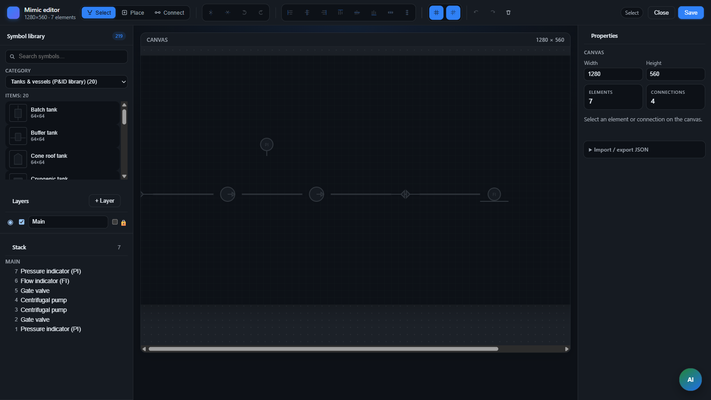

> **Language:** Canonical English. Russian edition: [ru/scada-mimic.md](../ru/scada-mimic.md).

# SCADA Mimic Format (`diagramJson`) and REST API

> **Status:** Stable — `diagramJson` version 2 document schema, interactive element actions, and REST API. Status tags: [doc-status.md](doc-status.md).

Technical reference for the JSON structure of SCADA mimic diagrams and their REST endpoints. For an overview of creating and editing mimics in the Web Console, see **[SCADA Mimic Diagrams (`scada.md`)](scada.md)** and **[SCADA Symbol Library (`scada-symbol-library.md`)](scada-symbol-library.md)**.

---

## 1. Core Concepts

| Concept | Purpose |
|---------|---------|
| `MIMIC` node | Reusable mimic diagram stored in the object tree under `root.platform.mimics.*` (model `mimic-v1`) |
| `scada-mimic` widget | Dashboard widget that renders a mimic diagram by reference (`mimicPath`) or inline (`diagramJson`) |
| `diagramJson` | Version 2 JSON document containing layers, elements, orthogonal connections, variable bindings, click actions, and custom SVG symbols |
| `grid.snap` & `grid.visible` | Editor grid snap and visibility toggles |

---

## 2. Document Schema (`version: 2`)

Version 2 is the canonical storage format (legacy v1 documents are automatically upgraded to v2 on load):

```json
{
  "version": 2,
  "width": 1600,
  "height": 900,
  "background": "var(--bg)",
  "grid": { "size": 1, "snap": false, "visible": false },
  "layers": [{ "id": "layer-default", "name": "Main", "visible": true }],
  "elements": [
    {
      "id": "t1",
      "symbolId": "pack.ispf-pid.vertical-tank",
      "layerId": "layer-default",
      "x": 100,
      "y": 80,
      "rotation": 0,
      "bindings": {
        "fillLevel": {
          "objectPath": "root.platform.devices.demo-sensor-01",
          "variableName": "level",
          "valueField": "value",
          "transform": "number"
        }
      },
      "actions": [
        {
          "id": "act1",
          "type": "toggleVariable",
          "objectPath": "root.platform.devices.demo-valve-01",
          "variableName": "open",
          "valueField": "value"
        }
      ]
    }
  ],
  "connections": [
    {
      "id": "c1",
      "layerId": "layer-default",
      "from": { "elementId": "t1", "port": "e" },
      "to": { "elementId": "v1", "port": "n" },
      "points": [
        { "x": 180, "y": 140 },
        { "x": 249, "y": 140 },
        { "x": 249, "y": 120 },
        { "x": 318, "y": 120 }
      ],
      "bindings": {
        "flowing": {
          "objectPath": "root.platform.devices.demo-pump-01",
          "variableName": "running",
          "valueField": "value",
          "transform": "bool"
        }
      }
    }
  ],
  "customSymbols": []
}
```

### Element Fields (`elements[]`)

| Field | Description |
|-------|-------------|
| `id` | Unique element identifier within the diagram |
| `symbolId` | Symbol reference: built-in pack (`pack.ispf-pid.<name>`), document library (`custom:<id>`), or inline SVG (`custom.svg`) |
| `layerId` | Layer identifier from `layers[]` |
| `x`, `y` | Top-left pixel coordinates on the artboard |
| `rotation` | Rotation angle in degrees (`0`, `90`, `180`, `270`) |
| `props` | Geometry and display overrides (`width`, `height`, `flipX`, `flipY`, inline `svg`) |
| `bindings` | Map of symbol slot names (`fillLevel`, `alarmState`, `text`, …) to object variable bindings |
| `actions` | Array of operator click actions (see below) |
| `formatRules` | Conditional color/style rules driven by bound values |
| `labels`, `tooltip` | Text annotations and hover tooltip |

### Interactive Operator Actions (`actions[]`)

| Action `type` | Fields | Runtime Behavior |
|---------------|--------|------------------|
| `toggleVariable` | `objectPath`, `variableName`, optional `value` | Toggles a boolean variable or writes a fixed command value |
| `invokeFunction` | `objectPath`, `functionName`, optional `paramsJson` | Invokes a function on the target object |
| `setSelection` | `selectionKey` + `objectPath` (or `selectionJson`) | Updates the dashboard selection slot on the current screen (for example, opening the right-hand equipment detail card on `mini-tec-hmi`) |
| `navigate` | `dashboardPath`, optional `selectionJson` | Navigates to another dashboard and optionally seeds its selection context |
| `toggleLayer` | `layerId` | Shows or hides a diagram layer |
| `toggleExpand` | `elementId` | Expands or collapses a symbol group |
| `cycleUnit` | `bindingKey`, `units[]` | Cycles the displayed engineering unit |

Example `setSelection` action:

```json
{
  "id": "sel-gpu2",
  "type": "setSelection",
  "selectionKey": "equipment",
  "objectPath": "root.platform.devices.mini-tec-plant.gpu-02"
}
```

---

## 3. Editor Shortcuts and REST API



| Tool / Shortcut | Action |
|-----------------|--------|
| `V` (**Select**) | Select, Shift+multi-select, drag (with 10 px smart-snap alignment guides), and resize handles |
| `P` (**Place**) | Pick a symbol from the palette and click the canvas to place |
| `C` (**Connect**) | Click two symbol ports to route an orthogonal connection line |
| `Ctrl+Z` / `Ctrl+Y` | Undo / Redo |
| `Del` / `Backspace` | Delete selected elements or connection |

### Mimic REST Endpoints

| HTTP Method & Path | Description |
|--------------------|-------------|
| `GET /api/v1/mimics/by-path?path=root.platform.mimics.<name>` | Load mimic title and `diagramJson` |
| `PUT /api/v1/mimics/by-path/diagram?path=...` | Save updated `diagramJson` |
| `PUT /api/v1/mimics/by-path/title?path=...` | Update mimic display title |
