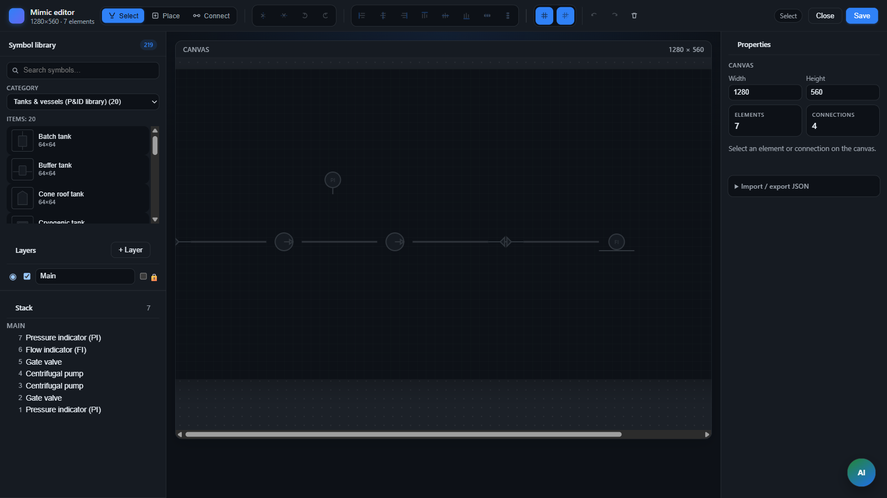

> **Language:** Canonical English. Russian edition: [ru/scada-symbol-library.md](../ru/scada-symbol-library.md).

# SCADA Symbol Library

> **Status:** Stable — built-in ISA/ISO P&ID symbol pack (218 symbols), custom SVG upload, and per-document symbol libraries. Status tags: [doc-status.md](doc-status.md).

Complete reference for using the built-in **P&ID symbol pack (`ispf-pid-v1`)**, uploading **custom SVG symbols**, and managing the **per-document symbol library** in the ISPF SCADA mimic editor.

**Related guides:** [SCADA mimics (`scada.md`)](scada.md) · [Mimic `diagramJson` & REST API (`scada-mimic.md`)](scada-mimic.md) · [Symbol marketplace (`symbol-marketplace.md`)](symbol-marketplace.md) · [P&ID symbol legal status (`pid-symbols-legal.md`)](pid-symbols-legal.md).

---

## 1. Symbol Catalog Overview



| Symbol Source | Palette Category | `symbolId` Format | Symbol Count |
|---------------|------------------|-------------------|--------------|
| Built-in ISA/ISO P&ID pack | `pack-valves`, `pack-pumps`, `pack-tanks`, … | `pack.ispf-pid.<name>` | **218** (`manifest.json` `totalSymbols`) |
| Inline custom SVG | `common` | `custom.svg` | 1 template |
| Document user library | `custom` (**My SVG**) | `custom:<id>` | Stored per mimic document in `customSymbols[]` |

Built-in pack manifest: `apps/web-console/src/scada/symbols/packs/ispf-pid-v1/manifest.json` (regenerate from source with `npm run build:pid-symbols --prefix apps/web-console`).

---

## 2. Placing Standard P&ID Pack Symbols

1. Open the mimic editor (select a `MIMIC` node in `root.platform.mimics.*` → **Edit diagram**).
2. Select the **Place (`P`)** tool and pick a category (`pack-tanks`, `pack-valves`, `pack-pumps`, etc.).
3. Click the canvas — the element is created with `symbolId: "pack.ispf-pid.vertical-tank"` (for example).
4. Configure live variable bindings (`fillLevel`, `alarmState`, etc.) and click actions in the right-hand Properties panel.

---

## 3. Custom SVG Symbols — Three Modes

| Mode | When to Use | Where SVG Markup Lives |
|------|-------------|------------------------|
| **Inline SVG** | One-off graphic on a single element | `element.props.svg` on an element with `symbolId: "custom.svg"` |
| **Document Library (`My SVG`)** | Reusable custom equipment symbol across a mimic diagram | `customSymbols[]` in `diagramJson` + `symbolId: "custom:<id>"` |
| **Customized Pack Symbol** | Start from a standard P&ID symbol and modify its SVG geometry | Select element → **Edit as SVG** → **Update symbol in library** |

### Uploading Your Own SVG File

1. In the mimic editor palette, open the **Custom (My SVG)** category and click **Upload SVG** (recommended file size ≤ 256 KB).
2. `sanitizeSvgMarkup()` automatically strips unsafe tags (`<script>`, `<iframe>`, `<object>`, `<foreignObject>`, `<style>`) and inline event attributes (`onclick`, `onload`, `javascript:` URLs).
3. Use clean vector elements (`<path>`, `<rect>`, `<circle>`, `<g>`, `<text>`) and theme-aware CSS variables such as `fill="var(--text)"` and `stroke="var(--border)"`.

Minimal custom SVG example:

```svg
<svg xmlns="http://www.w3.org/2000/svg" viewBox="0 0 64 64" width="64" height="64">
  <rect x="4" y="4" width="56" height="56" rx="8" fill="#161b22" stroke="#30363d" stroke-width="2"/>
  <text x="32" y="36" text-anchor="middle" fill="#8b949e" font-size="10">PUMP</text>
</svg>
```

---

## 4. Dynamic Behaviors and Bindings on Custom Symbols

Custom library entries in `customSymbols[]` can declare `bindingSchema` slots and dynamic `behaviors` (fill level, state colors, text substitution, rotation):

```json
{
  "id": "tank-1",
  "symbolId": "custom:lib-tank-a",
  "bindings": {
    "fillLevel": {
      "objectPath": "root.platform.devices.t1",
      "variableName": "level",
      "valueField": "value",
      "transform": "number"
    }
  }
}
```

---

## 5. Troubleshooting

| Symptom | Resolution |
|---------|------------|
| Custom symbol does not appear in the **My SVG** palette | Ensure `"inUserLibrary": true` is set on its `customSymbols[]` entry |
| Uploaded SVG renders blank | Verify the root `<svg>` element has a valid `viewBox` and does not rely on stripped `<style>` blocks |
| Symbol colors look inverted in dark/light theme | Replace hardcoded hex strokes/fills with `var(--text)` and `var(--border)` |
