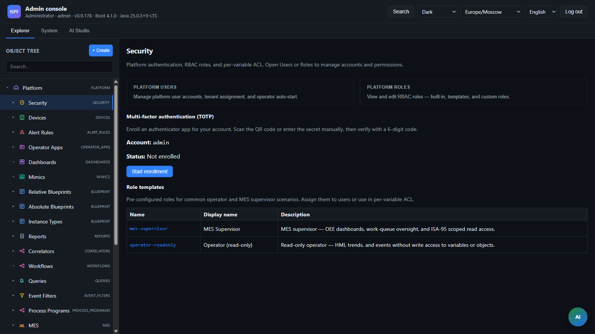

> **Language:** Canonical English. Russian edition: [ru/security.md](../ru/security.md).

# Security, Authentication, and Access Control (RBAC & ACL)

> **Status:** Stable — local Bearer and OAuth2/Keycloak authentication, TOTP multi-factor authentication, role-based access control (RBAC), per-object and per-variable ACLs, and multi-tenant isolation. Status tags: [doc-status.md](doc-status.md).

**Related architecture records:** [Platform security model (ADR-0066)](decisions/0066-security-model.md) · [Secrets encryption and key rotation (ADR-0065)](decisions/0065-secrets-key-rotation.md) · [Hosted UI-pack token scoping (ADR-0073)](decisions/0073-hosted-ui-pack-trust.md) · [MFA roadmap (ADR-0056)](decisions/0056-webauthn-idp-mfa.md).

---

## 1. System Roles and Responsibilities



ISPF enforces role-based access control across all HTTP REST endpoints and WebSocket subscriptions (plus custom roles for fine-grained variable and function permissions):

| Role | Spring Security Authority | Capabilities |
|------|---------------------------|--------------|
| **`admin`** | `ROLE_admin` | Full platform administration: runtime settings, user and role management, backups, cluster, federation, tenants, and application deployment |
| **`developer`** | `ROLE_developer` | Solution authoring and debugging: object tree, blueprints, functions, `bundle.json` deploy, schedules, alert rules, correlators, and AI Studio (no access to platform security, federation, or cluster settings) |
| **`operator`** | `ROLE_operator` | Shift operations: view dashboards, mimics, and history, invoke permitted functions (`POST /api/v1/bff/invoke`), write `writable` variables, and claim/complete BPMN tasks in the Work Queue |

---

## 2. Authentication Modes by Spring Profile

### 1. Local Profile (`local`, `application-local.yml`)
- Authenticates via **Bearer token** returned by `POST /api/v1/auth/login`.
- Unauthenticated requests to protected routes are rejected (`ispf.security.local-default-role` is empty; the debug header `X-ISPF-Role` is disabled by default).
- On an empty database, three demo accounts are seeded automatically for local evaluation: `admin / admin`, `developer / developer`, `operator / operator`.

```bash
curl -X POST http://localhost:8080/api/v1/auth/login \
  -H "Content-Type: application/json" \
  -d '{"username":"admin","password":"admin"}'

curl -H "Authorization: Bearer <token>" http://localhost:8080/api/v1/objects
```

Each user account can optionally enable **operator workspace auto-start** (`autoStartEnabled = true`, `autoStartApp = "<appId>"`), which opens the configured Operator App immediately upon login instead of the Admin Console.

### 2. Production and OIDC Profile (`prod` / `default` / `dev`)
- The server runs as an **OAuth2 Resource Server** validating JWT tokens issued by **Keycloak** (or any OIDC-compliant Identity Provider).
- The Web Console signs in using **OIDC Authorization Code + PKCE** (**Sign in with Keycloak**, client `ispf-web-console`; login mode is advertised by `GET /api/v1/auth/config`).
- Roles are mapped from `realm_access.roles` in the JWT. When running `docker compose up -d` locally, the `ispf` realm is imported automatically from `deploy/keycloak/ispf-realm.json` on port `8180`.

### 3. Automated Test Profile (`test`)
- Used only by isolated in-memory JUnit / MockMvc tests (`application-test.yml`).

---

## 3. Managing Local Users (`admin`)

| HTTP Method & Path | Description |
|--------------------|-------------|
| `GET /api/v1/security/users` | List user accounts |
| `POST /api/v1/security/users` | Create a user account |
| `PUT /api/v1/security/users/{username}` | Update roles, `enabled` status, `displayName`, `autoStartEnabled`, and `autoStartApp` |
| `DELETE /api/v1/security/users/{username}` | Delete a user account |
| `POST /api/v1/security/users/{username}/password` | Change user password |
| `GET /api/v1/auth/me` | Return current principal and roles |
| `POST /api/v1/auth/logout` | Revoke current session token |

All users and roles are mirrored into the object tree under `root.platform.security.users.*` and `root.platform.security.roles.*`.

---

## 4. HTTP Endpoint Authorization Matrix (`IspfAuthorizationRules`)

| Endpoint Group | `admin` | `developer` | `operator` | Public |
|----------------|:-------:|:-----------:|:----------:|:------:|
| `GET /api/v1/info`, `POST /api/v1/auth/login`, `GET /actuator/health` | ✓ | ✓ | ✓ | ✓ |
| `GET /api/v1/**` (subject to object and variable ACLs) | ✓ | ✓ | ✓ | — |
| `POST .../functions/invoke`, `POST /api/v1/bff/**` | ✓ | ✓ | ✓ | — |
| `GET / POST /api/v1/work-queue/**`, cancel workflow instance | ✓ | ✓ | ✓ | — |
| `POST /api/v1/events/fire` | ✓ | ✓ | ✓ | — |
| Solution authoring (`/objects`, `/applications`, `/blueprints`, `/alert-rules`, `/correlators`, `/schedules`, `/ai/**`) | ✓ | ✓ | — | — |
| Platform administration (`/security/**`, `/objects/by-path/acl`, `/platform/backup/**`, `/platform/metrics`, `/runtime-settings`, `/federation/**`, `/tenants/**`) | ✓ | — | — | — |

### Scoped Tokens for Hosted UI Packs ([ADR-0073](decisions/0073-hosted-ui-pack-trust.md))
A token carrying the `uiPackAppId` claim is restricted to that hosted React application (`/apps/<appId>/`): `IspfAuthorizationRules` allows only `GET /api/v1/auth/me`, `POST /api/v1/auth/logout`, `GET /api/v1/info`, and `POST /api/v1/bff/**` for that `appId`, denying all administrative APIs regardless of realm roles. A `Referer` of `/apps/<other>/` or header `X-ISPF-Ui-Pack-App` that disagrees with the claim is rejected. Realm role `admin` does not lift this.

Partner packs (`ui-pack.json` `uiPackTrust`: `partner` or `signedPartner`) must not call `POST /api/v1/auth/login`. A request whose `Referer` is `/apps/<appId>/` for such a pack is **403**. That check is not a guarantee if the pack omits `Referer`. First-party packs may still log in on `/apps/`.

---

## 5. Per-Object and Per-Variable Access Control Lists (ACL)

### Per-Object Subtree ACL (`object_acl_entries`)
Administrators can attach fine-grained access rules (`READ`, `WRITE`, `INVOKE`, or composite `OWNER`, `EDITOR`, `VIEWER`) to any node in the tree via the **Access** tab in the Inspector or via REST:

```http
GET /api/v1/objects/by-path/acl?path=root.platform.devices.shop-1
PUT /api/v1/objects/by-path/acl?path=root.platform.devices.shop-1
```

Rules inherit down the subtree. If no ACL entries exist on an object or its ancestors, standard role-based access applies.

### Per-Variable and Per-Function Role Restrictions (`MEMBER` Mode)
Individual variables can define `readRoles` and `writeRoles` (JSON arrays of role names), and functions/events can define `invokeRoles`. Interactive requests (REST, WebSocket, BFF, Object Query, Haystack/Brick export, analytics queries, and AI agent tools) execute in `VariableAclRequestContext.MEMBER` mode and enforce these role lists through `VariableMemberAccessService`.

When a hub proxies an interactive request to a remote federated peer, it forwards the caller's identity in `X-ISPF-On-Behalf-Of-*` headers, and the remote peer enforces the **intersection** of the channel's roles and the user's roles ([Federation](federation.md)).

---

## 6. Multi-Factor Authentication (TOTP MFA)

| Property | Environment Variable | Default |
|----------|----------------------|---------|
| `ispf.security.mfa.enabled` | `ISPF_MFA_ENABLED` | `false` |
| `ispf.security.mfa.required-for-admin` | `ISPF_MFA_REQUIRED_FOR_ADMIN` | `false` |
| `ispf.security.mfa.time-window-steps` | — | `1` (±30 s tolerance) |

When enabled, users can enroll an authenticator app via the Security console or REST API (`GET /api/v1/security/mfa/status`, `POST /api/v1/security/mfa/enroll`, `POST /api/v1/security/mfa/verify`, `DELETE /api/v1/security/mfa/enroll`) and pass `totpCode` on `POST /api/v1/auth/login`.

**REAL today (BL-153 Done — TOTP GA).** **Follow-up (BL-194 Parked):** WebAuthn / passkeys; Keycloak OTP as the primary IdP MFA path — [ADR-0056](decisions/0056-webauthn-idp-mfa.md) (**Parked** until a named tender/customer MFA task — [parked-backlog](parked-backlog.md) **P-WEBAUTHN**). Pen-test prep (G-01): [pen-test-scope.md](pen-test-scope.md) · [pen-test-prep.md](pen-test-prep.md) · [pen-test-roe.md](pen-test-roe.md). Non-claims: [known-limitations](known-limitations.md).

---

## 7. Multi-tenancy isolation

Canonical detail: [multi-tenant](multi-tenant.md). Tender view: [compliance-tender-pack G-03](compliance-tender-pack.md).

| Layer | Status |
| ----- | ------ |
| Logical SaaS A≠B (path + API + `tenant-admin`) | **Done** |
| OIDC `tenant_id` claim + hard mode schema provision/drop | **Done** |
| PostgreSQL RLS on shared platform object tables (`ispf.tenant.db-row-isolation`) | **Done** (no-op on H2) |
| Physical per-tenant table routing | **Optional / not claimed** |

Do **not** claim H2 row isolation or physical schema isolation for shared tables.

---

## 8. Production Hardening Checklist

- Run with `--spring.profiles.active=prod` (`application-prod.yml`). In production, `ispf.security.strict-startup=true` refuses server startup if RBAC is disabled, if the debug role header is enabled, or if WebSocket origins are left as wildcard `*`.
- Set a strong encryption key in `ISPF_SECURITY_SECRETS_KEY` (supports zero-downtime key rotation via `ISPF_SECURITY_SECRETS_PREVIOUS_KEY` and `POST /api/v1/federation/secrets-key/reencrypt` — see [ADR-0065](decisions/0065-secrets-key-rotation.md)).
- Enable bundle signature verification (`ISPF_LICENSE_ENFORCE=true`, `ISPF_LICENSE_REQUIRE_SIGNED_BUNDLES=true`).
- Restrict `ISPF_WEBSOCKET_ALLOWED_ORIGIN_PATTERNS` to your console domain(s) and terminate TLS at nginx/ingress.
- Keep `ispf.security.local-role-header-enabled=false`. Do not expose the `local` profile on internet-facing hosts.
- Federation outbound login: `ISPF_FEDERATION_BLOCK_LOOPBACK=true` (prod default) and optional `ISPF_FEDERATION_OUTBOUND_URL_ALLOWLIST`.
- Default users (`admin`/`admin`, …) are intentional for **local / test / lab** only.
