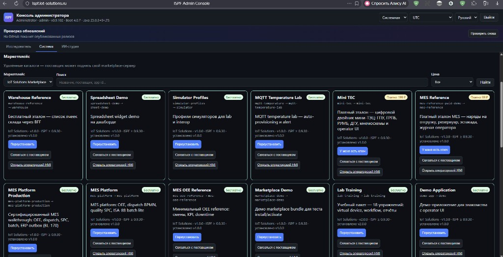
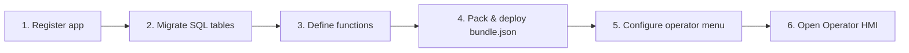

> **Language:** Canonical English. Russian edition: [ru/solution-developer-guide.md](../ru/solution-developer-guide.md).

# Solution Developer Guide

> **Status:** Stable — building, packaging, and deploying complete applications on ISPF. Status tags: [doc-status.md](doc-status.md).

This guide walks through building an application on ISPF **without modifying the Java server core**: registering an isolated database schema, creating SQL migrations, writing backend script functions, building operator screens, and packaging everything into a repeatable `bundle.json`.

Related guides: [How ISPF works](learn.md) · [Application architecture rules](application-principles.md) · [Applications API](applications.md) · [Public bundle contract](solution-developer-public-api.md) · [Custom React UI](external-ide.md).

---

## How an ISPF application is put together



An application on ISPF combines **isolated SQL tables** for business records (orders, batches, shift logs) with **object tree nodes** for live equipment, calculations, alarms, workflows, and screens:

| Part of your project | Where it lives on the server | Example |
|----------------------|------------------------------|---------|
| **Equipment I/O** | `DEVICE` nodes under `root.platform.devices.*` | `root.platform.devices.pump-01` |
| **Calculations & backend functions** | `SINGLETON` hub or `INSTANCE` twins | `root.platform.singleton-blueprints.terminal-hub` |
| **Business tables (SQL)** | Isolated PostgreSQL schema (`schemaName`) | `oil_terminal.ot_order` |
| **Alarms & workflows** | `ALERT` and `WORKFLOW` nodes in the tree | `root.platform.workflows.order-dispatch` |
| **Operator screens** | `DASHBOARD` / `MIMIC` nodes (or a React `ui-pack`) | `root.platform.dashboards.terminal-overview` |
| **Operator navigation** | `operator_app_ui` (`root.platform.operator-apps`) | `?mode=operator&app=my-terminal` |

> **Key rule:** The record in `applications` only registers your app's ID and isolated SQL schema. At runtime, function calls, alarms, bindings, and dashboards all execute through the **object tree**. Keep calculations and functions on `SINGLETON` or `INSTANCE` objects — never on `DEVICE` nodes ([Application architecture rules](application-principles.md)).

---

## Step-by-step lifecycle



You can either deploy everything at once via a single `bundle.json` (Step 4 — recommended for Git/CI) or test individual pieces step by step via REST.

### Step 1. Register the application

```http
POST /api/v1/applications
Authorization: Bearer <admin-token>
Content-Type: application/json

{
  "appId": "my-terminal",
  "displayName": "Oil Terminal",
  "tablePrefix": "ot_",
  "schemaName": "oil_terminal"
}
```

Or in the Admin Console: select `root.platform.applications` → **+ Deploy application**.

### Step 2. Apply SQL table migrations

Application tables are stored in `schemaName` (`oil_terminal`), completely isolated from ISPF's own Flyway system tables:

```http
POST /api/v1/applications/my-terminal/data/migrate
Authorization: Bearer <admin-token>
Content-Type: application/json

{
  "version": "1.0.0",
  "scripts": [
    {
      "id": "orders",
      "sql": "CREATE TABLE IF NOT EXISTS ot_order (id SERIAL PRIMARY KEY, status VARCHAR(32), created_at TIMESTAMPTZ DEFAULT NOW());"
    }
  ]
}
```

Re-running the same `version` + `id` is idempotent (already-applied scripts are skipped). Check migration status at any time:

```http
GET /api/v1/applications/my-terminal/data/status
```

### Step 3. Deploy JSON script functions

Backend CRUD and domain operations are written as declarative JSON **script** steps (`selectOne`, `selectMany`, `exec`, `setVar`, `if`, `return`) running in a single database transaction per call. Use field names **`sql`** and **`var`**, and end every script with a **`return`** step:

```http
POST /api/v1/applications/my-terminal/functions/deploy
Authorization: Bearer <admin-token>
Content-Type: application/json

{
  "functions": [
    {
      "name": "listOrders",
      "description": "List active terminal orders",
      "script": {
        "steps": [
          {
            "type": "selectMany",
            "var": "rows",
            "sql": "SELECT id, status FROM ot_order WHERE status = 'ACTIVE' ORDER BY created_at"
          },
          {
            "type": "return",
            "fields": {
              "rows": "${rows}"
            }
          }
        ]
      }
    }
  ]
}
```

> **Tip for dashboards:** To display rows from a SQL table on a built-in dashboard, use a **`report`** widget (`type: "report"`), not `object-table` (`object-table` lists child nodes of an object-tree folder).

### Step 4. Deploy as a single `bundle.json` (recommended)

In day-to-day work, you deliver migrations, functions, objects, dashboards, workflows, reports, and operator navigation together via `POST /api/v1/applications/{appId}/deploy` (`Content-Type: application/json`). Re-deploying reconciles existing tree nodes rather than failing on duplicates. Full field specification: [Applications API](applications.md#bundle-deploy-req-pf-03).

```http
POST /api/v1/applications/my-terminal/deploy
Authorization: Bearer <admin-token>
Content-Type: application/json

{
  "version": "1.0.0",
  "displayName": "Oil Terminal",
  "tablePrefix": "ot_",
  "schemaName": "oil_terminal",
  "objects": [],
  "dashboards": [
    {
      "path": "root.platform.dashboards.terminal-overview",
      "title": "Overview",
      "layoutJson": "{ \"columns\": 84, \"rowHeight\": 8, \"widgets\": [] }"
    }
  ],
  "migrations": [],
  "functions": [],
  "operatorUi": {
    "title": "Oil Terminal",
    "dashboards": [
      { "dashboardPath": "root.platform.dashboards.terminal-overview", "label": "Overview" }
    ],
    "defaultDashboardPath": "root.platform.dashboards.terminal-overview"
  },
  "reports": [
    {
      "name": "daily-summary",
      "sql": "SELECT status, COUNT(*) FROM ot_order GROUP BY status"
    }
  ]
}
```

Always author dashboard layouts on the **84×8** grid (`"columns": 84, "rowHeight": 8`) — see [Dashboards](dashboards.md).

### Step 5. Configure the operator menu

`operatorUi` controls which screens appear as tabs for shift operators. You can manage it in three ways:

1. **Inside `bundle.json` (`operatorUi` section above)** — applied automatically on deploy.
2. **Via REST API:**
   ```http
   PUT /api/v1/operator-apps/my-terminal/ui
   Content-Type: application/json

   {
     "title": "Oil Terminal",
     "dashboards": [
       { "dashboardPath": "root.platform.dashboards.terminal-overview", "label": "Overview" },
       { "dashboardPath": "root.platform.dashboards.terminal-queue", "label": "Queue" }
     ],
     "defaultDashboardPath": "root.platform.dashboards.terminal-overview"
   }
   ```
3. **In the Admin Console:** `root.platform.operator-apps` → **+ Operator app**.

### Step 6. Open Operator HMI

- All-in-one JAR / Docker: `http://localhost:8080?mode=operator&app=my-terminal`
- Vite dev server: `http://localhost:5173?mode=operator&app=my-terminal`

---

## Calling functions from screens (`POST /api/v1/bff/invoke`)

Both built-in form/button widgets and custom React UI packs call backend functions through the BFF endpoint:

```http
POST /api/v1/bff/invoke
Authorization: Bearer <token>
Content-Type: application/json

{
  "objectPath": "root.platform.applications.my-terminal.functions",
  "functionName": "listOrders",
  "input": {
    "schema": { "name": "in", "fields": [] },
    "rows": [{}]
  },
  "wireProfile": "ispf-operator-v1"
}
```

Functions placed on a `SINGLETON` hub (for example, `root.platform.singleton-blueprints.my-terminal-hub`) are invoked the exact same way by passing that hub's `objectPath`. Wire format details: [Applications API § BFF](applications.md#bff-req-pf-06).

---

## Reports, schedules, and BPMN integration

### SQL reports

```http
GET /api/v1/applications/my-terminal/reports/daily-summary?format=csv
```

Reports declared in `reports[]` can be rendered on dashboards or exported as CSV/documents. Details: [Reports](reports.md).

### Scheduled jobs

```http
POST /api/v1/schedules
Content-Type: application/json

{
  "name": "nightly-cleanup",
  "cron": "0 0 2 * * *",
  "appId": "my-terminal",
  "function": "archiveOrders",
  "enabled": true
}
```

### Calling functions from BPMN workflows

Use a BPMN `serviceTask` with `ispf:actionType="INVOKE_FUNCTION"` (or `ispf:action="invoke_function"` on an object path):

```xml
<bpmn:serviceTask id="Task_ListOrders" name="List orders"
  ispf:actionType="INVOKE_FUNCTION"
  ispf:functionAppId="my-terminal"
  ispf:functionName="listOrders"
  ispf:resultVariable="orders"/>
```

BPMN `userTask` steps automatically appear in the operator's **Work Queue**. Details: [BPMN workflows](workflows.md).

---

## Repository layout (solution-as-repo)

Instead of editing one huge JSON file by hand, keep your project in Git as a structured folder and compile it into `bundle.json` with **`tools/ispf-cli`** (`ispf pack | unpack | validate | diff | deploy`):

| File / folder in Git | Compiled section in `bundle.json` |
|----------------------|-----------------------------------|
| `solution.json` | `version`, `displayName`, `tablePrefix`, `schemaName`, `operatorUi`, `metadata`, `license`, `requires` |
| `sql/V*__*.sql` | `migrations[]` (`id` is taken from the suffix after `V{n}__`) |
| `functions/<name>.json` | `functions[]` (SQL steps can reference `@file:step.sql` next to the JSON file) |
| `blueprints/*.json` | `blueprints[]` |
| `objects.json` | `objects[]` |
| `dashboards/*.layout.json` (+ optional `*.meta.json`) | `dashboards[]` |
| `reports/<id>.sql` + `<id>.json` | `reports[]` |
| `alerts/*.json`, `correlators/*.json` | `alertRules[]`, `correlators[]` |
| `events.json` | `events[]` |
| `workflows/*.bpmn` + `*.meta.json` | `workflows[]` |

Typical CLI workflow:

```bash
cd tools/ispf-cli && npm install

# Pack folder -> bundle.json
node bin/ispf.mjs pack ../../examples/demo-app -o ../../examples/demo-app/bundle.json

# Validate locally (add --strict before release)
node bin/ispf.mjs validate ../../examples/demo-app --local

# Compare local folder against a running server
node bin/ispf.mjs diff ../../examples/demo-app --app demo

# Deploy to server (uses ISPF_BASE_URL and ISPF_API_TOKEN)
node bin/ispf.mjs deploy ../../examples/demo-app --app demo
```

---

## Pre-production checklist

- [ ] Application registered with an isolated `schemaName` and `tablePrefix`
- [ ] SQL migrations applied cleanly (`GET .../data/status`)
- [ ] `ispf validate --strict` passes with zero errors (`LOGIC_HOST_DEVICE`, `HEAVY_WIDGET_EXPRESSION`, cycle checks)
- [ ] Functions tested via `POST /api/v1/bff/invoke`
- [ ] Operator screens verified at `?mode=operator&app=<appId>` (or `/apps/<appId>/` if shipping a React `ui-pack`)
- [ ] Shift accounts use the `operator` role (or a scoped custom role), not `admin`
- [ ] Production authentication (Keycloak OIDC / strong credentials) is enabled
