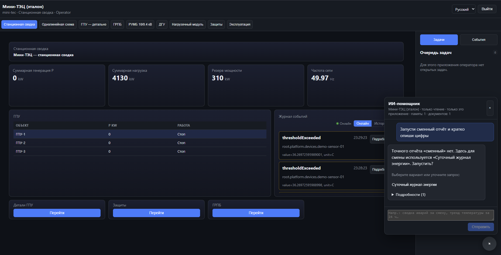
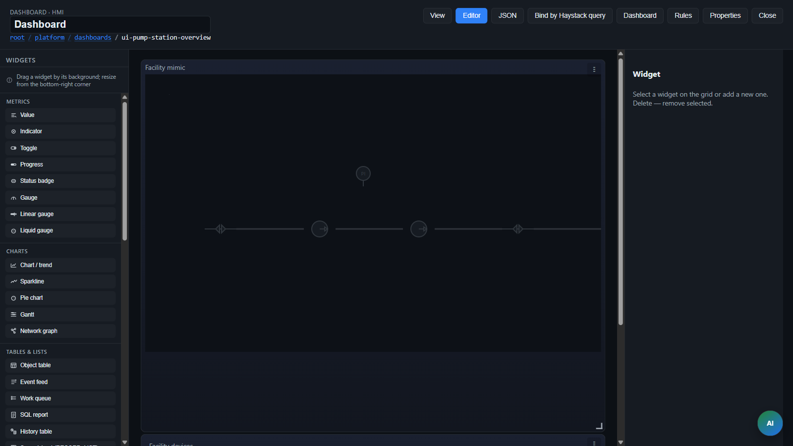
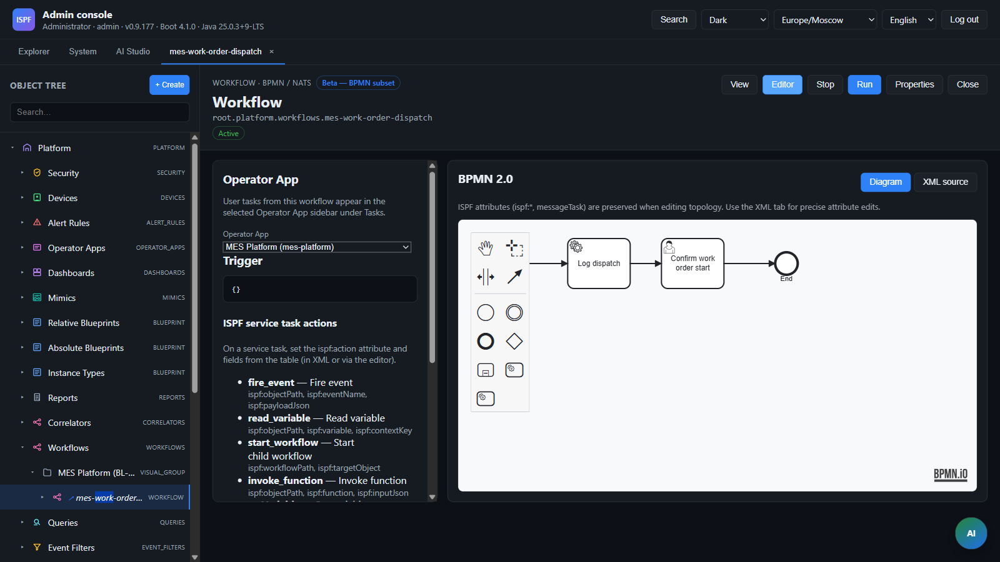
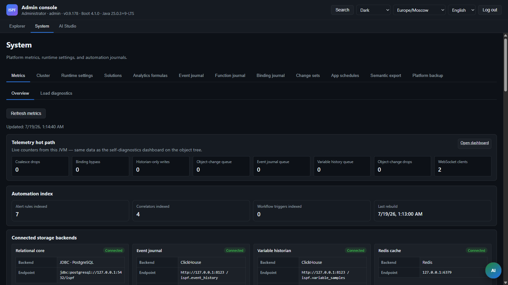
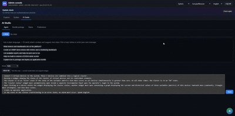

> **Language:** Canonical English. Russian edition: [ru/web-console.md](../ru/web-console.md).

# Web Console

> **Status:** Stable — Administrator Console, Operator HMI, Dashboard and BPMN Builders, System Diagnostics, and AI Studio. Status tags: [doc-status.md](doc-status.md).

Built with React 19, Vite 6, and TanStack Query (`apps/web-console/`).

**Default URLs:** all-in-one JAR — `http://localhost:8080`; Vite development server — `http://localhost:5173` (proxies `/api` and `/ws` to `:8080`). See [Getting started](getting-started.md).

---

## 1. Operating Modes

### Administrator Mode (Default)

URL: `http://localhost:8080` (JAR) or `http://localhost:5173` (Vite dev)

| Workspace Area | Capabilities |
|----------------|--------------|
| **Object tree** | Search, expand, create/edit/delete nodes, drag-and-drop sibling ordering |
| **Explorer** | Browse child objects of the selected folder |
| **Inspector** | Edit properties, variables, calculation rules (`@bindingRules`), functions, events, alert rules, correlators, and access control (`ACL`) |


Double-clicking a node in the object tree opens its dedicated editor:

| `ObjectType` | Editor Component |
|--------------|------------------|
| `DASHBOARD` | `DashboardBuilder` (`84×8` grid canvas and widget inspector) |
| `MIMIC` | `ScadaMimicEditor` (vector P&ID / single-line diagram editor) |
| `WORKFLOW` | `WorkflowBuilder` (`IspfBpmnEditor`) |
| `REPORT` | `ReportBuilder` (SQL / tree-variable report editor and template uploader) |
| `ALERT` | `AlertRuleInspector` |
| `CORRELATOR` | `CorrelatorInspector` |
| Other types | `ObjectPropertiesEditor` |

### Operator HMI Mode (`?mode=operator`)

URL: `http://localhost:8080?mode=operator` (or `?mode=operator&app=<appId>`)



- Full-screen read-only dashboard and mimic view without the object tree or configuration editors.
- Right-hand sidebar for the BPMN **Work Queue** and live **Event Journal**, plus the read-only shift AI assistant.
- Resolves application navigation from `GET /api/v1/operator-apps/{appId}/ui` (`root.platform.operator-apps`) or `GET /api/v1/applications/{appId}/operator-ui` (`bundle.json`). If the application includes a hosted React `ui-pack`, the **Open app UI** button launches `/apps/<appId>/`.

---

## 2. Dashboard Builder and Workflow Builder

### Dashboard Builder


- **84-column × 8 px fine grid** with drag-and-drop placement and resizing.
- Palette of **40+ widget types** (values, gauges, trend charts, SCADA mimics, object tables, forms, spreadsheets, work queues, reports, and navigation links).
- Live JSON layout preview and one-click save via REST API. See [Dashboards](dashboards.md) and [Widget reference](widgets.md).

### Workflow Builder


- Built-in vector BPMN 2.0 editor (`IspfBpmnEditor`, [ADR-0052](decisions/0052-ispf-workflow-diagram-editor.md)) with `DRAFT` / `ACTIVE` / `STOPPED` status toggle and manual **Run** button.
- Automatic graph layout (`ensureDiagram.ts`) for BPMN XML without `bpmndi` coordinates, plus live step execution timeline. See [Workflows](workflows.md).

---

## 3. Live Data, Build Commands, and Localization (i18n)

### Live Data Updates
1. **WebSocket (`/ws/objects`):** `useObjectWebSocket` subscribes to visible object paths and invalidates the TanStack Query cache on `VARIABLE_UPDATED`.
2. **Polling fallback:** each dashboard also refetches at its configured `refreshIntervalMs`.
3. **Large folder guard:** expanding a tree folder with more than 64 children skips live WebSocket subscription on that folder row (`Live off` badge) to avoid flooding the browser; collapse and re-expand to refresh.

### Build and Localization Commands

```bash
cd apps/web-console
npm install
npm run dev              # start Vite dev server on :5173
npm run build            # production bundle in dist/
npm run i18n:check       # verify locale keys against canonical English (en/*.json)
npm run i18n:translate   # update ru/de/zh locale files (tools/i18n/generate-locales.py)
```

Supported UI languages: **English (`en`)**, **Russian (`ru`)**, **German (`de`)**, and **Chinese (`zh`)**, selectable in the top header or via `?lang=` ([ADR-0013](decisions/0013-web-console-i18n.md)).

---

## 4. System Administration, Federation, and AI Studio

### System Section (`admin`)


| Tab | Capabilities |
|-----|--------------|
| **Metrics** | Platform metrics, backend health cards (Redis, NATS, ClickHouse, MCP), **Load diagnostics**, and **Platform backup** (`GET / POST /api/v1/platform/backup/*`) |
| **Runtime settings** | Inspect and override live runtime properties (`GET / PATCH /api/v1/platform/runtime-settings`) and schedule a server restart |
| **Events / Functions / Bindings** | Execution and audit logs |
| **Change sets** | Preview and apply transactional multi-object change sets ([Collaboration](collaboration.md)) |
| **App schedules** | Manage periodic schedules (`GET / POST /api/v1/schedules`) |
| **Semantic export** | Export subtrees as Project Haystack JSON or Brick JSON-LD / Turtle |
| **Analytics formulas** | Manage site-wide reusable Tier B formulas ([Analytics formulas](analytics-formulas-and-packs.md)) |

### Application Lifecycle Panels (`Inspector → APPLICATION → Deploy`)
- `ApplicationBundlePanel` — export, validate, deploy `bundle.json`, and run `pull-from-tree`.
- `ApplicationDeployPanel` — deployment history, version rollback, event catalog, and function versions.
- `ApplicationLifecyclePanel` — run `data/migrate`, `data/seed`, refresh SQL bindings, and deploy reports/functions.

### AI Studio (`admin`)


- **Agent tab:** multi-turn chat with the tree-first agent (persisted in PostgreSQL; continues running in the background while you browse the Explorer).
- **Bundle tab:** generate, validate, dry-run, and import `bundle.json` packages from natural-language prompts.
- **Settings & Status tabs:** configure LLM provider, inspect `ContextPack` metadata, and view per-tool latency/token metrics. See [AI development](ai-development.md).
