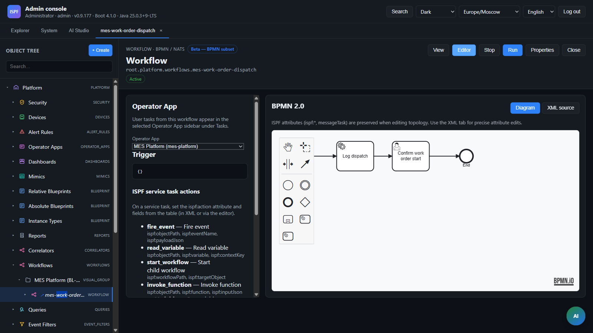

> **Language:** Canonical English. Russian edition: [ru/workflows.md](../ru/workflows.md).

# Workflows and BPMN 2.0 Automation

> **Status:** Beta — pure-Java BPMN 2.0 subset engine, vector diagram editor, operator Work Queue tasks, timers, webhooks, and typed MCP/agent workflow tools. Status tags: [doc-status.md](doc-status.md).

A **workflow** in ISPF is an object tree node of type `WORKFLOW` (model `workflow-v1` under `root.platform.workflows.*`). It executes multi-step operational procedures — combining automated server actions, CEL branching, timers, and human tasks in the operator **Work Queue** — using a lightweight pure-Java engine (`ispf-plugin-workflow`) without external Camunda or Flowable servers.

**Related guides:** [Automation: events, alerts, correlators](automation.md) · [Escalation workflow templates](reference-escalation-templates.md) · [Hands-on OT Automation tutorials](ot-automation-excellence-tutorials.md) · [ADR-0047](decisions/0047-custom-bpmn-subset-engine.md) · [ADR-0049](decisions/0049-ot-automation-excellence.md) · [ADR-0052](decisions/0052-ispf-workflow-diagram-editor.md).

**Demo:** [`examples/demo-plant`](../../examples/demo-plant/) — `mes-work-order-dispatch.bpmn`; built-in `demo-alarm-handler` with the local profile.

---

## 1. Workflow Object Variables and Lifecycle

| Variable on `WORKFLOW` | Description |
|------------------------|-------------|
| `title` | Display title of the process |
| `status` | `DRAFT` (editable, manual run only), `ACTIVE` (responds to triggers, webhooks, cron, and tool calls), or `STOPPED` |
| `bpmnXml` | BPMN 2.0 XML definition (with `bpmndi` layout coordinates and `ispf:*` attributes) |
| `triggerJson` | Optional automatic start trigger on variable changes or events |
| `operatorAppId` | Identifier of the Operator App whose sidebar **Work Queue** receives `userTask` items from this workflow |
| `webhookSlug` | Inbound HTTP webhook slug (`POST /api/v1/webhooks/workflows/{slug}`) |
| `cronExpression` | Periodic schedule expression (for example, `every:1m`, `every:15m`) when `status = "ACTIVE"` |
| `inputSchemaJson`, `outputSchemaJson`, `toolDescription`, `sideEffectClass` | Typed tool contract ([ADR-0049](decisions/0049-ot-automation-excellence.md)) for invoking the workflow via `/invoke-tool`, AI agent `invoke_workflow_tool`, or MCP (`wf_<name>`) |
| `retryMaxAttempts`, `retryBackoffSeconds`, `errorWorkflowPath` | Automatic retry policy on failure (`workflow_retry_schedule`) and dead-letter queue (`workflow_dead_letters`) fallback |
| `instanceState`, `lastRunAt`, `lastAction` | Runtime snapshot of the most recent instance |

**Instance states (`InstanceStatus`):** `RUNNING` → `WAITING` (paused at a `userTask`, signal, message, or timer) → `COMPLETED` or `FAILED`.

---

<a id="supported-bpmn-elements"></a>

## 2. Supported BPMN 2.0 Elements ([ADR-0047](decisions/0047-custom-bpmn-subset-engine.md))

ISPF implements a focused, deterministic subset of BPMN 2.0 (extension namespace `http://ispf.io/bpmn`, prefix `ispf:`):

| BPMN Element | Behavior in ISPF |
|--------------|------------------|
| `startEvent`, `endEvent` | Process entry and completion nodes |
| `serviceTask` | Automated server action (`log`, `set_variable`, `read_variable`, `invoke_function`, `fire_event`, `publish_nats`, `start_workflow`, `llm_complete`, `invoke_agent`) |
| `userTask` | Human task placed into the operator **Work Queue** (`OPEN` → `CLAIMED` → `COMPLETED`) |
| `exclusiveGateway` (`sequenceFlow`) | Conditional branching using boolean Google CEL expressions in `ispf:condition` (plus `ispf:default="true"`) |
| `parallelGateway` | Parallel fork and join of execution tokens |
| `intermediateCatchEvent` | Waits for a named signal (`ispf:signal`), a message (`messageEventDefinition` / `ispf:message`), or a timer (`ispf:durationSeconds`) |
| `intermediateThrowEvent` | Publishes a named message event (`messageEventDefinition`) |
| `boundaryEvent` | Interrupting SLA timer attached to a `userTask` (`ispf:durationSeconds`, `cancelActivity="true"`) or error-handling boundary on a task (`errorEventDefinition` / `ispf:errorCode`) |
| `subProcess` | Embedded subprocess (`startEvent` → inner steps → `endEvent`) |
| `callActivity` | Starts another `WORKFLOW` (`ispf:workflowPath`) and waits for it to complete |
| `messageTask` | Publishes a message to a NATS subject |

> **Unsupported BPMN 2.0 constructs (rejected at parse/save time):** multi-instance loops (`multiInstanceLoopCharacteristics`), `inclusiveGateway`, `eventBasedGateway`, compensation events, event subprocesses, and DMN tables. When importing external files via **Import BPMN**, the editor automatically normalizes or flags unsupported constructs.

---

## 3. Configuring `serviceTask` and `userTask` Attributes

### Automated Actions (`serviceTask`)

| `ispf:action` | Key XML Attributes |
|---------------|--------------------|
| `invoke_function` | `ispf:objectPath` (`SINGLETON` or `INSTANCE` logic node), `ispf:functionName`, `ispf:inputMap`, `ispf:outputMap` |
| `set_variable` | `ispf:targetPath`, `ispf:variable`, `ispf:value` |
| `read_variable` | `ispf:objectPath`, `ispf:variable`, `ispf:contextKey` |
| `fire_event` | `ispf:objectPath`, `ispf:eventName`, `ispf:payloadVariable` or `ispf:payloadJson` |
| `publish_nats` | `ispf:subject`, `ispf:message`, `ispf:channel` |
| `start_workflow` | `ispf:workflowPath`, `ispf:objectPath` |
| `log` | `ispf:message` |
| `llm_complete` | `ispf:promptTemplate` (supports `${var}`), `ispf:outputVariable`, `ispf:outputFormat`, `ispf:modelRef`, `ispf:timeoutMs` |
| `invoke_agent` | `ispf:goalTemplate`, `ispf:agentMode`, `ispf:outputVariable` (single-step prompt mode; `toolAllowlist` must be empty and `maxSteps <= 1` per [ADR-0049](decisions/0049-ot-automation-excellence.md)) |

Example `invoke_function` step:

```xml
<serviceTask id="assign" name="Acknowledge Order"
             ispf:action="invoke_function"
             ispf:objectPath="root.platform.singleton-blueprints.myapp-hub"
             ispf:functionName="myapp_acknowledge"
             ispf:inputMap="orderId=${workflow.orderId}"
             ispf:outputMap="ackResult=result"/>
```

### Operator Tasks (`userTask`) and the Work Queue

```xml
<userTask id="approve" name="Confirm Alarm"
          ispf:title="Confirm high temperature alarm"
          ispf:instructions="Inspect pump-01 and confirm"
          ispf:assigneeRole="operator"
          ispf:targetObjectPath="root.platform.singleton-blueprints.myapp-hub"
          ispf:function="acknowledgeAlarm"/>
```

When execution reaches a `userTask`:
1. A task row is created in `workflow_user_tasks` with status `OPEN` (filtered in the operator sidebar by `operatorAppId`).
2. The operator claims the task (`POST /api/v1/work-queue/claim?taskId=...&operatorId=...` → status `CLAIMED`).
3. The operator completes the task (`POST /api/v1/work-queue/complete?taskId=...&operatorId=...`). If `ispf:function` is configured on the task, that function is invoked automatically before advancing the workflow.

---

## 4. Visual BPMN Editor (`IspfBpmnEditor`)



Double-clicking any `WORKFLOW` node in the Web Console opens the built-in vector BPMN editor ([ADR-0052](decisions/0052-ispf-workflow-diagram-editor.md)):
- Drag-and-drop palette for all supported tasks, gateways, timers, signals, and AI steps.
- Automatic graph layout (`ensureDiagram.ts`) when opening BPMN XML that lacks `bpmndi` coordinates.
- Live **Execution timeline** showing step-by-step status and latency for each run (`GET /api/v1/workflows/instances/{instanceId}/steps`).

---

## 5. Workflow REST API Summary

| HTTP Method & Path | Description |
|--------------------|-------------|
| `GET /api/v1/workflows/by-path?path=...` | Read BPMN XML, status, and latest instance state |
| `PUT /api/v1/workflows/by-path/bpmn?path=...` | Save updated BPMN XML |
| `PUT /api/v1/workflows/by-path/status?path=...` | Set workflow status (`DRAFT`, `ACTIVE`, `STOPPED`) |
| `POST /api/v1/workflows/by-path/run?path=...` | Start a new workflow instance (`{ "input": { ... } }`) |
| `POST /api/v1/workflows/by-path/invoke-tool?path=...` | Synchronously invoke an `ACTIVE` workflow against its `inputSchemaJson` / `outputSchemaJson` |
| `GET /api/v1/workflows/by-path/runs?path=...` | List recent execution instances |
| `GET /api/v1/workflows/instances/{instanceId}/steps` | Step-by-step execution timeline for an instance |
| `POST /api/v1/workflows/instances/{instanceId}/signal` (`/message`, `/timer`, `/cancel`) | Deliver a signal, message, timer trigger, or cancellation to a running instance |
| `POST /api/v1/webhooks/workflows/{slug}` | Trigger an `ACTIVE` workflow via inbound HTTP webhook |
| `GET /api/v1/workflows/by-path/dead-letters?path=...` | Inspect failed runs in the dead-letter queue (`POST /api/v1/workflows/dead-letters/{id}/resolve` to clear) |
