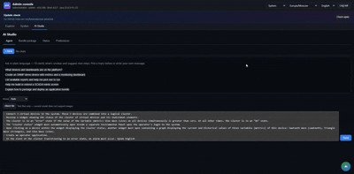

> **Язык:** русская версия. Английский оригинал: [en/ai-agent.md](../en/ai-agent.md).

# Работа с ИИ-агентом: генератор решений, метрики и проверка сценариев

> **Статус:** Beta — генерация решений по текстовому описанию (`POST /api/v1/ai/solutions/generate`), регрессионный набор из 52 сценариев и статистика выполнения инструментов. Метки зрелости: [doc-status.md](doc-status.md).

Этот документ описывает практическую работу с пошаговым ИИ-агентом ISPF, автоматический генератор каркаса решений и инструменты контроля качества работы агента.

**Связанные разделы:** [ИИ-студия и адаптер MCP](ai-development.md) · [Регрессионные сценарии агента](agent-regression.md) · [ADR-0005](decisions/0005-tree-first-ai-agent.md) · [ADR-0034](decisions/0034-agent-observability-and-session-knowledge.md).

---

## 1. Поэтапная подгрузка инструментов (`Progressive tool packs`)

Чтобы не перегружать контекст языковой модели сотней схем на каждом шаге, агент в ИИ-студии стартует с компактного базового набора инструментов (`core` + `discovery`) и при необходимости сам подключает специализированные пакеты в ходе диалога через `list_agent_tools`, `describe_agent_tool` и `enable_agent_tool_pack`.

Основные параметры по умолчанию:
- глубина передаваемой истории диалога: `agent-max-history-turns = 24`;
- лимит токенов ответа на один шаг: `agent-max-tokens = 16384`;
- полная статическая сводка о платформе передаётся только на первом ходе (`briefing-every-turn = false`), а живой снимок дерева обновляется на каждом шаге.

---

## 2. Генератор решений по текстовому описанию (`/api/v1/ai/solutions/generate`)



Метод `POST /api/v1/ai/solutions/generate` строит по текстовому описанию объекта черновик структуры решения, а при передаче флага `"apply": true` сразу разворачивает в дереве объектов узел логики (`SINGLETON`), устройства, правила тревог и экран оператора.

### Режим черновика (`apply: false`, работает даже без внешней LLM)

```json
{
  "prompt": "Резервуарный парк SCADA с двумя насосами и тревогой высокого давления"
}
```

Ответ возвращает подобранную предметную область (`scada`, `mes` или `hvac`), базовый шаблон и ссылку на ближайший эталонный пакет в `examples/`:

```json
{
  "status": "OK",
  "mode": "draft",
  "domain": "scada",
  "domainSelection": "keyword",
  "playbook": "AgentSolutionGeneratorPlaybook",
  "blueprintDraft": {
    "id": "scada-tank-farm-with-2-pumps",
    "title": "SCADA facility overview",
    "domain": "scada",
    "referenceBundle": {
      "appId": "simulator",
      "manifestPath": "examples/simulator-profiles/bundle.json"
    }
  }
}
```

### Режим автоматического развёртывания (`apply: true`, требуется подключённая LLM)

```json
{
  "prompt": "Приточная установка здания (AHU) с обзорным дашбордом и тревогой по температуре",
  "apply": true
}
```

В режиме `live` генератор создаёт:
- центральный узел логики по шаблону `SINGLETON` в ветке `root.platform.singleton-blueprints.<имя>-hub` (в строгом соответствии с правилом: логика отдельно от `DEVICE`);
- узлы телеметрии `DEVICE` в ветке `root.platform.devices`;
- правило тревоги `ALERT` и экран оператора `DASHBOARD`.

Ответ возвращает созданные пути `hubPath`, `dashboardPath` и `alertPath`. Если на сервере настроен закрытый ключ подписи (`ISPF_LICENSE_SIGNING_PRIVATE_KEY_PEM`), сгенерированный пакет автоматически подписывается.

### Определение предметной области по ключевым словам

| Область | Примеры ключевых слов в запросе |
|---------|---------------------------------|
| `scada` | `scada`, `pump`, `tank`, `mimic`, `modbus`, `snmp`, `historian`, насос, резервуар, мнемосхема |
| `mes` | `mes`, `dispatch`, `oee`, `work order`, `manufacturing`, смена, заказ, брак |
| `hvac` | `hvac`, `building`, `comfort`, `zone`, `ahu`, `chiller`, вентиляция, климат |

---

## 3. Проверка генератора и регрессионный набор сценариев

Для проверки качества работы агента на реальных инженерных задачах в репозитории поддерживается набор из **52 сценариев** (SCADA, MES, вентиляция зданий) в каталоге `tools/agent-regression/scenarios/*.json`.

| Скрипт / тест | Назначение |
|---------------|------------|
| `node tools/agent-regression/validate-scenarios.mjs` | Проверка JSON-схем всех сценариев и связанных с ними манифестов `bundle.json` (выполняется в CI на каждом PR) |
| `bash tools/agent-regression/run-platform-gate.sh` | Прогон платформенных сценариев и установки всех эталонных пакетов без вызова внешней LLM |
| `bash tools/agent-regression/run-live-oneshot.sh` | Сквозной прогон развёртывания решения с живой LLM (`ISPF_LLM_SMOKE=true`) |
| `bash tools/agent-regression/run-live-generator-oneshot.sh` | Проверка генератора решений (`apply: true`) с замером времени выполнения и сохранением отчёта в `build/agent-regression/live-generator-results.json` |
| `bash tools/agent-regression/run-live-suite.sh` | Полный прогон всех 52 сценариев с живой моделью (`AGENT_LIVE_SUITE_MODE=full`) |

Пример запуска одиночной проверки с внешней моделью:

```bash
export ISPF_LLM_SMOKE=true
export ISPF_AI_PROVIDER=openai-compatible
export ISPF_AI_BASE_URL=https://api.openai.com/v1
export ISPF_AI_MODEL=gpt-4o-mini
export ISPF_AI_API_KEY=<ваш-ключ>

bash tools/agent-regression/run-live-oneshot.sh
```

Подробное устройство файлов сценариев описано в разделе **[Регрессионные сценарии агента](agent-regression.md)**.

---

## 4. Статистика работы агента и инструментов (`/api/v1/ai/agent/metrics`)

Администратор может отслеживать количество диалогов, расход токенов, среднюю задержку и частоту ошибок по каждому инструменту:

| Метод и путь | Роль | Что возвращает |
|--------------|------|----------------|
| `GET /api/v1/ai/agent/metrics?days=7` | `admin` | Статистика ходов по статусам (`turnsByStatus`), среднее число шагов (`avgStepsPerTurn`), суммарный расход токенов и список инструментов с частыми ошибками (`topFailingTools`) |
| `GET /api/v1/ai/agent/metrics/tools?days=7` | `admin` | Показатели по каждому инструменту: число вызовов `callCount`, средняя и максимальная задержка (`avgLatencyMs`, `maxLatencyMs`), расход токенов и доля ошибок `errorRate` |

В веб-консоли эти таблицы отображаются во вкладке **ИИ-студия → Состояние** (`AgentMetricsPanel`). При временных сетевых сбоях или тайм-аутах во время вызова инструмента сервис `TreeFirstAgentService` автоматически выполняет одну повторную попытку (`AgentToolTransientRetry`).
