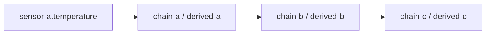

> **Язык:** русская версия. Английский оригинал: [en/analytics-historian-cookbook.md](../en/analytics-historian-cookbook.md).

# Рецепты аналитических расчётов по истории переменных (`kind: historian`)

> **Статус:** Stable — примеры настройки исторических правил расчёта (`kind: historian`), скользящие окна, OEE, многошаговые цепочки и графики по нескольким тегам. Метки зрелости: [doc-status.md](doc-status.md).

Правила расчёта с типом **`kind: "historian"`** в системной переменной `@bindingRules` позволяют вычислять агрегаты по временным окнам архива истории (среднее, минимум, максимум, скорость изменения, расход, OEE) и записывать результат в выходную переменную объекта по расписанию или при обновлении входных сигналов.

**Связанные разделы:** [Правила расчёта (`Binding rules`)](bindings.md) · [Справочник языка выражений](expression-language.md) · [Пользовательские формулы и пакеты расширений](analytics-formulas-and-packs.md) · [Каталог аналитических тегов](analytics-tag-catalog.md) · [ADR-0041](decisions/0041-multi-tag-historian-computations.md).

**Пример:** [`examples/analytics-rolling-avg`](../../examples/analytics-rolling-avg/) — скользящее среднее `avg` по `demo-sensor-01`.

---

## 1. Как устроено историческое правило расчёта

| Понятие | Описание |
|---------|----------|
| Где хранится | В массиве `@bindingRules` на узле объекта (вместе с обычными мгновенными правилами) |
| Поле `kind` | `"historian"` — обычное реактивное ядро пропускает такое правило, а вычисление выполняет аналитический движок `AnalyticsEngineService` |
| Идентификатор тега в каталоге | `<путь_объекта>/tag/<id_правила>` (например, `root.platform.devices.sensor-a/tag/avg-temp-5m`) |
| Выходная переменная | Поле `target.variableName` (создаётся на объекте автоматически при сохранении правила) |
| Диагностика выполнения | Системная переменная `@historianRuleMeta` хранит статус качества (`quality`), время и результат последнего расчёта по каждому `id` правила |

### Пример JSON-структуры правила

```json
{
  "id": "avg-temp-5m",
  "name": "Средняя температура за 5 минут",
  "enabled": true,
  "order": 10,
  "kind": "historian",
  "activators": {
    "onStartup": false,
    "onVariableChange": [
      { "objectPath": "root.platform.devices.sensor-a", "variableName": "temperature" }
    ],
    "onEvent": null,
    "periodicMs": 60000
  },
  "condition": "",
  "expression": "avg(root.platform.devices.sensor-a/temperature, 5m)",
  "windowBucket": "5m",
  "target": { "kind": "variable", "variableName": "avgTemp5m", "field": "value" }
}
```

### Основные виды выражений

| Вид расчёта | Пример записи | Функция |
|-------------|---------------|---------|
| Среднее за окно | `avg(root.platform.devices.sensor-a/temperature, 5m)` | `avg` |
| Скорость изменения | `rateOfChange(root.platform.devices.tank-01/level, 1h)` | `rateOfChange` |
| Показатель OEE смены | `oee('root.platform.devices.line-01', 'avail', 'perf', 'qual', 8h)` | `oee` |
| Комбинированная формула CEL | `(avg(root.../sensor-a/temperature, 5m) + avg(root.../sensor-b/temperature, 5m)) / 2.0` | `cel` |
| Чтение текущего значения | `live(@/temperature)` | `live` |

> В комбинированных выражениях CEL всегда используйте **вещественные числа с точкой** (`2.0`, а не `2`), поскольку агрегаты истории возвращают тип `double`.

### Сохранение через REST API и веб-консоль

```http
GET  /api/v1/objects/by-path/binding-rules?path=<путь_объекта>
PUT  /api/v1/objects/by-path/binding-rules?path=<путь_объекта>
```

В веб-консоли откройте объект в инспекторе → вкладка **«Вычисления»** → **«+ Правило»** → выберите режим **Historian**. Готовые шаблоны функций (`rollingAvg`, `rateOfChange`, `oee`, `customCel`) доступны прямо в каталоге модального редактора выражений.

---

## 2. Готовые рецепты

<a id="recipe-rolling-avg"></a>

### Рецепт 1. Скользящее среднее за 5 минут

Вычисляет среднее значение `temperature` за последние 5 минут и записывает в переменную `avgTemp5m`:

```json
{
  "id": "avg-temp-5m",
  "kind": "historian",
  "expression": "avg(root.platform.devices.sensor-a/temperature, 5m)",
  "windowBucket": "5m",
  "target": { "kind": "variable", "variableName": "avgTemp5m", "field": "value" }
}
```

<a id="recipe-rate-of-change"></a>
<a id="recipe-min"></a>
<a id="recipe-max"></a>
<a id="recipe-totalizer"></a>
<a id="recipe-last"></a>

### Рецепт 2. Скорость изменения, минимум, максимум, сумматор и последнее значение

- **Скорость изменения (`rateOfChange`)** — разница между средним значением первого и последнего интервала в окне:
  ```json
  "expression": "rateOfChange(root.platform.devices.sensor-a/temperature, 1h)",
  "windowBucket": "1h"
  ```
- **Минимум и максимум за окно (`min`, `max`):**
  ```json
  "expression": "min(root.platform.devices.sensor-a/temperature, 1h)",
  "windowBucket": "1h"
  ```
  ```json
  "expression": "max(root.platform.devices.sensor-a/temperature, 1h)",
  "windowBucket": "1h"
  ```
- **Накопительный итог (`totalizer`)** — накопленная сумма по интервалам окна:
  ```json
  "expression": "totalizer(root.platform.devices.sensor-a/flow, 1h)",
  "windowBucket": "1h"
  ```
- **Последняя сохранённая точка (`last`)** — последнее значение из архива за последние 24 часа (или текущее живое значение, если точек нет):
  ```json
  "expression": "last(root.platform.devices.sensor-a/temperature, 1h)",
  "windowBucket": "1h"
  ```

### Рецепт 3. Расчёт OEE смены (`Доступность × Производительность × Качество`)

Рассчитывает общий коэффициент эффективности оборудования (`oeePct`) по трём процентным переменным (`0–100`) за 8-часовое окно:

```json
{
  "id": "shift-oee",
  "kind": "historian",
  "expression": "oee('root.platform.devices.line-01', 'availabilityPct', 'performancePct', 'qualityPct', '8h')",
  "windowBucket": "8h",
  "activators": { "periodicMs": 300000 },
  "target": { "kind": "variable", "variableName": "oeePct", "field": "value" }
}
```

Формула расчёта: `oeePct = (A / 100) × (P / 100) × (Q / 100) × 100`.

### Рецепт 4. Каскадная цепочка из нескольких расчётных тегов

Когда один расчётный показатель служит входом для следующего (например: сырой датчик → 5-минутное сглаживание → часовое сглаживание → сводный KPI):



1. Первое правило считает `avg(root.platform.devices.analytics-demo.sensor-a/temperature, 5m)` и пишет в переменную `derived-a` (на которой также включена запись истории `historyEnabled: true`).
2. Следующее правило читает историю `derived-a` и пишет в `derived-b`.
3. Проверить граф зависимостей тегов (`upstreamTagPaths`, `downstreamTagPaths`) можно запросом:
   ```http
   GET /api/v1/platform/analytics/tags/by-path?path=root.platform.devices.analytics-chain-c#analytics-chain-c-rule
   ```

<a id="recipe-cel"></a>

### Рецепт 5. Комбинированная формула CEL по нескольким устройствам

Средняя температура по двум разным датчикам за 5 минут:

```json
{
  "id": "avg-ab-5m",
  "kind": "historian",
  "expression": "(avg(root.platform.devices.analytics-demo.sensor-a/temperature, 5m) + avg(root.platform.devices.analytics-demo.sensor-b/temperature, 5m)) / 2.0",
  "windowBucket": "5m",
  "target": { "kind": "variable", "variableName": "temperature", "field": "value" }
}
```

---

## 3. Служебная переменная `@historianRuleMeta`

На каждом объекте с историческими правилами платформа автоматически обновляет переменную `@historianRuleMeta`:

```json
{
  "chain-a-rule": {
    "quality": "ok",
    "lastEvalAt": "2026-07-09T15:19:14.477Z",
    "lastEvalStatus": "ok"
  }
}
```

Эта переменная используется только для диагностики и отображения статуса качества в каталоге тегов — **не указывайте `@historianRuleMeta` как источник данных внутри выражений**.

---

## 4. Отображение исторических тегов на дашбордах

- **Текущее значение (`value`, `gauge`):** привяжите виджет к пути объекта и имени целевой переменной правила (например, `avgTemp5m`).
- **График одного ряда (`chart`, `sparkline`):** укажите `objectPath`, `variableName` (не забудьте включить `historyEnabled: true` на этой выходной переменной) и глубину `historyRange`.
- **Сводный график нескольких тегов на одной оси (`chart`):** задайте массив тегов в свойстве `analyticsQueryTagsJson` — виджет загрузит выровненные по времени ряды через `POST /api/v1/platform/analytics/query`:

```json
[
  {"path": "root.platform.devices.analytics-demo.sensor-a", "variable": "temperature", "field": "value", "label": "Датчик"},
  {"path": "root.platform.devices.analytics-demo.chain-a", "variable": "derived-a", "field": "value", "label": "Среднее 5 мин"}
]
```
