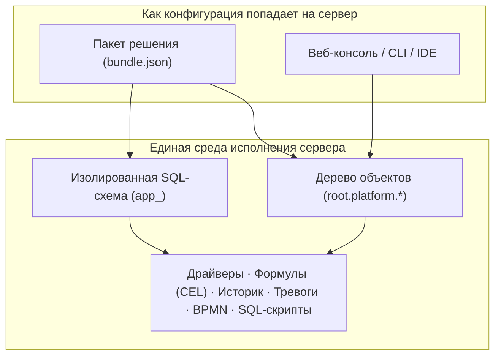

> **Язык:** русская версия. Английский оригинал: [en/application-principles.md](../en/application-principles.md).

# Правила архитектуры прикладных решений на ISPF

> **Статус:** Stable — базовые инженерные правила проектирования решений. Метки зрелости: [doc-status.md](doc-status.md).

В этом документе собраны архитектурные правила, по которым строятся проекты на ISPF — чтобы опрос оборудования, расчёты, таблицы базы данных, экраны оператора и обновления между серверами оставались понятными, надёжными и не ломались при развитии проекта.

Связанные руководства: [Как устроен ISPF](learn.md) · [Руководство разработчика решений](solution-developer-guide.md) · [Модель объектов](object-model.md) · [Шаблоны объектов (Blueprints)](blueprints.md) · [Разработка своего React-интерфейса](external-ide.md) · [Частые ошибки при проектировании](anti-patterns.md).

---

## Главный принцип

Прикладное решение на ISPF **не требует доработки Java-кода сервера** (`ispf-server`) и **не требует правок встроенной консоли администратора** (`apps/web-console`). Разделение ответственности устроено так:

1. **Платформа даёт готовые серверные механизмы:** драйверы протоколов, дерево объектов, движок расчёта формул (CEL и привязки), архив временных рядов, контроль уставок, маршруты BPMN и песочницу для SQL-скриптов.
2. **Инженер проекта настраивает эти механизмы под свою площадку:** описывает шаблоны объектов, узлы оборудования и расчётов, таблицы в изолированной SQL-схеме приложения, функции, экраны и процессы.
3. **Поставка оформляется пакетом `bundle.json`:** пакет переносит конфигурацию в дерево объектов и схему БД целевого сервера (а если у проекта есть собственный веб-интерфейс на React — рядом ставится архив `ui-pack`).



---

## Десять инженерных правил (P1–P10)

### P1. Вся работа во время эксплуатации идёт через дерево объектов

После загрузки решения все живые теги, функции, дашборды, правила тревог и процессы работают как узлы единого дерева (`root.platform.*`) через общий REST API и WebSocket. Запись в каталоге `root.platform.applications.<appId>` — это только паспорт приложения и привязка к его собственной SQL-схеме (`app_<appId>`), а не отдельный параллельный сервер.

### P2. Не смешивайте код конкретного проекта с ядром платформы

Не добавляйте отраслевые Java-контроллеры в `ispf-server`, миграции таблиц заказа/партий в системный Flyway платформы и кастомные страницы в `apps/web-console`. Иначе вы получите собственный форк, который невозможно штатно обновлять. Таблицы проекта кладутся в `migrations[]` приложения, запросы — в `functions[]`, а нестандартный веб-интерфейс оператора — в отдельный `ui-pack` ([ADR-0001](decisions/0001-app-platform-boundary.md)).

### P3. Используйте штатные декларативные механизмы вместо ручного кода

Если задача решается готовым механизмом платформы, не пишите для неё обходной код:
- **Пересчёт единиц измерения, масштабирование, формулы КПД:** правила расчёта (*binding rules*) на языке CEL или встроенные функции (`scale`, `clamp`, `movingAvg`, `counterRate`).
- **Контроль порогов с задержкой и гистерезисом:** узлы тревог `ALERT`.
- **Пошаговые регламенты с участием дежурного персонала:** процессы BPMN (`WORKFLOW`).
- **Чтение и запись прикладных таблиц SQL:** декларативные JSON-скрипты функций (`selectMany`, `selectOne`, `exec`, `return`).

### P4. Пакет `bundle.json` — это способ доставки конфигурации

Манифест `bundle.json` нужен для того, чтобы хранить проект в Git, проверять его в CI и повторяемо раскатывать на тестовый и промышленный контуры (`ispf pack` → `ispf validate` → `ispf deploy` или `POST /api/v1/applications/{appId}/deploy`). Повторный деплой аккуратно обновляет существующие узлы дерева и идемпотентно применяет только новые SQL-миграции.

### P5. Единая схема реактивных правил: КОГДА → ЕСЛИ → ТО

Все реактивные правила в платформе строятся по одной понятной схеме:

```text
КОГДА (изменилась переменная / пришло событие / сработал таймер)
  → ЕСЛИ (выполнено условие CEL)
  → ТО (записать переменную / обновить контекст экрана / опубликовать событие)
```

Не прячьте сложные условия и расчёты внутри отдельных виджетов дашборда — держите логику на узлах объектов, где её видно в инспекторе и легко проверить валидатором ([Единая модель правил](platform-logic.md)).

### P6. Каждой задаче — свой инструмент

Не дублируйте одну и ту же логику в разных подсистемах:

| Задача инженера | Штатный механизм ISPF | Чего избегать |
|-----------------|-----------------------|---------------|
| Опрос ПЛК, счётчиков, датчиков, брокеров | Узел `DEVICE` + драйвер протокола + привязка точек | Самописный опрос из внешних скриптов или браузера |
| Расчётные показатели и сводка по нескольким приборам | Правила расчёта (`@bindingRules`) на узле логики | Длинные выражения внутри виджетов экрана |
| Аварийные и предупредительные пороги | Узел `ALERT` (`root.platform.alert-rules.*`) | Периодические SQL-запросы для поиска превышений |
| Обнаружение цепочки или серии событий за окно времени | Узел `CORRELATOR` (`root.platform.correlators.*`) | Ручные счётчики и флаги в переменных |
| Регламент смены с постановкой задач человеку | Узел `WORKFLOW` (BPMN: `userTask` + `serviceTask`) | Цепочки разрозненных кнопок на экране |
| Учётные таблицы (заказы, смены, партии, справочники) | Функции-скрипты (`script`) в SQL-схеме приложения | Запись в системные таблицы платформы |
| Подтягивание значения из SQL-таблицы в тег | `sqlBinding` | Ручная синхронизация внешними утилитами |

### P7. Как соотносятся консоль, шаблоны, пакеты и наборы изменений

Чтобы не путаться, когда применять шаблоны, прямое редактирование дерева, `bundle.json` и `change set`, разделите их по назначению — это четыре разных инструмента для разных этапов работы:

1. **Шаблон (`Blueprint`) задаёт типовую структуру объекта.** Если на площадке 20 одинаковых котлов или насосов, создайте шаблон `INSTANCE` один раз — тогда у каждого экземпляра будет одинаковый набор переменных, событий и формул.
2. **Консоль администратора (или IDE с MCP) — инструмент разработки и наладки.** Для лабораторного стенда или простого мониторинга без собственных SQL-таблиц достаточно настроить объекты прямо в дереве.
3. **Пакет решения (`bundle.json`) — единица хранения в Git и поставки на сервер.** Как только проекту нужны собственные таблицы БД, проверка в CI или перенос между стендами (dev → test → prod), решение собирается в `bundle.json` (`ispf pack`).
4. **Набор изменений (`Change set`) — инструмент предварительного просмотра и согласования пачки правок** на уже работающем дереве (`preview → apply`), а не способ создания нового приложения с нуля ([Совместная работа](collaboration.md)).

### P8. Вызывайте функции через узлы дерева и единый шлюз BFF

После деплоя прикладные функции адресуются на узлах дерева (например, на центральном узле логики `root.platform.singleton-blueprints.<hub>` или в `{appId}.functions.*`) и вызываются из интерфейса единым запросом `POST /api/v1/bff/invoke`. Для настройки навигации оператора в пакете используйте блок `operatorUi` (устаревший формат `operatorManifest` оставлен только для обратной совместимости).

### P9. Выбирайте подходящий вид интерфейса оператора

В ISPF предусмотрены два штатных варианта экранов для дежурного персонала:
- **Встроенные дашборды и мнемосхемы SCADA (`?mode=operator&app=<appId>`):** идеальны для технологических схем P&ID, однолинейных схем электроснабжения, графиков трендов, таблиц тревог и типовых пультов управления — собираются в браузере без программирования фронтенда.
- **Собственное веб-приложение на React (`ui-pack` по адресу `/apps/<appId>/`):** выбирайте, когда продукту нужны нестандартная вёрстка, интерактивные карты, 3D-сцены или сложные учётные формы. Разрабатывается в отдельном репозитории (Vite + React) и раздаётся сервером ISPF ([Разработка своего React-интерфейса](external-ide.md)). При желании можно оставить базовый встроенный дашборд как резервный экран.

### P10. Проверяйте проект валидатором до выкатки

Перед переносом изменений на общий или промышленный сервер обязательно прогоняйте автоматические проверки:
- формулы CEL — через кнопку **Проверить (Validate)** в консоли или `POST /api/v1/expressions/validate`;
- пакет решения — через `ispf validate` (перед релизом — со строгим флагом `--strict`) и пробный прогон `dry-run`.

---

## Разделение оборудования и логики

<a id="logic-objects-vs-device-mandatory"></a>

### Узлы логики и узлы `DEVICE` (обязательное правило)

**Главное правило моделирования:** узел, на котором живут прикладные функции, SQL-запросы, сводные расчёты по станции или логика цифрового двойника, **не должен иметь тип `ObjectType.DEVICE`**.

**Почему это важно на реальном объекте:** узел `DEVICE` привязан к жизненному циклу конкретного драйвера связи (IP-адрес контроллера, номер регистра, таймауты, статус опроса). На площадке датчики и ПЛК регулярно выводят в ремонт, переключают на резерв или меняют модель прибора. Если повесить расчёт общестанционного баланса или функции обработки заказов прямо на узел датчика, отключение или замена прибора сломает работу приложения и экранов.

Выбирайте тип узла по его инженерной роли:

| Роль в проекте | Что использовать | Типичное расположение в дереве | Комментарий |
|----------------|------------------|--------------------------------|-------------|
| **Один центральный контроллер / оркестратор** на всё решение или площадку | Шаблон **`SINGLETON`** | `root.platform.singleton-blueprints.<project>-hub` | Единственный экземпляр; оптимальное место для BFF-функций, SQL-скриптов и общих KPI |
| **Много однотипных установок / цифровых двойников** (линии, котельные, магазины, резервуары) | Шаблон типа **`INSTANCE`** (Instance Type) | `root.platform.instances.*` или `root.platform.devices.<site>.*` | По одному шаблону создаётся N объектов; у каждого свои переменные и собственные расчёты |
| **Физический прибор, ПЛК или симулятор** | Узел **`DEVICE`** | Внутри `root.platform.devices.*` (или дочерним узлом под своей установкой) | Только настройки драйвера связи и точки ввода-вывода (телеметрия и уставки прибора) |

> **Группировка в дереве `devices`:** размещать дочерние узлы `DEVICE` внутри родительского узла `SINGLETON` / `INSTANCE` или в папке `CUSTOM` по пути `root.platform.devices.<цех>` — совершенно нормально. Важен именно **тип узла логики**: он должен быть `SINGLETON` или `INSTANCE`, а не `DEVICE`.

**Как это проверяется при сборке ([ADR-0060](decisions/0060-solution-authoring-constraints.md)):**
- При обычной отладке валидатор помечает `LOGIC_HOST_DEVICE` как **предупреждение (`WARNING`)**, не мешая быстрой проверке гипотез.
- При строгой проверке перед поставкой (`ispf validate --strict`, `POST .../deploy?strict=true`, автотесты `examples/` и публикация в каталог решений) `LOGIC_HOST_DEVICE` считается **ошибкой (`ERROR`)**.

---

## Краткая шпаргалка: где что размещать

| Что нужно сделать | Где размещается в ISPF | Где прочитать подробнее |
|-------------------|------------------------|-------------------------|
| Опрос оборудования (Modbus, OPC UA, S7, MQTT, SNMP) | Узел `DEVICE` + настройка точек драйвера | [Драйверы устройств](drivers.md) |
| Центральная логика приложения / диспетчерской (1 на проект) | Узел `SINGLETON` | [Шаблоны (Blueprints)](blueprints.md) |
| Типовой агрегат / цифровой двойник (много однотипных) | Шаблон `INSTANCE` + созданные экземпляры | [Шаблоны (Blueprints)](blueprints.md) |
| Пересчёт сигналов и сводные показатели | Правила расчёта (`@bindingRules`) | [Правила расчёта](bindings.md) |
| Часовые / сменные средние и OEE по архиву | Исторические правила (`kind: "historian"`) | [Рецепты расчётов по истории](analytics-historian-cookbook.md) |
| Уставки и сигнализация превышений | Узел `ALERT` | [Автоматизация](automation.md) |
| Пошаговая обработка аварий и задания смене | Узел `WORKFLOW` (BPMN) | [Процессы BPMN](workflows.md) |
| Учётные таблицы БД и операции чтения/записи | `migrations[]` + функции `script` на узле логики | [Руководство разработчика решений](solution-developer-guide.md) |
| Стандартные операторские экраны и мнемосхемы P&ID | Узлы `DASHBOARD` и `MIMIC` | [Дашборды](dashboards.md) · [Мнемосхемы SCADA](scada.md) |
| Кастомный веб-интерфейс оператора на React | Отдельный проект Vite/React → `ui-pack` + `/api/v1/bff/invoke` | [Разработка своего React-интерфейса](external-ide.md) |

> **Для разработчиков сценариев ИИ-студии и MCP:** внутренние таблицы маршрутизации инструментов ИИ-агента вынесены в отдельные технические документы [agent-knowledge.md](agent-knowledge.md) и [ai-development.md](ai-development.md).
