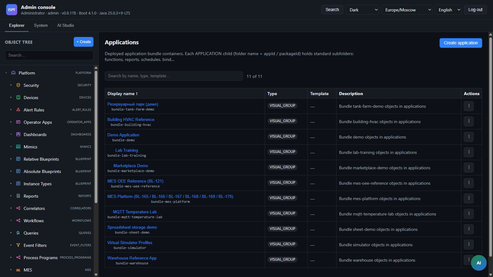

> **Язык:** русская версия. Английский оригинал: [en/applications.md](../en/applications.md).

# Прикладные решения: пакеты `bundle.json`, функции, миграции и BFF

> **Статус:** Stable — упаковка и установка решений (`bundle.json`), изолированные SQL-схемы, скриптовые функции, шлюз BFF, расписания и интеграция с Git. Метки зрелости: [doc-status.md](doc-status.md).

ISPF позволяет разрабатывать и поставлять готовые отраслевые решения (SCADA, MES, учёт энергоресурсов, диспетчеризация зданий) **в виде декларативных пакетов `bundle.json` без изменения Java-кода сервера `ispf-server`** ([ADR-0001](decisions/0001-app-platform-boundary.md)). Пошаговый учебник по сборке проекта с нуля приведён в **[Руководстве разработчика решений](solution-developer-guide.md)**.

---

## 1. Обзор механизмов прикладного решения



| Возможность | Как вызывается |
|-------------|----------------|
| Регистрация приложения и его схемы БД | `POST /api/v1/applications` |
| Изолированные SQL-миграции таблиц приложения | `POST /api/v1/applications/{appId}/data/migrate` (или секция `migrations[]` в пакете) |
| Скриптовые функции на узлах логики | `POST /api/v1/applications/{appId}/functions/deploy` (или секция `functions[]` в пакете) |
| Установка всего решения одним запросом | `POST /api/v1/applications/{appId}/deploy` (манифест `bundle.json`) |
| Единый шлюз вызова функций из интерфейса (BFF) | `POST /api/v1/bff/invoke` |
| Вызов функций из процессов BPMN | Шаг `serviceTask` с действием `invoke_function` |
| Периодический запуск функций по расписанию | `GET / POST /api/v1/schedules` (или секция `schedules[]` в пакете) |
| Привязка к репозиторию Git (pull / push PR) | Вкладка **Git** на узле приложения (`/api/v1/applications/{appId}/git/**`) |

---

## 2. Регистрация приложения и изолированная SQL-схема

```http
POST /api/v1/applications
Content-Type: application/json

{
  "appId": "myapp",
  "displayName": "Моё приложение",
  "tablePrefix": "myapp_",
  "schemaName": "myapp"
}
```

### Миграции таблиц приложения

Таблицы прикладного решения хранятся отдельно от системных миграций Flyway — в собственной SQL-схеме приложения (`schemaName`, по умолчанию `app_<appId>`):

```http
POST /api/v1/applications/myapp/data/migrate
Content-Type: application/json

{
  "version": "1.0.0",
  "scripts": [
    { "id": "items", "sql": "CREATE TABLE IF NOT EXISTS myapp_item (id VARCHAR(64) PRIMARY KEY, title VARCHAR(255));" }
  ]
}
```

- Повторный вызов с уже применённой парой `(version, id)` безопасен и пропускается.
- Сервер блокирует попытки изменять системные таблицы платформы (`applications`, `object_nodes`, `workflow_*` и др.). Если задан `tablePrefix`, имена всех создаваемых таблиц должны начинаться с этого префикса.
- Проверить применённые миграции: `GET /api/v1/applications/myapp/data/status`.

---

## 3. Скриптовые функции приложения (`source.type = "script"`)

Прикладные функции размещаются на узлах логики (`SINGLETON` или `INSTANCE`, но не `DEVICE`) и описываются JSON-сценарием из последовательных шагов:

| Шаг сценария | Что делает |
|--------------|------------|
| `selectOne` | Выполняет SQL `SELECT` и сохраняет одну строку (`Map`) в переменную сценария |
| `selectMany` | Выполняет SQL `SELECT` и сохраняет список строк (`List<Map>`) в переменную сценария |
| `exec` | Выполняет параметризованный SQL `INSERT` / `UPDATE` / `DELETE` |
| `setVar` | Записывает в переменную сценария константу или выражение `${...}` |
| `buildRecord` | Собирает объект (`Map`) из набора вычисляемых полей `fields` |
| `map` | Преобразует каждый элемент массива `source` по шаблону `fields` (текущий элемент доступен как `${item.*}`) |
| `invoke_function` | Вызывает другую функцию дерева объектов (вложенность до 8 уровней) |
| `when` / `if` | Условное ветвление (`then` / `else`) |
| `readVariable` | Читает значение переменной узла дерева (`objectPath: "self"` или полный путь) |
| `jsonParse` | Разбирает JSON-строку в структуру полей |
| `setDriverTelemetry` | Записывает значение телеметрии в узел устройства |
| `instantiateModelIfMissing` | Создаёт экземпляр объекта по шаблону, если он ещё не существует |
| `cancel_workflows` | Отменяет активные экземпляры процесса BPMN |
| `failIfNull` / `failIfNotEquals` | Прерывает выполнение и возвращает заданный `error_code` и `error_message` |
| `return` | Формирует итоговый ответ функции по списку полей `fields` |

Каждый вызов функции выполняется в одной транзакции БД (при необработанной ошибке изменения откатываются). Подробные примеры всех типов функций (встроенных, скриптовых и Java в песочнице) приведены в разделе **[Функции на объектах](object-functions.md)**.

```http
POST /api/v1/applications/myapp/functions/deploy
Content-Type: application/json

{
  "objectPath": "root.platform.singleton-blueprints.myapp-hub",
  "functionName": "myapp_ping",
  "version": "1",
  "descriptor": {
    "inputSchema": { "name": "in", "fields": [{"name": "orderId", "type": "STRING"}] },
    "outputSchema": {
      "name": "out",
      "fields": [
        {"name": "error_code", "type": "STRING"},
        {"name": "error_message", "type": "STRING"}
      ]
    }
  },
  "source": {
    "type": "script",
    "body": "{ \"steps\": [ ... ] }"
  }
}
```

---

## 4. Пакетное развёртывание решения (`bundle.json`)

<a id="bundle-deploy-req-pf-03"></a>

Один запрос `POST /api/v1/applications/{appId}/deploy` регистрирует приложение, накатывает SQL-миграции, создаёт шаблоны (`blueprints`), узлы дерева (`objects`), функции (`functions`), правила тревог (`alertRules`), корреляторы (`correlators`), дашборды (`dashboards`), процессы (`workflows`), отчёты (`reports`) и расписания (`schedules`).

### Требования к версии и структуре манифеста (ADR-0064)

- Поле `version` обязательно и должно соответствовать формату SemVer `MAJOR.MINOR.PATCH` (например, `"1.0.0"`).
- Необязательное поле `formatVersion` указывает версию формата самого JSON-манифеста (по умолчанию `1`).
- Описание изменений версии можно указать в поле `changelog` (или `metadata.changelog`) — оно отображается в каталоге решений.

```http
POST /api/v1/applications/myapp/deploy
Content-Type: application/json

{
  "version": "1.0.0",
  "displayName": "Моё приложение",
  "tablePrefix": "myapp_",
  "schemaName": "myapp",
  "blueprints": [
    {
      "name": "myapp-hub-v1",
      "description": "Центральный узел логики приложения",
      "type": "SINGLETON",
      "targetObjectType": "CUSTOM",
      "variables": []
    }
  ],
  "objects": [
    {
      "parentPath": "root.platform.singleton-blueprints",
      "name": "myapp-hub",
      "type": "CUSTOM",
      "templateId": "myapp-hub-v1",
      "displayName": "Логика приложения"
    }
  ],
  "dashboards": [
    {
      "path": "root.platform.dashboards.myapp-ops",
      "title": "Пульт оператора",
      "layoutJson": "{ \"columns\": 84, \"rowHeight\": 8, \"widgets\": [] }"
    }
  ],
  "migrations": [ { "id": "001_init", "sql": "..." } ],
  "functions": [ ... ],
  "schedules": [
    {
      "scheduleId": "import-job",
      "enabled": true,
      "intervalMs": 60000,
      "actionType": "invoke_function",
      "action": {
        "objectPath": "root.platform.singleton-blueprints.myapp-hub",
        "functionName": "myapp_importRecords"
      }
    }
  ]
}
```

### Проверка, откат и выгрузка пакета из дерева

```http
GET  /api/v1/applications/{appId}/export
POST /api/v1/applications/{appId}/bundle/validate?dryRun=true|false&strict=true|false
POST /api/v1/applications/{appId}/deploy?strict=true|false&runTests=true|false
GET  /api/v1/applications/{appId}/deploy/history
POST /api/v1/applications/{appId}/deploy/rollback
```

- **Режим проверки (`strict`):** при обычной отладке (`strict=false`) размещение логики на узле `DEVICE` (`LOGIC_HOST_DEVICE`) выдаёт предупреждение (`WARNING`), не блокируя установку. При строгой проверке перед поставкой (`strict=true` или `ispf validate --strict`) нарушение архитектурных правил возвращает ошибку `400` ([ADR-0060](decisions/0060-solution-authoring-constraints.md)).
- **Автотесты пакета (`runTests=true`):** если в манифесте задана секция `tests[]`, они автоматически прогоняются сразу после установки.
- **Атомарность при ошибках:** перед изменением дерева сервер проверяет структуру узлов и выполняет SQL-миграции. Если в SQL-скрипте нового деплоя возникает ошибка, транзакция откатывается, а созданные этой попыткой таблицы удаляются.
- **Сборка манифеста из живого дерева (`pull-from-tree`):** запрос `POST /api/v1/applications/{appId}/bundle/pull-from-tree` собирает актуальные дашборды, процессы и объекты приложения из дерева обратно в структуру `bundle.json`.

---

## 5. Шлюз вызова функций из интерфейса (`BFF`)

<a id="bff-req-pf-06"></a>

Экраны оператора и внешние React-приложения (`ui-pack`) вызывают серверные функции через единый шлюз:

```http
POST /api/v1/bff/invoke
Content-Type: application/json

{
  "objectPath": "root.platform.singleton-blueprints.myapp-hub",
  "functionName": "myapp_processRecord",
  "input": {
    "schema": { "name": "in", "fields": [{"name": "orderId", "type": "STRING"}] },
    "rows": [{ "orderId": "ORD-101" }]
  },
  "wireProfile": "ispf-operator-v1"
}
```

Формат ответа с профилем `ispf-operator-v1`:
- при успехе возвращается `"error_code": "OK"`, `"error_message": ""`, поле `"result"` (объект для одной записи или массив строк для табличной выборки) и словарь человекочитаемых заголовков колонок `"result_field_labels"`;
- при прикладной ошибке возвращается код ошибки в `"error_code"` и текст в `"error_message"`.

---

## 6. SQL-привязки переменных (`sqlBinding`)

Переменную узла логики можно автоматически обновлять результатом SQL-запроса к схеме приложения:

```http
POST /api/v1/applications/{appId}/bindings/deploy
Content-Type: application/json

{
  "objectPath": "root.platform.singleton-blueprints.myapp-hub",
  "variable": "readyCount",
  "query": "SELECT COUNT(*) AS value FROM myapp_item WHERE status = 'ready'",
  "refresh": "on_schedule",
  "refreshIntervalMs": 30000,
  "valueField": "value"
}
```

Режимы обновления (`refresh`):
- `on_schedule` — периодический опрос по таймеру (`ApplicationSqlBindingScheduler`);
- `on_function_success` — пересчёт сразу после успешного вызова указанной функции;
- `on_event` — пересчёт при публикации события на объекте.

---

## 7. Связь приложения с репозиторием Git (ADR-0063)

<a id="application-git-adr-0063"></a>

Вкладка **Git** на узле `APPLICATION` позволяет связать пакет приложения с репозиторием GitHub или GitLab:

| Операция | API | Что делает |
|----------|-----|------------|
| Настройка привязки | `GET / PUT / DELETE /api/v1/applications/{appId}/git` | Сохраняет HTTPS URL репозитория, провайдера (`github` или `gitlab`), ветку, путь к `bundle.json` и токен доступа (в зашифрованном хранилище секретов) |
| Проверка статуса | `GET /api/v1/applications/{appId}/git/status` | Показывает текущую привязку и хэш последнего применённого коммита |
| Загрузка релиза из Git (`Pull`) | `POST /api/v1/applications/{appId}/git/pull` | Скачивает `bundle.json` из указанной ветки/тега (`ref`), проверяет и разворачивает его на сервере |
| Выгрузка правок в Git (`Push PR`) | `POST /api/v1/applications/{appId}/git/push-pr` | Собирает текущее состояние приложения из дерева (`pull-from-tree`), создаёт ветку `ispf/...` и открывает Pull Request / Merge Request |

---

## 8. Настройка меню и экранов оператора (`operatorUi`)

Чтобы приложение появилось в списке рабочих мест оператора (`?mode=operator&app=myapp`), добавьте в `bundle.json` секцию `operatorUi` (подробнее см. в разделе **[Приложения оператора](operator-apps.md)**):

```json
{
  "appId": "myapp",
  "title": "Диспетчерская цеха",
  "defaultDashboard": "root.platform.dashboards.myapp-ops",
  "dashboards": [
    { "path": "root.platform.dashboards.myapp-ops", "title": "Обзор цеха" }
  ]
}
```

После установки пакета все его ресурсы отражаются в дереве объектов внутри ветки `root.platform.applications.<appId>` (папки `reports`, `functions`, `schedules`, `bindings`, `migrations`).

**Связанные разделы:** [Руководство разработчика решений](solution-developer-guide.md) · [Публичный контракт разработчика](solution-developer-public-api.md) · [Функции на объектах](object-functions.md) · [Процессы BPMN](workflows.md) · [Отчёты](reports.md).
