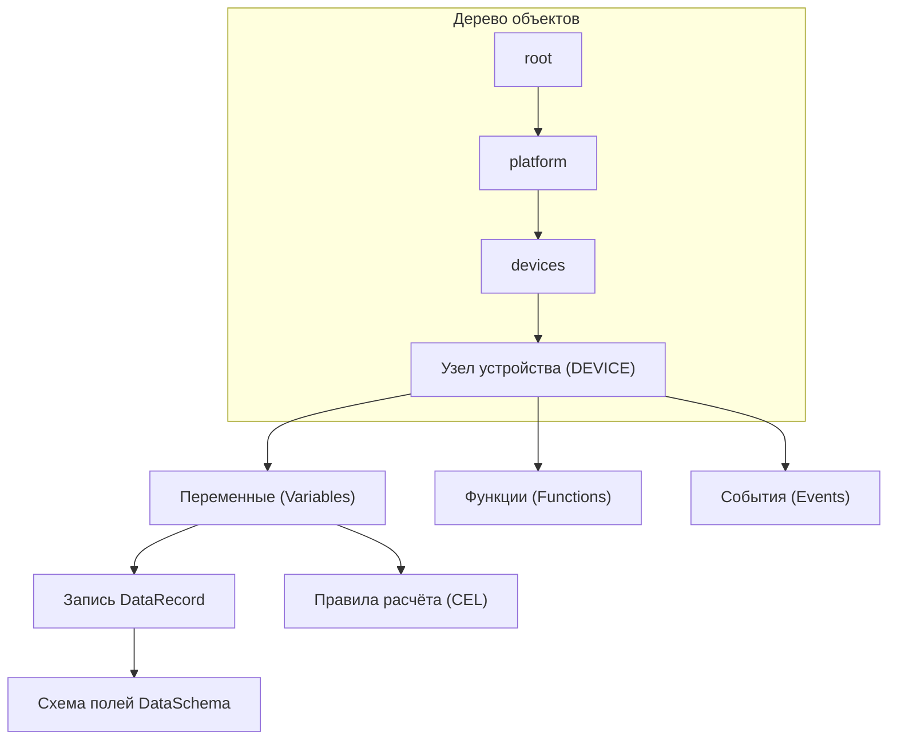

> **Язык:** русская версия. Английский оригинал: [en/architecture.md](../en/architecture.md).

# Архитектура ISPF

> **Статус:** Stable — устройство сервера, слои исполнения, потоки данных и точки расширения. Метки зрелости: [doc-status.md](doc-status.md).

**Связанные разделы:** [Как устроен ISPF](learn.md) · [Модель объектов](object-model.md) · [Кластер высокой доступности](cluster.md) · [Правила архитектуры приложений](application-principles.md) · [Архитектурные решения (ADR)](decisions/readme.md).

---

## Общий замысел

**ISPF (IoT Solutions Platform Framework)** — серверная платформа для промышленной автоматизации, диспетчеризации (SCADA), IoT-мониторинга и цехового учёта (MES). Она предоставляет единую модель данных, систему прав и REST/WebSocket API для работы с оборудованием, экранами оператора, тревогами, архивом историй и процессами BPMN.

<a id="основной-принцип-бизнес-логика-в-механизмах-платформы"></a>

## Основной принцип: логика в механизмах дерева объектов

Прикладная логика конкретного завода или объекта описывается **конфигурацией дерева объектов**, а не доработкой Java-кода сервера `ispf-server`:

| Механизм платформы | За что отвечает |
|--------------------|-----------------|
| **Шаблоны (`Blueprints`)** | Типовой состав узла: переменные, события, функции и правила расчёта (`SINGLETON`, `INSTANCE`, `MIXIN`) |
| **Переменные (`Variables`)** | Текущие значения (`DataRecord`), формулы пересчёта (CEL и встроенные функции), запись истории |
| **События и тревоги (`ALERT`, `CORRELATOR`)** | Уведомления, контроль уставок с гистерезисом и корреляция серий событий |
| **Функции (`Functions`)** | Вызываемые операции на узлах дерева (встроенные обработчики, SQL/JSON-скрипты, песочница Java) |
| **Процессы (`WORKFLOW`)** | Маршруты BPMN, задачи в рабочей очереди оператора и таймеры эскалации |

- **Ядро платформы (`main`)** один раз реализует универсальные серверные движки: опрос протоколов, дерево объектов, вычисление формул CEL, архив историй, контроль уставок, BPMN и выполнение SQL-скриптов.
- **Прикладное решение (`bundle.json`)** поставляет настройки этих движков и собственные таблицы в изолированной SQL-схеме приложения (а при необходимости кастомного фронтенда — пакет `ui-pack` на `/apps/<appId>/`). См. [ADR-0001](decisions/0001-app-platform-boundary.md).

---

## Доменная модель



- **Узел дерева (`PlatformObject`):** адресуется путём через точку (`root.platform.devices.pump-01`) и имеет семантический тип `ObjectType` (`DEVICE`, `DASHBOARD`, `MIMIC`, `WORKFLOW`, `ALERT`, `CORRELATOR`, `REPORT` и др.).
- **Запись данных (`DataRecord` и `DataSchema`):** строго типизированная строка (или таблица строк) с проверкой типов полей и необязательной меткой достоверности `quality`.
- **Выражения:** язык Google **CEL** и встроенные функции обработки сигналов (`scale`, `clamp`, `movingAvg`, `counterRate`, чтение соседних узлов `read`) — см. [Правила расчёта](bindings.md).

```text
self.temperature.value > self.threshold.value
counterRate(ifInOctets)
```

---

## Слои сервера во время работы

```text
┌─────────────────────────────────────────────────────────────┐
│  Веб-консоль (React 19 + Vite + TanStack Query)             │
│  Консоль администратора │ Пульт оператора │ Редакторы схем  │
├─────────────────────────────────────────────────────────────┤
│  Слой API (Spring Boot 4, Java 25)                          │
│  REST API / WebSocket (/ws/objects) / OAuth2 JWT / RBAC     │
├─────────────────────────────────────────────────────────────┤
│  Доменные сервисы сервера                                   │
│  ObjectManager │ EventService │ WorkflowService             │
│  DashboardService │ AlertRuleService │ CorrelatorService    │
│  DriverRuntimeService │ BlueprintEngine                     │
│  ApplicationPlatform (миграции, функции, BFF, расписания)   │
├─────────────────────────────────────────────────────────────┤
│  Библиотеки и плагины ядра                                  │
│  ispf-core │ ispf-expression │ ispf-plugin-blueprint        │
│  ispf-plugin-workflow │ ispf-analytics-* │ ispf-ai-*        │
├─────────────────────────────────────────────────────────────┤
│  Протокольные драйверы (Driver SPI, внешние пакеты)         │
│  modbus-* │ opcua │ s7 │ mqtt │ snmp │ iec104 │ dnp3 │ jdbc │
├─────────────────────────────────────────────────────────────┤
│  Хранение данных и шины сообщений                           │
│  PostgreSQL/TimescaleDB (или H2) │ ClickHouse* │ NATS*      │
└─────────────────────────────────────────────────────────────┘
```

### Основные модули репозитория (`packages/`)

| Модуль | Назначение |
|--------|------------|
| `ispf-core` | Дерево объектов, `PlatformObject`, `DataRecord`, базовые модели |
| `ispf-expression` | Движок Google CEL, функции привязок и формальная проверка выражений |
| `ispf-driver-api` и `ispf-driver-*` | Контракт `DeviceDriver` SPI и пакеты промышленных/ИТ-протоколов |
| `ispf-plugin-blueprint` | Реестр и применение шаблонов объектов (`SINGLETON`, `INSTANCE`, `MIXIN`) |
| `ispf-plugin-workflow` | Парсер и исполнитель процессов BPMN |
| `ispf-analytics-*` | Исторические расчёты, агрегация временных рядов и пакеты формул |
| `ispf-ai-*` | Инструменты ИИ-студии, адаптер MCP и поиск по документации |
| `ispf-server` | Сборка Spring Boot, REST/WebSocket контроллеры, безопасность, работа с СУБД |

---

## Потоки данных

### Путь телеметрии от прибора до браузера

```text
DeviceDriver.readPoints()
  → DriverRuntimeService
  → ObjectManager (обновление переменной на узле DEVICE)
  → Запись в архив истории (асинхронно, если historyEnabled = true)
  → BindingPropagationListener → BindingRuleEngine (пересчёт зависимых формул)
  → AlertRuleListener (проверка аварийных порогов)
  → ObjectChangeEvent → WebSocket (/ws/objects) → обновление экранов оператора
```

### Путь обработки тревог и задач смены

```text
Срабатывание события (EventService) → запись в event_history
  → EventCorrelatorListener → запуск процесса BPMN (WorkflowService)
  → шаг userTask → рабочая очередь (Work Queue) → выполнение оператором
```

---

## Безопасность и варианты развёртывания

- **Аутентификация:** токены OAuth2 JWT (через Keycloak / OIDC) в промышленном контуре или встроенный вход `POST /api/v1/auth/login` в локальном профиле (`local`), с поддержкой ролей (`admin`, `operator` и пользовательских ролей) и двухфакторной проверки TOTP. Подробнее: [Безопасность](security.md).
- **Одиночный сервер:** `ispf-server` + PostgreSQL/TimescaleDB (при большом потоке телеметрии — дополнительно ClickHouse). Подробнее: [Развёртывание](deployment.md).
- **Кластер высокой доступности vs Федерация:**
  - **Кластер ([cluster.md](cluster.md))** — несколько узлов `ispf-server` поверх общей БД и одного дерева `root.platform.*` с распределением опроса драйверов и синхронизацией через NATS/Redis.
  - **Федерация ([federation.md](federation.md))** — связка самостоятельных серверов на удалённых площадках с центральным диспетчерским сервером и буферизацией при потере канала связи.

---

## Штатные способы расширения

1. **Новый протокол связи** — реализация интерфейса `DeviceDriver` в отдельном пакете драйвера ([SDK драйверов](driver-ddk.md)).
2. **Типовое оборудование или цифровой двойник** — шаблон `BlueprintDefinition` ([Шаблоны объектов](blueprints.md)).
3. **Прикладное решение под отрасль** — пакет `bundle.json` (изолированная SQL-схема, функции, экраны, процессы) + при необходимости веб-интерфейс `ui-pack` ([Руководство разработчика решений](solution-developer-guide.md), [Внешний React UI](external-ide.md)).
4. **Внешние интеграции** — REST API, вебхуки и шины MQTT/NATS ([API](api.md), [Шины сообщений](messaging.md)).

Полное оглавление документации: **[docs/ru/readme.md](readme.md)**.
