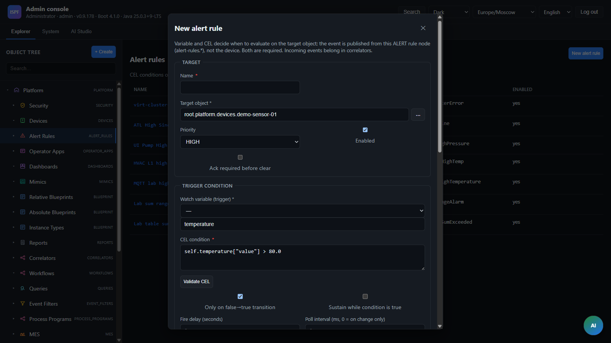
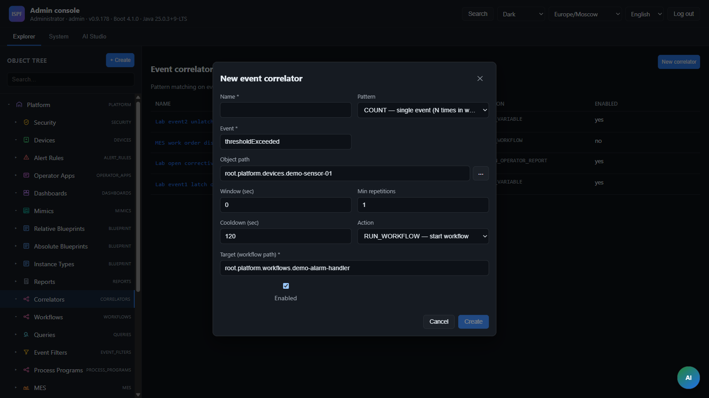

> **Язык:** русская версия. Английский оригинал: [en/automation.md](../en/automation.md).

# Автоматизация: события, правила тревог и корреляторы

> **Статус:** Stable — журнал событий, пороговые тревоги, корреляция событий и каналы уведомлений. Метки зрелости: [doc-status.md](doc-status.md).

Подсистема автоматизации ISPF отслеживает выход технологических параметров за допустимые пределы, фиксирует события в журнале, выявляет цепочки повторяющихся сбоев и запускает уведомления либо маршруты BPMN.

Связанные разделы: [Модель объектов](object-model.md) · [Процессы BPMN](workflows.md) · [Справочник языка выражений (CEL)](expression-language.md).

**Пример:** [`examples/alert-rule-evolution`](../../examples/alert-rule-evolution/) — как наращивают правило тревоги; [`examples/ot-alarm-classify`](../../examples/ot-alarm-classify/) — разбор OT-тревоги.

---

## 1. События и журнал событий

### Описание события (`EventDescriptor`)

На объекте объявляются допустимые типы событий (`EventDescriptor`): имя, схема полей данных (`payload`) и уровень важности (`DEBUG`, `INFO`, `WARNING`, `ERROR`, `CRITICAL`).

### Как формируются события

1. **Автоматически по правилу тревоги (`ALERT`)** или из правила расчёта (`fire(@/evt/...)`).
2. **Явным вызовом REST API** (из внешних систем, скриптов или тестов):
   ```http
   POST /api/v1/events/fire
   ```
3. **Напрямую из драйвера** (режим `telemetryPublishMode=EVENT_JOURNAL_ONLY` для специализированного пакетного аудита — см. [ADR-0027](decisions/0027-event-journal-ingress-fast-path.md)). На обычной потоковой телеметрии журнал событий объекта оставляют выключенным (`eventJournalEnabled=false`), чтобы не раздувать БД — см. [Частые ошибки при проектировании](anti-patterns.md).

После проверки по дескриптору событие асинхронно записывается в `event_history` (PostgreSQL/TimescaleDB или ClickHouse), рассылается в интерфейс по WebSocket и передаётся на вход корреляторам событий.

### Чтение журнала событий

```http
GET /api/v1/events?objectPath=root.platform.devices.demo-sensor-01&limit=50
```

Без параметра `objectPath` возвращается общий журнал (до 200 последних записей). Необязательный параметр `expr` позволяет отфильтровать записи выражением CEL по полям `payload.*`.

---

## 2. Расположение правил в дереве объектов

Правила тревог и корреляторы хранятся как обычные узлы дерева под `root.platform`:

```text
root.platform
├── root.platform.alert-rules
│   └── root.platform.alert-rules.temperature-threshold-exceeded
└── root.platform.correlators
    ├── root.platform.correlators.alarm-handler-on-threshold-event
    └── root.platform.correlators.threshold-then-alarm-active-sequence-demo
```

| Сущность | Тип узла | Встроенный шаблон | Раздел в дереве |
|----------|----------|-------------------|-----------------|
| Правило тревоги | `ALERT` | `alert-rule-v1` | `root.platform.alert-rules` |
| Коррелятор событий | `CORRELATOR` | `correlator-v1` | `root.platform.correlators` |

Настройка в консоли администратора: выберите узел в папке `alert-rules` или `correlators` — справа откроется специализированный инспектор (`AlertRuleInspector` / `CorrelatorInspector`).

---

## 3. Правила тревог (`Alert rules`)

Правило тревоги проверяет условие CEL при каждом обновлении контролируемой переменной (и при необходимости дополнительно по таймеру `pollIntervalMs`).



### Основные поля настройки

| Поле | Назначение |
|------|------------|
| `objectPath` | Путь контролируемого объекта (например, `root.platform.devices.demo-sensor-01`) |
| `watchVariable` | Имя отслеживаемой переменной на объекте (например, `temperature`) |
| `conditionExpr` | Условие срабатывания на языке CEL (например, `self.temperature.value > 80.0`) |
| `eventName` | Имя события, публикуемого при срабатывании |
| `payloadVariable` | Переменная, чьи данные прикладываются к событию (необязательно) |
| `enabled` | Включено ли правило |
| `edgeTrigger` | Срабатывать только на переходе `false → true` (по фронту) |
| `delaySeconds` | Выдержка времени (в секундах), в течение которой условие должно держаться истинным до тревоги (`0` — сразу) |
| `sustainWhileTrue` | Повторно публиковать событие, пока держится авария (не чаще `rateLimitSeconds`) |
| `rateLimitSeconds` | Минимальная пауза между повторными уведомлениями |
| `priority` | Приоритет: `CRITICAL` / `HIGH` / `MEDIUM` / `LOW` |
| `ackRequired` | Требуется ли подтверждение (квитирование) оператором |
| `deactivateExpr` | Условие возврата в норму с гистерезисом (например, `self.temperature.value < 70.0`) |
| `deactivateDelaySeconds` | Выдержка времени перед сбросом тревоги |
| `clearEventName` | Имя события при возврате в норму (например, `thresholdCleared`) |
| `pollIntervalMs` | Периодическая перепроверка в мс (`0` — проверять только при изменении переменной) |
| `triggerMessage` | Сообщение как выражение CEL (строковый литерал `'…'` или формула); пустое — без отдельного текста |
| `notificationWebhookUrl` | HTTP URL для отправки POST-уведомления |
| `notificationEmailTarget` | Получатель письма в формате `to@host\|тема\|текст` |

### Режим защёлки и гистерезиса (`latch`)

Если задано условие сброса `deactivateExpr`, имя события возврата `clearEventName` или задержка сброса `deactivateDelaySeconds > 0`, правило работает с **защёлкой**: после превышения верхнего порога (например, `> 80 °C`) тревога остаётся активной (`latchedActive = true`), пока параметр уверенно не вернётся ниже порога сброса (`< 70 °C`). Это защищает журнал от «дребезга» сигнала возле уставки.

Оценка одного правила потокобезопасна (параллельные обновления не вызывают двойного срабатывания). Ошибка вычисления формулы на одном правиле пишется в лог и счётчик `ispf.alert.rule_failures.total`, не останавливая остальные правила.

### REST API правил тревог

| Метод | Путь | Роль |
|-------|------|------|
| `GET` | `/api/v1/alert-rules` | `admin` |
| `GET` | `/api/v1/alert-rules/by-path?path=...` | `admin` |
| `POST` | `/api/v1/alert-rules` | `admin` |
| `PUT` | `/api/v1/alert-rules/by-path?path=...` | `admin` |
| `DELETE` | `/api/v1/alert-rules/by-path?path=...` | `admin` |

---

## 4. Корреляторы событий (`Event correlators`)



Коррелятор отслеживает комбинацию или серию событий за заданное окно времени (`windowSeconds`) и выполняет ответное действие (чаще всего — запускает процесс BPMN).

### Шаблоны корреляции (`patternType`)

| Тип шаблона | Когда срабатывает |
|-------------|-------------------|
| `COUNT` | Событие `eventName` повторилось `minOccurrences` раз за `windowSeconds` |
| `SEQUENCE` | На одном объекте сначала произошло событие A (`eventName`), а затем событие B (`secondEventName`) в пределах окна |
| `EVENT_CHAIN` | Упорядоченная цепочка из 3 и более событий (`eventName` + список в `secondEventName` через запятую; посторонние события между ними игнорируются) |
| `WINDOW` | Все перечисленные события произошли на объекте хотя бы по одному разу за `windowSeconds` в любом порядке |

После срабатывания выдерживается пауза `cooldownSeconds`, чтобы не плодить дублирующие инциденты.

### Ответные действия (`actionType`)

| `actionType` | Поле `actionTarget` | Что выполняется |
|--------------|---------------------|-----------------|
| `RUN_WORKFLOW` | Путь к узлу `WORKFLOW` | Запускается процесс BPMN (например, разбор аварии сменой) |
| `FIRE_EVENT` | Имя сводного события | Публикуется укрупнённое событие на объекте |
| `SET_VARIABLE` | `имяПеременной=значение` | Записывается значение в переменную |
| `OPEN_OPERATOR_REPORT` | Путь к отчёту | Отправляется команда открытия отчёта оператору |
| `SEND_WEBHOOK` | HTTP URL | Отправляется JSON POST с контекстом события |
| `SEND_EMAIL` | `кому\|тема\|текст` | Отправка письма через настроенный почтовый шлюз |
| `SEND_SMS` | `+7900...\|текст` | Отправка SMS через HTTP-шлюз |

### REST API корреляторов

`GET / POST /api/v1/correlators` и `GET / PUT / DELETE /api/v1/correlators/by-path?path=...` (роль `admin`).

---

## 5. Шлюзы внешних уведомлений (почта, SMS, вебхуки)

Помимо глобальных настроек `ISPF_NOTIFICATIONS_EMAIL_RELAY_URL` и `ISPF_NOTIFICATIONS_SMS_RELAY_URL`, каналы оповещения можно оформлять как отдельные узлы `DEVICE` с драйверами `email`, `sms` или `webhook` (вызываются из расписаний и сценариев через запись в точку `outbound`).

---

## 6. Циклические программы, фильтры событий и контекст CEL

- **Программы управления (`root.platform.process-programs`):** периодические контуры с выражением расчёта `controlExpression` и условием блокировки безопасности `interlockExpression`.
- **Сохранённые фильтры журнала (`root.platform.event-filters`):** именованные CEL-фильтры для быстрого отбора событий через `GET /api/v1/events?filterPath=...`.

### Какие переменные доступны в выражениях CEL

| Где пишется формула | Доступные поля в CEL |
|---------------------|----------------------|
| Правило расчёта на объекте (`@bindingRules`) | `self.<переменная>.<поле>` |
| Правило тревоги (`ALERT`) | `self.<переменная>.<поле>` контролируемого объекта |
| Программа процесса | `self.*` целевого объекта |
| Фильтр журнала событий | `payload.*` (поля события) |
| Шлюз ветвления в процессе BPMN | Переменные текущего экземпляра процесса |

В режиме оператора (`?mode=operator`) поток событий идёт в боковую панель журнала и виджеты `event-log` / `event-feed`, а задачи из процессов BPMN — в **очередь задач смены** и виджет `work-queue`.
