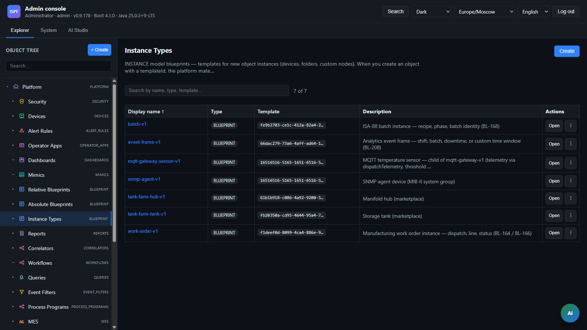

> **Язык:** русская версия. Английский оригинал: [en/blueprints.md](../en/blueprints.md).

# Шаблоны объектов (Blueprints)

> **Статус:** Stable — типовые модели структуры объектов (`SINGLETON`, `INSTANCE`, `MIXIN`). Метки зрелости: [doc-status.md](doc-status.md).

Модуль `ispf-plugin-blueprint` реализует систему **шаблонов объектов** (*blueprints*) — переиспользуемых моделей, которые задают набор переменных, событий, функций и правил расчёта на узлах дерева.

---

## Три вида шаблонов (`BlueprintType`)



| Вид шаблона | Каталог в дереве | Назначение и поведение |
|-------------|------------------|------------------------|
| **`SINGLETON`** | `root.platform.singleton-blueprints` | **Одиночный узел логики.** Создаёт единственный рабочий экземпляр прямо в каталоге `root.platform.singleton-blueprints.<имя>` — используется для центрального контроллера/оркестратора всего решения. |
| **`INSTANCE`** | `root.platform.instance-types` | **Шаблон типа объекта.** Описывает типовой агрегат или цифровой двойник (например, котельную, резервуар, магазин); из него создаётся любое количество однотипных экземпляров (`instantiate`). |
| **`MIXIN`** | `root.platform.mixin-blueprints` | **Примесь.** Дополнительный набор переменных, событий, функций и правил, который подключается к уже существующему объекту. |

**Пример:** [`examples/demo-plant`](../../examples/demo-plant/) — хаб `SINGLETON` и типовые объекты `INSTANCE` в одном пакете.

### Где размещать прикладную логику

| Роль в проекте | Вид шаблона | Правило |
|----------------|-------------|---------|
| Центральный оркестратор решения (один на проект) | **`SINGLETON`** | Размещайте в `root.platform.singleton-blueprints.<имя>` |
| Цифровой двойник или типовой агрегат (много одинаковых) | **`INSTANCE`** | Создавайте экземпляры из шаблона типа; каждый узел хранит свои расчёты |
| Физический прибор / контроллер / канал связи | — | Узел **`DEVICE`** — только драйвер и телеметрия |

> **Обязательное правило:** узел, на котором живут функции приложения и сводные расчёты, **не должен иметь тип `ObjectType.DEVICE`**. Группировать дочерние узлы `DEVICE` под родительским узлом `SINGLETON` / `INSTANCE` или в папке внутри `devices` можно, но сам узел логики не может быть `DEVICE`. Подробнее: [Правила архитектуры приложений](application-principles.md).

**Внутренние системные схемы** (`dashboard-v1`, `workflow-v1`, `alert-rule-v1`, `correlator-v1`, `report-v1`, `data-source-v1`, `schedule-v1`) создаются сервером автоматически для соответствующих системных типов узлов и не отображаются в пользовательском каталоге примесей.

---

## Как шаблон связывается с объектом

- `templateId` — основной шаблон объекта (`INSTANCE` или `SINGLETON`).
- `appliedBlueprintIds` — сохранённый в БД массив идентификаторов всех подключённых к объекту шаблонов.
- При совпадении имён переменных или функций во время слияния нескольких шаблонов побеждает **последний применённый шаблон**, а в журнал пишется предупреждение.

### Автоматическое и явное подключение `MIXIN`

При создании объекта (`POST /api/v1/objects` с флагом `autoApplyMixinBlueprints = true` по умолчанию) сервер проверяет все пользовательские примеси `MIXIN`.

**Примесь подключается автоматически только если выполнены все четыре условия:**
1. Вид шаблона — `BlueprintType.MIXIN` (не системная схема).
2. Поле `targetObjectType` совпадает с типом создаваемого объекта.
3. **Условие применимости `suitabilityExpression` (выражение CEL) не пустое** и возвращает `true`.
4. Этот шаблон ещё не числится в `appliedBlueprintIds` объекта.

> Если поле CEL пустое, примесь **никогда не применяется автоматически** — её можно подключать и отключать вручную (через `templateId` при создании, `POST /api/v1/mixin-blueprints/{id}/apply` и `.../detach`). Если `suitabilityExpression` заполнено, примесь управляется автоматически по CEL (при создании объекта и через `reevaluate`), а ручные `apply` / `detach` отклоняются.

| Значение `suitabilityExpression` | Автоподключение при создании | Ручное подключение / отключение через API |
|----------------------------------|------------------------------|-------------------------------------------|
| *(пусто)* | Нет | Да (при совпадении `targetObjectType`) |
| `true` | Да, ко всем объектам `targetObjectType` | Нет (управляется автоматически / `reevaluate`) |
| `self.flag.value == true` | Только если условие истинно | Нет (управляется автоматически / `reevaluate`) |

### Повторная проверка примесей (`reevaluation`, ADR-0058)

При желании у примеси `MIXIN` можно включить автоматический пересмотр (`reevaluation.enabled = true`) по событиям `OBJECT_CREATED` и `SERVER_READY`. Если условие CEL становится `true`, примесь подключается; если `false` — отключаются элементы, владельцем которых записана эта примесь (`blueprintContributions`).

Методы управления: `POST /api/v1/mixin-blueprints/{id}/detach`, `.../reevaluate`, `POST /api/v1/objects/by-path/reevaluate-mixins?path=...`.

---

## Состав шаблона и параметризация (`${...}`)

Описание `BlueprintDefinition` может включать:
- **Переменные** (`ModelVariableDefinition`) — схема полей, значение по умолчанию, группа, права чтения/записи, настройки истории;
- **События** (`EventDescriptor`) и **функции** (`FunctionDescriptor`);
- **Правила расчёта** (`ModelBindingRule`) — см. [Правила расчёта](bindings.md);
- **Шаблонные SQL-привязки** (`sqlBindings`) и **шаблонные правила тревог** (`alertRules`), которые разворачиваются для каждого созданного экземпляра.

При создании экземпляра подставляются встроенные переменные (`${self.path}`, `${self.name}`, `${self.displayName}`, `${parentPath}` / `${self.parentPath}`) и пользовательские параметры из `parameters`.

**Пример:** [`examples/oil-control`](../../examples/oil-control/) — шаблоны резервуаров с `${code}` в SQL-привязках и именах тревог.

```json
{
  "name": "oil-control-tank-v1",
  "type": "INSTANCE",
  "sqlBindings": [
    {
      "variable": "levelCm",
      "query": "SELECT COALESCE((SELECT level_cm FROM oc_measurement WHERE tank_code='${code}' ORDER BY measured_at DESC LIMIT 1), 0) AS value, 'cm' AS unit",
      "dataSourcePath": "root.platform.data-sources.oil-control",
      "refreshIntervalMs": 5000,
      "valueField": "value"
    }
  ],
  "alertRules": [
    {
      "name": "tank-${code}-high",
      "watchVariable": "levelCm",
      "conditionExpr": "self.levelCm.value > 1000",
      "eventName": "levelHigh",
      "enabled": true
    }
  ]
}
```

Использование такого шаблона в `bundle.json` (секция `blueprints[]` всегда обрабатывается раньше `objects[]`):

```json
{
  "parentPath": "root.platform.devices.oil-control.tanks",
  "name": "rvs-1",
  "type": "CUSTOM",
  "templateId": "oil-control-tank-v1",
  "parameters": { "code": "RVS-1" }
}
```

---

## Уровни шаблонов на сервере

| Уровень | Откуда загружается | Когда доступен |
|---------|--------------------|----------------|
| **Системные схемы** | `ModelBootstrap` | Всегда (`dashboard-v1`, `workflow-v1`, `alert-rule-v1`, `correlator-v1`, `report-v1` и др.) |
| **Демонстрационные (fixtures)** | `FixtureModelBootstrap` | При `ispf.bootstrap.fixtures-enabled=true` (`mqtt-sensor-v1`, `mqtt-gateway-v1`, `snmp-agent-v1`, `device-driver-v1`) |
| **Прикладные (пользовательские)** | `bundle.json` (`blueprints[]` / `models[]`) или БД `blueprint_definitions` | После деплоя пакета или сохранения в консоли |

### Примеры демонстрационных шаблонов (`fixtures`)

- **`mqtt-sensor-v1`** — учебный датчик температуры (`demo-sensor-01`): переменные `temperature`, `threshold`, `alarmActive`, `alarmAcknowledged`, `temperaturePercent`, событие `thresholdExceeded` и функция `acknowledgeAlarm`.
- **`mqtt-gateway-v1`** — входной шлюз MQTT, распределяющий сообщения из `lastIngress` по дочерним датчикам через функцию `dispatchTelemetry`.
- **`snmp-agent-v1`** — мониторинг хоста по SNMP (MIB-II и HOST-RESOURCES: `sysName`, `sysUpTime`, `hrMemorySize`, `hrProcessorLoad`, `ifInOctets`, `ifOutOctets`); используется на демо-экране `snmp-host-monitoring`.

---

## Основные методы REST API

| Метод | Путь | Назначение |
|-------|------|------------|
| `GET / POST / ...` | `/api/v1/singleton-blueprints` | Управление одиночными шаблонами `SINGLETON` |
| `GET / POST / ...` | `/api/v1/instance-types` | Управление шаблонами типов `INSTANCE` |
| `GET / POST / ...` | `/api/v1/mixin-blueprints` | Управление примесями `MIXIN` |
| `GET / POST / PUT / DELETE` | `/api/v1/blueprints` | Унифицированный API всех видов шаблонов |
| `POST` | `/api/v1/blueprints/{id}/apply?objectPath=...` | Применить шаблон к существующему объекту |
| `POST` | `/api/v1/blueprints/{id}/instantiate` | Создать новый узел по шаблону |
| `POST` | `/api/v1/blueprints/from-object` | Сохранить структуру существующего узла как новый шаблон |

Пример создания экземпляра по шаблону:

```http
POST /api/v1/blueprints/{id}/instantiate
Content-Type: application/json

{
  "parentPath": "root.platform.devices",
  "name": "sensor-02",
  "parameters": {}
}
```

---

## Связанные разделы

- [Модель объектов](object-model.md) — переменные, схемы `DataRecord`, события и функции
- [Правила расчёта (привязки)](bindings.md) — формулы пересчёта переменных в шаблонах
- [Драйверы устройств](drivers.md) — автоматическое создание переменных драйвера на узлах `DEVICE`
- [ADR-0018](decisions/0018-fixture-models-and-cel-applicability.md) — правила автоприменения примесей по условию CEL
