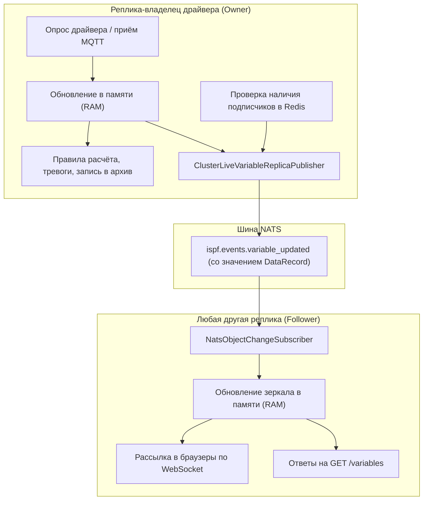

> **Язык:** русская версия. Английский оригинал: [en/cluster.md](../en/cluster.md).

# Кластер высокой доступности ISPF (несколько реплик)

> **Статус:** Beta — горизонтальное масштабирование `ispf-server`: распределение драйверов между узлами, синхронизация структуры и живых значений через NATS и выделенные профили реплик. Метки зрелости: [doc-status.md](doc-status.md).

Это руководство описывает, как запустить несколько серверных узлов (`ispf-server`) поверх одной базы данных PostgreSQL для обеспечения отказоустойчивости и распределения нагрузки между опросом оборудования, экранами операторов и фоновой аналитикой.

**Связанные разделы:** [Развёртывание и конфигурация](deployment.md) · [Профили развёртывания](demostands.md) · [Шины сообщений](messaging.md) · [Регламент испытаний кластера под нагрузкой](cluster-chaos-soak-runbook.md) · [ADR-0028](decisions/0028-horizontal-active-active-cluster.md) · [ADR-0029](decisions/0029-cluster-live-variable-replica-sync.md) · [ADR-0032](decisions/0032-replica-profiles-and-capabilities.md).

---

## 1. Чем кластер отличается от федерации

| Характеристика | Кластер (`ISPF_CLUSTER_ENABLED=true`) | Федерация ([federation.md](federation.md)) |
|----------------|---------------------------------------|--------------------------------------------|
| **Дерево объектов** | Одно общее дерево `root.platform.*` в единой БД PostgreSQL | У каждой площадки своя БД и своё дерево объектов |
| **Серверные узлы** | Несколько реплик JVM внутри одного ЦОД/контура за балансировщиком nginx | Центральный сервер (Hub) и удалённые площадки (Edge), в том числе за NAT |
| **Опрос устройств** | Каждое устройство автоматически закрепляется за одной живой репликой; при её сбое устройство перехватывает другой узел | Каждая площадка опрашивает своё оборудование самостоятельно |

---

## 2. Архитектура и распределение обязанностей в кластере

```text
                    nginx :8080
           Балансировка REST и привязка WebSocket
        ┌──────────┬───────────────┬──────────┐
        ▼          ▼               ▼          │
   replica-1   replica-2      replica-3      │
   :8081       :8082           :8083          │
        └──────────┴───────┬───────┴──────────┘
                           │
              PostgreSQL (единое дерево объектов и блокировки)
              NATS (синхронизация событий и живых значений между репликами)
              Redis (реестр открытых подписок WebSocket, кэш прав и окна корреляторов)
```

При запуске каждая реплика:
1. Проверяет и при необходимости применяет миграции Flyway (под защитой блокировки БД).
2. Загружает дерево объектов из PostgreSQL (`loadFromDatabase()`).
3. Регистрируется в таблице `platform_cluster_replicas` и начинает регулярно обновлять отметку активности (heartbeat).
4. Захватывает свободные устройства в таблице `platform_driver_locks` и запускает их драйверы.

### Где хранятся и как синхронизируются данные

| Вид данных | Где хранится | Как работает в кластере |
|------------|--------------|-------------------------|
| **Структура дерева, шаблоны, функции, правила** | PostgreSQL | Изменение на любой реплике публикует уведомление в NATS; остальные реплики тут же подгружают обновлённый узел из БД ([ADR-0030](decisions/0030-cluster-config-structure-replica-sync.md)) |
| **Первичная телеметрия с драйвера** | Оперативная память (RAM) реплики-владельца устройства | Обновляется на каждом цикле опроса без лишней нагрузки на PostgreSQL |
| **Зеркало текущих значений на других репликах** | Оперативная память остальных реплик | Реплика-владелец рассылает укрупнённые пакеты со значениями через NATS (`ClusterLiveVariableReplicaPublisher`, [ADR-0029](decisions/0029-cluster-live-variable-replica-sync.md)) |
| **История переменных и журнал событий** | PostgreSQL / TimescaleDB или ClickHouse | Запись в архив выполняет **только реплика-владелец** устройства (без дублирования точек) |
| **Правила расчёта, тревоги и корреляторы** | Конвейер автоматизации на реплике-владельце | Вычисляются один раз на реплике-владельце; готовые расчётные значения рассылаются остальным узлам через NATS |

### Закрепление устройств за репликами (`platform_driver_locks`)

Каждое устройство (`DEVICE`) в любой момент времени опрашивается **ровно одной репликой**. Владелец периодически продлевает аренду строки в таблице `platform_driver_locks`. Если узел останавливается или теряет связь с БД, срок аренды (`TTL`) истекает, и другая реплика автоматически забирает устройство себе (`DriverOwnershipScheduler`).

Посмотреть, какие устройства за каким узлом закреплены сейчас, можно запросом `GET /api/v1/platform/cluster/health` (поле `heldDevicePaths`).

---

## 3. Как синхронизируются живые значения между репликами (ADR-0029)



1. **На реплике-владельце (`Owner`):** драйвер записывает новое значение в память, запускает локальные правила расчёта (`BindingRuleEngine`), проверяет уставки тревог и сохраняет точку в архив истории.
2. **Публикация по требованию:** если на это устройство кто-то подписан (открыт экран оператора на любой реплике кластера — счётчик интереса хранится в Redis по ключу `ispf:cluster:ws:interest:{path}`), владелец отправляет пакет со значением `DataRecord` в NATS.
3. **На остальных репликах (`Follower`):** сервис `ClusterVariableReplicaApplier` записывает полученное значение в локальную память с пометкой `replicaIngress = true`. Повторный пересчёт правил и повторная запись в архив на этих узлах **не запускаются**, а подключённые к ним браузеры сразу получают обновление по WebSocket и через REST API.

---

## 4. Настройка параметров кластера и интервалов слияния

### Обязательные переменные окружения на каждой реплике

```bash
ISPF_CLUSTER_ENABLED=true
ISPF_REPLICA_ID=replica-1          # уникальный идентификатор для каждого узла
ISPF_DB_URL=jdbc:postgresql://postgres:5432/ispf
ISPF_NATS_ENABLED=true
ISPF_NATS_REPLICA_EVENTS=true
ISPF_REDIS_ENABLED=true
ISPF_CLUSTER_LIVE_VARIABLE_SYNC=true
ISPF_CLUSTER_PATH_INTEREST=true
```

### Два независимых интервала укрупнения пакетов (`coalesce`)

| Параметр | Переменная окружения | По умолчанию | За что отвечает |
|----------|----------------------|--------------|-----------------|
| `ispf.runtime-telemetry.coalesce-ms` | `ISPF_RUNTIME_TELEMETRY_COALESCE_MS` | `250` мс | Слияние частых изменений на входе реплики-владельца (снижает нагрузку на CPU при расчётах правил) |
| `ispf.cluster.live-variable-sync-coalesce-ms` | `ISPF_CLUSTER_LIVE_VARIABLE_SYNC_COALESCE_MS` | `500` мс | Слияние пакетов при рассылке живых значений между репликами по сети NATS |

Для операторских экранов обычно достаточно межрепликового интервала `500–1000` мс при входном интервале `250` мс. Изменить `cluster.live-variable-sync-coalesce-ms` можно без перезапуска сервера в разделе **Система → Настройки времени выполнения → Кластер**.

---

## 5. Профили реплик и выделение ролей (`ISPF_REPLICA_PROFILE`)

На крупных объектах разные виды нагрузки можно разнести по специализированным узлам ([ADR-0031](decisions/0031-cluster-replica-roles-platform-jobs.md), [ADR-0032](decisions/0032-replica-profiles-and-capabilities.md)):

| Профиль (`ISPF_REPLICA_PROFILE`) | Публичный API / WS | Запись конфигурации | Опрос драйверов | Фоновые задания (`jobs`) | Планировщики | Назначение узла |
|----------------------------------|:------------------:|:-------------------:|:---------------:|:------------------------:|:------------:|-----------------|
| `unified` (`all`) | да | да | да | да | да | Одиночный сервер без кластера (`ISPF_CLUSTER_ENABLED=false`) |
| `edge-api` | да | да | нет | нет | да | Основные узлы REST API и WebSocket для консоли администратора |
| `hmi-read` | только чтение (`/hmi/*`) | нет | нет | нет | нет | Выделенные узлы для пультов дежурных операторов |
| `io` | нет | нет | да | нет | да | Узлы опроса промышленных протоколов и расчёта правил |
| `compute` | внутренний | нет | нет | да | нет | Выполнение асинхронных отчётов и тяжёлых фоновых задач (`platform_jobs`) |
| `analytics` | внутренний | нет | нет | нет | нет | Материализация исторических агрегатов и пересчёт витрин |

> При включённом кластере (`ISPF_CLUSTER_ENABLED=true`) профиль `unified` не используется — явно задавайте роль каждой реплики (`edge-api`, `io`, `hmi-read` и т.д.).

### Схема разделения трафика в nginx

```text
                         nginx :8080
              /api/, /ws/           ──► реплики edge-api (консоль администратора, запись настроек)
              /hmi/api/, /hmi/ws/  ──► реплики hmi-read (пульты операторов ?mode=operator)
              внутренний контур:    ──► io (драйверы), compute (отчёты), analytics (агрегаты)
```

- В режиме оператора (`?mode=operator`) веб-консоль автоматически обращается к префиксам `/hmi/api/...` и `/hmi/ws/...`. Если перед сервером нет разделяющего nginx (например, на одиночном сервере), браузер автоматически переключается на стандартные пути `/api/...` и `/ws/...`.
- Не добавляйте узлы `hmi-read`, `io` или `compute` в основной пул `/api/` для администраторов: запросы на изменение дерева объектов на таких узлах отклоняются с кодом `503 REPLICA_CAPABILITY_DENIED`.

---

## 6. Порядок поэтапного запуска кластера

Готовые скрипты запуска: [`deploy/lab-cluster-bootstrap.sh`](../../deploy/lab-cluster-bootstrap.sh) и [`deploy/vps-cluster-bootstrap.sh`](../../deploy/vps-cluster-bootstrap.sh).

```text
Шаг 1. Запустить инфраструктуру: PostgreSQL → Redis → NATS → ClickHouse (дождаться готовности).
Шаг 2. Запустить первую реплику (replica-1, профиль edge-api):
       она спокойно применит миграции Flyway и создаст начальную структуру дерева в БД.
Шаг 3. После готовности replica-1 запустить остальные узлы (replica-2, hmi-read, analytics, compute) и nginx.
Шаг 4. Через 10–15 секунд запустить узлы опроса драйверов (профиль io).
Шаг 5. Проверить состояние кластера: GET /api/v1/platform/cluster/health (все узлы в статусе UP).
```

> **Почему важен поэтапный старт на чистой БД:** не запускайте все контейнеры `ispf-server` одновременно в одну секунду на пустой базе данных — параллельная первичная инициализация системных объектов на старте может вызвать взаимную блокировку транзакций (`deadlock`) на таблице `object_nodes`.

---

## 7. Диагностика и проверка работы кластера

### Методы API для администратора

```http
GET /api/v1/platform/cluster/health
GET /api/v1/platform/cluster/diagnostics
Authorization: Bearer <токен-администратора>
```

- `/cluster/health` возвращает количество активных узлов (`nodesUp` / `nodesTotal`), настройки синхронизации и распределение блокировок драйверов по репликам.
- `/cluster/diagnostics` показывает загрузку процессора по каждой реплике, наиболее нагруженные пулы потоков (`ispf-driver-io`, `object-change` и др.), очереди драйверов и выполняющиеся фоновые задания. В веб-консоли эти данные отображаются в разделе **Система → Метрики → Диагностика нагрузки**.

### Автоматическая проверка кластера

```bash
ISPF_CLUSTER_REQUIRE_DRIVER_LOCKS=1 \
  bash deploy/cluster-smoke-test.sh --config-sync --live-var-lag
```

Скрипт проверяет балансировку запросов, синхронизацию изменений дерева между узлами, задержку доставки живых значений и автоматический перехват драйверов при остановке одной из реплик.

---

## 8. Разбор частых нештатных ситуаций

| Симптом | Причина | Решение |
|---------|---------|---------|
| При обновлении страницы значения переменных мигают или чередуются со старыми | Выключена межрепликовая синхронизация значений в памяти | Убедитесь, что `ISPF_CLUSTER_LIVE_VARIABLE_SYNC=true` и `ISPF_NATS_REPLICA_EVENTS=true` на всех узлах |
| Ошибка `503 REPLICA_CAPABILITY_DENIED` при сохранении объекта | Балансировщик nginx направил запрос записи на узел с профилем `hmi-read`, `io` или `analytics` | Оставьте в пуле `upstream` для `/api/` только реплики с профилем `edge-api` |
| В режиме оператора не открываются данные на одноузловом сервере за кастомным прокси | Прокси не перенаправляет префикс `/hmi/api/` на сервер | Добавьте проксирование `/hmi/api/` и `/hmi/ws/` по образцу [`deploy/nginx-vps-single.conf`](../../deploy/nginx-vps-single.conf) |
| Устройства не опрашиваются в кластере из узлов `edge-api` | В кластере не запущена ни одна реплика с поддержкой драйверов (`io`) | Запустите реплику с профилем `ISPF_REPLICA_PROFILE=io` |
