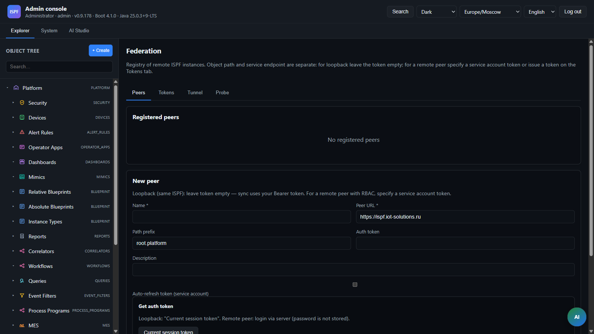

> **Язык:** русская версия. Английский оригинал: [en/federation.md](../en/federation.md).

# Федерация серверов ISPF (центральный узел и удалённые площадки)

> **Статус:** Beta — объединение центрального сервера (Hub) и удалённых площадок (Edge): реестр узлов, прозрачное чтение и запись через прокси, синхронизация каталогов и исходящие WebSocket-туннели через NAT. Метки зрелости: [doc-status.md](doc-status.md).

Федерация позволяет подключить несколько удалённых экземпляров ISPF (например, цеховые серверы, котельные или насосные станции за NAT) к центральному диспетчерскому серверу (**Hub**), чтобы операторы работали со всеми площадками из единого окна.

---

## 1. Основной принцип



**Путь объекта в дереве не привязан к IP-адресу сервера.** Путь вроде `root.platform.devices.pump-01` служит стабильным именем объекта в каталоге, а сетевой адрес и токен удалённого сервера ISPF хранятся отдельно в **реестре соседних узлов** (`federation_peers`).

| Механизм | Назначение |
|----------|------------|
| Таблица `federation_peers` | Реестр соседних узлов: имя, `baseUrl`, `authToken`, `pathPrefix`, статус включения, режим обновления токена |
| Таблица `federation_inbound_registrations` | Одноразовые коды регистрации для подключения удалённых площадок по входящему туннелю |
| Таблица `federation_outbound_agents` | Настройки исходящего туннельного агента на стороне удалённой площадки (Edge) |
| `GET / POST / PUT / DELETE /api/v1/federation/peers` | Управление списком соседних серверов (роль `admin`) |
| `GET / POST /api/v1/federation/peers/{id}/auth-status`, `refresh-token` | Диагностика и принудительное обновление токена сервисной учётной записи |
| `POST / GET / DELETE /api/v1/federation/inbound/registrations` | Выпуск одноразового кода регистрации на центральном узле |
| `GET /api/v1/federation/tunnels` | Список активных туннельных сессий на центральном узле |
| `POST / GET / PUT / DELETE /api/v1/federation/outbound/agents`, `connect` | Настройка и запуск исходящего туннеля на удалённой площадке |
| `/ws/federation/tunnel` | WebSocket-канал туннеля между площадкой и центром |
| `POST /api/v1/federation/remote-token` | Получение токена с удалённого сервера по логину и паролю |
| `POST /api/v1/security/users/{username}/federation-token` | Выпуск токена для сервисного пользователя на текущем узле |
| `GET /api/v1/federation/peers/{id}/catalog-sync-preview` | Предварительный просмотр синхронизации каталога (число новых/обновляемых узлов и конфликты) |
| `POST /api/v1/federation/peers/{id}/sync-catalog` | Импорт каталога объектов с удалённого узла в локальное дерево |
| Прокси-узлы в дереве | Узлы с признаками `federationProxy = true`, `federationPeerId`, `federationRemotePath` |
| `GET /api/v1/federation/proxy/objects/by-path` | Прямое чтение удалённого объекта без предварительной синхронизации каталога |
| `PATCH /api/v1/federation/proxy/objects/by-path/variables/value` | Запись значения переменной на удалённом узле |
| `POST /api/v1/federation/proxy/objects/by-path/functions/invoke` | Вызов функции объекта на удалённом узле |
| `GET /api/v1/objects/by-path` | Прозрачное чтение прокси-узлов через стандартный API дерева объектов |
| `GET / PUT /api/v1/dashboards/by-path` (`/layout`, `/title`) | Прозрачное чтение и сохранение дашбордов с автоматическим пересчётом путей виджетов |
| `GET /api/v1/objects/by-path/variables/history*` | Прозрачное чтение истории переменных с удалённого узла |
| `FederationWebSocketFanoutService` | Пересылка живых обновлений WebSocket подписчикам федеративных объектов |
| `POST / PATCH / DELETE /api/v1/federation/binds` | Точечная привязка удалённого объекта к произвольному локальному пути в дереве |

---

## 2. Два способа подключения объектов: зеркало каталога и точечная привязка

| Характеристика | Синхронизация каталога (зеркало) | Точечная привязка (`bind`) |
|----------------|----------------------------------|----------------------------|
| **Для чего подходит** | Массовый обзор всех устройств удалённой площадки | Подстановка удалённого агрегата в существующую структуру цеха по привычному локальному пути |
| **Где появляется в дереве** | В выделенной ветке `root.platform.federation.<имя_узла>.*` | По любому выбранному пути, например `root.platform.devices.edge-pump` |
| **Как настроить в консоли** | Кнопка **«Синхронизировать каталог»** на панели федерации | Вкладка **«Привязка федерации»** в инспекторе объекта (или кнопка **«Разместить локально…»** на узле зеркала) |

### Как работает точечная привязка (`bind`)

При привязке существующий или новый локальный узел получает служебные переменные `federationProxy`, `federationPeerId` и `federationRemotePath`. После этого чтение и запись переменных, вызов функций, запросы истории и открытие дашбордов автоматически перенаправляются на удалённый сервер через `FederationProxyService`.

Если к локальному узлу `DEVICE` был привязан собственный драйвер, при включении привязки он останавливается, а прежние метаданные узла (`displayName`, `description`, `type`, состояние драйвера) сохраняются в снимке. При отмене привязки (`unbind`) локальные настройки и работа драйвера восстанавливаются.

```http
POST /api/v1/federation/binds
Content-Type: application/json

{
  "localPath": "root.platform.devices.edge-pump",
  "peerId": "<uuid-соседнего-узла>",
  "remotePath": "root.platform.devices.demo-sensor-01"
}
```

- Создать новый узел и сразу привязать: укажите `parentPath` и `name` вместо `localPath`.
- Изменить цель привязки: `PATCH /api/v1/federation/binds`.
- Снять привязку: `DELETE /api/v1/federation/binds?localPath=...`.

**Защита от петель проксирования:**
- Нельзя привязать `localPath` к тому же `remotePath` на том же самом сервере ISPF.
- Нельзя указывать в `remotePath` узел, который сам уже является локальным прокси-узлом.
- Цепочки проксирования через несколько промежуточных серверов не допускаются (разрешён ровно один переход Hub → Edge).

---

## 3. Синхронизация каталога объектов

### Предварительный просмотр и разрешение конфликтов

Перед синхронизацией консоль вызывает `GET /api/v1/federation/peers/{peerId}/catalog-sync-preview` и показывает диалог проверки конфликтов (`FederationCatalogSyncDialog`):

| Тип конфликта | Когда возникает | Варианты решения (`action`) |
|---------------|-----------------|-----------------------------|
| `LOCAL_NATIVE` | По целевому пути уже существует обычный (не прокси) локальный объект | `SKIP` (пропустить, по умолчанию) или `BIND` (заменить прокси-ссылкой) |
| `PROXY_MISMATCH` | По этому пути уже есть прокси-узел, но он указывает на другой сервер или путь | `SKIP` или `BIND` |

Запрос на выполнение синхронизации с выбранными решениями:

```http
POST /api/v1/federation/peers/{peerId}/sync-catalog
Content-Type: application/json

{
  "resolutions": [
    { "localPath": "root.platform.federation.site-a.devices.pump-01", "action": "BIND" }
  ]
}
```

Если передать пустое тело запроса при наличии конфликтов, синхронизация вернёт ошибку и ничего не перезапишет вслепую. Ответ при успехе: `{ localRoot, created, updated, remoteCount, skipped }`.

Импортированные прокси-узлы создаются в ветке `root.platform.federation.<имя_узла>.*`. Повторный запуск синхронизации идемпотентен: существующие прокси-узлы просто обновляют метаданные, а чужие федеративные ветки `root.platform.federation.*` с удалённого сервера игнорируются, чтобы не создавать вложенных зеркал.

### Выборочная синхронизация одной ветки (`sync-subtree`)

Если с удалённой площадки нужно забрать только папку устройств (без дашбордов и прочих разделов), используйте выборочную синхронизацию поддерева:

| Метод и путь | Назначение |
|--------------|------------|
| `GET /api/v1/federation/peers/{id}/subtree-sync-preview?remoteSubtreePath=…&localParentPath=…` | Предпросмотр добавляемых и обновляемых узлов для выбранной ветки |
| `POST /api/v1/federation/peers/{id}/sync-subtree` | Синхронизация только указанной ветки |

```json
{
  "remoteSubtreePath": "root.platform.devices",
  "localParentPath": "root.platform.federation.site-a.devices",
  "resolutions": []
}
```

В веб-консоли для этого есть быстрая кнопка **«Синхронизировать поддерево устройств»** на панели соседних узлов, а также кнопка на вкладке «Федерация» любой папки зеркала.

---

## 4. Прозрачная работа с дашбордами через прокси

При открытии или сохранении дашборда с удалённого узла (`federationProxy = true`):
1. Веб-консоль отображает и сохраняет макет с локальными путями зеркала (`root.platform.federation.<имя_узла>.*`).
2. `FederationProxyService` и `FederationPathRemapper` автоматически переводят пути виджетов обратно в координаты удалённой площадки и отправляют `PUT /api/v1/dashboards/by-path/layout` (или `/title`) на удалённый сервер.
3. Ответ снова переводится в локальные пути для браузера оператора.

---

## 5. Аутентификация между серверами и передача прав пользователя

### Режимы аутентификации канала (`authMode`)

| Режим | Как работает |
|-------|--------------|
| `STATIC_TOKEN` | Статический токен Bearer, выпущенный на удалённом узле (по умолчанию) |
| `SERVICE_ACCOUNT` | Логин и пароль сервисной учётной записи; пароль хранится в зашифрованном виде (`ispf.security.secrets-key`), а токен автоматически продлевается фоновым планировщиком до истечения срока действия |

Для межсерверного обмена рекомендуется создать на удалённом узле отдельную учётную запись (например, `federation-agent`) с нужной областью прав. Выпустить токен можно в разделе **Платформа → Федерация → Токены** или запросить его с удалённого узла прямо при создании карточки соседа.

### Передача прав конечного оператора (`On-Behalf-Of`)

Когда оператор открывает удалённый объект через центральный сервер:
1. Центральный сервер удостоверяет сам межсерверный канал своим сервисным токеном (`authToken`) и передаёт в заголовках `X-ISPF-On-Behalf-Of-User`, `X-ISPF-On-Behalf-Of-Roles` и `X-ISPF-On-Behalf-Of-Tenant` имя, роли и тенант оператора.
2. На удалённом сервере фильтр `FederationOnBehalfOfFilter` вычисляет **пересечение** прав канального токена и ролей оператора.
3. Благодаря этому сервисный канал не может случайно повысить права оператора, а все пообъектные и попеременные правила доступа (ACL) на удалённой площадке проверяются точно для того человека, который сидит за экраном.

---

## 6. Исходящий WebSocket-туннель для площадок за NAT

Чаще всего цеховой сервер или шлюз (Edge) находится за NAT или межсетевым экраном и не принимает входящих подключений извне. В этом случае площадка сама устанавливает исходящее WebSocket-соединение к центральному серверу:

```text
Удалённая площадка (Edge за NAT) ── исходящий WebSocket ──► Центральный сервер (Hub)
Центральный сервер (Hub)         ── запросы прокси      ──► Удалённая площадка (Edge)
```

### Порядок подключения

1. **На центральном сервере (Hub):** откройте **Федерация → Входящая регистрация**, укажите имя площадки и префикс пути и выпустите **одноразовый код регистрации**.
2. **На удалённой площадке (Edge):** откройте **Федерация → Исходящий агент**, введите URL центрального сервера и полученный код, нажмите **«Подключиться»**.
3. Центральный сервер автоматически зарегистрирует узел в режиме `connection_mode = TUNNEL_INBOUND`.
4. Нажмите **«Синхронизировать каталог»** на центральном сервере — устройства площадки появятся в `root.platform.federation.<площадка>.*`.
5. Все операции чтения, записи, вызова функций и живые уведомления (`event_notify`) пойдут внутри установленного WebSocket-туннеля.

Для работы туннеля на стороне площадки должен быть задан ключ шифрования секретов `ispf.security.secrets-key`, а обратный прокси перед центральным сервером должен пропускать соединения `wss://`.

### Буферизация событий при обрыве связи (`store-and-forward`)

Если связь между площадкой и центром временно прервалась, изменения переменных и события на площадке не теряются:
1. Служба `AgentStoreForwardService` (`FederationOutboundEventBufferRegistry`) складывает события `ObjectChangeEvent` в кольцевой буфер (по умолчанию до 2 МиБ на агента) и при `persist-to-disk: true` сохраняет снимок на диск в `{ISPF_DATA_DIR}/agent/store-forward-buffer.json`.
2. Как только WebSocket-туннель восстанавливается, накопленные события досылаются на центральный сервер строго в порядке номеров последовательности (`seq`).

```yaml
ispf:
  agent:
    store-forward:
      enabled: true                 # ISPF_AGENT_STORE_FORWARD_ENABLED
      max-bytes: 2097152            # ISPF_AGENT_STORE_FORWARD_MAX_BYTES
      drop-policy: DROP_OLDEST      # DROP_OLDEST (вытеснять старые) или DROP_NEWEST
      persist-to-disk: true
```

Проверить состояние буфера на площадке можно запросом `GET /api/v1/agent/store-forward/stats` (возвращает `totalPending`, `totalBytes`, `totalDropped`).

---

## 7. Контроль состояния связи и действия при сбоях

### Диагностика состояния соседнего узла

```http
GET /api/v1/federation/peers/{id}/health
```

Ответ содержит итоговый уровень состояния `level` (`GREEN`, `YELLOW`, `RED`), статус туннеля `tunnelConnected`, время и задержку последнего успешного запроса `lastProxyLatencyMs`, текст последней ошибки `lastProxyError` и число событий в очереди `pendingBufferedEvents`.

При переходе включённого соседа между состояниями `RED` и `GREEN` монитор `FederationPeerHealthMonitor` публикует на объекте `root.platform.federation` системные события `peerHealthDegraded` и `peerHealthRecovered`, на которые можно настроить отправку уведомлений администратору.

| Ситуация | Признак | Действия инженера |
|----------|---------|-------------------|
| Узел отключён вручную | Ответ прокси `400` | Включить узел через `PUT /api/v1/federation/peers/{id}` (`enabled: true`) |
| Связь потеряна (`RED`) | Тайм-аут прокси или обрыв туннеля | Проверить сеть и сертификаты, при необходимости обновить токен (`POST .../refresh-token`); на время долгого ремонта временно отключить узел, чтобы запросы не ждали тайм-аута |
| Накопилась очередь на площадке | Растёт `pendingBufferedEvents` | Дождаться восстановления канала или переподключить исходящий агент; очередь разгружается автоматически |

---

## 8. Центральный пульт диспетчера для нескольких площадок (Manager of Managers)

На центральном сервере можно настроить единое рабочее место оператора (`?mode=operator&app=federation-hub`), объединяющее несколько удалённых площадок:

```text
                    ┌─────────────────────────────────────┐
                    │  Центральный сервер ISPF (Hub)      │
                    │  Пульт: ?mode=operator&app=         │
                    │    federation-hub                   │
                    │  root.platform.federation.{site}.*  │
                    └──────────────┬──────────────────────┘
          туннель WS               │               туннель WS
     ┌──────────────┐    ┌──────────────┐    ┌──────────────┐
     │ Площадка A   │    │ Площадка B   │    │ Площадка C   │
     │ (ARM / NAT)  │    │ (ARM / NAT)  │    │ (ARM / NAT)  │
     └──────────────┘    └──────────────┘    └──────────────┘
```

### Что видит оператор на центральном пульте
- **Вкладки дашбордов** — по одной вкладке на каждую площадку или технологический участок.
- **Переключатель площадок (`OperatorFederationPeerSelector`)** — показывает индикаторы связи по каждой площадке (зелёный / жёлтый / красный).
- **Живые значения и признак устаревания** — при потере связи с площадкой (`YELLOW` / `RED`) оператор видит последние известные показания и предупреждающую плашку.
- **Сводный журнал событий** — собирает важные события (`WARNING` и выше) со всех подключённых площадок.

Связанные разделы: [Руководство оператора](operator-guide.md) · [Кластер ISPF](cluster.md) · [Профили развёртывания](demostands.md).
