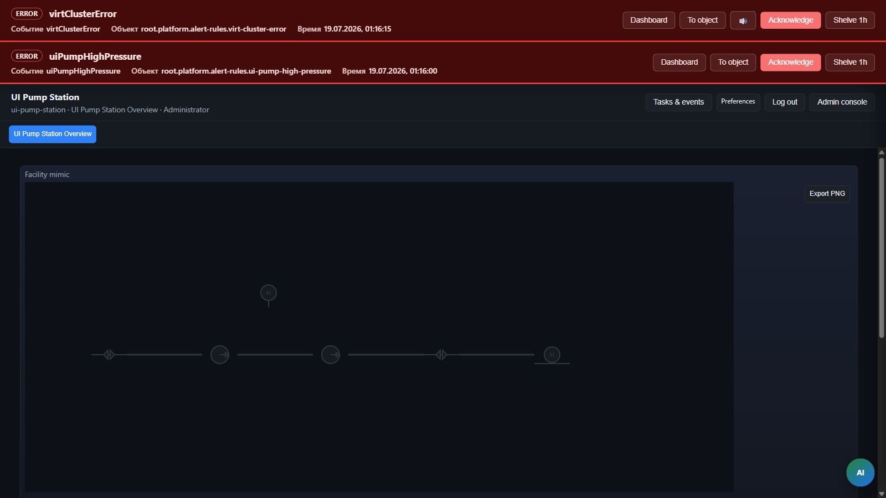

> **Язык:** русская версия. Английский оригинал: [en/lab-training.md](../en/lab-training.md).

# Практический учебный курс: 18 лабораторных упражнений (`lab-training`)

> **Статус:** Lab — готовый учебный пакет с виртуальными устройствами, правилами тревог, корреляторами, отчётами и 18 тренировочными экранами. Метки зрелости: [doc-status.md](doc-status.md).

Пакет **`lab-training`** ([`examples/lab-training/bundle.json`](../../examples/lab-training/bundle.json)) предназначен для практического освоения возможностей ISPF: от пообъектных прав доступа и правил тревог с выдержкой времени до табличных формул, составных SVG-виджетов и сводных отчётов по дереву. Брокер и подчинённый Modbus без ПЛК: [Стенд без ПЛК](lab-without-plc.md).

---

## 1. Быстрый старт учебного стенда



1. Запустите сервер ISPF и веб-консоль в локальном профиле (`local`).
2. Импортируйте учебный пакет одним запросом:

```http
POST /api/v1/platform/packages/import?packageId=lab-training
Content-Type: application/json

<содержимое файла examples/lab-training/bundle.json>
```

(Либо через `POST /api/v1/applications/lab-training/deploy`.)

После импорта в дереве объектов появятся:
- приложение `root.platform.applications.lab-training` и меню оператора `root.platform.operator-apps.lab-training`;
- два учебных виртуальных устройства `root.platform.devices.lab-userA-01` и `lab-userB-01` (шаблон `virtual-lab-v1`, профиль драйвера `lab`);
- правила тревог, корреляторы, отчёты и 18 тематических дашбордов `root.platform.dashboards.lab-*`.

3. Откройте пульт оператора учебного приложения: `http://localhost:8080/?mode=operator&app=lab-training`.
4. Для проверки разграничения прав между пользователями создаются две тестовые учётные записи операторов:
   - `lab-user-a` / пароль `lab-user-a`
   - `lab-user-b` / пароль `lab-user-b`

---

## 2. Переменные и функции учебного устройства (`virtual-lab-v1`)

| Переменная / элемент | Тип | Описание |
|----------------------|-----|----------|
| `sineWave`, `sawtoothWave` | `DOUBLE` | Непрерывно генерируемые синусоида и пилообразный сигнал |
| `intValue`, `floatValue` | `INTEGER`, `DOUBLE` | Записываемые числовые переменные для ручного ввода с экрана |
| `table` | `RECORD_LIST` | Многострочная табличная переменная с колонками `int` и `string` |
| `sumWaves`, `sumIntFloat`, `tableIntSum` | расчётные переменные | Автоматически вычисляются правилами расчёта (`@bindingRules`) |
| `alarmLatched`, `fanRunning` | `BOOLEAN` | Флаги состояния фиксации тревоги и работы вентилятора |
| События `event1`, `event2` | события | Принимают полезную нагрузку `{ int, string }` |
| Функции `calculate`, `fireEvent1`, `fireEvent2`, `appendTableRow` | функции объекта | Вызываются с кнопок и форм на учебных экранах |

---

## 3. Описание 18 практических упражнений

| № | Тема упражнения | Объекты и дашборды в дереве | Что проверяется |
|---|-----------------|-----------------------------|-----------------|
| **1** | Совместная работа и пообъектные права (`ACL`) | `lab-userA-01`, `lab-userB-01`, экран `lab-variable-editor` | Пользователь `lab-user-a` является владельцем (`OWNER`) устройства A и редактором (`EDITOR`) устройства B |
| **2** | Защёлка тревоги по двум событиям (`Latch / Unlatch`) | Корреляторы `lab-event1-latch-on` и `lab-event2-unlatch`, экран `lab-event-gen` | Событие `event1` взводит переменную `alarmLatched = true`, а событие `event2` с параметром `int > 20` сбрасывает её в `false` |
| **3** | Тревога с выдержкой времени 10 секунд (`delaySeconds`) | Правило тревоги `lab-sum-range-sustained-alert` на переменной `sumIntFloat` | Событие `labSumRangeAlarm` срабатывает только если сумма `intValue + floatValue` держится в диапазоне `[50, 100]` не менее 10 секунд подряд |
| **4** | Тревога по сумме колонки таблицы с открытием отчёта | Правило `lab-table-sum-threshold`, коррелятор `lab-open-corrective-report`, отчёт `lab-table-corrective` | Когда сумма колонки `int` в табличной переменной превышает `100`, автоматически формируется корректирующий отчёт |
| **5** | Фильтрация ленты событий по полям (`payloadFilterExpr`) | Экран `lab-event-gen` (виджет `event-feed`) | В нижней ленте отображаются только те события `event2`, у которых `int > 10` или строковое поле содержит `"abc"` |
| **6** | Табличный ввод и редактирование строк (`Form Grid`) | Экран `root.platform.dashboards.lab-form-grid` | Добавление и редактирование записей табличной переменной с экрана оператора |
| **7** | Вызов серверной функции с параметрами | Функция `calculate(inputA, inputB)` на устройстве | Передача аргументов с формы ввода и отображение результата расчёта |
| **8** | Применение шаблона-примеси (`MIXIN`) | Шаблон `virtual-lab-waves-sum-v1`, экран `lab-virtual-overview` | Примесь добавляет переменную `sumWaves = sineWave + sawtoothWave` без смены основного типа устройства |
| **9** | Электронная таблица с формулами (`spreadsheet`) | Экран `root.platform.dashboards.lab-calculator` | Ввод чисел в ячейки `A2` и `B2`, автоматический пересчёт формул суммы (`C2`) и коэффициента (`D2`) с сохранением в переменную `sheetValues` ([подробнее о виджете `spreadsheet`](spreadsheet-widget.md)) |
| **10** | Универсальный редактор переменных на экране | Экран `root.platform.dashboards.lab-variable-editor` | Просмотр и изменение доступных переменных обоих устройств через виджет `variable-editor` |
| **11** | Сводный отчёт по переменным группы устройств (`tree-variables`) | Отчёт `root.platform.reports.lab-all-devices-table` | Сбор значений одноимённой переменной по маске `root.platform.devices.lab-*` без написания SQL |
| **12** | Быстрые графики реального времени (1 с) | Экран `root.platform.dashboards.lab-charts` | Одновременная отрисовка синусоиды и пилы в режиме `historyRange: "live"` |
| **13** | Круговая диаграмма по строкам таблицы (`pie-chart`) | Экран `root.platform.dashboards.lab-pie` | Построение диаграммы распределения по колонкам `string` и `int` табличной переменной |
| **14** | Генератор событий с двумя раздельными журналами | Экран `root.platform.dashboards.lab-event-gen` | Вызов `fireEvent1` и `fireEvent2` с раздельным отображением в двух лентах событий |
| **15** | Открытие детального экрана в модальном окне | Экран `root.platform.dashboards.lab-modal` (виджет `dashboard-link`, `openMode: "modal"`) | Всплывающее открытие экрана графиков `lab-charts` поверх текущего дашборда |
| **16** | Таблица истории и среднее за 5 минут (`history-table`) | Экран `root.platform.dashboards.lab-history` | Табличный просмотр архивных точек переменной `sineWave` |
| **17** | Интерактивная векторная графика SVG (`svg-widget`) | Экран `root.platform.dashboards.lab-fan-composite` | Кнопка SVG переключает переменную `fanRunning`, а символ вентилятора анимируется по её значению |
| **18** | Комплексный обзорный пульт участка | Экран `root.platform.dashboards.lab-virtual-overview` | Сочетание карточек значений, графиков, ленты событий и встроенного отчёта на одном экране |

**Связанные разделы:** [Дашборды и виджеты](dashboards.md) · [Справочник виджетов](widgets.md) · [Правила тревог и корреляторы](automation.md) · [Отчёты](reports.md).
