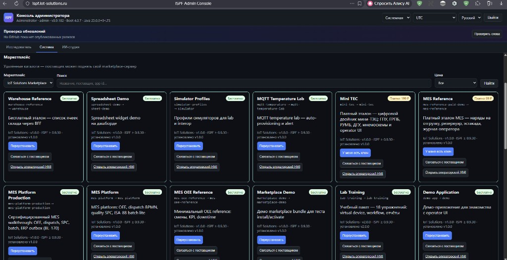

> **Язык:** русская версия. Английский оригинал: [en/marketplace.md](../en/marketplace.md).

# Витрина решений и пакетов расширений (Marketplace)

> **Статус:** Stable — подключение к каталогу готовых решений, установка бесплатных и коммерческих пакетов (`bundle.json`), библиотек символов SCADA (`symbol-pack`), аналитических модулей (`analytics-pack`) и веб-интерфейсов (`ui-pack`). Метки зрелости: [doc-status.md](doc-status.md).

Сервер ISPF умеет подключаться к удалённым каталогам решений (маркетплейсам), устанавливать бесплатные пакеты в один клик и активировать платные коммерческие поставки по ключу активации (`entitlement`).

**Связанные разделы:** [Прикладные решения (`applications.md`)](applications.md) · [Коммерческое лицензирование (`commercial-licensing.md`)](commercial-licensing.md) · [Библиотеки символов SCADA (`symbol-marketplace.md`)](symbol-marketplace.md) · [Каталог аналитических формул (`analytics-formulas-and-packs.md`)](analytics-formulas-and-packs.md) · [Внешний React-интерфейс (`external-ide.md`)](external-ide.md).

---

## 1. Настройка адресов каталога (`application.yml`)

Адрес основного каталога решений и дополнительных партнёрских витрин задаётся в блоке `ispf.marketplace`:

```yaml
ispf:
  marketplace:
    enabled: ${ISPF_MARKETPLACE_ENABLED:true}
    default-id: ${ISPF_MARKETPLACE_DEFAULT_ID:default-publisher}
    endpoints:
      - id: default-publisher
        name: IoT Solutions Marketplace
        base-url: ${ISPF_MARKETPLACE_DEFAULT_URL:https://marketplace.ispf.ai}
        contact-url: ${ISPF_MARKETPLACE_CONTACT_URL:https://vendor.example.invalid}
        default-endpoint: true
      - id: acme
        name: Каталог решений партнёра
        base-url: https://marketplace.acme.example
        contact-url: mailto:sales@acme.example
```

| Переменная окружения | По умолчанию | Назначение |
|----------------------|--------------|------------|
| `ISPF_MARKETPLACE_ENABLED` | `true` | Включает вкладку витрины решений в разделе **Система → Решения** |
| `ISPF_MARKETPLACE_DEFAULT_URL` | `https://marketplace.ispf.ai` | Базовый URL основного каталога решений |
| `ISPF_MARKETPLACE_CONTACT_URL` | адрес поставщика | Ссылка для связи с поставщиком платного пакета |

---

## 2. Работа с каталогом в веб-консоли и по API



В разделе **Система → Решения → Маркетплейс** администратор может:
- переключаться между подключёнными витринами (`endpoints`);
- искать пакеты по названию, тегам и типу лицензии (бесплатные / платные);
- **устанавливать бесплатные пакеты (`free`)** одной кнопкой **«Установить»** — сервер скачивает манифест и сразу разворачивает решение; установку могут делать **`admin`** и **`developer`**, роль **`operator`** получает **403**;
- **активировать платные пакеты (`paid`)** — после ввода полученного от поставщика кода активации сервер проверяет цифровую подпись и устанавливает пакет.

### Методы REST API платформы

| Метод | Путь | Назначение |
|-------|------|------------|
| `GET` | `/api/v1/solutions/marketplaces` | Список настроенных витрин решений |
| `GET` | `/api/v1/solutions/marketplaces/{id}/catalog?q=&pricing=` | Список позиций выбранной витрины с фильтрацией |
| `POST` | `/api/v1/solutions/marketplaces/{id}/listings/{slug}/install` | Установка бесплатного пакета |
| `POST` | `/api/v1/solutions/marketplaces/{id}/listings/{slug}/activate` | Активация и установка платного пакета (`{ "activationCode": "..." }`) |

---

## 3. Типы поставляемых пакетов (`artifactKind`)

Через единый механизм витрины распространяются четыре вида пакетов:

| Значение `artifactKind` | Куда устанавливается на сервере | Подробная документация |
|-------------------------|---------------------------------|------------------------|
| *(не указано / `bundle`)* | Устанавливается как прикладное решение `bundle.json` (схема БД, объекты, функции, дашборды, процессы) | [Прикладные решения (`applications.md`)](applications.md) |
| `symbol-pack` | Распаковывается в каталог `ISPF_SYMBOL_PACKS_DIR` и появляется в палитре редактора мнемосхем SCADA | [Маркетплейс символов SCADA](symbol-marketplace.md) |
| `analytics-pack` | Устанавливается в `ISPF_ANALYTICS_PACKS_DIR` и регистрирует новые функции расчёта в каталоге аналитики | [Каталог аналитических формул](analytics-formulas-and-packs.md) |
| `ui-pack` | Устанавливается в `ISPF_UI_PACKS_DIR` и раздаётся сервером как веб-приложение оператора по адресу `/apps/<appId>/` ([ADR-0054](decisions/0054-hosted-ui-packs.md)) | [Разработка собственного React-интерфейса](external-ide.md) |

> **Важная настройка nginx для пакетов `ui-pack`:** если перед `ispf-server` стоит внешний nginx, обязательно проксируйте префикс `location ^~ /apps/` на `ispf-server` (аналогично `/api/`), чтобы запросы к `/apps/<appId>/` не перехватывались статикой консоли администратора (см. пример в `deploy/nginx-ispf.conf`). Туда же — `location ^~ /ispf-embed/`, иначе скрипт ИИ-помощника подменится HTML консоли.

---

## 4. Формат паспорта позиции в каталоге (`listing.manifest.json`)

Примеры готовых позиций каталога находятся в [`examples/marketplace-catalog/`](../../examples/marketplace-catalog/) и [`examples/marketplace-demo/listing.manifest.json`](../../examples/marketplace-demo/listing.manifest.json). Основные поля карточки:
- `slug`, `title`, `description`, `tags` — идентификатор, название, описание и поисковые метки;
- `pricing` (`free` или `paid`), `priceCents` — модель распространения и цена;
- `appId`, `artifactKind`, `packId` — целевой идентификатор приложения или пакета расширения;
- `latestVersion`, `minIspfVersion` — версия пакета и минимально требуемая версия сервера ISPF;
- реквизиты поставщика: `vendorName`, `vendorLegalName`, `vendorInn`, `vendorContactEmail`, `vendorContactPhone`.

Проверка целостности всех позиций локального каталога решений выполняется скриптом:

```bash
node tools/marketplace-catalog/validate-catalog.mjs
```
