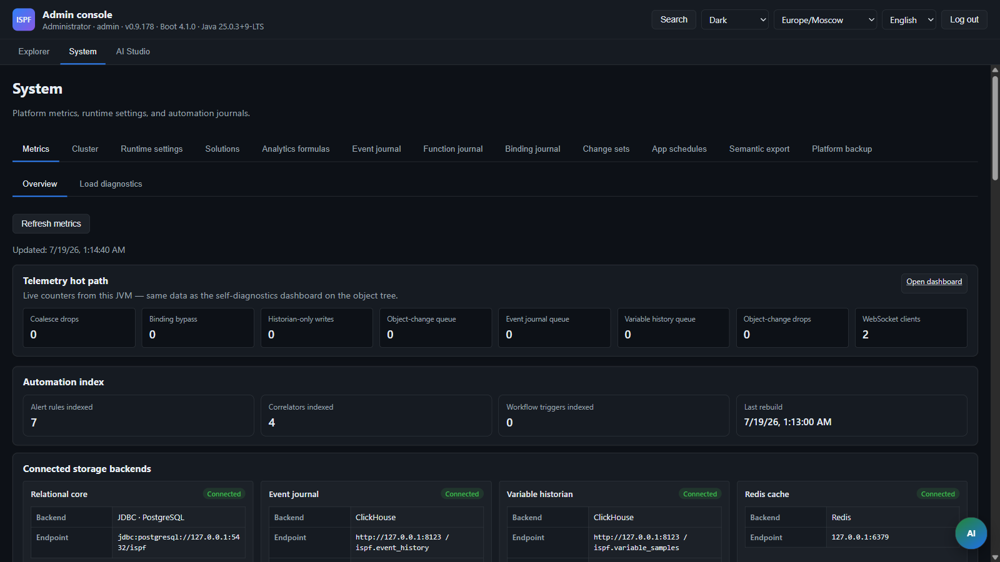

> **Язык:** русская версия. Английский оригинал: [en/observability.md](../en/observability.md).

# Мониторинг и диагностика (Observability)

> **Статус:** Stable — метрики Prometheus, экспорт OpenTelemetry (OTLP) и встроенная диагностика нагрузки. Метки зрелости: [doc-status.md](doc-status.md).

ISPF предоставляет встроенную панель диагностики в веб-консоли, отдаёт метрики в формате **Prometheus** (`/actuator/prometheus`) и при необходимости отправляет метрики и распределённые трассировки по протоколу **OTLP** в коллекторы OpenTelemetry (Grafana, Uptrace и аналоги).

---

## 1. Метрики Prometheus



Маршрут `/actuator/prometheus` (требуется роль `admin`) отдаёт как стандартные показатели JVM, HTTP и пула БД (`jvm.*`, `http.server.requests`, `hikaricp.*`), так и прикладные метрики движков ISPF:

| Метрика Micrometer | Тип | Что показывает |
|--------------------|-----|----------------|
| `ispf.object_tree.ready` | gauge | `1`, когда дерево объектов полностью инициализировано и готово к работе |
| `ispf.drivers.active` / `connected` | gauge | Количество запущенных и подключённых драйверов оборудования |
| `ispf.driver.errors.total{driver,op,kind}` | counter | Счётчик ошибок драйверов с разбивкой по типу (`transient`, `configuration`, `permanent`, `unsupported`) |
| `ispf.telemetry.coalesce_drops.total` | counter | Число промежуточных сэмплов, схлопнутых до последнего значения при высокой частоте входа |
| `ispf.telemetry.historian_only.total` | counter | Точки, записанные по прямому быстрому пути в архив истории |
| `ispf.object_change.queue.size{lane=...}` | gauge | Текущая глубина асинхронных очередей обработки (`telemetry`, `automation`, `total`) |
| `ispf.object_change.workers.active{lane=...}` | gauge | Число активных потоков обработки изменений |
| `ispf.object_change.queue.dropped.total` | counter | Отброшенные уведомления при переполнении очереди |
| `ispf.events.fired.total{source=...}` | counter | Опубликованные события по источникам (`alert`, `api`, `correlator`, `function`) |
| `ispf.alert.fires.total` / `evaluations.total` | counter | Срабатывания и общее число проверок правил тревог |
| `ispf.correlator.triggers.total` | counter | Срабатывания корреляторов событий |
| `ispf.event_journal.queue.size` / `flushed.total` | gauge / counter | Очередь и общее число записей, сброшенных в журнал событий |
| `ispf.workflow.starts.total` / `workflow_instances.running` | counter / gauge | Запуски процессов BPMN и число активных экземпляров |
| `ispf.websocket.clients` | gauge | Активные клиентские сессии WebSocket (`/ws/objects`) |

Готовый дашборд для внешней Grafana лежит в [`deploy/grafana/ispf-automation-pipeline.json`](../../deploy/grafana/ispf-automation-pipeline.json) (описание — [`deploy/grafana/README.md`](../../deploy/grafana/README.md)).

---

## 2. Встроенная диагностика нагрузки в веб-консоли

В разделе **Система → Метрики (System → Metrics)** карточка **Диагностика нагрузки** позволяет без SSH и внешних систем понять, на что расходуется процессор и где копятся очереди:

| Метод API | Роль | Назначение |
|-----------|------|------------|
| `GET /api/v1/platform/metrics` | `admin` | Сводка метрик текущего узла JVM и блок `diagnostics` (загрузка ЦП, подозрительные подсистемы, топ потоков) |
| `GET /api/v1/platform/cluster/diagnostics` | `admin` | Сводка по всем узлам кластера с ранжированием реплик по загрузке ЦП |

Детализация внутри узла показывает:
- **Группы потоков:** загрузку ЦП по пулам `ispf-driver-io`, `driver-ingress`, `object-change` и топ-5 самых активных потоков;
- **Драйверы:** какие именно устройства (`devicePath`, `driverId`) создают наибольший входной поток;
- **Фоновые задания и активные процессы BPMN** (`platform_jobs`, `workflow_instances`).

> Если загрузка ЦП внутри всех процессов `ispf-server` низкая, а хост нагружен — проверьте соседние контейнеры СУБД (`PostgreSQL`, `ClickHouse`) командой `docker stats`.

### Временная запись метрик в пробное устройство дерева

Во время нагрузочных испытаний метрики сервера можно временно транслировать прямо в переменные объекта `root.platform.devices.platform-metrics-probe` (через чекбокс на вкладке **Система → Метрики** или `PUT /api/v1/platform/diagnostics/metrics-probe` с `{"enabled": true}`).

> **Важно:** при уходе со страницы диагностики синхронизация с пробным устройством **автоматически выключается**, чтобы не оставлять лишнюю фоновую запись в рабочем режиме.

Для быстрой диагностики по SSH без браузера можно запустить скрипт [`deploy/vps-idle-thread-sample.py`](../../deploy/vps-idle-thread-sample.py), который снимает два среза `/api/v1/platform/metrics` с интервалом 6 секунд и выводит активные потоки в консоль.

---

## 3. Экспорт метрик и трассировок по протоколу OpenTelemetry (OTLP)

По умолчанию отправка OTLP выключена. Включается переменными окружения при подключении централизованного коллектора:

### Метрики OTLP

```bash
ISPF_OTLP_METRICS_ENABLED=true
ISPF_OTLP_METRICS_URL=http://otel-collector:4318/v1/metrics
ISPF_OTLP_METRICS_STEP=30s
ISPF_ENVIRONMENT=prod
```

| Свойство Spring | Переменная окружения | По умолчанию |
|-----------------|----------------------|--------------|
| `management.otlp.metrics.export.enabled` | `ISPF_OTLP_METRICS_ENABLED` | `false` |
| `management.otlp.metrics.export.url` | `ISPF_OTLP_METRICS_URL` | `http://localhost:4318/v1/metrics` |
| `management.otlp.metrics.export.step` | `ISPF_OTLP_METRICS_STEP` | `30s` |

### Распределённая трассировка OTLP

```bash
ISPF_OTLP_TRACING_ENABLED=true
ISPF_OTLP_TRACING_URL=http://otel-collector:4318/v1/traces
ISPF_OTLP_TRACING_SAMPLING=0.1   # доля трассируемых событий (1.0 для стенда отладки)
```

| Свойство Spring | Переменная окружения | По умолчанию |
|-----------------|----------------------|--------------|
| `management.tracing.enabled` | `ISPF_OTLP_TRACING_ENABLED` | `false` |
| `management.opentelemetry.tracing.export.otlp.endpoint` | `ISPF_OTLP_TRACING_URL` | `http://localhost:4318/v1/traces` |
| `management.tracing.sampling.probability` | `ISPF_OTLP_TRACING_SAMPLING` | `0.1` |

При включённой трассировке HTTP-запросы (`http.server.requests`) и асинхронные обработчики шины изменений (`ispf.object-change.handler` с тегами `handler`, `lane`, `change_type`, `path`) формируют связанные spans в OpenTelemetry. Минимальный конфигурационный файл локального коллектора для проверки: [`deploy/otel-collector-minimal.yaml`](../../deploy/otel-collector-minimal.yaml).
