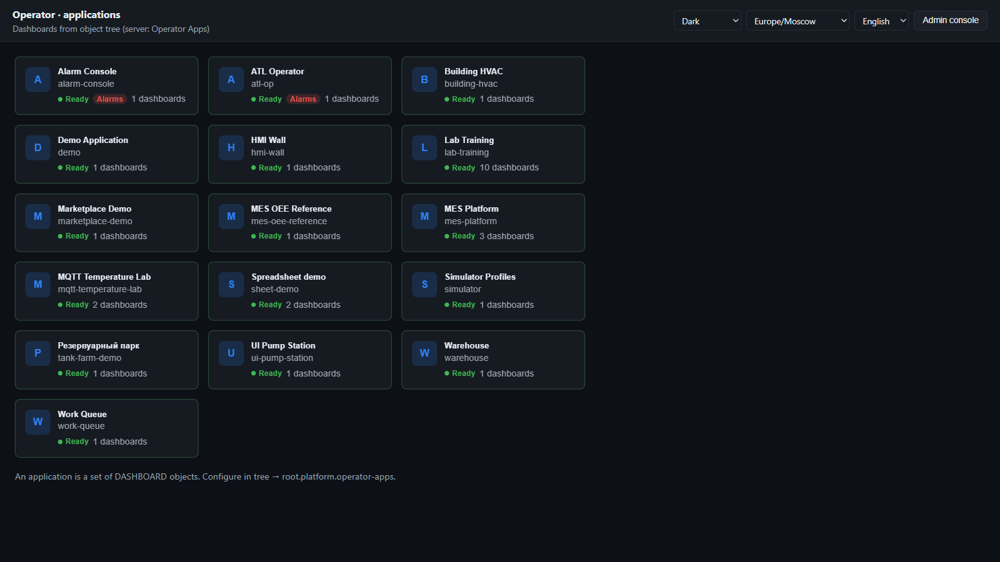

> **Язык:** русская версия. Английский оригинал: [en/operator-apps.md](../en/operator-apps.md).

# Приложения оператора (Operator Apps)

> **Статус:** Stable — настройка меню экранов и стартовых рабочих мест для дежурного персонала. Метки зрелости: [doc-status.md](doc-status.md).

**Приложение оператора (`Operator App`)** определяет набор вкладок дашбордов, заголовок и стартовый экран (либо адрес встроенного React-интерфейса `/apps/<appId>/`), которые открываются сменному персоналу в режиме оператора. Настройки хранятся на сервере в таблице `operator_app_ui` и отображаются в дереве по пути `root.platform.operator-apps.<appId>`.

---

## Адреса запуска

| Режим / приложение | URL |
|--------------------|-----|
| Экран выбора приложений (лаунчер) | `/?mode=operator` |
| Пульт тревог | `/?mode=operator&app=alarm-console` |
| Рабочая очередь задач смены | `/?mode=operator&app=work-queue` |
| Видеостена (мозаика 2×2) | `/?mode=operator&app=hmi-wall` |
| Обзорный пульт платформы | `/?mode=operator&app=platform` |

---

## Встроенные стартовые шаблоны

| `appId` | Целевой дашборд | Назначение |
|---------|-----------------|------------|
| `alarm-console` | `root.platform.dashboards.alarm-console` | Живая лента событий и панель квитирования активных тревог |
| `work-queue` | `root.platform.dashboards.work-queue` | Полноэкранная очередь задач оператора из процессов BPMN |
| `hmi-wall` | `root.platform.dashboards.hmi-wall` | Экран для диспетчерской видеостены (раскладка 2×2) |

- При включённых демонстрационных данных (`fixtures-enabled=true`) эти приложения создаются автоматически при первом старте сервера.
- На чистой установке их можно развернуть одной кнопкой с экрана выбора приложений (**Установить стартовые шаблоны**) или запросом `POST /api/v1/operator-apps/starters/install` (роль `admin`).

---

## REST API

| Метод | Путь | Назначение |
|-------|------|------------|
| `GET` | `/api/v1/operator-apps` | Список всех приложений оператора |
| `GET` | `/api/v1/operator-apps/{appId}/ui` | Получить конфигурацию меню и экранов |
| `POST` | `/api/v1/operator-apps/{appId}` | Создать приложение оператора |
| `PUT` | `/api/v1/operator-apps/{appId}/ui` | Обновить заголовок, вкладки дашбордов и ссылки на `ui-pack` |
| `GET` | `/api/v1/operator-apps/starters` | Список доступных стартовых шаблонов |
| `POST` | `/api/v1/operator-apps/starters/install` | Установить стартовые шаблоны |

---

## Связанные разделы

- [Руководство оператора](operator-guide.md) — ежедневная работа с экранами и очередью задач
- [Веб-консоль](web-console.md) — отличие режима администратора и режима оператора
- [Разработка своего React-интерфейса](external-ide.md) — подключение внешних веб-пакетов `ui-pack`
