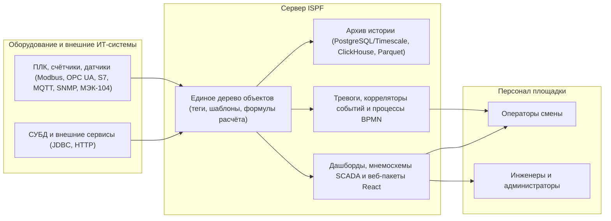
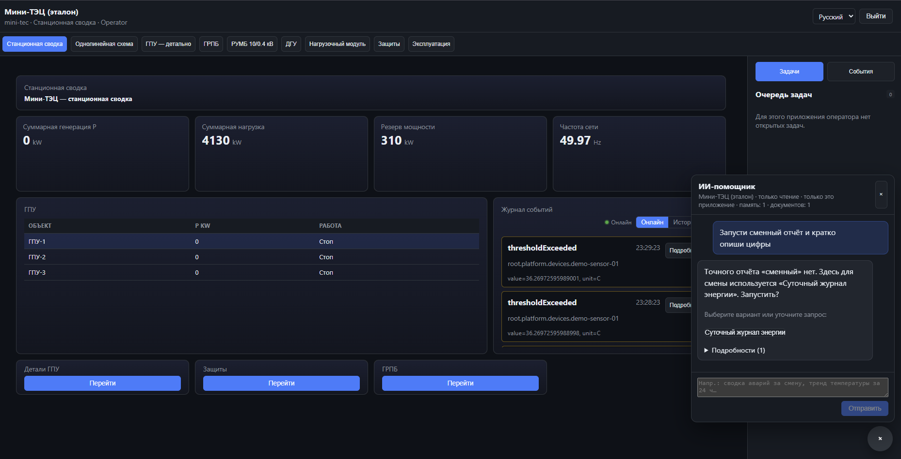

> **Язык:** русская версия. Английский оригинал: [en/product.md](../en/product.md).

# ISPF — Обзор продукта

> **Статус:** Stable — обзор возможностей платформы для инженеров, операторов и руководителей проектов. Метки зрелости: [doc-status.md](doc-status.md).

**ISPF (IoT Solutions Platform Framework)** — серверная платформа для промышленной автоматизации, диспетчеризации (SCADA), IoT-мониторинга и цехового производственного учёта (MES), разворачиваемая на серверах заказчика. Платформа объединяет опрос оборудования, расчёт показателей в реальном времени, архив истории, сигнализацию тревог, маршруты BPMN и экраны оператора вокруг единой модели данных — без необходимости дописывать Java-ядро сервера под каждый новый объект или отрасль.

Только начинаете знакомство? Откройте **[Как устроен ISPF](learn.md)** или сразу переходите к **[Быстрому старту за 15 минут](getting-started.md#попробовать-ispf-15-минут)**.

---

## Для кого предназначена платформа

| Роль | Основные задачи | С чего начать |
|------|-----------------|---------------|
| **Дежурный оператор / диспетчер** | Контроль параметров на экранах и мнемосхемах, квитирование тревог, выполнение задач смены, выгрузка отчётов | [Руководство оператора](operator-guide.md) |
| **Инженер АСУ ТП / разработчик решений** | Настройка структуры площадки, подключение драйверов, написание формул, сборка экранов и пакетов приложений | [Как устроен ISPF](learn.md) → [Руководство разработчика решений](solution-developer-guide.md) |
| **Фронтенд-разработчик (кастомный UI)** | Создание специализированных веб-приложений оператора на React (`ui-pack`) поверх API платформы | [Разработка своего React-интерфейса](external-ide.md) |
| **Системный администратор / DevOps** | Установка в Docker или закрытом контуре, настройка PostgreSQL/ClickHouse, Keycloak, резервного копирования и мониторинга | [Развёртывание](deployment.md) · [Безопасность](security.md) |
| **Разработчик драйверов и ядра** | Написание собственных драйверов протоколов (`DeviceDriver` SPI) и развитие открытого ядра | [SDK драйверов (DDK)](driver-ddk.md) · [Архитектура](architecture.md) |

---

## Какую проблему решает ISPF

На типичном промышленном объекте со временем вырастает «зоопарк» из четырёх-пяти разрозненных систем: шлюз протоколов (OPC/Modbus), отдельная база временных рядов, редактор мнемосхем, система оповещений и самописный веб-бэкенд для сменных журналов и заказов. Любое добавление нового агрегата превращается в ручную правку во всех пяти местах.

ISPF собирает все эти задачи вокруг **одного дерева объектов** (`root.platform.*`) с единым API, общей системой прав доступа и единой консолью:

---

## Ключевые возможности

### 1. Единое дерево объектов и шаблоны (`Blueprints`)

Любая сущность системы — контроллер ПЛК, узел расчёта насосной станции, экран оператора, мнемосхема, правило тревоги или маршрут BPMN — является узлом дерева с понятным адресом через точку (например, `root.platform.devices.pump-01`).
- **Переменные (`DataRecord`):** строго типизированные поля (`DOUBLE`, `INTEGER`, `BOOLEAN`, `STRING`, `DATETIME`, таблицы) с поддержкой флагов достоверности телеметрии (`GOOD`, `UNCERTAIN`, `BAD`) и записи истории.
- **Шаблоны (`Blueprints`):** позволяют один раз описать структуру типового агрегата (`INSTANCE`) или центрального узла станции (`SINGLETON`) и тиражировать объекты без ручного копирования переменных.
- **Чёткое разделение ролей:** узлы `DEVICE` отвечают только за связь с приборами, а узлы `SINGLETON` и `INSTANCE` — за прикладные расчёты и функции.
Подробнее: [Модель объектов](object-model.md) · [Шаблоны объектов](blueprints.md).

### 2. Подключение оборудования и ИТ-источников (драйверы)

Модульные пакеты драйверов связывают протоколы с переменными узлов `DEVICE`: Modbus TCP/RTU/UDP, OPC UA (клиент и сервер), Siemens S7, MQTT, SNMP, BACnet, МЭК 60870-5-104, DNP3, EtherNet/IP, DLMS, HTTP, JDBC и др. Для каждого драйвера в каталоге открыто указан реальный уровень готовности (`PRODUCTION` с автотестами или `BETA`, а также статус полевых испытаний).
Подробнее: [Драйверы устройств](drivers.md) · [SDK драйверов (DDK)](driver-ddk.md).

### 3. Расчёты в реальном времени и архив истории (Historian)

- **Правила расчёта (*binding rules*):** автоматический пересчёт по изменению входных сигналов, по событию или по таймеру. Формулы пишутся на языке **CEL** либо через встроенные функции обработки сигналов (`scale`, `clamp`, `movingAvg`, `hysteresis`, `counterRate`, чтение соседних узлов `read`).
- **Архив истории:** запись выбранных переменных со сроками хранения и готовыми окнами агрегации (`1m`, `5m`, `1h`, смена `8h`). Масштабируется от встроенной файловой H2 (на ноутбуке) до PostgreSQL/TimescaleDB (единая БД), ClickHouse (высокочастотные потоки и длинная аналитика) и выгрузки холодного архива в Parquet.
Подробнее: [Правила расчёта](bindings.md) · [История переменных](variable-history.md) · [Уровни хранения истории](historian-tiers.md).

### 4. Дашборды, мнемосхемы SCADA и кастомные веб-приложения

- **Конструктор дашбордов:** сетка **84×8** и более 40 типов виджетов (числовые карточки, тренды, шкалы, связанные таблицы объектов через `selectionKey`, расчётные листы в стиле Excel, отчёты, очередь задач).
- **Редактор мнемосхем SCADA:** браузерный векторный редактор технологических (P&ID) и однолинейных электрических схем с библиотекой из 218 промышленных символов, живой индикацией и подачей команд управления.
- **Пакеты веб-интерфейса (`ui-pack`):** если решению нужен полностью индивидуальный интерфейс (интерактивные карты, 3D, плотные диспетчерские таблицы MES), команда собирает отдельное React-приложение в привычной IDE, и ISPF раздаёт его по адресу `/apps/<appId>/`.
Подробнее: [Дашборды](dashboards.md) · [Мнемосхемы SCADA](scada.md) · [Виджеты](widgets.md) · [Разработка своего React-интерфейса](external-ide.md).

### 5. Тревоги, корреляция событий и процессы BPMN

- **Правила тревог (`ALERT`):** контроль порогов и состояний с выдержкой времени, защёлкой/гистерезисом сброса (`deactivateExpr`) и отправкой оповещений по вебхуку или почте.
- **Корреляторы событий (`CORRELATOR`):** обнаружение серий или цепочек событий на заданном интервале времени.
- **Процессы BPMN (`WORKFLOW`):** визуальный редактор регламентов, сочетающий автоматические шаги (вызов функций, запись переменных, отправка сообщений) и задачи для дежурного оператора в рабочей очереди (**Work Queue**).
Подробнее: [Автоматизация](automation.md) · [Процессы BPMN](workflows.md).

### 6. Поставка готовых решений без доработки ядра сервера

Отраслевое приложение — собственные таблицы БД (`migrations[]`), серверные функции на SQL/JSON (`functions[]`), шаблоны объектов, экраны, отчёты и расписания — упаковывается в единый JSON-пакет (`bundle.json`), проверяется валидатором (`ispf validate`) и раскатывается через REST API или встроенную интеграцию с Git.
Подробнее: [Руководство разработчика решений](solution-developer-guide.md) · [API приложений](applications.md).

### 7. Безопасность, работа без интернета и распределённые площадки

- Ролевой доступ (`admin`, `operator` и пользовательские роли) с разграничением вплоть до отдельных объектов, переменных и функций; локальная авторизация или единый вход через Keycloak (OIDC); двухфакторная аутентификация TOTP.
- Полностью автономная установка (*air-gap*) для изолированных технологических сетей.
- Отказоустойчивый кластер и федерация удалённых площадок с буферизацией данных при потере связи.
Подробнее: [Безопасность](security.md) · [Установка в закрытом контуре](air-gap-deployment.md) · [Кластер](cluster.md) · [Федерация](federation.md).

---

## Режимы работы веб-консоли

Один и тот же сервер отдаёт два режима интерфейса в зависимости от роли пользователя и адреса:

| Режим | Адрес | Кто и зачем использует |
|-------|-------|------------------------|
| **Консоль администратора** | `http://<хост>:8080` | Дерево объектов, настройка драйверов и формул, конструкторы дашбордов, мнемосхем и процессов BPMN, диагностика сервера |
| **Рабочее место оператора** | `http://<хост>:8080?mode=operator` | Полноэкранный пульт дежурной смены без дерева настроек: экраны мониторинга, управление с мнемосхем, журнал событий и очередь задач |
| **Конкретное приложение оператора** | `http://<хост>:8080?mode=operator&app=<appId>` | Открывает меню экранов выбранного решения (либо переводит в установленный React-интерфейс `/apps/<appId>/`) |

---

## Типовые сценарии работы

### 1. Мониторинг оборудования и обработка аварии
1. Инженер создаёт узел `DEVICE` (например, Modbus или MQTT), привязывает регистры к переменным и запускает драйвер.
2. На дашборде и мнемосхеме P&ID оператор видит текущие параметры и графики трендов.
3. При выходе температуры за порог правило тревоги фиксирует событие и запускает процесс BPMN.
4. В очереди задач (**Work Queue**) у оператора появляется задание: он берёт его в работу, проверяет показания, подтверждает тревогу и закрывает шаг регламента.

### 2. Развёртывание учётного или диспетчерского приложения
1. Разработчик собирает папку проекта: SQL-миграции прикладных таблиц (заказы, партии), функции чтения/записи и экраны (дашборды либо свой `ui-pack` на React).
2. Команды `ispf pack` и `ispf validate --strict` проверяют целостность пакета до выкатки.
3. Команда `ispf deploy` (или запрос `POST /api/v1/applications/<appId>/deploy`) создаёт изолированную схему БД, функции и узлы дерева за один шаг.
4. Операторы входят под своей ролью и работают по адресу `?mode=operator&app=<appId>` или `/apps/<appId>/`.

---

## Технологический стек и лицензия

- **Сервер:** Java 25, Spring Boot 4, PostgreSQL / TimescaleDB (встроенная H2 для локального запуска; опционально ClickHouse, NATS, MQTT, Keycloak).
- **Интерфейс:** React 19, TypeScript, Vite, обмен по REST API и WebSocket (`WS /ws/objects`).
- **Лицензирование:** ядро платформы (`main`) распространяется под свободной лицензией **GNU AGPL v3** (предусмотрена также коммерческая лицензия Enterprise для закрытых проектов). Пакеты драйверов и прикладные решения могут поставляться на отдельных условиях — см. [Лицензия](license.md) и [Модули и плагины](plugins.md).

Полный каталог разделов документации: **[docs/ru/readme.md](readme.md)**.
