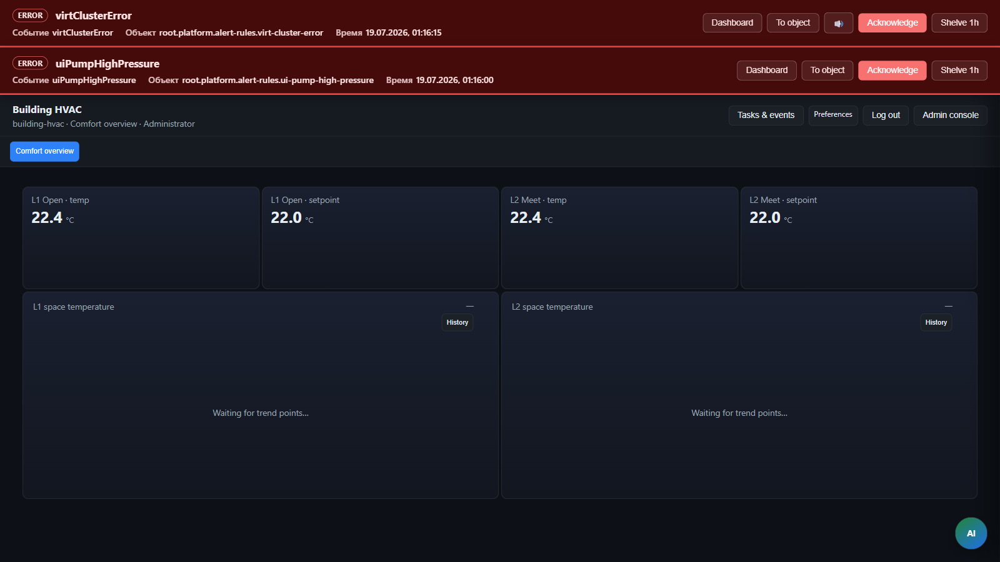

> **Язык:** русская версия. Английский оригинал: [en/reference-building-hvac-walkthrough.md](../en/reference-building-hvac-walkthrough.md).

# Разбор эталонного примера: диспетчеризация климата здания (`building-hvac`)

> **Статус:** Stable — компактный учебный пакет управления температурными зонами здания с семантической разметкой Project Haystack. Метки зрелости: [doc-status.md](doc-status.md).

Пакет **`building-hvac`** ([`examples/building-hvac-app/`](../../examples/building-hvac-app/)) показывает устройство простого приложения мониторинга и управления микроклиматом по этажам и помещениям здания.

---

## 1. Состав примера



| Элемент | Описание |
|---------|----------|
| Таблица зон (`hvac_zone`) | Код климатической зоны (`L1-OPEN-01`, `L2-MEET-02`), текущая температура, уставка комфорта и режим работы (`cooling` / `heating`) |
| Функция выборки зон (`hvac_listZones`) | Скриптовая функция для отображения состояния помещений на экране оператора |
| Семантические теги (`metadata.haystackTags`) | Набор стандартных маркеров Project Haystack (`site`, `equip`, `ahu`, `zone`, `temp`) |
| Пульт оператора | Открывается по адресу `?mode=operator&app=building-hvac` |

---

## 2. Установка и проверка

Установить пакет можно через раздел **Система → Решения** в веб-консоли или HTTP-запросом:

```bash
curl -s -X POST http://localhost:8080/api/v1/applications/building-hvac/deploy \
  -H "Content-Type: application/json" \
  --data-binary @examples/building-hvac-app/bundle.json
```

Запуск автоматического теста:

```bash
./gradlew :packages:ispf-server:test --tests com.ispf.server.application.BuildingHvacBundleSmokeTest
```
