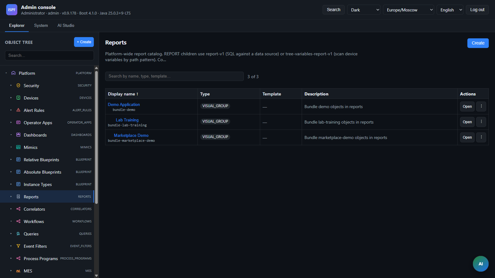

> **Язык:** русская версия. Английский оригинал: [en/reports.md](../en/reports.md).

# Отчёты (`REPORT`)

> **Статус:** Stable — табличные SQL-отчёты, отчёты по переменным дерева и выгрузка по шаблонам XLSX/PDF/HTML/CSV. Метки зрелости: [doc-status.md](doc-status.md).

Отчёты в ISPF хранятся как узлы типа **`REPORT`** в ветке `root.platform.reports.*` (шаблон `report-v1`). Запрос данных выполняется только на чтение (`SELECT` / `WITH`) через привязанный источник данных **`DATA_SOURCE`** (`root.platform.data-sources.*`) — например, по изолированной SQL-схеме вашего приложения или внешней реляционной БД.

---

## Структура узла `REPORT` в дереве



| Путь в дереве | Тип узла | Шаблон |
|---------------|----------|--------|
| `root.platform.reports` | `REPORTS` | Каталог отчётов |
| `root.platform.reports.<reportId>` | `REPORT` | `report-v1` (или `tree-variables-report-v1`) |

### Переменные SQL-отчёта (`report-v1`)

| Переменная | Назначение |
|------------|------------|
| `title` | Заголовок отчёта на экране и в выгрузке |
| `dataSourcePath` | Путь к источнику данных `DATA_SOURCE` (`root.platform.data-sources.*`) |
| `query` | SQL-запрос (`SELECT` или `WITH`; изменяющие запросы запрещены) |
| `parameters` | Массив JSON с именами позиционных параметров `?` |
| `columns` | Массив JSON `{ "field", "label" }` для заголовков колонок |
| `defaultParameters` | Объект JSON со значениями параметров по умолчанию |
| `maxRows` | Ограничение числа возвращаемых строк (по умолчанию `1000`) |
| `refreshIntervalMs` | Период автообновления на экране в мс (по умолчанию `30000`) |
| `templateFormat` | Формат прикреплённого файла шаблона: `xlsx`, `docx`, `html` (пусто — табличный вывод без шаблона) |

Сам бинарный файл печатного шаблона хранится в системной таблице `report_templates`. В консоли администратора узел открывается в визуальном **конструкторе отчётов (Report Builder)** с предпросмотром выборки, настройкой колонок без ручного редактирования JSON и загрузкой шаблона.

### Отчёт по переменным дерева (`tree-variables-report-v1`)

Позволяет собрать сводную ведомость текущих значений одноимённой переменной сразу по группе устройств (без SQL):
- `reportType`: `"tree-variables"`;
- `devicePathPattern`: префикс или маска пути объектов (`*`, `?`);
- `variableName`: имя переменной на каждом узле;
- `columns`: список выводимых полей (по умолчанию путь объекта и значение).

---

## Форматы просмотра и выгрузки

| Где открыт отчёт | Выгрузка в CSV | Печатная форма XLSX / PDF / HTML |
|------------------|----------------|----------------------------------|
| Конструктор отчётов (Admin Console) | Да | Да |
| Виджет дашборда `type: "report"` | Настраивается (`showCsv`) | Настраивается (`showXlsx`, `showPdf`, `showHtml`) |
| Меню отчётов в приложении оператора (`operatorUi.reports[]`) | Да | Да |

### Виджет `report` на дашборде

| Поле виджета | Назначение |
|--------------|------------|
| `reportPath` | **Обязательно.** Путь к узлу `root.platform.reports.<id>` |
| `parametersJson` | Постоянные параметры запуска отчёта |
| `contextParamsJson` | Подстановка параметров из контекста экрана `{ "параметрОтчёта": "ключСессии" }` |
| `showCsv`, `showPdf`, `showXlsx`, `showHtml` | Какие кнопки скачивания показывать оператору |
| `selectable`, `rowSelectionKey` | Передача выбранной строки отчёта другим виджетам экрана |

---

## Печатные шаблоны Excel (`Band1`) и Word

Табличные шаблоны `.xlsx` заполняются встроенным движком на базе Apache POI ([ADR-0053](decisions/0053-ispf-template-filler.md)):
1. Подготовьте файл `.xlsx` с именованной областью строки данных **`Band1`** и подстановками вида `${Band1.ИМЯ_КОЛОНКИ}` (имена колонок выборки в верхнем регистре).
2. Загрузите файл на вкладке **Шаблон отчёта** в конструкторе (`POST /api/v1/reports/by-path/template?path=...&format=xlsx`).
3. Выгружайте готовый документ через кнопки виджета или запрос `GET .../export?format=xlsx|pdf|html`.

Даже если шаблон не загружен, отчёт всегда можно скачать в виде CSV или стандартной таблицы XLSX/HTML.

---

## Поставка отчёта в пакете `bundle.json`

Секция `reports[]` при деплое пакета автоматически создаёт или обновляет узлы `root.platform.reports.<reportId>`:

```json
{
  "reports": [
    {
      "reportId": "ready-items",
      "title": "Готовые партии на складе",
      "query": "SELECT item_code, status FROM demo_item WHERE status = ?",
      "parameters": ["status"],
      "columns": [
        { "field": "item_code", "label": "Код партии" },
        { "field": "status", "label": "Статус" }
      ],
      "maxRows": 500
    }
  ]
}
```

---

## Основные методы REST API

```http
GET    /api/v1/reports/by-path?path=root.platform.reports.ready-items
PUT    /api/v1/reports/by-path/definition?path=...
PUT    /api/v1/reports/by-path/tree-variables-definition?path=...
POST   /api/v1/reports/by-path/run?path=...
GET    /api/v1/reports/by-path/export?path=...&format=csv|pdf|xlsx|html
POST   /api/v1/reports/by-path/template?path=...&format=xlsx
DELETE /api/v1/reports/by-path/template?path=...
```

Пример запуска с параметрами (доступно ролям `operator` и `admin`):

```http
POST /api/v1/reports/by-path/run?path=root.platform.reports.ready-items
Content-Type: application/json

{ "parameters": { "status": "ready" } }
```

См. также: [Руководство разработчика решений](solution-developer-guide.md) · [Дашборды](dashboards.md) · [Справочник виджетов](widgets.md).
