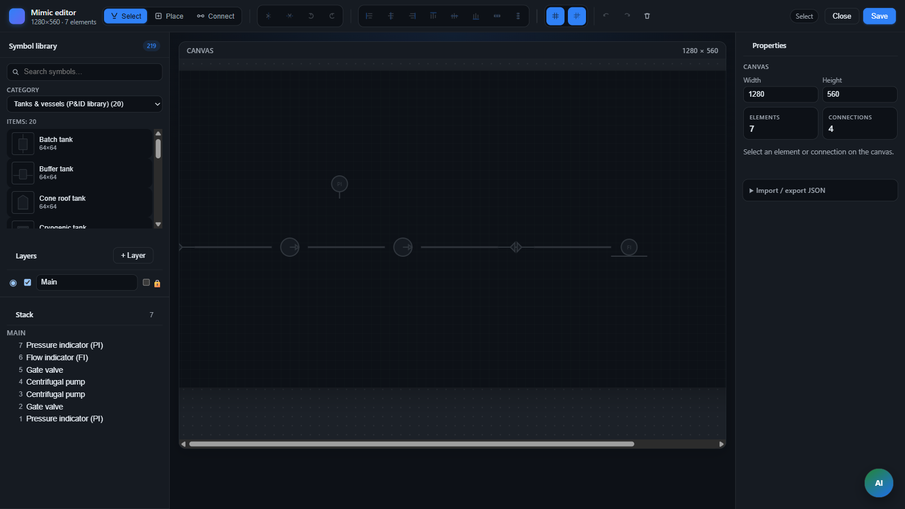

> **Язык:** русская версия. Английский оригинал: [en/scada-mimic.md](../en/scada-mimic.md).

# Формат мнемосхемы SCADA (`diagramJson`) и REST API

> **Статус:** Stable — структура документа `diagramJson` (версия 2), действия на элементах и REST API. Метки зрелости: [doc-status.md](doc-status.md).

Технический справочник по JSON-структуре мнемосхем и методам API. Общее описание работы с мнемосхемами см. в разделе **[Мнемосхемы SCADA](scada.md)**, а работу с графическими символами — в **[Библиотеке символов SCADA](scada-symbol-library.md)**.

---

## Основные понятия

| Понятие | Назначение |
|---------|------------|
| Узел `MIMIC` | Переиспользуемая мнемосхема в дереве `root.platform.mimics.*` (шаблон `mimic-v1`) |
| Виджет `scada-mimic` | Виджет дашборда, отображающий мнемосхему по пути `mimicPath` (или встроенный `diagramJson`) |
| `diagramJson` | JSON-документ схемы: слои, элементы, соединительные линии, привязки к сигналам и пользовательские символы |
| `grid.snap` и `grid.visible` | Привязка к шагу сетки и отображение сетки в редакторе (переключаются на верхней панели) |

---

## Структура документа (`version: 2`)

Единственный актуальный формат хранения — **версия 2** (старые документы версии 1 автоматически приводятся к формату v2 при загрузке):

```json
{
  "version": 2,
  "width": 1600,
  "height": 900,
  "background": "var(--bg)",
  "grid": { "size": 1, "snap": false, "visible": false },
  "layers": [{ "id": "layer-default", "name": "Основной слой", "visible": true }],
  "elements": [
    {
      "id": "t1",
      "symbolId": "pack.ispf-pid.vertical-tank",
      "layerId": "layer-default",
      "x": 100,
      "y": 80,
      "rotation": 0,
      "bindings": {
        "fillLevel": {
          "objectPath": "root.platform.devices.demo-sensor-01",
          "variableName": "level",
          "valueField": "value",
          "transform": "number"
        }
      },
      "actions": [
        {
          "id": "act1",
          "type": "toggleVariable",
          "objectPath": "root.platform.devices.demo-valve-01",
          "variableName": "open",
          "valueField": "value"
        }
      ]
    }
  ],
  "connections": [
    {
      "id": "c1",
      "layerId": "layer-default",
      "from": { "elementId": "t1", "port": "e" },
      "to": { "elementId": "v1", "port": "n" },
      "points": [
        { "x": 180, "y": 140 },
        { "x": 249, "y": 140 },
        { "x": 249, "y": 120 },
        { "x": 318, "y": 120 }
      ],
      "bindings": {
        "flowing": {
          "objectPath": "root.platform.devices.demo-pump-01",
          "variableName": "running",
          "valueField": "value",
          "transform": "bool"
        }
      }
    }
  ],
  "customSymbols": []
}
```

### Поля элемента схемы (`elements[]`)

| Поле | Описание |
|------|----------|
| `symbolId` | Идентификатор символа: из стандартного каталога (`pack.ispf-pid.vertical-tank`), из библиотеки документа (`custom:<id>`) или одиночный SVG (`custom.svg`) |
| `x`, `y` | Координаты верхнего левого угла на холсте (в пикселях) |
| `rotation` | Угол поворота: `0` \| `90` \| `180` \| `270` |
| `props` | Размеры (`width`, `height`), зеркальное отражение (`flipX`, `flipY`), подписи и пользовательская разметка `svg` |
| `bindings` | Карта привязок свойств символа к переменным объектов (`objectPath` или `selectionKey`, `variableName`, `valueField`, `transform`) |
| `actions` | Действия по клику оператора (см. ниже) |
| `formatRules` | Условная подсветка в зависимости от значения сигнала |
| `labels`, `tooltip` | Надписи на схеме и всплывающая подсказка при наведении |

Соединительные линии (`connections[]`) между портами символов строятся ортогональной трассировкой (`routeOrthogonal`) и автоматически перестраиваются при перемещении элементов.

---

## Управляющие действия на схеме (`actions[]`)

| Тип действия (`type`) | Основные поля | Поведение на пульте оператора |
|-----------------------|---------------|-------------------------------|
| `toggleVariable` | `objectPath`, `variableName`, опционально `value` | Переключить или записать булеву/командную переменную |
| `invokeFunction` | `objectPath`, `functionName`, опционально `paramsJson` | Вызвать функцию объекта (в т.ч. импульсную команду `sourceType: "pulse"`) |
| `setSelection` | `selectionKey` + `objectPath` (или `selectionJson`) | Выбрать агрегат в контексте текущего экрана (например, обновить карточку параметров справа без ухода со схемы) |
| `navigate` | `dashboardPath`, опционально `selectionJson` | Перейти на другой дашборд с передачей выбранного оборудования |
| `toggleLayer` | `layerId` | Показать или скрыть слой мнемосхемы |
| `toggleExpand` | `elementId` | Развернуть или свернуть компактный блок на схеме |
| `cycleUnit` | `bindingKey`, `units[]` | Переключить отображаемую единицу измерения |

Пример выбора газопоршневой установки (ГПУ-2) на однолинейной схеме мини-ТЭЦ с обновлением соседних виджетов дашборда по ключу `"equipment"`:

```json
{
  "id": "sel-gpu2",
  "type": "setSelection",
  "selectionKey": "equipment",
  "objectPath": "root.platform.devices.mini-tec-plant.gpu-02"
}
```

На панели виджета мнемосхемы оператору также доступна кнопка **Экспорт PNG** для сохранения снимка текущего состояния схемы.

---

## Горячие клавиши и инструменты редактора



| Инструмент | Клавиша / панель | Действие |
|------------|------------------|----------|
| **Выбор (Select)** | `V` | Выделение, групповой выбор с `Shift`, перемещение с автопривязкой к соседним фигурам (~10 пикс.), изменение размера за маркеры |
| **Размещение (Place)** | `P` | Выбор символа в палитре и постановка на холст |
| **Линия связи (Connect)** | `C` | Соединение двух портов ортогональной линией трубопровода или шины |
| **Отражение и поворот** | Панель инструментов | Отражение по горизонтали/вертикали (`Flip H/V`) и поворот на `±90°` |
| **Выравнивание и распределение** | Панель инструментов | Выравнивание краёв/центров (от 2 фигур) и равномерный шаг (от 3 фигур) |
| **Отмена / повтор / удаление** | `Ctrl+Z`, `Ctrl+Y`, `Del` | История правок и удаление выбранных элементов |
| **Импорт / экспорт JSON** | Панель инструментов | Прямой просмотр и загрузка полного `diagramJson` |

---

## REST API

| Метод | Путь | Назначение |
|-------|------|------------|
| `GET` | `/api/v1/mimics/by-path?path=...` | Получить мнемосхему по пути узла `MIMIC` |
| `PUT` | `/api/v1/mimics/by-path/diagram?path=...` | Сохранить JSON документа схемы (`diagramJson`) |
| `PUT` | `/api/v1/mimics/by-path/title?path=...` | Изменить заголовок мнемосхемы |

---

## Готовые демонстрационные схемы

При включённых демо-данных (`ispf.bootstrap.fixtures-enabled=true`) на сервере доступны эталонные мнемосхемы:
- **Мини-ТЭЦ (ГПУ и РУ):** `root.platform.mimics.mini-tec-single-line` (дашборд `mini-tec-hmi`);
- **Резервуарный парк:** `root.platform.mimics.tank-farm-demo` (дашборд `tank-farm-hmi`);
- **Магистральный нефтепровод (формы РП / РД-029):** `root.platform.mimics.pipeline-rp` и связанные экранные формы.
