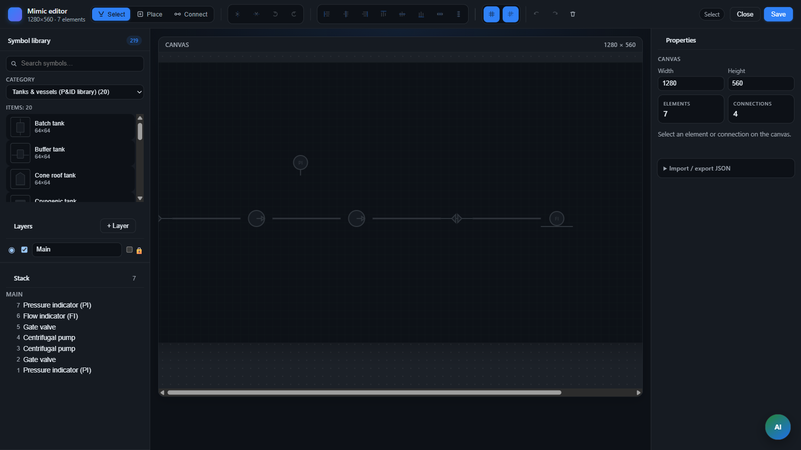

> **Язык:** русская версия. Английский оригинал: [en/scada-symbol-library.md](../en/scada-symbol-library.md).

# Библиотека символов SCADA

> **Статус:** Stable — встроенный каталог из 218 символов P&ID / энергетики и загрузка собственных SVG. Метки зрелости: [doc-status.md](doc-status.md).

Справочник по работе со стандартным каталогом промышленных символов, загрузкой собственных векторных изображений SVG и динамической анимацией элементов в редакторе мнемосхем ISPF.

Связанные разделы: [Мнемосхемы SCADA](scada.md) · [Формат `diagramJson` и API](scada-mimic.md) · [Правовой статус пакета символов](pid-symbols-legal.md).

---

## Состав палитры символов



| Источник | Категории в палитре | Формат `symbolId` | Количество |
|----------|---------------------|-------------------|------------|
| Встроенный пакет ISA/ISO P&ID | `pack-valves`, `pack-pumps`, `pack-tanks`, `pack-pipes`, `pack-instruments`, `pack-electrical`, `pack-isa`, `pack-misc` | `pack.ispf-pid.*` | **218** символов |
| Одиночный встроенный SVG | `common` | `custom.svg` | Базовый шаблон |
| Библиотека документа («Свои SVG») | `custom` | `custom:<id>` | Произвольный набор в рамках мнемосхемы |

Манифест встроенного пакета: `apps/web-console/src/scada/symbols/packs/ispf-pid-v1/manifest.json` (пересборка: `npm run build:pid-symbols --prefix apps/web-console`).

---

## Использование стандартных символов пакета

1. Откройте мнемосхему в редакторе (`root.platform.mimics` → выбрать узел `MIMIC`).
2. Выберите инструмент **Размещение (Place, `P`)** и раскройте нужную категорию палитры (например, ёмкости `pack-tanks` или арматуру `pack-valves`).
3. Кликните по холсту — создастся элемент со ссылкой `symbolId: "pack.ispf-pid.vertical-tank"`, без дублирования SVG-кода в JSON документа.
4. На правой панели свойств привяжите сигналы оборудования к свойствам элемента.

---

## Три способа работы с собственными SVG

| Режим | Когда удобно использовать | Где хранится разметка |
|-------|---------------------------|-----------------------|
| **На одном элементе (`Inline`)** | Разовая уникальная плашка или подложка на схеме | В поле `element.props.svg` у элемента с `symbolId: "custom.svg"` |
| **В библиотеке документа (`customSymbols[]`)** | Типовой агрегат (например, ячейка РУ или ГПУ), повторяющийся на схеме несколько раз | В массиве `customSymbols[]` документа (`symbolId: "custom:<id>"`) |
| **Доработка стандартного символа** | Нужно взять готовый насос/клапан из пакета и добавить свои индикаторы | Кнопка **Редактировать как SVG** → **Обновить символ в библиотеке** |

---

## Загрузка своего файла `.svg`

1. В редакторе мнемосхемы откройте категорию палитры **Свои SVG (Custom)**.
2. Нажмите **Загрузить SVG (Upload SVG)** и выберите файл `.svg` (рекомендуемый размер — до 256 КБ).
3. Символ сохранится в `customSymbols[]` текущего документа с флагом `inUserLibrary: true`, получит стандартные точки присоединения линий по сторонам света (N/S/E/W) и сразу станет доступен для размещения на холсте.

### Требования безопасности к загружаемому SVG

При загрузке фильтр `sanitizeSvgMarkup()` автоматически удаляет потенциально опасные конструкции:
- теги `script`, `iframe`, `object`, `embed`, `link`, `meta`, `style`, `foreignObject`;
- обработчики событий (`onclick`, `onload` и т.п.) и ссылки `javascript:` / `data:text/html`.

Используйте чистые векторные примитивы (`path`, `rect`, `circle`, `line`, `polygon`, `g`, `text`). Для корректного отображения в светлой и тёмной темах используйте CSS-переменные `var(--text)` и `var(--border)`.

```svg
<svg xmlns="http://www.w3.org/2000/svg" viewBox="0 0 64 64" width="64" height="64">
  <rect x="4" y="4" width="56" height="56" rx="8" fill="#161b22" stroke="#30363d" stroke-width="2"/>
  <text x="32" y="36" text-anchor="middle" fill="#8b949e" font-size="10">НАСОС</text>
</svg>
```

---

## Динамическая индикация (`behaviors` и `bindingSchema`)

Чтобы части пользовательского SVG меняли цвет заливки, обводки, высоту столба жидкости, текст или мигание по живым переменным объектов, в записи `customSymbols[]` описываются слоты `bindingSchema` и правила `behaviors[]` с целевыми `id` внутри SVG (например, `#ispf-status`, `#ispf-power`). Полный рабочий пример — в `packages/ispf-server/src/main/resources/bootstrap/mini-tec-mimic.json` и разделе [Мнемосхемы SCADA](scada.md).

---

## Лицензионная чистота графики

- Встроенный пакет **`ispf-pid-v1`** (218 символов) создан специально для ISPF и распространяется под свободной лицензией **Apache-2.0** ([pid-symbols-legal.md](pid-symbols-legal.md)).
- Не загружайте в публичные и тиражируемые пакеты проприетарную графику из коммерческих SCADA-библиотек сторонних вендоров.

---

## Частые вопросы и диагностика

| Ситуация | Решение |
|----------|---------|
| Добавленный символ из `customSymbols[]` не виден в палитре «Свои SVG» | Убедитесь, что у записи установлен флаг `"inUserLibrary": true` |
| Загруженный SVG отображается пустым | Проверьте наличие корректного атрибута `viewBox` на корневом `<svg>` и перенесите цвета из `<style>` в атрибуты `fill`/`stroke` |
| Цвета символа сливаются с фоном при смене темы | Используйте `var(--text)` и `var(--border)` вместо жёсткого чёрного/белого цвета |
| Стандартные категории пакета пусты при сборке из исходников | Выполните `npm run build:pid-symbols --prefix apps/web-console` и обновите вкладку браузера |
