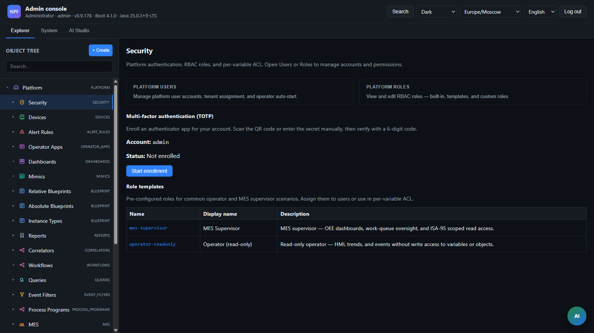

> **Язык:** русская версия. Английский оригинал: [en/security.md](../en/security.md).

# Безопасность, аутентификация и разграничение прав (RBAC и ACL)

> **Статус:** Stable — вход в систему, OAuth2/Keycloak, двухфакторная проверка TOTP, ролевой и пообъектный доступ. Метки зрелости: [doc-status.md](doc-status.md).

Связанные архитектурные документы: [Модель безопасности (ADR-0066)](decisions/0066-security-model.md) · [Шифрование и ротация ключей секретов (ADR-0065)](decisions/0065-secrets-key-rotation.md) · [Дальнейшее развитие MFA (ADR-0056)](decisions/0056-webauthn-idp-mfa.md).

---

## Базовые роли пользователей



На уровне HTTP API и веб-консоли действуют три стандартные системные роли (плюс произвольные прикладные роли для переменных и функций):

| Роль | Внутреннее имя Spring Security | Полномочия |
|------|--------------------------------|------------|
| **`admin`** | `ROLE_admin` | Полный доступ: настройка сервера, управление пользователями и правами, резервное копирование, кластер, федерация, деплой решений |
| **`developer`** | `ROLE_developer` | Разработка и отладка решений: дерево объектов, шаблоны, функции, деплой `bundle.json`, расписания, тревоги и ИИ-студия (без доступа к системным настройкам безопасности и кластера) |
| **`operator`** | `ROLE_operator` | Работа на смене: просмотр экранов и историй, вызов разрешённых функций, запись уставок (`writable`), работа с очередью задач BPMN |

---

## Режимы аутентификации (по профилям запуска)

### 1. Локальный профиль (`local`, `application-local.yml`)

- Аутентификация выполняется по **токену Bearer**, выдаваемому методом `POST /api/v1/auth/login`.
- Без токена доступ к защищённым маршрутам закрыт (`ispf.security.local-default-role` пуст; отладочный заголовок `X-ISPF-Role` по умолчанию выключен).
- На чистой базе автоматически создаются тестовые учётные записи: `admin / admin`, `developer / developer`, `operator / operator`.

```bash
curl -X POST http://localhost:8080/api/v1/auth/login \
  -H "Content-Type: application/json" \
  -d '{"username":"admin","password":"admin"}'

curl -H "Authorization: Bearer <token>" http://localhost:8080/api/v1/objects
```

У любой учётной записи можно включить **автозапуск рабочего места оператора** (`autoStartEnabled = true`, `autoStartApp = "<appId>"`): тогда сразу после входа откроется нужный пульт оператора вместо консоли администратора.

### 2. Промышленный профиль и разработка с единым входом (`default` / `dev`)

- Сервер работает как OAuth2 Resource Server и проверяет JWT-токены от **Keycloak** (или совместимого провайдера OIDC).
- В веб-консоли вход выполняется по протоколу **OIDC Authorization Code + PKCE** (кнопка **Войти через Keycloak**, клиент `ispf-web-console`; режим определяется через `GET /api/v1/auth/config`).
- Роли извлекаются из поля `realm_access.roles` токена JWT (`admin`, `developer`, `operator` и пользовательские роли).
- При локальном запуске `docker compose up -d` пространство (`realm`) **`ispf`** автоматически импортируется из `deploy/keycloak/ispf-realm.json` на порту `8180`.

### 3. Тестовый профиль (`test`)

Используется только при прогоне изолированных автотестов в памяти.

---

## Управление локальными учётными записями (`admin`)

| Метод и путь | Назначение |
|--------------|------------|
| `GET /api/v1/security/users` | Список пользователей |
| `POST /api/v1/security/users` | Создать пользователя |
| `PUT /api/v1/security/users/{username}` | Изменить роли, имя, статус `enabled`, настройки `autoStartEnabled` / `autoStartApp` |
| `DELETE /api/v1/security/users/{username}` | Удалить пользователя |
| `POST /api/v1/security/users/{username}/password` | Сменить пароль |
| `GET /api/v1/auth/me` | Проверить текущего пользователя и его роли |
| `POST /api/v1/auth/logout` | Завершить текущую сессию |

Все учётные записи и роли автоматически отображаются в дереве объектов по пути `root.platform.security.users.*` и `root.platform.security.roles.*`.

---

## Сводная таблица прав по группам API (`IspfAuthorizationRules`)

| Маршрут | `admin` | `developer` | `operator` | Без входа |
|---------|:-------:|:-----------:|:----------:|:---------:|
| `GET /api/v1/info`, `POST /api/v1/auth/login`, `GET /actuator/health` | ✓ | ✓ | ✓ | ✓ |
| `GET /api/v1/**` (чтение с учётом ACL узлов и переменных) | ✓ | ✓ | ✓ | — |
| `POST .../functions/invoke`, `POST /api/v1/bff/**` | ✓ | ✓ | ✓ | — |
| `GET/POST /api/v1/work-queue/**`, отмена экземпляра BPMN | ✓ | ✓ | ✓ | — |
| `POST /api/v1/events/fire` | ✓ | ✓ | ✓ | — |
| Конфигурация объектов, шаблонов, тревог, расписаний, деплой приложений, ИИ-студия | ✓ | ✓ | — | — |
| Настройка прав (`.../acl`), пользователей (`/security/**`), бэкапов, метрик, федерации и тенантов | ✓ | — | — | — |

---

## Пообъектные права (ACL) и права на отдельные переменные

### 1. Списки доступа на узлах дерева (`ACL`)

На вкладке **Доступ** в инспекторе любого узла (или через `GET / PUT /api/v1/objects/by-path/acl?path=...`) администратор может задать правила доступа для конкретных ролей (`ROLE`) или пользователей (`USER`):
- разрешения: `READ` (чтение), `WRITE` (изменение), `INVOKE` (вызов функций);
- если на узле и его родительских папках нет отдельных записей ACL, действует базовая ролевая модель; роль `admin` всегда сохраняет полный доступ.

### 2. Разграничение на уровне переменных и функций

- На отдельных переменных можно задать списки ролей **`readRoles`** и **`writeRoles`**, а на функциях и событиях — **`invokeRoles`**.
- Все пользовательские обращения — прямое чтение/запись и история, запросы Object Query, формулы, вызовы функций из браузера и ИИ-агента, рассылка по WebSocket и прокси-запросы федерации от имени пользователя — проверяют эти списки прав и скрывают недоступные поля.
- Внутренние фоновые планировщики и движок пересчёта правил работают в системном контексте (`SYSTEM`). При федерации между серверами полномочия делегированного запроса ограничиваются пересечением прав сервисного канала и ролей конечного пользователя (`FederationOnBehalfOfFilter`), исключая повышение привилегий.

---

## Двухфакторная аутентификация (MFA TOTP)

| Параметр конфигурации | Переменная окружения | По умолчанию | Назначение |
|-----------------------|----------------------|--------------|------------|
| `ispf.security.mfa.enabled` | `ISPF_MFA_ENABLED` | `false` | Включить привязку и проверку одноразовых кодов TOTP |
| `ispf.security.mfa.required-for-admin` | `ISPF_MFA_REQUIRED_FOR_ADMIN` | `false` | Обязательный второй фактор для всех пользователей с ролью `admin` |
| `ispf.security.mfa.time-window-steps` | — | `1` (±30 с) | Допустимое расхождение часов для 6-значного кода |

Методы настройки второго фактора для вошедшего пользователя:
- `GET /api/v1/security/mfa/status` — проверить статус привязки;
- `POST /api/v1/security/mfa/enroll` — сгенерировать секрет и `otpauth://` ссылку (QR-код для приложения-аутентификатора);
- `POST /api/v1/security/mfa/verify` — подтвердить привязку 6-значным кодом;
- `DELETE /api/v1/security/mfa/enroll` — отменить незавершённую привязку.

При входе через `POST /api/v1/auth/login` одноразовый код передаётся в поле `totpCode`.

TOTP (`BL-153`) поставлен. WebAuthn / passkeys / IdP OTP (`BL-194`) — **Parked** до именованного тендера ([ADR-0056](decisions/0056-webauthn-idp-mfa.md), [parked-backlog](parked-backlog.md) `P-WEBAUTHN`; non-claims: [known-limitations](known-limitations.md)).

---

## Шифрование учётных данных и ключевые настройки безопасности

Секреты подключений (хранилище учётных данных и токены федерации) никогда не хранятся в переменных дерева объектов — они шифруются в БД алгоритмом AES-GCM в версионированном конверте `ispf1.<keyId>.…` ([ADR-0065](decisions/0065-secrets-key-rotation.md)):

| Параметр / переменная окружения | Назначение |
|---------------------------------|------------|
| `ISPF_OAUTH_ISSUER` | Адрес издателя JWT-токенов (Keycloak realm URL) |
| `ISPF_SECURITY_SECRETS_KEY` (`ispf.security.secrets-key`) | Основной мастер-ключ шифрования хранилища секретов и федерации |
| `ISPF_SECURITY_SECRETS_PREVIOUS_KEY` (`ispf.security.secrets-previous-key`) | Предыдущий мастер-ключ на время плановой ротации ключей |
| `ispf.security.trusted-proxy-ips` | Список IP доверенных обратных прокси (nginx), от которых учитывается заголовок `X-Forwarded-For` при защите входа от перебора паролей |
