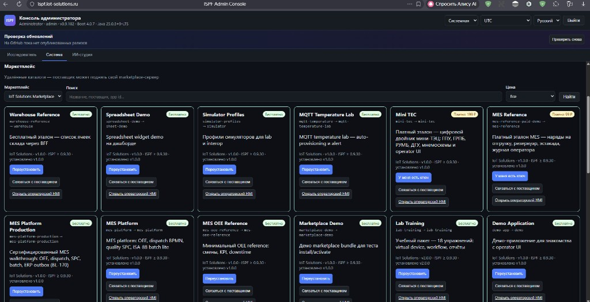
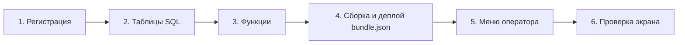

> **Язык:** русская версия. Английский оригинал: [en/solution-developer-guide.md](../en/solution-developer-guide.md).

# Руководство разработчика решений

> **Статус:** Stable — создание, упаковка и развёртывание прикладных решений на ISPF. Метки зрелости: [doc-status.md](doc-status.md).

Пошаговое руководство по созданию прикладного решения на ISPF **без изменения Java-ядра сервера**: регистрация собственной схемы таблиц БД, миграции SQL, серверные функции-скрипты, экраны оператора, отчёты и упаковка всего проекта в переносимый файл `bundle.json`.

Связанные разделы: [Как устроен ISPF](learn.md) · [Правила архитектуры приложений](application-principles.md) · [API приложений](applications.md) · [Контракт манифеста `bundle.json`](solution-developer-public-api.md) · [Разработка своего React-интерфейса](external-ide.md).

---

## Из чего состоит прикладное решение на ISPF



Прикладное решение объединяет **изолированную схему SQL-таблиц** (для заказов, партий, справочников, журналов смены) и **узлы дерева объектов** (для живой телеметрии, расчётов, тревог, маршрутов BPMN и экранов):

| Часть проекта | Где находится на сервере | Пример |
|---------------|--------------------------|--------|
| **Опрос приборов и ПЛК** | Узлы `DEVICE` в `root.platform.devices.*` | `root.platform.devices.pump-01` |
| **Расчёты и прикладные функции** | Узел логики `SINGLETON` или экземпляры `INSTANCE` | `root.platform.singleton-blueprints.terminal-hub` |
| **Таблицы бизнес-данных (SQL)** | Изолированная схема СУБД (`schemaName`) | `oil_terminal.ot_order` |
| **Тревоги и регламенты** | Узлы `ALERT` и `WORKFLOW` в дереве | `root.platform.workflows.order-dispatch` |
| **Экраны оператора** | Узлы `DASHBOARD` / `MIMIC` (либо внешний React `ui-pack`) | `root.platform.dashboards.terminal-overview` |
| **Меню рабочего места оператора** | Таблица `operator_app_ui` (`root.platform.operator-apps`) | `?mode=operator&app=my-terminal` |

> **Важно:** запись в списке приложений (`applications`) — это только регистрация имени проекта и его отдельной SQL-схемы. Во время работы вызов функций, тревоги, формулы и дашборды выполняются через **единое дерево объектов**. Прикладные функции и сводные расчёты размещайте на узлах `SINGLETON` или `INSTANCE`, а не на `DEVICE` ([Правила архитектуры приложений](application-principles.md)).

---

## Этапы сборки решения



В командной разработке все эти части обычно поставляются одной операцией через пакет `bundle.json` (шаг 4). Ниже также показаны отдельные HTTP-запросы, чтобы было понятно, как устроен каждый шаг.

### Шаг 1. Регистрация приложения

```http
POST /api/v1/applications
Authorization: Bearer <admin-token>
Content-Type: application/json

{
  "appId": "my-terminal",
  "displayName": "Нефтетерминал",
  "tablePrefix": "ot_",
  "schemaName": "oil_terminal"
}
```

То же самое в веб-консоли: выберите `root.platform.applications` → **+ Deploy application**.

### Шаг 2. Создание таблиц БД (SQL-миграции)

Таблицы решения создаются в выделенной схеме `schemaName` (`oil_terminal`) и не пересекаются с системными таблицами платформы:

```http
POST /api/v1/applications/my-terminal/data/migrate
Authorization: Bearer <admin-token>
Content-Type: application/json

{
  "version": "1.0.0",
  "scripts": [
    {
      "id": "orders",
      "sql": "CREATE TABLE IF NOT EXISTS ot_order (id SERIAL PRIMARY KEY, status VARCHAR(32), created_at TIMESTAMPTZ DEFAULT NOW());"
    }
  ]
}
```

Повторная отправка скрипта с теми же `version` и `id` безопасна (уже применённые миграции пропускаются). Проверить применённые миграции:

```http
GET /api/v1/applications/my-terminal/data/status
```

### Шаг 3. Серверные функции (JSON-скрипты)

Чтение и запись прикладных таблиц описываются JSON-скриптами из шагов (`selectOne`, `selectMany`, `exec`, `setVar`, `if`, `return`). Каждый вызов выполняется в одной транзакции БД. Поля запроса называются **`sql`** и **`var`**, а завершаться скрипт должен шагом **`return`**:

```http
POST /api/v1/applications/my-terminal/functions/deploy
Authorization: Bearer <admin-token>
Content-Type: application/json

{
  "functions": [
    {
      "name": "listOrders",
      "description": "Список активных нарядов",
      "script": {
        "steps": [
          {
            "type": "selectMany",
            "var": "rows",
            "sql": "SELECT id, status FROM ot_order WHERE status = 'ACTIVE' ORDER BY created_at"
          },
          {
            "type": "return",
            "fields": {
              "rows": "${rows}"
            }
          }
        ]
      }
    }
  ]
}
```

> **Подсказка по таблицам на дашборде:** чтобы вывести строки из SQL-таблицы на встроенный дашборд, используйте виджет отчёта **`report`** (`type: "report"`), а не `object-table` (виджет `object-table` показывает дочерние узлы папки в дереве объектов).

### Шаг 4. Деплой единого пакета `bundle.json` (основной способ)

Основной метод доставки проекта на сервер — `POST /api/v1/applications/{appId}/deploy` с JSON-телом (`Content-Type: application/json`). При повторном деплое сервер аккуратно обновляет существующие объекты дерева, а не падает на дубликатах. Полный список секций манифеста: [API приложений](applications.md#bundle-deploy-req-pf-03).

```http
POST /api/v1/applications/my-terminal/deploy
Authorization: Bearer <admin-token>
Content-Type: application/json

{
  "version": "1.0.0",
  "displayName": "Нефтетерминал",
  "tablePrefix": "ot_",
  "schemaName": "oil_terminal",
  "objects": [],
  "dashboards": [
    {
      "path": "root.platform.dashboards.terminal-overview",
      "title": "Обзор терминала",
      "layoutJson": "{ \"columns\": 84, \"rowHeight\": 8, \"widgets\": [] }"
    }
  ],
  "migrations": [],
  "functions": [],
  "operatorUi": {
    "title": "Нефтетерминал",
    "dashboards": [
      { "dashboardPath": "root.platform.dashboards.terminal-overview", "label": "Обзор" }
    ],
    "defaultDashboardPath": "root.platform.dashboards.terminal-overview"
  },
  "reports": [
    {
      "name": "daily-summary",
      "sql": "SELECT status, COUNT(*) FROM ot_order GROUP BY status"
    }
  ]
}
```

Все макеты дашбордов задаются на стандартной сетке **84×8** (`"columns": 84, "rowHeight": 8`) — см. [Дашборды](dashboards.md).

### Шаг 5. Настройка меню экранов оператора

Блок `operatorUi` определяет, какие вкладки дашбордов видит дежурный оператор:

1. **Внутри `bundle.json` (секция `operatorUi` выше)** — применяется автоматически при деплое пакета.
2. **Через REST API:**
   ```http
   PUT /api/v1/operator-apps/my-terminal/ui
   Content-Type: application/json

   {
     "title": "Нефтетерминал",
     "dashboards": [
       { "dashboardPath": "root.platform.dashboards.terminal-overview", "label": "Обзор" },
       { "dashboardPath": "root.platform.dashboards.terminal-queue", "label": "Очередь налива" }
     ],
     "defaultDashboardPath": "root.platform.dashboards.terminal-overview"
   }
   ```
3. **В консоли администратора:** `root.platform.operator-apps` → **+ Operator app**.

### Шаг 6. Открытие рабочего места оператора

- Готовая сборка (JAR / Docker): `http://localhost:8080?mode=operator&app=my-terminal`
- Режим фронтенд-разработки (Vite): `http://localhost:5173?mode=operator&app=my-terminal`

---

## Вызов функций с экранов (`POST /api/v1/bff/invoke`)

И кнопки/формы на встроенных дашбордах, и внешние React-приложения (`ui-pack`) вызывают серверные функции через единый шлюз BFF:

```http
POST /api/v1/bff/invoke
Authorization: Bearer <token>
Content-Type: application/json

{
  "objectPath": "root.platform.applications.my-terminal.functions",
  "functionName": "listOrders",
  "input": {
    "schema": { "name": "in", "fields": [] },
    "rows": [{}]
  },
  "wireProfile": "ispf-operator-v1"
}
```

Если функции размещены на центральном узле логики `SINGLETON` (например, `root.platform.singleton-blueprints.my-terminal-hub`), в `objectPath` указывается путь этого узла. Формат ответа подробно описан в [API приложений § BFF](applications.md#bff-req-pf-06).

---

## Отчёты, расписания и связь с BPMN

### SQL-отчёты

```http
GET /api/v1/applications/my-terminal/reports/daily-summary?format=csv
```

Отчёты из секции `reports[]` можно выводить на дашборд виджетом `report` и скачивать в CSV или по шаблону документа. Подробнее: [Отчёты](reports.md).

### Запуск функций по расписанию (cron)

```http
POST /api/v1/schedules
Content-Type: application/json

{
  "name": "nightly-cleanup",
  "cron": "0 0 2 * * *",
  "appId": "my-terminal",
  "function": "archiveOrders",
  "enabled": true
}
```

### Вызов функций из процессов BPMN

В процессе BPMN автоматический шаг `serviceTask` вызывает функцию приложения:

```xml
<bpmn:serviceTask id="Task_ListOrders" name="Получить активные наряды"
  ispf:actionType="INVOKE_FUNCTION"
  ispf:functionAppId="my-terminal"
  ispf:functionName="listOrders"
  ispf:resultVariable="orders"/>
```

Шаги `userTask` автоматически попадают в рабочую очередь смены (**Work Queue**). Подробнее: [Процессы BPMN](workflows.md).

---

## Хранение проекта в Git и сборка через `ispf-cli`

Чтобы не редактировать один огромный `bundle.json` вручную, храните исходники проекта разложенными по папкам и собирайте пакет утилитой **`tools/ispf-cli`** (`login`, `doctor`, `pack`, `unpack`, `validate`, `diff`, `deploy`, `fork`, `init-solution`). Справка по командам: [tools/ispf-cli/README.md](../../tools/ispf-cli/README.md).

| Файл / папка в репозитории | Куда попадает при сборке `bundle.json` |
|----------------------------|----------------------------------------|
| `solution.json` | Паспорт решения: `version`, `displayName`, `tablePrefix`, `schemaName`, `operatorUi`, `metadata`, `license`, `requires` |
| `sql/V*__*.sql` | `migrations[]` (`id` берётся из имени файла после `V{n}__`) |
| `functions/<name>.json` | `functions[]` (длинный SQL можно выносить в соседний файл через `@file:step.sql`) |
| `blueprints/*.json` | `blueprints[]` (шаблоны объектов) |
| `objects.json` | `objects[]` (экземпляры узлов дерева) |
| `dashboards/*.layout.json` (+ `*.meta.json`) | `dashboards[]` |
| `reports/<id>.sql` + `<id>.json` | `reports[]` |
| `alerts/*.json`, `correlators/*.json` | `alertRules[]`, `correlators[]` |
| `events.json` | `events[]` |
| `workflows/*.bpmn` + `*.meta.json` | `workflows[]` |

Типовые команды работы с проектом:

```bash
cd tools/ispf-cli && npm install

# Собрать папку проекта в единый bundle.json
node bin/ispf.mjs pack ../../examples/demo-app -o ../../examples/demo-app/bundle.json

# Проверить проект локально (перед сдачей добавляйте --strict)
node bin/ispf.mjs validate ../../examples/demo-app --local

# Сохранить токен и проверить сервер вместе с драйвером virtual
node bin/ispf.mjs login --username admin --password admin
node bin/ispf.mjs doctor

# Сравнить локальную папку с тем, что сейчас загружено на сервере
node bin/ispf.mjs diff ../../examples/demo-app --app demo

# Загрузить решение на сервер (ISPF_BASE_URL, затем ISPF_API_TOKEN или сохранённый вход)
node bin/ispf.mjs deploy ../../examples/demo-app --app demo
```

---

## Контрольный список перед сдачей в эксплуатацию

- [ ] Приложение зарегистрировано с собственной схемой `schemaName` и префиксом таблиц `tablePrefix`
- [ ] Миграции БД применились без ошибок (`GET .../data/status`)
- [ ] Проверка `ispf validate --strict` проходит без ошибок (`LOGIC_HOST_DEVICE`, `HEAVY_WIDGET_EXPRESSION`, циклы привязок)
- [ ] Все функции проверены через `POST /api/v1/bff/invoke`
- [ ] Рабочее место оператора открывается по `?mode=operator&app=<appId>` (или `/apps/<appId>/` при использовании `ui-pack`)
- [ ] Учётным записям дежурного персонала назначена роль `operator` (или ограниченная прикладная роль), а не `admin`
- [ ] На промышленном стенде настроена штатная авторизация (Keycloak OIDC / надёжные пароли)
