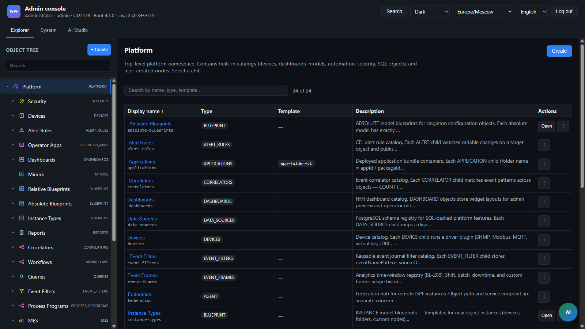
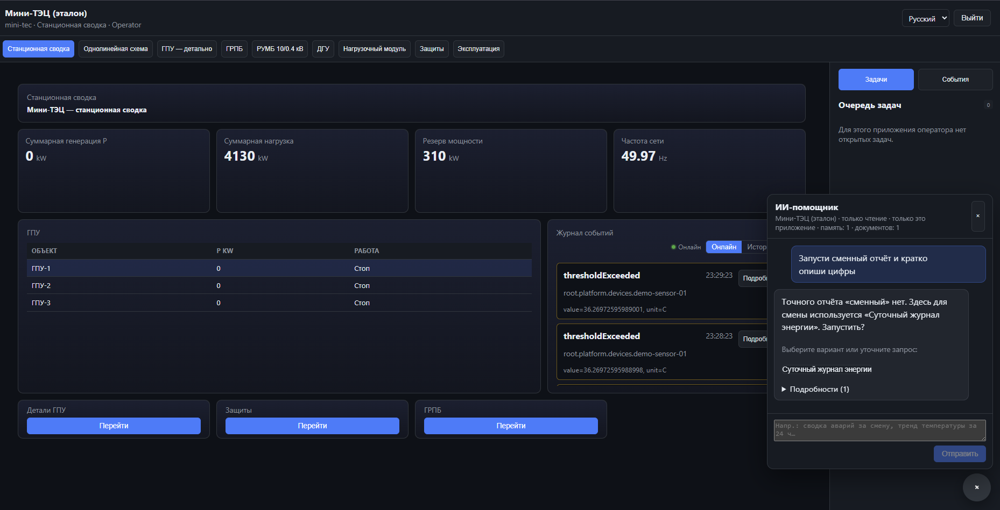

> **Язык:** русская версия. Английский оригинал: [en/web-console.md](../en/web-console.md).

# Веб-консоль (Web Console)

> **Статус:** Stable — консоль администратора, пульт оператора, системная диагностика и ИИ-студия. Метки зрелости: [doc-status.md](doc-status.md).

React 19 + Vite 6 + TanStack Query. Каталог: `apps/web-console/`.

**URL:** all-in-one JAR — `http://localhost:8080`; Vite dev — `http://localhost:5173` (прокси `/api`, `/ws` → `:8080`). См. [getting-started](getting-started.md).

## Режимы работы

### Администратор (по умолчанию)

URL: `http://localhost:8080` (JAR) или `http://localhost:5173` (Vite dev)

| Область | Возможности |
|---------|-------------|
| Дерево объектов | Поиск, раскрытие, создание/правка/удаление, перестановка соседей drag-and-drop |
| Проводник (Explorer) | Список дочерних объектов |
| Инспектор | Свойства, переменные, события; правила тревог и корреляторы |



### Редакторы по типу объекта

Двойной клик в дереве:

| Тип объекта | Компонент |
|-------------|-----------|
| `DASHBOARD` | `DashboardBuilder` |
| `WORKFLOW` | `WorkflowBuilder` |
| `ALERT` | `AlertRuleInspector` |
| `CORRELATOR` | `CorrelatorInspector` |
| Остальные | `ObjectPropertiesEditor` |

### Режим оператора (HMI)

URL: `http://localhost:8080?mode=operator` (JAR) или `http://localhost:5173?mode=operator` (Vite dev)



- Полноэкранный дашборд (только просмотр)
- Боковая панель: очередь задач смены + журнал событий
- Без правки макета и объектов

### Приложение оператора (дашборды)

URL: `http://localhost:8080?mode=operator&app=platform` (JAR) или `http://localhost:5173?mode=operator&app=platform` (Vite dev)

Оболочка оператора общая для всех приложений (отраслевой код в `ispf-server` не добавляется):

- UI приложения: сначала `GET /api/v1/operator-apps/{appId}/ui` (встроенные apps из `root.platform.operator-apps`), затем `GET /api/v1/applications/{appId}/operator-ui` (из `bundle.json`); в dev при отсутствии обоих возможен резервный файл `public/operator-apps/<appId>.ui.json`
- Навигация по вкладкам дашбордов; те же виджеты, что в конструкторе (`DashboardBuilder` + `operatorMode`)
- BFF (`POST /api/v1/bff/invoke`) вызывается только когда виджет или функция приложения обращается к backend

### Устаревший operator manifest

Параметры `?mode=operator&app=demo` вместе с `operatorManifest` больше не используются. Настраивайте `operatorUi` и объекты `DASHBOARD`.

## Навигация

Клиентский роутер не используется. Состояние в `App.tsx`:

- `mode`: `admin` | `operator`
- `app`: id приложения оператора (опционально)
- `dashboard`: путь объекта `DASHBOARD` (опционально)
- `screen`: id экрана в устаревшем manifest (не используется)
- `selectedPath`, `editorPath`

## Роли

Вход через экран login; консоль использует **Bearer** после `POST /api/v1/auth/login`. Роль берётся из аутентифицированного пользователя.

`X-ISPF-Role` / селектор роли в заголовке **выключены по умолчанию** (`ispf.security.local-role-header-enabled=false`) — включать только для локальных экспериментов. См. [Безопасность](security.md), [Быстрый старт](getting-started.md).

| Роль | Интерфейс |
|------|-----------|
| `admin` | Полный доступ, автоматизация, сохранение |
| `operator` | Просмотр, вызов функций, очередь задач |

## Структура исходников

```
src/
├── App.tsx                 # Shell, tabs, login
├── api.ts                  # REST client
├── api/bff.ts              # POST /bff/invoke (ispf-operator-v1)
├── types/                  # dashboard, workflow, bff, operatorUi, operatorManifest (legacy)
├── hooks/
│   ├── useObjectWebSocket.ts
│   ├── useBoundVariable.ts
│   ├── useTrendSeries.ts
│   ├── useOperatorUi.ts
│   └── useOperatorManifest.ts (legacy)
├── bpmn/
│   ├── ispf-moddle.json    # ISPF BPMN extensions
│   ├── constants.ts        # EMPTY_BPMN (with minimal bpmndi)
│   └── ensureDiagram.ts    # auto-layout when DI is missing
└── components/
    ├── ObjectTree.tsx
    ├── ExplorerView.tsx
    ├── ObjectPropertiesEditor.tsx
    ├── dashboard/          # Конструктор дашбордов и более 40 типов виджетов
    ├── workflow/           # Встроенный редактор и просмотрщик BPMN
    ├── automation/         # AlertRuleInspector, CorrelatorInspector, automationPath
    └── operator/           # OperatorView, OperatorDashboardApp, sidebar panels
```

`public/operator-apps/` — резервный каталог dev-режима `{appId}.ui.json`. Настройка приложений оператора выполняется в `root.platform.operator-apps`.

## Конструктор дашбордов (Dashboard Builder)


- Сетка **84 колонки × шаг высоты 8 пикселей**, перетаскивание и изменение размеров карточек
- Палитра добавления виджетов (свыше 40 типов)
- `WidgetEditorPanel` — настройка свойств выбранного виджета
- Просмотр и экспорт JSON макета
- Сохранение через REST API

См. [Дашборды](dashboards.md) и [Справочник виджетов](widgets.md).

## Редактор процессов (Workflow Builder)


- Переключатель статуса `DRAFT` / `ACTIVE` / `STOPPED` и кнопка ручного запуска
- Собственный векторный редактор диаграмм BPMN (`IspfBpmnEditor`, [ADR-0052](decisions/0052-ispf-workflow-diagram-editor.md))
- Автоматическая раскладка блоков для схем без координат (`bpmndi`) и режим просмотра XML

См. [Процессы BPMN](workflows.md).

## Живые данные

1. **Опрос (polling)** — `refetchInterval` = `refreshIntervalMs` дашборда
2. **WebSocket** — `useObjectWebSocket` сбрасывает кэш при `VARIABLE_UPDATED`
3. **Большие папки** — развёрнутая папка с более чем 64 детьми не подписывается на live-обновления. У строки метка «Без live»; чтобы обновить список, сверните и снова разверните папку.

Прокси Vite (`vite.config.ts`): `/api`, `/ws` → `:8080`.

## Сборка

```bash
cd apps/web-console
npm install
npm run dev      # dev-сервер
npm run build    # production dist/
npm run i18n:check   # ключи локалей против en (канон)
npm run i18n:translate   # пересобрать ru/de/zh из en (tools/i18n/generate-locales.py)
```

## Локализация (фаза 19)

- **Каноническая локаль:** английский (`apps/web-console/src/locales/en/*.json`)
- **Локали UI:** `en`, `ru`, `de`, `zh` — выпадающий список в шапке admin/operator и на карточке входа
- **Хранение:** `localStorage` (`ispf.ui.locale`), URL `?lang=`, запасной вариант `en`
- **Новые строки:** ключ в `en/{namespace}.json` → `useTranslation` + `t('key')` → `npm run i18n:translate` → `npm run i18n:check`

См. [ADR-0013](decisions/0013-web-console-i18n.md).

## Федерация

Раздел **Федерация** (`root.platform.federation`, только `admin`) — вкладки:

| Вкладка | Содержимое |
|---------|------------|
| **Соседи (Peers)** | Таблица соседей, форма нового узла, **Sync catalog** (предпросмотр конфликтов → SKIP/BIND) |
| **Токены** | Выпуск локального federation-токена для другого ISPF |
| **Туннель** | Входящие регистрации, исходящие агенты, secrets key (если есть capability `federation-tunnel`) |
| **Probe** | Пробное чтение через прокси для выбранного узла |

На объектах device/dashboard — панель **Привязка федерации** (`FederationBindPanel`): проверка remote path, bind/rebind, подтверждение unbind. Для зеркала каталога — подсказка «Разместить локально».

Компоненты: `FederationPeersPanel`, `FederationCatalogSyncDialog`, `components/federation/*`, `FederationBindPanel`.

## Система (admin)


Раздел **Система** (`SystemView`) — вкладки:

| Вкладка | Содержимое |
|---------|------------|
| **Метрики** | Метрики платформы, карточки health (Redis, NATS, YARG, MCP), **резервная копия платформы** |
| **Runtime settings** | `GET/PATCH /api/v1/platform/runtime-settings`; **Перезапуск сервера** → `POST .../runtime-settings/restart` |
| **Events / Functions / Bindings** | Журналы вызовов и аудита |
| **Change sets** | Управление наборами изменений платформы |
| **App schedules** | `GET/POST /api/v1/schedules` — JDBC `platform_schedules` (не путать с узлом дерева `SCHEDULE` → `ScheduleEditor`) |
| **Semantic export** | Haystack JSON + Brick JSON-LD/Turtle (`GET /platform/haystack/export`, `GET /platform/brick/export`) |

**Развёртывание приложения (Инспектор → APPLICATION → Deploy):**

| Панель | API |
|--------|-----|
| ApplicationBundlePanel | export, validate, deploy, pull-from-tree |
| ApplicationDeployPanel | история deploy, rollback, каталог событий, версии функций, жизненный цикл объектов бандла |
| ApplicationLifecyclePanel | `data/migrate`, `data/seed`, `data/status`, deploy/refresh привязок, deploy отчётов и функций |

**WorkflowBuilder:** отмена / сигнал активному экземпляру BPMN (`POST /workflows/instances/{id}/cancel|signal`).

**Резервная копия платформы** (`PlatformBackupPanel`, BL-47): экспорт JSON-поддерева `root.platform`; импорт с dry-run. API: `GET /api/v1/platform/backup/export`, `POST /api/v1/platform/backup/import?dryRun=true|false`. Прокси-узлы федерации при импорте пропускаются. В папке каталога есть **Импорт из JSON**: экспорт поддерева ровно с одним узлом создаёт новый объект в открытой папке. Путь в файле не используется, имя вводится при импорте. Импорт в каталог mixin, типов экземпляров или singleton регистрирует blueprint. Цель остаётся `CUSTOM` или `DEVICE`; другой тип исходного узла становится `CUSTOM`. API: `POST /api/v1/platform/backup/import-node?parentPath=&name=`.

## ИИ-студия

Вкладка **ИИ-студия** (admin): режимы **Агент** | **Bundle** | **Настройки**.


- **Агент** — боковая панель чата; состояние в `AgentChatProvider` (не сбрасывается при смене вкладок)
- **Настройки** — провайдер LLM, список моделей (`GET /ai/models`), Context Pack, корневой путь сессии, список tools, очистка локального кэша чата
- **Bundle** — prompt, generate/validate/dry-run/publish, история deploy

Фоновое выполнение: HTTP-запрос агента продолжается при переходе в проводник; индикатор в шапке и точка на вкладке ИИ-студии. После закрытия окна незавершённый запрос восстанавливается из `localStorage` (опрос серверной сессии).

См. [ИИ-студия и MCP](ai-development.md).

## UI-зависимости

| Пакет | Назначение |
|-------|------------|
| @tanstack/react-query | Состояние серверных данных |
| recharts | chart, sparkline |
| bpmn-js | Редактор / просмотр BPMN |
| bpmn-auto-layout | Генерация DI для BPMN без графической разметки |

## Кастомизация

- Стили: `src/styles.css` (CSS variables `--bg`, `--border`, …)
- Новый виджет: тип в `types/dashboard.ts`, view в `widgets/`, dispatch в `renderDashboardWidget.tsx` / `DashboardWidgetContent.tsx`, editor в `WidgetEditorPanel.tsx`
- **40+ типов виджетов** (см. `WIDGET_TYPES` в `types/dashboard.ts`)
