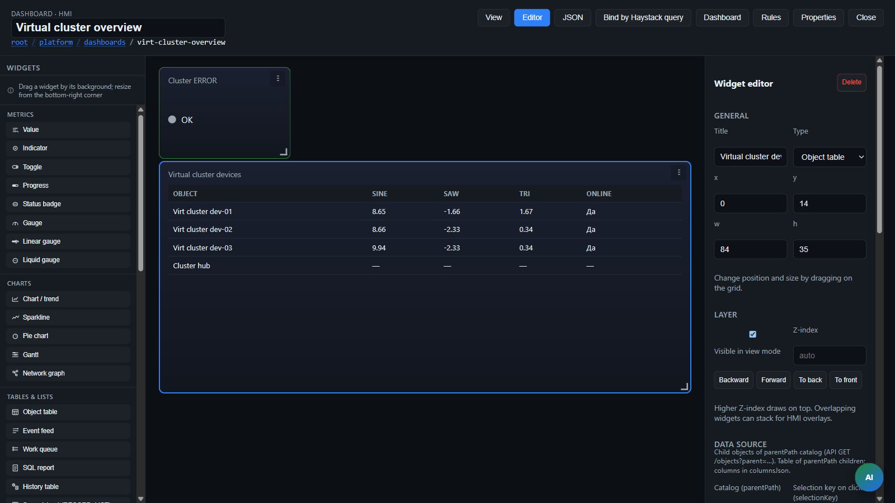

> **Язык:** русская версия. Английский оригинал: [en/widgets.md](../en/widgets.md).

# Справочник виджетов дашборда

> **Статус:** Stable — полный перечень типов виджетов, поля настроек и примеры. Метки зрелости: [doc-status.md](doc-status.md).

Полное описание всех типов виджетов ISPF: назначение, использование на экранах оператора, расположение полей и примеры.

**Связанные разделы:** [Дашборды](dashboards.md) · [Руководство оператора](operator-guide.md) · [Правила расчёта](bindings.md) · [Виджет spreadsheet](spreadsheet-widget.md).



---

## Общие поля (все виджеты)

Каждый виджет в `layout.widgets[]` имеет позицию на сетке и опциональную привязку к данным.

| Поле | Тип | Описание |
|------|-----|----------|
| `id` | string | Уникальный идентификатор в layout (напр. `temp-value`) |
| `type` | string | Тип виджета (`value`, `chart`, …) |
| `title` | string | Заголовок карточки на HMI |
| `x`, `y` | number | Позиция на сетке (0-based) |
| `w`, `h` | number | Ширина и высота на сетке **84×8** (полная ширина = `w: 84`; см. [dashboards](dashboards.md)) |
| `objectPath` | string | Статический путь объекта (`root.platform.devices.foo`) |
| `selectionKey` | строка | Выбор имени слота; путь берётся из `selection[key]` (см. [dashboards](dashboards.md)) |
| `variableName` | string | Имя переменной на объекте |
| `valueField` | строка | Поле `DataRecord`: `value` (по умолчанию), `raw`, `online`, `unit`, `int`, `string` |
| `paramKey` | string | Читать значение из `session.params[key]` |
| `contextPathKey` | string | Путь объекта из `session.params[key]` |
| `modelHintPath` | string | Только редактор: образец объекта для dropdown переменных |
| `stylesJson` | строка | JSON стилей элементов карточки (см. [dashboards.md § stylesJson](dashboards.md)) |
| `demoPreviewJson` | string | Необязательное превью только для редактора. Виджет из палитры это поле не сохраняет: пока нет живых данных, редактор показывает встроенный пример с плашкой ДЕМО-ПРОСМОТР. В режиме оператора подмены нет. |

**Приоритет пути к объекту:** если задано `selectionKey` и в сеансе есть выбор → используется выбранный путь; иначе `objectPath`.

### JSON-поля (всегда строки в макете)

| Поле | Содержимое |
|------|------------|
| `columnsJson` | Колонки `object-table` |
| `variablesJson` | Массив имён переменных |
| `fieldsJson` | Поля `function-form` / `input-form` |
| `childrenJson` | Вложенные виджеты |
| `tabsJson` | Вкладки `tab-panel` |
| `slidesJson` | Слайды `carousel` |
| `stepsJson` | Шаги `steps-panel` |
| `itemsJson` | Пункты `nav-menu` |
| `eventNamesJson` | Фильтр имён событий |
| `contextSelectionJson` / `contextParamsJson` | Контекст при открытии дашборда |
| `rowParamsJson` / `cardParamsJson` | Params при клике строки/карточки |
| `sheetConfigJson` | Конфиг spreadsheet |
| `stylesJson` | Inline CSS по элементам карточки |

Редактор виджета правит вложенные виджеты, слайды, шаги мастера, списки путей карты, строки popup и ячейки таблицы полями. В макете эти значения по-прежнему хранятся строкой JSON.

---

## Категории виджетов

| Категория | Привязка данных | Примеры (`type`) |
|-----------|-----------------|------------------|
| Показатели и графики (`object-variable`) | Переменные одного объекта | `value`, `chart`, `gauge`, `indicator` |
| Действия и формы (`object-only`) | Объект для вызова функции или записи | `function`, `function-form`, `input-form` |
| Списки дочерних узлов (`parent-catalog`) | Дочерние узлы папки `parentPath` | `object-table`, `map`, `card-grid` |
| Платформа и навигация (`external`) | Отчёты, события, очередь задач, переходы | `report`, `work-queue`, `dashboard-link`, `event-feed` |
| Оформление и контекст (`session / static`) | Параметры сессии или статический контент | `label`, `image`, `breadcrumbs` |
| Компоновка экрана (`composition`) | Вложенные контейнеры виджетов | `panel`, `tab-panel`, `drawer-panel`, `nav-menu` |

---

## Показатели и графики (`object-variable`)

### `value` — Числовое или текстовое значение

**Назначение:** крупное отображение текущего числа или строки из переменной объекта.

**Режим оператора:** только просмотр.

| Поле | Описание |
|------|----------|
| `variableName` | **Обязательно.** Имя переменной |
| `valueField` | Поле записи (по умолчанию `value`) |
| `decimals` | Знаков после запятой для чисел |
| `unit` | Статическая единица (`°C`, `%`) |
| `unitField` | Взять unit из поля переменной (напр. `unit`) |

**Пример:** датчик температуры

```json
{
  "id": "temp",
  "type": "value",
  "title": "Температура",
  "x": 0, "y": 0, "w": 21, "h": 14,
  "objectPath": "root.platform.devices.demo-sensor-01",
  "variableName": "temperature",
  "valueField": "value",
  "decimals": 1,
  "unit": "°C"
}
```

**Сценарий:** SNMP monitoring — `selectionKey: "device"` + `variableName: "sysName"` для имени выбранного хоста.

---

### `indicator` — Индикатор состояния (лампа)

**Назначение:** дискретное (булево) или строковое состояние («В работе / Остановлен», «Норма / Авария»).

**Режим оператора:** просмотр (цвет и подпись определяются конфигурацией).

| Поле | Описание |
|------|----------|
| `variableName` | **Обязательно.** |
| `valueField` | Для online-статуса: `variableName: status`, `valueField: online` |
| `trueLabel` / `falseLabel` | Подписи состояний |
| `trueColor` / `falseColor` | CSS-цвета |
| `alarmMode` | `true` = true означает тревогу (красный); иначе true = OK (зелёный) |

**Пример:**

```json
{
  "type": "indicator",
  "title": "Связь",
  "variableName": "status",
  "valueField": "online",
  "trueLabel": "Online",
  "falseLabel": "Offline"
}
```

---

### `toggle` — Переключатель

**Назначение:** запись булевой переменной (`writable: true`) по клику оператора.

**Режим оператора:** клик переключает значение `true` / `false`.

| Поле | Описание |
|------|----------|
| `variableName` | **Обязательно.** Записываемая булева переменная |
| `trueLabel` / `falseLabel` | Подписи состояний ВКЛ / ВЫКЛ |

---

### `chart` — График / тренд

**Назначение:** график истории переменной (линия, область, столбцы и др.) либо многопараметрические диаграммы `bubble` / `radar`.

**Режим оператора:** просмотр, переключение интервала истории и выгрузка точек.

| Поле | Описание |
|------|----------|
| `variableName` | **Обязательно** для линии/площади/бара/диапазона/свечи. На переменном нужен `historyEnabled: true` |
| `chartStyle` | `line` \| `area` (не для bubble/radar) |
| `chartType` | `line`, `area`, `bar`, `candlestick`, `bubble`, `radar`, `range` |
| `historyRange` | `live` (скользящее окно), `1h`, `6h`, `24h`, `7d`, `all`. Авто-бакеты совпадают с rollup: 5m / 1h / 8h. |
| `maxPoints` | Макс. точек (~120 по умолчанию) |
| `color` | Цвет линии |
| `decimals`, `unit`, `unitField` | Формат оси/подписи |
| `bubbleXVariable`, `bubbleYVariable` | **bubble:** траектория X/Y по live/history трендам |
| `bubbleSizeVariable`, `bubbleDefaultSize` | **bubble:** размер маркера (Z); default 80 |
| `bubblePointsJson` | **bubble:** snapshot JSON `[{label,xVariable,yVariable,sizeVariable?}]` — перекрывает trajectory |
| `bubbleXMin`, `bubbleXMax`, `bubbleYMin`, `bubbleYMax` | **bubble:** необязательные пределы осей. Пустой конец следует за точками. Оба конца фиксируют ось. Если минимум не меньше максимума, ось остаётся автоматической |
| `radarAxesJson` | **radar:** JSON `[{label,variableName,valueField?,max?}]`, минимум 3 оси |

**Ограничения пузырька/радара:** траектория zip по индексу точек (без слияния по временной метке); радар — только последний снимок, а не история.

**Пример:**

```json
{
  "type": "chart",
  "title": "Температура",
  "w": 56, "h": 28,
  "selectionKey": "device",
  "variableName": "temperature",
  "historyRange": "24h",
  "chartStyle": "area",
  "decimals": 1,
  "unit": "°C"
}
```

---

### `sparkline` — Компактный мини-тренд

**Назначение:** компактная линия тренда без осей (внутри сводной карточки).

| Поле | Описание |
|------|----------|
| `variableName` | **Обязательно.** На переменной должен быть включён `historyEnabled` |
| `historyRange`, `maxPoints`, `color`, `decimals` | Аналогично виджету `chart` |

---

### `gauge` — Радиальная шкала (стрелочный прибор)

**Назначение:** отображение значения на дуговой шкале `min…max`.

| Поле | Описание |
|------|----------|
| `variableName` | **Обязательно.** Текущее значение |
| `minValue` / `maxValue` | Числовые границы шкалы |
| `minVariable` / `maxVariable` | Границы из других переменных того же объекта |
| `unit`, `decimals` | Единица измерения и число знаков |

**Важно:** если задать только `minValue` без `maxValue`, шкала не сможет построить диапазон.

---

### `linear-gauge` — Линейная шкала

**Назначение:** горизонтальная линейная шкала; поля совпадают с `gauge`.

---

### `liquid-gauge` — Уровнемер («жидкость»)

**Назначение:** вертикальный индикатор заполнения резервуара; поля совпадают с `gauge` (`minValue` / `maxValue` или переменные).

---

### `progress` — Индикатор выполнения (прогресс-бар)

**Назначение:** отношение текущего значения к плановому максимуму (выполнение заказа, загрузка).

| Поле | Описание |
|------|----------|
| `currentVariable` | **Обязательно.** Не `variableName`! |
| `maxVariable` | **Обязательно.** |
| `unit`, `decimals` | Подпись и точность |

**Пример:**

```json
{
  "type": "progress",
  "title": "Выполнение",
  "objectPath": "root.platform.orders.o-1",
  "currentVariable": "doneQty",
  "maxVariable": "orderQty",
  "unit": "шт"
}
```

---

### `status-badge` — Плашка статуса

**Назначение:** компактная цветная метка состояния (статус драйвера, этап работы).

| Поле | Описание |
|------|----------|
| `variableName` | По умолчанию `status` |
| `valueField` | По умолчанию `value` |

---

### `pie-chart` — Круговая диаграмма

**Назначение:** распределение долей по строкам табличной переменной (`RECORD_LIST`).

| Поле | Описание |
|------|----------|
| `variableName` | **Обязательно.** Переменная типа `RECORD_LIST` |
| `labelField` | Поле названия сектора |
| `valueField` | Числовое поле доли (по умолчанию `value`) |
| `decimals` | Точность |

---

### `history-table` — Таблица последних измерений

**Назначение:** таблица недавних точек истории переменной и среднего значения за окно.

| Поле | Описание |
|------|----------|
| `variableName` | **Обязательно.** Требуется `historyEnabled: true` |
| `valueField`, `decimals` | Поле и точность |

---

### `timer` — Таймер / секундомер

**Назначение:** обратный отсчёт (`countdown`) или время с момента старта (`elapsed`).

| Поле | Описание |
|------|----------|
| `mode` | `countdown` — отсчёт от `durationSeconds`; `elapsed` — сколько прошло от метки времени в `variableName` |
| `durationSeconds` | Длительность для `countdown` |
| `variableName` | Переменная со временем начала для `elapsed` |

**Режим оператора:** показывает оставшееся или прошедшее время в реальном времени.

---

### `gantt-chart` — Диаграмма Ганта

**Назначение:** временная шкала интервалов и операций из переменной типа `RECORD_LIST`.

| Поле | Описание |
|------|----------|
| `variableName` | **Обязательно.** RECORD_LIST |
| `labelField` | Подпись строки |
| `startField` / `endField` | Поля начала и конца (epoch ms, epoch s или числовая шкала) |
| `interactive` | Показатель панорамирования/масштабирования в режиме оператора (по умолчанию `true`; в редакторе отключено) |
| `allowBarDrag` | Перетаскивание полос при writable RECORD_LIST (по умолчанию `true`) |

**Оператор:** колёсико — масштабирование, перетаскивание по шкале — панорамирование, двойной клик — сбросить область просмотра; перетащите полосы — начало/конец перехода с сохранением через `setVariable`.

---

### `network-graph` — Граф сети

**Назначение:** граф узлов и связей из двух переменных типа `RECORD_LIST`.

| Поле | Описание |
|------|----------|
| `nodesVariable` | RECORD_LIST узлов |
| `edgesVariable` | RECORD_LIST рёбер |
| `labelField` | Подпись узла |

---

### `svg-widget` — SVG-кнопка

**Назначение:** интерактивная SVG-иконка с действием по клику.

**Режим оператора:** нажатие вызывает функцию или переключает булеву переменную.

| Поле | Описание |
|------|----------|
| `svgUrl` | **Обязательно.** URL SVG-изображения |
| `clickAction` | `function` \| `toggle` |
| `functionName` | Имя функции при `function` |
| `toggleVariable` | Имя переменной при `toggle` |
| `confirmMessage` | Текст подтверждения перед выполнением |

---

### `spreadsheet` — Электронная таблица (расчётный лист)

**Назначение:** таблица с адресацией ячеек A1, формулами и привязкой к живым переменным.

**Полное описание:** [spreadsheet-widget](spreadsheet-widget.md). Работа оператора: [operator-guide](operator-guide.md).

| Поле | Описание |
|------|----------|
| `sheetMode` | `free` (по умолчанию) \| `configured` |
| `sheetConfigJson` | Настройки строк, столбцов, ячеек и фильтров |
| `persistMode` | `session` \| `variable` |
| `valuesVariable` | Переменная `RECORD_LIST` при сохранении в объект (`variable`) |
| `sessionKey` | Ключ сессии (по умолчанию `sheet:{id}`) |
| `editable` | `false` — только просмотр |

---

### `mini-tec-sld` — Однолинейная схема mini-TEC *(удалено)*

**Статус:** устаревший виджет удалён. Используйте [`scada-mimic`](#scada-mimic--мнемосхема-scada) с объектом `MIMIC` или встроенным `diagramJson`. См. [scada](scada.md).

---

<a id="scada-mimic--scada-мнемосхема"></a>

### `scada-mimic` — Мнемосхема SCADA

**Назначение:** интерактивная технологическая (P&ID) или однолинейная электрическая схема с библиотекой символов и живой привязкой к переменным.

**Режим оператора:** просмотр состояний, панорамирование и масштабирование, подача команд по клику на элементы с `actions` (`toggle`, `setVariable`, `invokeFunction`).

| Поле | Описание |
|------|----------|
| `diagramJson` | JSON документа схемы (если не задан `mimicPath`) |
| `mimicPath` | Путь объекта `MIMIC` — diagram загружается с сервера |
| `defaultZoom` | Масштаб (default `1`) |
| `panEnabled` | Масштабирование колёсиком (default `true`) |
| `showGrid` | Сетка в preview (reserved) |

**Создание MIMIC:** Explorer → `root.platform.mimics` → «Создать мнемосхему».

**Редактор:** Dashboard Builder → «Открыть редактор мнемосхемы»; Проводник → объект `MIMIC`. Инструменты: выбор/размещение/подключение, **выравнивание и распределение**, переворот/поворот, **манипуляторы изменения размера**, интеллектуальная привязка, переключение сетки, множественный выбор (Shift), Del для удаления. Подробно — [SCADA.md § Редактор](scada.md).

**См.:** [scada](scada.md), [scada-mimic](scada-mimic.md).

---

## Действия и формы (`object-only`)

### `function` — Кнопка вызова функции

**Назначение:** вызов функции на объекте по нажатию кнопки (`POST .../functions/invoke` или запуск процесса).

**Режим оператора:** нажатие кнопки (при заданном `confirmMessage` сначала запрашивается подтверждение).

| Поле | Описание |
|------|----------|
| `functionName` | **Обязательно.** |
| `buttonLabel` | Текст кнопки |
| `confirmMessage` | Диалог подтверждения |
| `inputJson` | Статические input rows для invoke |
| `workflowPath` | Альтернатива: запуск workflow вместо function |
| `objectPath` / `selectionKey` | Объект для invoke |

**Пример:**

```json
{
  "type": "function",
  "title": "Сброс",
  "objectPath": "root.platform.devices.demo-sensor-01",
  "functionName": "resetAlarm",
  "buttonLabel": "Сбросить alarm"
}
```

---

### `function-form` — Форма вызова функции

**Назначение:** форма ввода параметров с кнопкой отправки и передачей аргументов в функцию (поддерживает многошаговый мастер).

**Режим оператора:** заполнить поля и нажать кнопку отправки.

| Поле | Описание |
|------|----------|
| `functionName` | **Обязательно.** |
| `fieldsJson` | Массив полей (см. ниже) |
| `buttonLabel` | Текст кнопки |
| `wizardStepsJson` | `[{ "id", "label" }]` — шаги мастера |
| `validateFunctionName` | BFF-валидация на «Далее» |
| `paramBindingsJson` | Поле формы ← session param |
| `requireSessionParamsJson` | Обязательные params перед submit |
| `syncFieldsToSessionJson` | Синхронизация полей в session |
| `clearSessionParamsJson` | Очистка params после успеха |
| `closeModalOnSuccess` | Закрыть модальное окно (default true в modal) |

**Поля `fieldsJson`:**

| Свойство | Описание |
|----------|----------|
| `name` | Имя аргумента функции |
| `label` | Подпись на форме |
| `type` | `text`, `number`, `select`, `multiselect`, `time`, `checkbox`, `textarea` |
| `optionsFrom` | parentPath — options = дети каталога |
| `optionsFromReport` | Options из SQL-отчёта |
| `staticOptions` | Фиксированный список |
| `defaultValue` | Значение по умолчанию |
| `required`, `hidden`, `hint` | UX |
| `step` | id шага wizard |
| `showWhenJson` | Условное отображение |
| `colSpan` | 1 = половина строки, 2 = полная |

**Пример (добавление строки в таблицу):**

```json
{
  "type": "function-form",
  "title": "Append row",
  "objectPath": "root.platform.devices.lab-userA-01",
  "functionName": "appendTableRow",
  "buttonLabel": "Append",
  "fieldsJson": "[{\"name\":\"int\",\"label\":\"Int\",\"type\":\"number\"},{\"name\":\"string\",\"label\":\"String\",\"type\":\"text\"}]"
}
```

---

### `input-form` — Форма записи в переменные

**Назначение:** оператор вводит значения → `setVariable` на объект (HMI-форма без функции).

| Поле | Описание |
|------|----------|
| `fieldsJson` | Поля формы |
| `buttonLabel` | Кнопка сохранения |

**Поля:** `name`, `label`, `type` (`text`, `number`, `textarea`, `select`, `slider`, `checkbox`, `radio`, `datetime`, `time`), `variableName` (куда писать), `optionsFrom`, `min`/`max`/`step`, `defaultValue`.

---

### `variable-editor` — Редактор переменных

**Назначение:** таблица переменных объекта с быстрым редактированием записываемых полей.

**Режим оператора:** изменение значения в строке с сохранением на сервер.

| Поле | Описание |
|------|----------|
| `variablesJson` | JSON-массив имён переменных; пусто = все переменные объекта |
| `objectPath` / `selectionKey` | Целевой объект |

---

## Списки дочерних узлов (`parent-catalog`)

### `object-table` — Таблица объектов

**Назначение:** таблица **дочерних** объектов папки `parentPath`. Дочерние узлы загружаются страницами по 50 (`offset` и `limit` у `GET /api/v1/objects`, общее количество в `X-Total-Count`). Фильтры `namePattern` и `objectType` применяются на сервере.

**Режим оператора:** просмотр; клик по строке записывает выбранный путь в слот `selectionKey` и/или открывает детальный дашборд.

| Поле | Описание |
|------|----------|
| `parentPath` | **Обязательно.** Папка, не device |
| `columnsJson` | Колонки (см. ниже) |
| `selectionKey` | Публиковать `selection[key]=path` при клике |
| `namePattern` | Glob по имени (`gpu-*`) |
| `objectType` | Фильтр типа (`DEVICE`, …) |
| `rowTargetDashboard` | Открыть дашборд при клике |
| `rowOpenMode` | `navigate` \| `modal` |
| `rowSelectionKey` | Ключ selection в целевом дашборде |
| `rowParamsJson` | Доп. params при клике |

**Колонка `columnsJson`:**

```json
[
  { "variable": "sysName", "label": "Имя" },
  { "variable": "status", "label": "On", "field": "online", "trueLabel": "OK", "falseLabel": "—" },
  { "objectField": "displayName", "label": "Объект" }
]
```

| Свои колонки | Описание |
|------------------|----------|
| `variable` | Имя переменной на строке-объекте |
| `label` | Заголовок |
| `field` | Поле DataRecord (default `value`) |
| `objectField` | `displayName` или `path` без variable |

---

### `card-grid` — Карточки объектов

**Назначение:** плитки дочерних объектов с несколькими переменными на карте.

**Оператор:** клик по карточке → выбор/навигация.

| Поле | Описание |
|------|----------|
| `parentPath` | **Обязательно.** |
| `variablesJson` | `["temperature","status"]` — что показать |
| `cardTargetDashboard`, `cardOpenMode` | Навигация |
| `cardSelectionKey`, `cardParamsJson` | Контекст при клике |

---

### `map` — Геокарта объектов

**Назначение:** маркеры для каждого ребёнка `parentPath` (MapLibre + OSM).

**Оператор:** клик по маркеру → выбор / дашборд.

| Поле | Описание |
|------|----------|
| `parentPath` | **Обязательно.** |
| `latVariable` | Переменная с geo на child |
| `latField` / `lonField` | Поля координат (default `lat`/`lon`) |
| `labelVariable` | Подпись маркера |
| `zoom`, `centerLat`, `centerLon` | Вид карты |
| `tileUrl`, `mapStyleUrl`, `tileAttribution` | Кастомные тайлы |
| `rowTargetDashboard`, `rowOpenMode`, `rowSelectionKey`, `rowParamsJson` | Как у таблицы |

---

### `object-tree` — Дерево объектов

**Назначение:** компактная иерархия узлов внутри `parentPath` для навигации и выбора.

| Поле | Описание |
|------|----------|
| `parentPath` | **Обязательно.** |
| `selectionKey` | Слот выбора узла |
| `maxDepth` | Максимальная глубина обхода |

---

## Платформа и навигация (`external`)

### `dashboard-link` — Переход на другой дашборд

**Назначение:** кнопка открытия другого дашборда (переключением вкладки или в модальном окне).

**Оператор:** нажать кнопку; при `requireSessionParamsJson` кнопка неактивна без нужного контекста.

| Поле | Описание |
|------|----------|
| `targetDashboardPath` | **Обязательно.** |
| `openMode` | `navigate` \| `modal` |
| `buttonLabel` | Текст кнопки |
| `modalTitle` | Заголовок modal |
| `confirmMessage` | Подтверждение |
| `contextSelectionJson` | Передать selection |
| `contextParamsJson` | Передать params |
| `requireSessionParamsJson` | JSON-массив обязательных keys |

---

### `sub-dashboard` — Вложенный дашборд

**Назначение:** встраивание макета другого дашборда внутрь виджета.

| Поле | Описание |
|------|----------|
| `targetDashboardPath` | Статический путь к дашборду |
| `targetDashboardPathKey` | Путь из `session.params[key]` |
| `inheritContext` | По умолчанию `true` — вложенные виджеты используют общие `selection` и `params` родителя; `false` изолирует контекст |

---

### `report` — SQL-отчёт

**Назначение:** табличный вывод отчёта платформы (`REPORT`).

**Оператор:** просмотр; экспорт CSV/PDF/XLSX; опционально выбор строки.

| Поле | Описание |
|------|----------|
| `reportPath` | **Обязательно.** |
| `emptyMessage` | Текст при пустом результате |
| `parametersJson` | Статические параметры run |
| `contextParamsJson` | session param → report param |
| `showCsv`, `showPdf`, `showXlsx`, `showHtml` | Кнопки экспорта |
| `selectable` | Клик по строке → session |
| `rowSelectionKey`, `rowParamsFromRowJson` | Маппинг колонок в params |
| `autoSelectFirstRow` | Выбрать первую строку при загрузке |
| `statusDotColumnsJson` | Колонки со status-dot |

---

### `event-feed` — Лента событий

**Назначение:** поток последних событий из журнала платформы.

| Поле | Описание |
|------|----------|
| `objectPathPrefix` | Фильтр по префиксу пути объектов |
| `eventNamesJson` | `["thresholdExceeded", …]` |
| `payloadFilterExpr` | Фильтр на клиенте или выражение CEL по `payload` (`GET /events?expr=`) |
| `maxItems` | Лимит строк |

---

### `work-queue` — Рабочая очередь задач BPMN

**Назначение:** список пользовательских задач (`userTask`) для дежурного оператора.

**Режим оператора:** взять задачу в работу (**Claim**) → выполнить действие → завершить (**Complete**).

| Поле | Описание |
|------|----------|
| `operatorId` | Фильтр по логину оператора |
| `operatorAppId` | Фильтр по приложению оператора |
| `maxItems` | Лимит задач |

---

## Оформление и контекст (`session / static`)

### `label` — Текстовая метка

**Назначение:** статический заголовок или текст с подстановкой параметров сессии.

| Поле | Описание |
|------|----------|
| `text` | Фиксированный текст |
| `textJson` | JSON для шаблона |
| `paramKey` | Подставить `session.params[key]` |

---

### `breadcrumbs` — Хлебные крошки

**Назначение:** путь из сеанса (выбор или параметры).

| Поле | Описание |
|------|----------|
| `pathKey` | Ключ в selection/params |
| `separator` | Разделитель (default `/`) |

---

### `context-list` — Отладка контекста экрана

**Назначение:** отображает текущие `selection` и `params` дашборда при отладке связей между виджетами.

---

### `image` — Изображение

| Поле | Описание |
|------|----------|
| `imageUrl` | URL картинки |
| `alt` | Альтернативный текст |

---

### `html-snippet` — HTML-фрагмент

| Поле | Описание |
|------|----------|
| `htmlJson` | Разметка HTML (используйте только проверенный статический контент) |

---

## Компоновка экрана (`composition`)

### `panel` — Панель-контейнер

**Назначение:** визуальная группа вложенных виджетов с общим заголовком.

| Поле | Описание |
|------|----------|
| `childrenJson` | Массив вложенных виджетов |
| `collapsible` | Сворачиваемая панель |
| `variant` | `simple` |

---

### `tab-panel` — Вкладки

**Назначение:** переключение между несколькими вкладками внутри одного экрана.

| Поле | Описание |
|------|----------|
| `tabsJson` | `[{ "id", "label", "children": [ …widgets ] }]` |

**Режим оператора:** переключение вкладок кликом.

---

### `drawer-panel` — Выдвижная боковая панель

| Поле | Описание |
|------|----------|
| `drawerLabel` | Текст кнопки открытия |
| `childrenJson` | Вложенные виджеты панели |

---

### `carousel` — Карусель экранов

| Поле | Описание |
|------|----------|
| `slidesJson` | `[{ "title", "children": [ … ] }]` |
| `autoplayMs` | Интервал автопрокрутки в мс (`0` = выкл.) |

---

### `steps-panel` — Пошаговая панель

| Поле | Описание |
|------|----------|
| `stepsJson` | `[{ "id", "label", "children": [ … ] }]` |
| `activeStepKey` | Ключ активного шага |

---

### `composite-widget` — Составной блок без рамки

**Назначение:** плоская группа вложенных виджетов без заголовка и карточки панели.

| Поле | Описание |
|------|----------|
| `childrenJson` | Массив вложенных виджетов |

---

### `nav-menu` — Меню переходов

**Назначение:** встроенный блок навигационных ссылок по дашбордам.

| Поле | Описание |
|------|----------|
| `itemsJson` | `[{ "label", "dashboardPath" }]` |

---

## Типичные ошибки

| Ошибка | Решение |
|--------|---------|
| `progress` с `variableName` | Использовать `currentVariable` + `maxVariable` |
| `object-table` с `objectPath` | Нужен `parentPath` (папка) |
| Пустой `chart` | Включить `historyEnabled` на переменной |
| `gauge` без max | Задать `maxValue` или `maxVariable` |
| `pie-chart` не RECORD_LIST | Переменная должна быть таблицей строк |
| Колонка «—» | Имя переменной не соответствует модели |
| Два виджета с одним `selectionKey` | Нормально для детализации; разные ключи для разных выборов |
| `columnsJson` как объект в API | В layout — **escaped string** |

---

## Рекомендуемые размеры (`w × h` на сетке `84 × 8`)

| Тип виджета (`type`) | Типичный размер (`columns: 84`, `rowHeight: 8` пикс.) |
|----------------------|-------------------------------------------------------|
| `value`, `indicator`, `toggle`, `gauge` | `w = 21..28`, `h = 14` (ряд из 3–4 карточек KPI) |
| `chart` | `w = 42..84`, `h = 28..35` |
| `object-table`, `report` | `w = 42..84`, `h = 28..42` |
| `function-form`, `input-form` | `w = 28..42`, `h = 28` |
| `spreadsheet` | `w = 56..84`, `h = 35..56` |
| `map`, `scada-mimic` | `w = 56..84`, `h = 42..70` |

---

## Исходники

| Что | Где |
|-----|-----|
| TypeScript типы | `apps/web-console/src/types/dashboard.ts` |
| View-компоненты | `apps/web-console/src/components/dashboard/widgets/` |
| Редактор свойств | `widgetEditorFields.tsx`, `WidgetEditorPanel` |
| Образцы из палитры | `widgetSamples.ts` |
| AI / agent spec | `AgentWidgetPropertiesGuide.java` |
