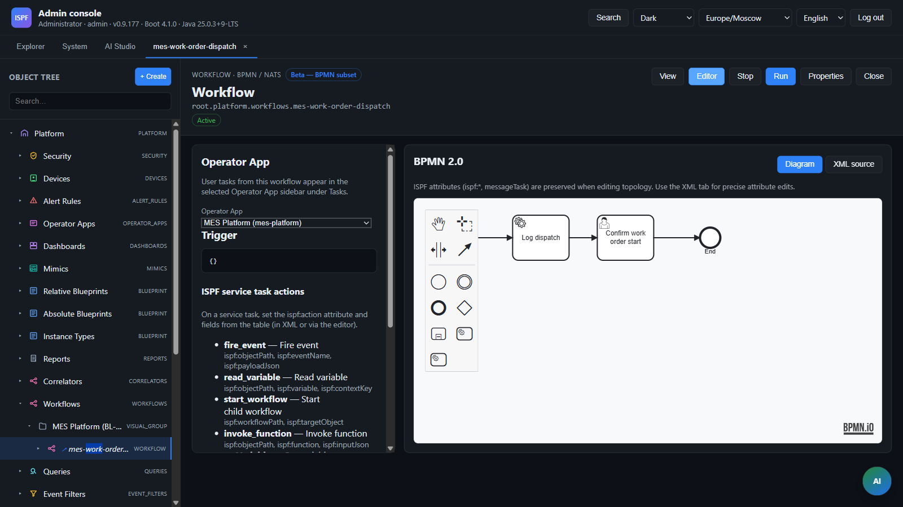

> **Язык:** русская версия. Английский оригинал: [en/workflows.md](../en/workflows.md).

# Процессы BPMN (Workflows)

> **Статус:** Beta — встроенный движок поддерживаемого подмножества BPMN 2.0. Метки зрелости: [doc-status.md](doc-status.md).

Узел типа **`WORKFLOW`** (шаблон `workflow-v1`, ветка `root.platform.workflows`) описывает пошаговый процесс: автоматические действия на сервере, ветвления по условиям CEL, ожидание таймеров/сигналов и постановку задач дежурному оператору в рабочую очередь (**Work Queue**). Движок написан на чистой Java в модуле `ispf-plugin-workflow` без внешних тяжёлых серверов Camunda/Flowable.

**Пример:** [`examples/demo-plant`](../../examples/demo-plant/) — `mes-work-order-dispatch.bpmn`; в профиле `local` также есть встроенный `demo-alarm-handler`.

---

## Переменные узла `WORKFLOW` и статусы

| Переменная | Назначение |
|------------|------------|
| `title` | Человекочитаемое название процесса |
| `status` | Состояние описания: `DRAFT` (черновик, только ручной пуск), `ACTIVE` (принимает автозапуск по триггерам и корреляторам), `STOPPED` (остановлен) |
| `bpmnXml` | XML-схема процесса в формате BPMN 2.0 с расширениями `ispf:*` |
| `triggerJson` | Условие автоматического запуска при изменении переменных или приходе события |
| `operatorAppId` | Идентификатор приложения оператора, в боковую очередь которого попадают задачи `userTask` |
| `instanceState`, `lastRunAt`, `lastAction` | Диагностика последнего запуска |
| `inputSchemaJson`, `outputSchemaJson`, `toolDescription`, `sideEffectClass` | Публикация активного процесса как инструмента MCP (`wf_<имя>`) при заполненном `toolDescription` |
| `webhookSlug`, `cronExpression`, `errorWorkflowPath` | Запуск по вебхуку, расписанию cron и маршрут обработки сбоев |

Состояния запущенного экземпляра процесса (`InstanceStatus`):
- **`RUNNING`** — выполняется прямо сейчас;
- **`WAITING`** — ожидает действия оператора (`userTask`), внешнего сигнала/сообщения или срабатывания таймера;
- **`COMPLETED`** — успешно дошёл до конечного узла;
- **`FAILED`** — остановлен из-за необработанной ошибки или отменён оператором.

---

## Поддерживаемые элементы BPMN

ISPF поддерживает фиксированное практическое подмножество BPMN 2.0 ([ADR-0047](decisions/0047-custom-bpmn-subset-engine.md)). Неподдерживаемые конструкции сторонних редакторов (такие как `inclusiveGateway`, `eventBasedGateway`, `multiInstanceLoopCharacteristics`, `compensation`, DMN-таблицы) парсер **явно отклоняет с понятной ошибкой** при сохранении, а не игнорирует молча.

| Элемент BPMN | Что делает в ISPF |
|--------------|-------------------|
| `startEvent` / `endEvent` | Начало и завершение процесса |
| `serviceTask` | Автоматический шаг: запись в лог (`log`), изменение переменной (`set_variable`), отправка в NATS (`publish_nats`) или вызов функции объекта/приложения (`invoke_function`) |
| `userTask` | Задача человеку: появляется в **Work Queue**, ждёт взятия в работу (`claim`) и выполнения (`complete`) |
| `exclusiveGateway` | Ветвление «ИЛИ» по условиям CEL на исходящих стрелках (`sequenceFlow`) |
| `parallelGateway` | Параллельное разветвление и синхронизация веток («И») |
| `intermediateCatchEvent` | Ожидание именованного сигнала (`ispf:signal`), сообщения (`ispf:message`) или паузы по таймеру (`ispf:durationSeconds`) |
| `intermediateThrowEvent` | Отправка сообщения (`messageEventDefinition`) |
| `boundaryEvent` | Граничный таймер SLA на задаче оператора (`ispf:durationSeconds`, `cancelActivity`) либо перехват ошибки шага (`errorEventDefinition` / `ispf:errorCode`) |
| `subProcess` | Встроенный подпроцесс |
| `callActivity` | Вызов другого узла `WORKFLOW` с ожиданием его завершения (`ispf:workflowPath`) |
| `messageTask` | Публикация сообщения в шину NATS |

Пространство имён атрибутов платформы в XML: `xmlns:ispf="http://ispf.io/bpmn"`.

---

## Примеры настройки шагов (`ispf:*`)

### Автоматический шаг (`serviceTask`)

Вызов прикладной или объектной функции:

```xml
<serviceTask id="assign" name="Назначить резервуар"
             ispf:action="invoke_function"
             ispf:objectPath="root.platform.singleton-blueprints.terminal-hub"
             ispf:functionName="ot_assignTank"
             ispf:inputMap="orderId=${workflow.orderId}"
             ispf:outputMap="assignResult=result"/>
```

Поддерживаемые значения `ispf:action`:
- `log` — запись сообщения `ispf:message` в журнал шагов;
- `set_variable` — запись `ispf:value` в переменную `ispf:variable` объекта `ispf:targetPath`;
- `publish_nats` — отправка `ispf:message` в тему `ispf:subject`;
- `invoke_function` — вызов функции `ispf:functionName` на узле `ispf:objectPath`.

### Задача оператора (`userTask`)

```xml
<userTask id="approve" name="Подтверждение смены"
          ispf:title="Подтвердить тревогу перегрева"
          ispf:instructions="Проверьте показания датчика и состояние охлаждения"
          ispf:assigneeRole="operator"
          ispf:targetObjectPath="root.platform.devices.demo-sensor-01"
          ispf:function="acknowledgeAlarm"/>
```

Если указан атрибут `ispf:function`, эта функция автоматически вызывается в момент нажатия оператором кнопки **Завершить (Complete)**; если функция вернёт ошибку, задача останется открытой.

### Условия переходов (`sequenceFlow`)

```xml
<sequenceFlow sourceRef="gw" targetRef="approve" ispf:condition="needsApproval == true"/>
<sequenceFlow sourceRef="gw" targetRef="end" ispf:default="true"/>
```

### Граничный таймер эскалации (`boundaryEvent`)

Если оператор не закрыл задачу за отведённое время (например, 300 секунд), процесс переходит на ветку эскалации:

```xml
<boundaryEvent id="ackTimeout" attachedToRef="approve"
               cancelActivity="true" ispf:durationSeconds="300"/>
<sequenceFlow sourceRef="ackTimeout" targetRef="escalate"/>
```

Аналогично граничное событие с `ispf:errorCode` на `serviceTask` или `callActivity` позволяет перехватить сбой вызова и направить процесс по ветке восстановления вместо падения в `FAILED`.

---

## Очередь задач оператора (`Work Queue`)

Все активные шаги `userTask` попадают в очередь `GET /api/v1/work-queue`:
- Чтобы задача отображалась в боковой панели конкретного приложения оператора (`?mode=operator&app=platform`), укажите у процесса переменную **`operatorAppId`** (например, `platform`). Виджет `work-queue` на самом дашборде умеет показывать задачи независимо от боковой панели.
- Оператор сначала берёт задачу себе (**Claim** → статус `CLAIMED`), выполняет регламентное действие и нажимает **Complete** — после чего процесс двигается дальше по схеме.

```http
POST /api/v1/work-queue/claim?taskId=...&operatorId=operator
POST /api/v1/work-queue/complete?taskId=...&operatorId=operator
```

---

## Редактор в веб-консоли



Двойной клик по узлу `WORKFLOW` открывает встроенный графический редактор диаграмм (`WorkflowBuilder` / `IspfBpmnEditor`):
- все пути объектов, имена функций и переменных выбираются из выпадающих списков дерева объектов на правой панели свойств;
- если загружен XML без координат блоков (`bpmndi`), редактор расставляет элементы автоматически;
- кнопка **Import BPMN** адаптирует внешние схемы к поддерживаемому набору элементов и подсвечивает предупреждения.

---

## Основные методы REST API

```http
GET  /api/v1/workflows/by-path?path=...
PUT  /api/v1/workflows/by-path/bpmn?path=...
PUT  /api/v1/workflows/by-path/status?path=...           # { "status": "ACTIVE" }
POST /api/v1/workflows/by-path/run?path=...              # ручной запуск
GET  /api/v1/workflows/by-path/runs?path=...             # история запусков
GET  /api/v1/workflows/instances/{instanceId}/steps      # журнал пройденных шагов
POST /api/v1/workflows/instances/{instanceId}/cancel     # отмена экземпляра
POST /api/v1/workflows/instances/{instanceId}/signal     # доставка сигнала
POST /api/v1/workflows/instances/{instanceId}/message    # доставка сообщения
POST /api/v1/workflows/signal                            # широковещательный сигнал по имени
POST /api/v1/webhooks/workflows/{slug}                   # запуск по вебхуку
```

Пошаговые практические упражнения: [Практикум по автоматизации](ot-automation-excellence-tutorials.md).
